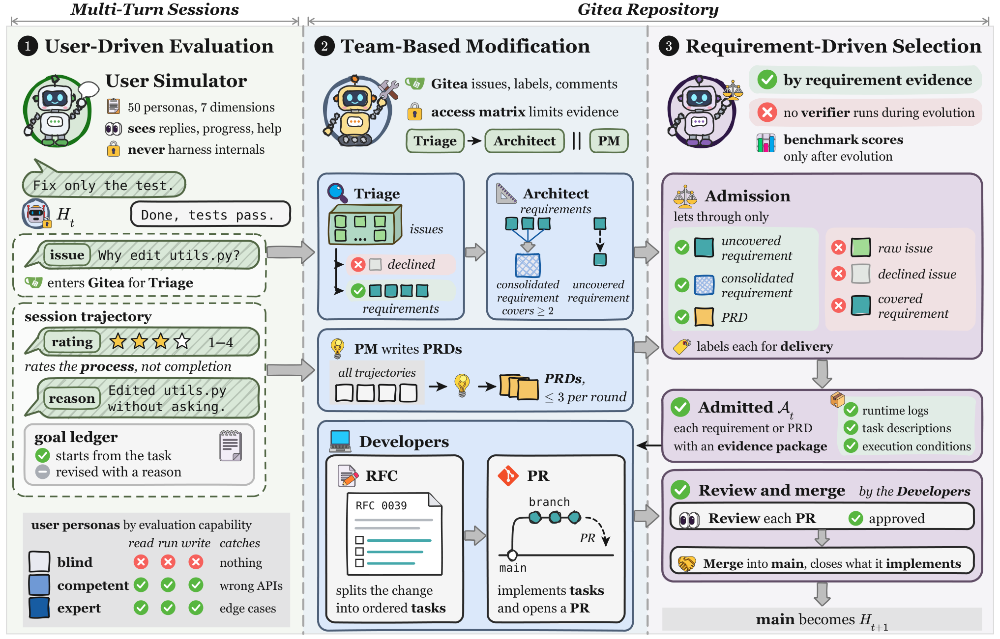

# Agentic Harness Engineering Beta: Requirement-Centered Evolution of Agent Harnesses

**English** | [简体中文](README.zh-CN.md)

<div align="left">

<p align="left">
  <!-- Replace the placeholder arXiv/PDF links when the paper is posted. -->
  <a href="https://arxiv.org/abs/XXXX.XXXXX"></a>
  <a href="https://arxiv.org/abs/XXXX.XXXXX"></a>
  
  
  
</p>

</div>

<p align="center">
  
</p>

---

## 🎯 Overview

**AHE-Beta** is a requirement-centered loop for evolving coding-agent harnesses around a fixed base model. Simulated users work with the harness over multiple turns, surface explicit and implicit requirements, and leave evidence-backed issues. A Gitea-based team triages and consolidates those requirements, writes general fixes, and admits only reviewed changes with an evidence package.

### Main results

- **Held-out performance:** on 38 tasks, success rises from **21.9% to 32.5%** and user rating from **2.59 to 3.04**, while execution tokens fall by **41.0%** versus Base Harness.
- **Strong baselines:** AHE-Beta exceeds Claude Code (**26.3%**) and Meta-Harness (**20.2%**) in success.
- **Human preference:** in a blind human A/B study, participants prefer AHE-Beta in **31 of 48 valid pairs** and rate it higher on all five user-experience dimensions.
- **Transfer:** without further evolution, gains transfer to other base models, improving success by **15.8 percentage points on GLM-5.3** and **7.9 points on DeepSeek-V4.1-Flash** over Base Harness.

---

## 🚀 Quick Start

The complete experiment and evaluation workflows are documented below. Start with the offline demo to see the interaction and feedback loop without model APIs or experiment infrastructure.

## Offline demo

The offline demo uses scripted simulated users and a scripted Harness to demonstrate an interaction and its feedback. It requires no model API or experiment infrastructure. Install [uv](https://docs.astral.sh/uv/getting-started/installation/) before running:

```bash
git clone https://github.com/Curry09/AHE-Beta.git
cd AHE-Beta
uv run --locked python backend/scripts/offline_demo.py
```

The script finishes with:

```text
Offline demo complete: scripted sessions only; no model, forge or delivery invoked.
```

To run a complete evolution experiment with models, follow the steps below.

## Run a Harness evolution experiment

Experiments are managed through `backend/scripts/experiment.py`, with a choice of local or cloud execution:

| Backend | Runtime | Repository hosting | Requirements |
| --- | --- | --- | --- |
| `local` | Local Docker | Local Gitea started automatically | Docker Engine with Compose |
| `e2b` | E2B sandbox | Your Gitea.com account | `E2B_API_KEY` and a Gitea.com token |

Both backends require model endpoints. Simulated users, the Harness and requirements agents use OpenAI-compatible APIs; OpenAgents delivery uses an Anthropic-compatible API. Select models in the experiment JSON and enter their endpoint URLs and keys in `.env.experiment`. See the [Quickstart](docs/QUICKSTART.md) for the configuration fields.

Start with the U1 example: one simulated user tries the same task each round for five rounds. The first four include feedback processing and code delivery; the final round tries the updated Harness. Run these commands from the repository root:

```bash
uv sync --locked --extra experiments
cp examples/experiment.env.example .env.experiment
chmod 600 .env.experiment

CONFIG=examples/experiments/u1-local.json
# For E2B, use:
# CONFIG=examples/experiments/u1-e2b.json

uv run --locked --extra experiments python backend/scripts/experiment.py check --config "$CONFIG" --offline
# Fill .env.experiment and confirm the configured model names, then start:
uv run --locked --extra experiments python backend/scripts/experiment.py run --config "$CONFIG" --secrets-file .env.experiment
```

`check --offline` checks the configuration and local material declarations. `run --config` then prepares materials, provisions resources and starts the experiment. Use the printed run ID to check progress (`status`), read logs (`logs`) or collect artifacts (`collect`). The [U1 walkthrough](docs/tutorials/u1-experiment.md) covers the complete workflow, expected outputs, and stop/resume operations.

### Multi-user experiments

The U4 examples provide a smaller multi-user experiment with four user sessions across two tasks over two rounds. Choose [`u4-local.json`](examples/experiments/u4-local.json) or [`u4-e2b.json`](examples/experiments/u4-e2b.json) and follow the [multi-user tutorial](docs/tutorials/multi-user-experiment.md).

For larger six-round experiments, use these E2B configurations:

| Configuration | Sessions per round | Simulated-user interaction / direct |
| --- | ---: | ---: |
| [`u8-mixed-e2b.json`](examples/experiments/u8-mixed-e2b.json) | 8 | 6 / 2 |
| [`u8-direct-e2b.json`](examples/experiments/u8-direct-e2b.json) | 8 | 0 / 8 |
| [`u16-mixed-e2b.json`](examples/experiments/u16-mixed-e2b.json) | 16 | 12 / 4 |
| [`u32-mixed-e2b.json`](examples/experiments/u32-mixed-e2b.json) | 32 | 25 / 7 |

Each configuration fixes its task packages, persona pairings and round schedule. Simulated-user sessions allow follow-up interaction; direct sessions let the Harness work autonomously after receiving the task. R1–R5 include trials, feedback processing and delivery; R6 tries the final Harness. Per-round official grading is disabled by default. See the [six-round tutorial](docs/tutorials/evolution32.md) and [task catalog](examples/tasks/evolution32/README.md) for materials and startup instructions, or the [batch tutorial](docs/tutorials/batch-experiment.md) to schedule several experiments.

## Evaluate an existing Harness

After evolution, use the independent Harbor evaluation workflow to assess the Harness on benchmark tasks. Configure it in [`evaluation.yaml`](evaluation.yaml) and launch it with `python -m evaluation`. It supports Harbor Index tasks and standard Harbor task packages on E2B.

Choose a released Harness (`v0`, `u8`, `u8-direct`, `u16` or `u32`), or an integrated agent (Claude Code, Meta-Harness or the pinned upstream AHE evolved harness). Set `user.enabled: false` for direct solving. With `true`, a simulated user participates in follow-up interaction and can ask questions or assess the response.

For the third-party AHE Messages adapter (`harnesses: [ahe]`), follow the [AHE setup](evaluation/README.md#ahe-over-anthropic-messages) and [configuration template](examples/evaluation/ahe-messages.yaml). Original agent policy is fixed; runtime code is independently verified.

Download the pinned runtime and Harness archives described in the [evaluation guide](evaluation/docs/harbor.md), then create a separate evaluation environment:

```bash
uv venv --python 3.12.13 --managed-python --seed .venv-evaluation
source .venv-evaluation/bin/activate
pip install --require-hashes -r evaluation/requirements.lock
pip install --no-deps -e ./evaluation
cp .env.example .env
```

Configure model names and endpoint URLs in `evaluation.yaml`, and enter API keys and E2B credentials in `.env`. The default configuration selects 38 tasks and two Harnesses. Start with one task and one Harness to verify your setup before expanding the run. For example, change these fields and keep the remaining settings:

```yaml
tasks: [swebenchpro-fix-file-suffix-chooser]
harnesses: [v0]
user:
  enabled: false
```

Once configured, validate, prepare and run:

```bash
python -m evaluation validate
python -m evaluation prepare
python -m evaluation run
```

`validate` checks the configuration, `prepare` prepares task and Harness materials, and `run` starts solving and grading. The run directory retains task scores, execution traces and usage records, along with interaction records when simulated users are enabled. Some tasks require an official judge model and its credentials. Task failures, infrastructure failures and judge failures are recorded separately.

This workflow evaluates the evolved Harness; its scores do not feed back into evolution. See the [evaluation guide](evaluation/docs/harbor.md) for resuming runs, viewing reports and regrading submissions.

## Documentation

| Topic | Guide |
| --- | --- |
| First local or E2B experiment | [Quickstart](docs/QUICKSTART.md) |
| Experiment configuration, task packages and credentials | [Configuration](docs/CONFIGURATION.md) |
| Six-round U8/U16/U32 experiments | [Six-round tutorial](docs/tutorials/evolution32.md) |
| Harbor evaluation setup and execution | [Evaluation guide](evaluation/docs/harbor.md) |
| Development checks and verification commands | [Verification](docs/VERIFICATION.md) |
| System architecture and design documents | [Architecture](docs/ARCHITECTURE.md) · [Specs](docs/specs/README.md) |

Further workflows cover [importing your own tasks](docs/tutorials/seed-task-import.md), [appending experiment rounds](docs/tutorials/experiment-continuation.md), [grading saved session artifacts](docs/tutorials/post-run-grading.md) and [enabling per-round assessment](docs/tutorials/evolution-feedback.md).

To participate in development, see [Contributing](CONTRIBUTING.md). Report security issues as described in [Security](SECURITY.md). Project code is [MIT licensed](LICENSE); third-party licenses and sources are documented in [THIRD_PARTY.md](THIRD_PARTY.md).
