# AHE-Beta

**通过模拟使用和结构化反馈，迭代改进编码 Agent 的 Harness。**

[English](README.md) · [简体中文](README.zh-CN.md) · [快速开始](docs/QUICKSTART.zh-CN.md) · [评测指南](evaluation/docs/harbor.zh-CN.md) · [贡献指南](CONTRIBUTING.zh-CN.md)

Python 3.12+ · Linux / WSL2 · [MIT](LICENSE)

AHE-Beta 通过模拟“用户使用、反馈、开发者改进”的过程，推动编码 Agent Harness 持续迭代。模拟用户在任务中使用 Harness 并反馈问题，Triage 与 Architect 据此形成改进提案，再由 [OpenAgents](https://github.com/Curry09/OpenAgents) 完成代码修改。更新后的 Harness 进入下一轮试用，形成持续的反馈与改进循环。

<p align="center">
  <picture>
    <source media="(prefers-color-scheme: dark)" srcset="assets/harness-evolution-zh-CN-dark.svg">
    
  </picture>
</p>

本仓负责实验编排，OpenAgents 负责代码交付。实验从 `backend/harness_template/` 提供的初始 Harness 开始，逐轮修改其源码，并保存每轮的 Harness 版本和运行记录。

## 离线演示

离线演示使用预设的模拟用户和 Harness，展示一次交互及其反馈，无需配置模型接口或启动实验环境。运行前请安装 [uv](https://docs.astral.sh/uv/getting-started/installation/)。

```bash
git clone https://github.com/Curry09/AHE-Beta.git
cd AHE-Beta
uv run --locked python backend/scripts/offline_demo.py
```

脚本结束时会输出：

```text
Offline demo complete: scripted sessions only; no model, forge or delivery invoked.
```

完整的模型驱动迭代实验按以下步骤启动。

## 运行 Harness 迭代实验

实验通过 `backend/scripts/experiment.py` 统一管理，可选择本地或云端运行：

| 后端 | 运行环境 | 代码仓托管 | 所需准备 |
| --- | --- | --- | --- |
| `local` | 本地 Docker | 自动启动的本地 Gitea | Docker Engine 与 Compose |
| `e2b` | E2B 沙箱 | 自己的 Gitea.com 账户 | `E2B_API_KEY` 与 Gitea.com Token |

两种后端都需要模型接口。模拟用户、Harness 和需求角色使用兼容 OpenAI 的接口，OpenAgents 交付使用兼容 Anthropic 的接口。在实验 JSON 中选择模型，并在 `.env.experiment` 中填写对应的接口地址和密钥。具体字段见[快速开始](docs/QUICKSTART.zh-CN.md)。

首次运行可选择 U1 示例：每轮一位模拟用户试用同一项任务，共五轮；前四轮包含反馈处理和代码交付，末轮只试用更新后的 Harness。以下命令均在仓库根目录执行：

```bash
uv sync --locked --extra experiments
cp examples/experiment.env.example .env.experiment
chmod 600 .env.experiment

CONFIG=examples/experiments/u1-local.json
# 使用 E2B 时改为：
# CONFIG=examples/experiments/u1-e2b.json

uv run --locked --extra experiments python backend/scripts/experiment.py check --config "$CONFIG" --offline
# 填写 .env.experiment，并确认配置中的模型名称后启动：
uv run --locked --extra experiments python backend/scripts/experiment.py run --config "$CONFIG" --secrets-file .env.experiment
```

`check --offline` 检查配置和本地材料声明。`run --config` 随后准备运行材料、创建所需资源并启动实验。启动后，使用输出的 run ID 查询状态（`status`）、查看日志（`logs`）或收集产物（`collect`）。完整步骤、预期产物和停止／恢复方法见 [U1 教程](docs/tutorials/u1-experiment.zh-CN.md)。

### 多用户实验

U4 示例在两项任务上安排四个用户会话，共运行两轮，提供较小规模的多用户实验。可选择 [`u4-local.json`](examples/experiments/u4-local.json) 或 [`u4-e2b.json`](examples/experiments/u4-e2b.json)，按[多用户教程](docs/tutorials/multi-user-experiment.zh-CN.md)启动。

更大规模的六轮实验使用以下 E2B 配置：

| 配置 | 每轮会话数 | 模拟用户交互 / direct |
| --- | ---: | ---: |
| [`u8-mixed-e2b.json`](examples/experiments/u8-mixed-e2b.json) | 8 | 6 / 2 |
| [`u8-direct-e2b.json`](examples/experiments/u8-direct-e2b.json) | 8 | 0 / 8 |
| [`u16-mixed-e2b.json`](examples/experiments/u16-mixed-e2b.json) | 16 | 12 / 4 |
| [`u32-mixed-e2b.json`](examples/experiments/u32-mixed-e2b.json) | 32 | 25 / 7 |

任务包、用户画像配对和各轮安排均由配置固定。模拟用户交互模式允许多轮沟通，direct 模式由 Harness 接收任务后自主执行。R1–R5 包含试用、反馈处理和交付，R6 只试用最终 Harness；默认不启用逐轮官方评分。材料准备和启动方法见[六轮实验教程](docs/tutorials/evolution32.zh-CN.md)及[任务材料清单](examples/tasks/evolution32/README.zh-CN.md)，多组实验的统一调度见[批量实验教程](docs/tutorials/batch-experiment.zh-CN.md)。

## 评测已有 Harness

迭代完成后，可以通过独立的 Harbor 评测流程测试 Harness 的任务能力。评测统一使用 [`evaluation.yaml`](evaluation.yaml) 配置，通过 `python -m evaluation` 启动，支持在 E2B 上运行 Harbor Index 题目和标准 Harbor 任务包。

可选择已发布的 Harness（`v0`、`u8`、`u8-direct`、`u16`、`u32`），也可选择已接入的 Claude Code 或 Meta-Harness。`user.enabled: false` 表示 direct 解题；设为 `true` 时，模拟用户会参与后续交互，对回复进行追问或验收。

先按[评测指南](evaluation/docs/harbor.zh-CN.md)下载固定版本的运行时和 Harness 压缩包，再创建独立的评测环境：

```bash
uv venv --python 3.12.13 --managed-python --seed .venv-evaluation
source .venv-evaluation/bin/activate
pip install --require-hashes -r evaluation/requirements.lock
pip install --no-deps -e ./evaluation
cp .env.example .env
```

在 `evaluation.yaml` 中配置模型和接口地址，在 `.env` 中填写 API 密钥与 E2B 凭证。默认配置选择 38 题和两个 Harness；首次运行建议先选择一题、一个 Harness，确认流程后再扩大范围。例如，修改以下字段，保留其余设置：

```yaml
tasks: [swebenchpro-fix-file-suffix-chooser]
harnesses: [v0]
user:
  enabled: false
```

完成配置后，依次检查、准备并运行：

```bash
python -m evaluation validate
python -m evaluation prepare
python -m evaluation run
```

`validate` 检查配置，`prepare` 准备任务和 Harness 材料，`run` 启动解题并执行评分。运行目录会保存任务成绩、执行轨迹和用量记录；启用模拟用户时，也会保存交互记录。部分题目需要官方指定的裁判模型，应配置相应凭证。任务失败、基础设施故障和裁判故障分别记录。

这套流程用于评测迭代后的 Harness，成绩不回流到迭代过程。恢复运行、查看报告及重新评分的方法见[评测指南](evaluation/docs/harbor.zh-CN.md)。

## 文档导航

| 主题 | 指南 |
| --- | --- |
| 首次运行本地或 E2B 实验 | [快速开始](docs/QUICKSTART.zh-CN.md) |
| 实验配置、任务包与凭证 | [配置说明](docs/CONFIGURATION.zh-CN.md) |
| 六轮 U8/U16/U32 实验 | [六轮实验教程](docs/tutorials/evolution32.zh-CN.md) |
| Harbor 评测安装与运行 | [评测指南](evaluation/docs/harbor.zh-CN.md) |
| 开发检查与验证命令 | [验证说明](docs/VERIFICATION.zh-CN.md) |
| 系统架构与设计文档 | [当前架构](docs/ARCHITECTURE.md) · [设计文档](docs/specs/README.md) |

扩展用法包括[导入自定义任务](docs/tutorials/seed-task-import.zh-CN.md)、[追加实验轮次](docs/tutorials/experiment-continuation.zh-CN.md)、[对已有会话产物评分](docs/tutorials/post-run-grading.zh-CN.md)和[启用逐轮客观验收](docs/tutorials/evolution-feedback.zh-CN.md)。历史实验材料见[研究索引](research/README.zh-CN.md)。

参与开发请参阅[贡献指南](CONTRIBUTING.zh-CN.md)，安全问题的报告方式见[安全说明](SECURITY.zh-CN.md)。项目代码采用 [MIT 许可证](LICENSE)，第三方材料的许可与来源见[第三方说明](THIRD_PARTY.zh-CN.md)。
