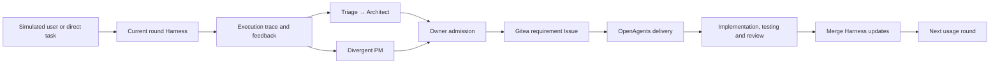

# System Architecture

AHE-Beta handles simulated use, feedback processing, round management, and experiment records; OpenAgents modifies the Harness based on admitted requirements. The Harness being iterated, task code used for trials, and experiment controller are managed separately.

## Iteration Process

Triage reviews user reports, and Architect synthesizes relevant proposals; Divergent PM proposes independent improvement directions based on usage evidence. The two requirement paths converge at Owner and are handed to OpenAgents after admission. Reports, proposals, and admitted requirements are stored separately to make the source of each change traceable.

Requirement roles and shared logic are in `backend/ahe_beta/demand/`, and role definitions are in `backend/agent_defs/`. OpenAgents runs as a standalone CLI and interacts with Gitea Issues, labels, PRs, Harness commit versions, and the controller. NexAU provides model runtime capabilities for user and requirement roles; the experiment example uses Claude Code as OpenAgents' delivery backend.

The project’s Python package name is `ahe_beta`, and the architecture role uses `architect`; its configuration, grouping strategy, and run records use the same name. Evidence protocol identifiers and log correlation fields required by the pinned OpenAgents version retain their original protocol names only at the delivery boundary; published task images continue to use repository addresses that can actually be pulled.

Each non-final round processes feedback after the user trial ends and waits for delivery of that round’s admitted requirements to complete before pinning the round’s Harness commit. If delivery fails, times out, or requires human intervention, the experiment remains in the current round. The final round only trials the final version and executes the configured objective acceptance; it does not start the requirements and delivery phases.

## Experiment Identity and Recovery

Experiments are managed uniformly through `backend/scripts/experiment.py`. `check` checks the configuration, `prepare` freezes the controller, Harness, task materials, dependencies, and session plan, and `run` starts the experiment. Prepared inputs are recorded by `manifest.json` and a hash manifest; subsequent changes to the original configuration do not affect the prepared experiment.

Each session is associated with a run, round, execution slot, user profile, task summary, interaction mode, and the actual Harness commit used. Even when the same profile or task is reused, each session has its own identifier, workspace, and recovery record. On recovery, only complete results whose identity and content both match are reused.

`resume` continues the same experiment, using the original frozen inputs and resources that are still available. When additional rounds are needed, create a new child experiment from the current complete archive, process the parent experiment’s final-round feedback first, and then run the additional user rounds; see the [Additional Rounds Tutorial](tutorials/experiment-continuation.md).

## Runtime Environment

| Backend | Controller and delivery | User task environment | Repository hosting |
| --- | --- | --- | --- |
| `local` | Dedicated local runtime container | Each session uses a separate task container | Automatically started local Gitea |
| `e2b` | Processes in the same E2B sandbox | Source-code tasks use separate directories and virtual environments; v3 container tasks use Docker inside the sandbox | User’s own Gitea.com |

The task environment is declared by the task package. v1/v2 packages provide source code and installation recipes; v3 packages can declare container images, inputs, services, setup and teardown commands, and artifacts. Container-based tasks create a separate container and service network for each attempt; code is located at `backend/ahe_beta/experiment/task_environments/`. Source-directory mode shares the sandbox’s Unix user, so its access isolation differs from container mode.

The management host is responsible for starting, checking status, and collecting artifacts. The E2B controller can continue running after the local CLI exits, but background collection depends on the management host being online, and the sandbox lease is not automatically extended at present. See [Quick Start](QUICKSTART.md) for lifecycle and resource cleanup.

## Feedback, Acceptance, and Independent Evaluation

The experiment stores task verdicts, experience scores, attribution, and improvement suggestions separately. The simulated user’s acceptance decision, objective test results, and held-out benchmark scores each have an independent source.

Optional `evaluation.session_grading` acceptance is performed after the task artifacts for each round are frozen, by an independent worker on a trusted Docker host. Requirement and delivery roles receive only result summaries whose signatures have been verified; private tests and detailed scoring logs remain on the worker side. These tasks have already participated in iteration, so their scores cannot be used as held-out results; acceptance failure does not automatically roll back the delivered Harness.

`evaluation/` provides independent Harbor evaluation, running new tasks through `evaluation.yaml` and `python -m evaluation`. Task scores do not feed back into the iteration process. See the [Evaluation Guide](../evaluation/docs/harbor.md) for setup details.

## Main Directories

| Directory | Responsibility |
| --- | --- |
| `examples/experiments/`, `examples/batches/` | Single-experiment and batch configuration |
| `examples/tasks/`, `examples/personas/` | Task packages and user profiles |
| `backend/ahe_beta/experiment/` | Preparation, scheduling, runtime backends, collection, and recovery |
| `backend/ahe_beta/demand/` | Feedback processing, proposal synthesis, and requirement admission |
| `backend/harness_template/` | Initial Harness source code |
| `backend/scripts/` | Public command entry points and check scripts |
| `evaluation/` | Independent Harness evaluation |
| `tools/dev/` | [Diagnostics, replay, and development tools](../tools/dev/README.md) |
| `.experiments/` | Default private experiment output directory |
| `research/` | [Historical research materials and source version index](../research/README.md) |

[Spec Overview](specs/OVERVIEW.md) records design tasks, and the [Code Map](specs/ARCHITECTURE.md) records the corresponding modules; both are generated by the Spec CLI.
