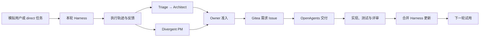

# 系统架构

AHE-Beta 负责模拟使用、反馈处理、轮次管理和实验记录；OpenAgents 负责根据已准入的需求修改 Harness。被迭代的 Harness、用于试用的任务代码与实验控制器分别管理。

## 迭代流程

Triage 对用户报告进行核查，Architect 综合相关提案；Divergent PM 从使用证据中提出独立的改进方向。两条需求路径在 Owner 汇合，经准入后交给 OpenAgents。报告、提案和已准入需求分别保存，便于追溯一项修改的来源。

需求角色及共享逻辑位于 `backend/ahe_beta/demand/`，角色定义位于 `backend/agent_defs/`。OpenAgents 作为独立 CLI 运行，通过 Gitea Issue、标签、PR 和 Harness 提交版本与控制器交互。NexAU 提供用户和需求角色的模型运行能力；实验示例使用 Claude Code 作为 OpenAgents 的交付后端。

项目 Python 包名为 `ahe_beta`，架构角色使用 `architect`，其配置、分组策略和运行记录采用同一名称。OpenAgents 固定版本要求的证据协议标识与日志关联字段仅在交付边界保持原协议名称；已发布任务镜像继续使用实际可拉取的仓库地址。

每个非末轮在用户试用结束后处理反馈，并等待本轮准入需求交付完成，再固定该轮的 Harness 提交。交付失败、超时或需要人工处理时，实验停留在当前轮。末轮只试用最终版本及执行已配置的客观验收，不再启动需求和交付阶段。

## 实验身份与恢复

实验统一通过 `backend/scripts/experiment.py` 管理。`check` 检查配置，`prepare` 固定控制器、Harness、任务材料、依赖和会话计划，`run` 启动实验。准备后的输入由 `manifest.json` 及哈希清单记录；后续修改原配置不会改变已准备的实验。

每个会话关联 run、轮次、执行槽位、用户画像、任务摘要、交互模式和实际使用的 Harness 提交。即使复用同一画像或任务，各会话仍有独立的标识、工作区和恢复记录。恢复时只复用身份与内容均匹配的完整结果。

`resume` 继续同一个实验，使用原冻结输入和仍然可用的资源。需要增加轮次时，通过当前完整归档创建新的子实验，先处理父实验末轮反馈，再运行新增用户轮；详见[追加轮次教程](tutorials/experiment-continuation.zh-CN.md)。

## 运行环境

| 后端 | 控制器与交付 | 用户任务环境 | 仓库托管 |
| --- | --- | --- | --- |
| `local` | 本地专属运行容器 | 每个会话使用独立任务容器 | 自动启动的本地 Gitea |
| `e2b` | 同一 E2B 沙箱内的进程 | 源码任务使用独立目录与虚拟环境；v3 容器任务使用沙箱内 Docker | 用户自己的 Gitea.com |

任务环境由任务包声明。v1/v2 包提供源码与安装配方；v3 包可声明容器镜像、输入、服务、初始化与收尾命令及产物。容器型任务按每次尝试创建独立容器和服务网络；代码位于 `backend/ahe_beta/experiment/task_environments/`。源码目录模式共享沙箱的 Unix 用户，其访问隔离能力与容器模式不同。

管理主机负责启动、查看状态和收集产物。E2B 控制器可以在本地 CLI 退出后继续运行，但后台收集依赖管理主机在线，且当前不会自动延长沙箱租期。生命周期和资源清理见[快速开始](QUICKSTART.zh-CN.md)。

## 反馈、验收与独立评测

实验分别保存任务判断、体验评分、原因归属和改进建议。模拟用户的接受决定、客观测试结果和留出基准成绩各有独立来源。

可选的 `evaluation.session_grading` 在每轮任务产物冻结后，由可信 Docker 主机上的独立 worker 执行验收。需求角色和交付角色仅接收经过签名验证的结果摘要，私有测试与详细评分日志保留在 worker 侧。这类任务已经参与迭代，其成绩不能作为留出结果；验收失败也不会自动回滚已交付的 Harness。

`evaluation/` 提供独立 Harbor 评测，通过 `evaluation.yaml` 和 `python -m evaluation` 运行新任务。任务成绩不会回流到迭代过程。具体设置见[评测指南](../evaluation/docs/harbor.zh-CN.md)。

## 主要目录

| 目录 | 职责 |
| --- | --- |
| `examples/experiments/`、`examples/batches/` | 单实验与批次配置 |
| `examples/tasks/`、`examples/personas/` | 任务包与用户画像 |
| `backend/ahe_beta/experiment/` | 准备、调度、运行后端、收集与恢复 |
| `backend/ahe_beta/demand/` | 反馈处理、提案综合与需求准入 |
| `backend/harness_template/` | 初始 Harness 源码 |
| `backend/scripts/` | 公开命令入口及检查脚本 |
| `evaluation/` | 独立 Harness 评测 |
| `tools/dev/` | [诊断、回放与开发工具](../tools/dev/README.md) |
| `.experiments/` | 默认的私有实验输出目录 |
| `research/` | [历史研究材料与源码版本索引](../research/README.zh-CN.md) |

[Spec 总览](specs/OVERVIEW.md)记录设计任务，[代码映射](specs/ARCHITECTURE.md)记录对应模块；两者均由 Spec CLI 生成。
