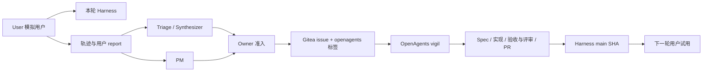

# 当前架构

auto-designer 控制实验身份、用户会话、需求提案、Owner 准入、轮次屏障和恢复。PM 与 Triage/Synthesizer 是独立需求路径，在 Owner 汇合。用户 report、proposal 与已准入需求不是同一状态。

`auto_designer.demand` 包含四个需求角色及共享证据/运行逻辑；`agent_defs/synthesizer/` 只定义结构综合角色。`auto_designer.guards` 保留需求工具路径检查、编排仓完整性检查和 Harness 提交钩子。旧内置开发角色的两个未接线提交中间件已删除，不将它们描述为 OpenAgents 的等价保障。

角色、恢复阶段、API 和静态导出统一使用 `synthesizer`。恢复流程通过 schema、身份与摘要检查保证记录一致。

OpenAgents 独立运行，负责交付；两仓运行时通过 Gitea 的 issue/标签/PR 与 Harness main SHA 连接，而非相互导入 Python 包。离线契约检查临时导入配置解析器，只用于开发验证。

NexAU 是 agent 运行时依赖。OpenAgents 可选择 Claude Code、Codex 或 NexAU 后端；seed Harness 自带入口及工具契约，后续产生的子 Agent 等能力取决于被试 Harness 的具体版本。

非末轮等待本轮准入需求达到交付终态再进入下一轮；失败、超时或 needs-human 不能被误算为已完成。末轮试用最终版本并运行已配置的独立验收，不再触发需求交付。

体感、用户 acceptance 与客观技术验证分开记录，不能相互替代。独立 held-out 评测不回灌演化；显式开启 `evaluation.session_grading` 时，独立 worker 对已用于演化的任务评分，仅向需求和交付传递签名安全摘要，这些任务不再属于 held-out。逐轮验收不自动淘汰或回滚候选；工程 CI/e2e 是否启用由交付配置决定。原始轨迹用于审计，公开静态看板仅保留经过导出的粗粒度数据。

## 实验入口与目录边界

新实验只使用 `backend/scripts/experiment.py`，v2 配置通过 check → prepare → run 进入完整闭环，后续用 status/logs/stop/resume/collect/destroy 管理。两种受支持部署为 local Docker + 自动启动的 localhost Gitea、E2B 单沙箱 + 用户自己的 Gitea.com。E2B 不依赖嵌套 Docker，隔离语义不同于本地每会话容器。

新 run 冻结 workload contract 1 的 TaskCatalog/SessionPlan，监督器启动同一 `auto_designer.experiment.controllers.unified`。普通/SWE 与 direct/simulated 差异留在任务包、工作区准备和会话工厂；多个任务围绕同一 Harness 迭代，同轮可由多个不同 persona 试用同一任务。已准备 v2 实验继续使用原冻结源码、旧 module/script 配方及 hash，不升级 controller。当前带 continuation export 的完整归档支持在新 run 追加轮次；旧格式实验产物不支持导入。

逻辑会话绑定为 run/round/slot/persona/task digest/interaction；session ID 只由 Orchestrator/RecoveryStore 生成。资源坐标不参与用户恢复输入，完整结果必须匹配冻结归属才可复用。Local task baseline 为不可变镜像，各 session 独立容器；E2B 任务基线为纯源码，各 session 最终目录重建独立 venv，下载缓存可共享。E2B 单 Unix 用户不宣称 Docker 等价恶意隔离。

观察与证据沿同一 session/task/persona/round/Harness SHA 关联，live 用户槽不再以 persona 唯一。status 从恢复账本给逐轮已完成/运行中/待运行/失败数量，无账本时明确 unknown；E2B 看板展示最近 collect 的快照与时间。

| 目录 | 当前职责 |
| --- | --- |
| `examples/experiments/` | U1/U4 的 local/E2B 与 U8/U16/U32 的 E2B 可校验定义 |
| `examples/tasks/`、`examples/personas/` | 任务与 persona 材料；主库为 `examples/personas/library.json` |
| `backend/scripts/` | 公开入口、演示、静态导出、CI 与构建检查 |
| `tools/dev/` | 维护中的诊断与回放，见[工具说明](../tools/dev/README.md) |
| `evaluation/` | 独立 held-out 评分与维护中的适配器 |
| `research/archives/` | 历史配置、研究代码和记录，见[研究索引](../research/README.zh-CN.md) |
| `.experiments/` | 忽略的私有运行输出 |

历史归档不注册为第三种运行后端，源码内的原相对路径对应原 checkout。复现需使用索引记录的冻结源码版本；诊断回放输出不等于新一轮用户评估。静态看板显示历史快照、记录时间和当时状态，实时 API 模式保持实时观测。

代码映射见 `docs/specs/ARCHITECTURE.md`（生成文件），详细契约见 `docs/specs/OVERVIEW.md`。
