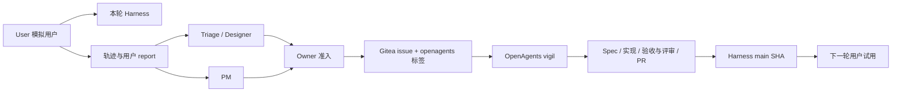

# 当前架构

auto-designer 控制实验身份、用户会话、需求提案、Owner 准入、轮次屏障和恢复。PM 与 Triage/Designer 是独立需求路径，在 Owner 汇合。用户 report、proposal 与已准入需求不是同一状态。

OpenAgents 独立运行，负责交付；两仓运行时通过 Gitea 的 issue/标签/PR 与 Harness main SHA 连接，而非相互导入 Python 包。离线契约检查临时导入配置解析器，只用于开发验证。

NexAU 是 agent 运行时依赖。OpenAgents 可选择 Claude Code、Codex 或 NexAU 后端；seed Harness 自带入口及工具契约，后续产生的子 Agent 等能力取决于被试 Harness 的具体版本。

非末轮等待本轮准入需求达到交付终态再进入下一轮；失败、超时或 needs-human 不能被误算为已完成。末轮只试用最终版本，不再触发需求交付。

体感、用户 acceptance 与客观技术验证分开记录，不能相互替代。benchmark 全程 held-out，不作为交付优化信号；工程 CI/e2e 是否启用由交付配置决定。原始轨迹用于审计，公开静态看板仅保留经过导出的粗粒度数据。

代码映射见 `docs/specs/ARCHITECTURE.md`（生成文件），详细契约见 `docs/specs/OVERVIEW.md`。
