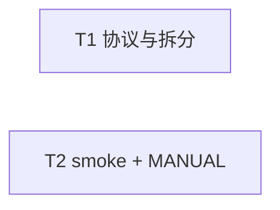

# 0013 · Harness 呈现与交互协议：拆信封 · 过程流分层 · 打断/心跳

<!-- 本文件由 spec 工具维护：frontmatter 为结构化源数据（含 tasks DAG），正文为组级 rust-RFC 9 段总览。 -->

## Summary

规范 harness 作为「可启动程序 + 黑盒对话契约」对用户的呈现与交互协议：

1. **拆信封**——`complete_task` 信封剥到 `output.result`，用户只看最终答案；
2. **过程流分层**——内层 `steps` 只吐观测层，persona 只吃 `reply`；
3. **进行中活动条**——一轮内可先发零或多行 `{"progress":{kind,text}}`（与终态 reply 共用 stdout 锁），终态仍为一行含 `reply`；
4. **打断/分片轮询**——`control:interrupt` → `[interrupted]`；launcher `begin/poll/control` 对活进程返回 pending、不盲杀。

旁路键放宽与 peek 续等见 **0019**。落点 `harness_template/` + `harness/launcher.py`。

## Motivation

harness 是黑盒对话契约：stdin 收消息、stdout 回复。需要根治信封泄漏、过程流污染体感、慢会话无协议；并让等待中有可见活动条，供 0012 心跳决策。

## Guide-level explanation

- **协议帧。** stdin：`{"message"}` / `{"control"}`。stdout：进行中可多行 `progress`；终态一行 `{"reply", "steps"?}`。
- **reply 给人看**；`steps` 观测旁路；`progress` 是活状态不是终答（MANUAL activity strip）。
- **打断** → `[interrupted]`，保留会话。
- **长任务不盲杀**：`poll` 活进程 → pending。
- **预算钮可见**（`_RUN_RETRIES` / `max_iterations`）；harness 不设整轮墙钟上限。

## Reference-level explanation

### 代码锚点

- `harness_template/entry.py`：`_emit_progress`、`_stdout_lock`、拆信封、interrupt、tracer→steps。
- `harness/launcher.py`：`begin`/`poll`/`control`、`last_steps`/`last_progress`（接收放宽见 0019）。
- `MANUAL.md`：activity strip + 终态 reply 分工。

### 契约表

| 关注点 | 本组契约 |
|---|---|
| 收尾 | 拆到 `output.result` |
| 内层过程 | `steps` 只观测 |
| 进行中 | 多行 `progress`，不替代 reply |
| 慢会话 | begin/poll/control，活进程 pending |
| 打断 | `[interrupted]` |

### DAG

### 接缝

0012 消费 progress/poll；0019 放宽未知旁路与 peek；0014 改对外行为须同步 MANUAL。

## Drawbacks

信封拆解启发式；progress 与 steps 可能重复信息；打断依赖 nexau `force_stop` 检查点。

## Rationale and alternatives

- 墙钟盲杀会误杀合法长任务。
- 把 progress 拼进 reply 会污染体感。
- 未知旁路接收归 0019，本组负责种子发射契约。

## Prior art

CLAUDE.md 黑盒契约；stdio JSONL；长任务 poll/heartbeat。

## Unresolved questions

超时是否种子内建「部分结果」？progress 粒度与截断？

## Future possibilities

种子「超时即回进行中」；观测层按 progress/steps 重建时间线。
