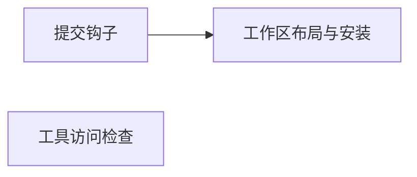

# 0015 · Harness 边界与需求工具访问

## Summary

当前保留三项机制：Harness 提交拒绝清单、工作目录与原始 trace 的布局隔离、需求 Agent 的工具文件路径检查。实现位于 `backend/ahe_beta/guards/`，不再归属一个内置开发角色。

## Motivation

产品仓不应收入密钥和实验运行态，需求 Agent 也不应随意读取原始任务轨迹。路径检查可阻挡直接越界访问，但不能约束解释器执行的所有行为，因此不得将它描述为操作系统沙箱。

## Guide-level explanation

- `harness_boundary.py` 生成独立 pre-commit 钩子，拒绝 `.env`、`.env.*` 与顶层 `.openagents`；`.env.example` 和正常产品文件允许提交。
- `run.py` 将 Harness 放在 `data/harness_sandbox/harness_repo`，避免原始 trace 成为工作区的同级目录。
- Triage、Architect、PM、Owner 通过 `WorkspaceJailMiddleware` 检查工具访问；声明的观测制品还须满足按调用和 session 的授权。

## Reference-level explanation

T1 拥有 `guards/harness_boundary.py` 及其测试；T2 拥有启动入口的目录布局和钩子安装；T3 拥有 `guards/workspace_jail.py` 及其测试。需求 Agent 定义引用 `ahe_beta.guards.workspace_jail:WorkspaceJailMiddleware`。

提交钩子在 seed 提交后安装，只依赖标准库和 Git。修改拒绝清单时同步 Harness 模板 smoke 的独立脚本。写操作限制于工作区；读操作放行工作区、NexAU 源码及框架临时输出，原始 session 与运行轨迹不因目录迁移而放行。显式观测授权仍由需求侧 observation provider 校验。

离线验证：`uv run --locked --extra dev pytest backend/tests/guards/test_harness_boundary.py backend/tests/guards/test_workspace_jail.py backend/tests/test_sandbox_isolation.py`。完整接线回归还检查四角色 YAML、临时仓提交与拒绝、观测授权。

## Drawbacks

工具参数级检查不能阻止解释器或任意 shell 的所有越界方式；目录隔离也不是权限隔离。容器或操作系统级隔离需要独立验证。

## Rationale and alternatives

保留有效检查并移入 `guards`，避免删除仍被装配的防线；采用明确拒绝清单而非旧的产品文件名白名单，使合法新增源码和 Spec 文档可以提交。

## Prior art

早期提交白名单和路径检查用于降低任务内容污染产品的风险。当前提交边界已经允许正常产品扩展，同时持续拒绝密钥与运行态。

## Unresolved questions

无。此整理保持现有检查行为和触发位置，不增加新沙箱能力。

## Future possibilities

可将提交钩子与 CI 的拒绝规则生成自同一份来源，并进一步验证操作系统级隔离；这些不是包迁移自动带来的保障。
