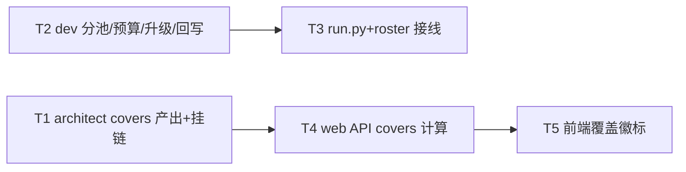

# 0020 · 覆盖关系兑现 + 开发者领取策略与票种预算

<!-- 本文件由 spec 工具维护：frontmatter 为结构化源数据（含 tasks DAG），正文为组级 rust-RFC 9 段总览。 -->

## Summary

实测显示：信号生产端健康（体感 reason 具体、issue 链路通、runtime_agg 已喂 architect），
瓶颈在**消费端**——设计师的洞察与开发者的劳动无法跨轮复利。本组补三条断链：

1. **覆盖关系兑现（covers）**：architect 的 subsume 判定已存在（重复判定 rubric R3）且提案正文里已
   自然写出「综合多张 bug」的整合表述，但无人执行——不结构化、不挂链、不影响领取、修好了也不连带
   关闭。本组把它数据化：
   提案 JSON 带 `covers` 字段 → 落库写入 body 机器可读行 + 被覆盖 bug 挂 comment → 领取时 covered bug
   沉底 → design 票完成后连带关闭 → 前端 issue 列表/详情展示覆盖徽标。
2. **领取策略分池（dispatch）**：实测中设计票长期饿死（每轮新 bug 数 ≈ dev 数，
   `work_one` 取 `list_open_issues()[0]` 且 Gitea 默认新→旧）。改为按 label 分池 + 每 dev 可配
   `pick_policy ∈ {design_first, bug_first}`：默认设计票优先，保留可配数量的 bug 优先 dev
   （空池互为回落，不空转）。
3. **票种预算 + 同票重试升级（budget）**：实测中结构性改动屡次撞满 38 迭代、报告丢失。按 label 给初始
   `max_iterations`（bug=38 / design=60，运行时覆盖 AgentConfig），同票重试（有 attempt 记录仍 open）
   自动升一档。附带最小版报告回写：work_one 收尾把结果 comment 回 issue（成功=报告全文，
   失败=attempt 标记），既是重试判定的数据源，也止住「follow-up 蒸发」。

不引入 benchmark 信号（held-out 不破）；architect 仍只产「问题+方向」，不获得关票权。

## Motivation

**设计票饿死 = 复刻项目要解决的原始问题。** 实测中多数版本推进是 prompt 层补丁；直指体感 reason
最高频痛点（超时/迭代上限）的结构性设计票长期无人领。而 bug 队列一旦清空，沉底的设计票立刻被领掉
并落地为结构性版本——不是 dev 不会做设计票，是排不上队。「只能局部修改、难产生结构性改进」正是
CLAUDE.md 里立项要解决的现象，而当前调度把它复刻在了自己的闭环里。

**覆盖判定断在执行层。** architect prompt 已要求「多条 issue 互为重复时用一条整合性提案点明
#X/#Y 系同一根因」，实测里 architect 也确实在提案正文写出了这类整合表述——但 architect 不碰
tracker 状态、dev 不读这句话，
于是同根因的 bug 与 design 票在队列里**互相竞争**：dev 修 bug 是白修一遍（根因在 design 票里），
同轮两个 dev 撞同一根因还会在 trunk 直推下互相踩。

**预算与任务规模错配。** entry.py 随版本演进持续长大，dev 预算固定 38——实测中结构性改动
撞满迭代、靠当时的提交催促中间件硬落地才保住 tag，complete_task 没跑完、报告全丢
（live detail 只剩迭代上限报错）。且报告丢失连带「follow-up 蒸发」：
prompt/中间件 8 处「剩余写进报告当 follow-up」，但报告只进看板、tracker 无痕，下一轮无人接得住。

**为什么不是更大的方案**（设计讨论已收敛）：
- 「dev 先评难度再浮动预算」被否：max_iterations 是构造期字段需拆两阶段跑、自评无 ground truth
  且激励歪（说难就多给）；改用 label 定初始 + **失败一次才升级**（被现实校准的 escalation）。
- 「每轮清空所有 issue 再进下一轮」被否：破坏归因粒度（8 改动打包无法信用分配）、拆掉 issue 曲线
  观测指标（恒为 0）、轮时无上界。backlog 有存量是特性，要治的是设计票饿死而非清空。
- 「architect 直接关重复票」被否：误判 subsume = 静默丢弃真实用户信号，违背「体感是唯一训练信号」
  底线；本组用「挂链降权、修好才关」，误判代价只是晚处理、可逆。

## Guide-level explanation

改完后的一轮（对照 spec-0007 的 a→d→b→c）：

- **d 段**：architect 提案 JSON 每项可带 `"covers": [5, 6]`（可选，缺省不覆盖任何票）。落库时驱动器
  在 design issue body 末尾追加机器可读行 `covers: #5 #6`，并对每张被覆盖的 open bug 挂 comment
  `covered-by: #<design号>`。architect 权限不变（只 create_issue + add_comment，不改状态）。
- **b 段**：每个 dev 带 `pick_policy`。`design_first`：先领 design 池（票号升序=最老优先），空则回落
  bug 池；`bug_first` 反之。池内**被覆盖的票沉底**（仍可领，防饿死回落）。领取后按 label 定预算：
  bug=38、design=60（env 可覆盖）；若该票恰有 1 条 attempt 标记（此前领过未修好）→ 升一档
  （bug→60、design→90）。**最多重试一次**：attempt 标记 ≥2 的票视为 stuck，沉到池底——正常不再
  被领取（不堵队列），仅池空兜底时可领（预算维持升档值，不再上加）。一张票的生命周期至多
  「首领(标准档) → 重试(升档) → stuck 沉底」，预算天然有界。运行时覆盖 `cfg.max_iterations` 后起 agent。
- **b 段收尾**：dev 完成 design 票（新 tag 出现）→ 驱动器解析该票 covers 行，把其中仍 open 的 bug
  连带关闭（comment：`covered by #<D> → v<K>`）。无论成败，把结果 comment 回 issue：成功=complete_task
  报告全文；失败/报告缺失=`[dev-attempt]` 标记 + git diff --stat 摘要兜底。
- **编制配置**：`N_BUG_FIRST_DEVS`（默认 1）——前 N 个 dev 用 `bug_first`，其余 `design_first`。
  沿用 roster 的 env 覆盖风格。
- **前端**：issue 列表里被覆盖的 bug 显示「⊂ #N」徽标（N=覆盖它的 design 票号）；design 票显示
  「覆盖 #5 #6」；详情页同。
  数据来自 `/api/issues` 新增的 `covers: number[]` / `covered_by: number | null` 字段（web 层从
  body 的 covers 行解析计算，无新存储）。

## Reference-level explanation

### covers 数据模型（单一真源 = design issue body）

- **产出**：`architect.py` 的 `_parse_proposals` 放行每项可选 `covers: list[int]`（非法值静默丢弃）；
  `propose_once` 落库时 body 追加 `\n\ncovers: #5 #6`（正则 `^covers:((\s*#\d+)+)\s*$`，
  MULTILINE 取**最后一条**匹配为准）。挂链 comment 仅为 Gitea 可读性，不作解析源。
- **消费方 1（领取降权）**：`agentic_developer.py` 领取时从 `list_open_issues()` 的 design 票 body
  里解析 covers 行合成 covered 集合（零额外 API 调用），bug 池排序键 `(is_covered, number)`。
- **消费方 2（连带关闭）**：`work_one` 中 `committed=True` 且所领是 design 票时，解析其 covers 行，
  对仍 open 的号 `set_state(closed, f"covered by #<D> → v<K>")`；单票关闭失败不影响其余（try/except）。
- **消费方 3（web）**：`api.py` `_list_issues` 对全量 issue 计算 `covers`/`covered_by` 字段；
  `covered_by` 只认**open** design 票（design 票关了覆盖关系随之消失——那批 bug 应已被连带关闭）。

### 领取与预算（`agentic_developer.py`）

- `__init__` 新参：`pick_policy: str = "design_first"`、`budget_bug: int`、`budget_design: int`
  （private 函数禁默认值规范只约束 `_` 开头函数；公开 ctor 允许默认）。
- 池划分：label 含 `design` → design 池；其余 → bug 池。池内排序键 `(is_stuck, is_covered, number)`
  ——stuck（attempt ≥2）最沉，covered 次之，其余按票号升序（最老优先）。
- 预算解析次序：label 定档 → attempt 标记升档（仅一次）。attempt 判定：
  `getattr(tracker, "list_comments")` 可用时统计该票以 `[dev-attempt]` 开头的 comment 数：
  =1 → 升一档（×1.5 取整）；≥2 → stuck（沉底，兜底领取时预算=升档值不再加）。
  tracker 无该能力（Fake 未扩展前）→ 不升档不沉底，行为退化为纯 label 定档。
- **为什么封顶两次尝试**：不封顶则最老优先的排序会让修不动的票每轮吃掉一个 dev 名额（无限重试
  堵队列）；封顶后选沉底而非关票——关票=静默丢真实用户信号且污染 issue 曲线，沉底可逆、
  「存在修不动的票」这个事实本身留在 open 集里可被观测。
- 运行时覆盖：`cfg = AgentConfig.from_yaml(...)` 后 `cfg.max_iterations = budget`（与 architect.py
  设 `cfg.resolved_tracer` 同一模式）。agent_defs yaml 里的 38 保持为缺省文档值。
- 回写：成功 → `add_comment(number, report_text)`（报告全文，含 dev 自己写的 follow-up 段）；
  未推进 → `add_comment(number, "[dev-attempt] 本轮未推进 main：<原因/diff-stat>")`。
- env 旋钮（run.py 接线）：`DEV_BUDGET_BUG`（默认 38）、`DEV_BUDGET_DESIGN`（默认 60）、
  `N_BUG_FIRST_DEVS`（默认 1）。升档 = 直接取上一档 ×1.5 取整（38→57≈60 档、60→90），常量不另设 env。

### 现状锚点

- `agentic_developer.py:84-88` 领取 = 过滤 skip 后取 `[0]`；`gitea.py:92-105` 未指定 sort（Gitea
  默认新→旧）→ 老票沉底。
- `gitea.py:141` 已有 `list_comments`（观测路径）；`tracker/base.py` 协议含 `add_comment`/`set_state`。
- `architect.py:244 _parse_proposals` 目前只取 title/body/labels。
- `roster.py` 只管数量；`run.py` 构造 developers 列表处是策略注入点。
- 前端 `SidePanel.tsx:114` 已渲染 label chips（徽标挂点）；`IssueDetail.tsx` 已有详情面板；
  `/api/issues` 返回 `{number,title,labels,state,...}`（`api.py:65-90`）。

### DAG

T1 与 T2 并行（covers 行格式由本 spec 定义，两侧各自按约定实现+测试）。

### 文件分配（互斥）

- **T1**：`backend/ahe_beta/demand/architect.py`、`backend/tests/loop/test_architect.py`
- **T2**：`backend/ahe_beta/dev/agentic_developer.py`、`backend/ahe_beta/tracker/fake.py`、
  `backend/tests/dev/test_agentic_developer.py`、`backend/tests/tracker/test_fake.py`
- **T3**：`backend/ahe_beta/experiment/controllers/ordinary.py`、`backend/ahe_beta/loop/roster.py`、`backend/tests/loop/test_roster.py`（新建）
- **T4**：`backend/ahe_beta/web/api.py`、`backend/tests/web/test_api.py`
- **T5**：`frontend/src/components/SidePanel.tsx`、`frontend/src/components/detail/IssueDetail.tsx`、
  `frontend/src/types.ts`、`frontend/src/api.ts`

## Drawbacks

- **covers 行解析是文本约定**：design 票 body 被人工编辑坏（改掉 covers 行）会静默失去覆盖关系。
  以「最后一条匹配为准」+ 单测钉格式缓解；不引入独立存储保持奥卡姆。
- **连带关闭有误杀面**：design 票的修复未必真解决每张被覆盖 bug。接受此代价——关错的 bug 若复发，
  用户侧下一轮自然再开（复发本身是训练信号）；且 reopen 便宜。
- **升档依赖 list_comments**：`IssueTracker` 协议不含它（观测能力），Fake 扩展前升档在测试后端退化
  为 no-op。本组顺带给 Fake 补 `list_comments`，协议本身不动。
- **design 票更贵**（60 迭代 × 串行 b 段）：轮时上升。以「design_first dev 数可配」兜底——
  担心轮时可把 N_BUG_FIRST_DEVS 调大。

## Rationale and alternatives

- **难度自评浮动预算（被否）**：见 Motivation；label 两档 + 失败升档 = 两条规则达成同等自适应，
  且不可被 agent gaming。
- **每轮清空 backlog（被否）**：见 Motivation 三条（归因/观测指标/轮时）。
- **architect 获得关票权（被否）**：误判 subsume = 丢真实用户信号；挂链降权方案误判可逆。
- **covers 存 tracker 之外（被否）**：任何旁路存储（本地 json/独立表）都与「issue 权威源在 Gitea」
  冲突且要做一致性；body 内嵌行零基建。
- **bug-only 专属 dev（被否）**：bug 池空时空转浪费预算；`bug_first` 带回落语义等价且不空转。

## Prior art

- **spec-0016（architect 根因信号）**：重复判定 rubric 与「整合性提案点名 #X/#Y」的产出侧已就位，
  本组是其执行侧补全。
- **旧提交纪律设计（现已退役）**：曾在单轮内催促提交与检查收尾；本组讨论跨轮
  连续性（报告回写、重试升档），互补不重叠。
- **GitHub duplicate/tracking issue 惯例**：`covered-by`/`tracking` 挂链 + 完成连带关闭是成熟工作流。
- **实测**：本组全部论据的数据源——设计票饿死、结构改动撞满预算、覆盖判定断链均为实测现象
  （数据：data/sessions 体感、Gitea issue、harness 仓 tag）。

## Unresolved questions

- 升档系数 1.5 与 design 默认 60 是拍的初值：等后续实测的 runtime_agg（撞顶率）校准。
- 跨票同根因复发（同一根因在不同票号下反复被开）的检测不在本组：需要 architect 对照 closed issue，
  留给后续 spec；本组的「同票重试升档”只覆盖同票号重领。
- covered bug 沉底后若 design 票长期不被修完，这批 bug 事实上被无限延迟——是否需要「覆盖时效」
  （design 票 N 轮未动则解除降权）？先观察。
- stuck 票（两次尝试失败沉底）的终局出路：两次升档预算都修不动，往往说明问题比一张 dev 票大——
  理想去向是转为 architect 的输入证据（其 attempt comment 里有失败原因），但 architect 目前只读
  issue body 不读 comment；本组先沉底观察，喂 architect 留后续。

## Future possibilities

- architect 对照 closed issue 的复发判定（「vK 未解决 #N」→ reopen + 自动升档），补全「修没修好」回路。
- 设计票附「可观测验收数字」（用 runtime_agg 指标定义完成判据），dev 关票时对照。
- follow-up 段结构化：报告里 `follow-up:` 行自动转 `create_issue(labels=["follow-up"])` 挂链。
- backlog 超阈值时弹性加派 dev（软规则），替代清空式冲动。

