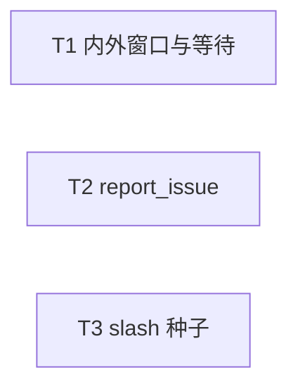

# 0022 · 用户↔harness 内外通道：开放 intent · 中途 report_issue · slash 示范

<!-- 本文件由 spec 工具维护：frontmatter 为结构化源数据（含 tasks DAG），正文为组级 rust-RFC 9 段总览。 -->

## Summary

钉死用户 agent 与 harness 的交互窗口，并据此改等待环与初始种子：

1. **内窗口**——一切对 harness「说话」都是 `message`（主 loop `send`/`begin`，等待中 `emit_message`；slash 亦是 message 正文，由 harness 内部分发）。
2. **外窗口**——`interrupt`（Ctrl+C，`control:interrupt`）与会话收场（`give_up` / `accept*` / 终止态 `file_issue`）；不等同于聊天。
3. **等待菜单**——`keep_waiting | send_message | interrupt | give_up`；去掉通用 `invoke_control`。
4. **开放 intent**——自由文本；由 act 收敛到菜单，并自报 `gap`→`WAIT_GAP`。
5. **中途 `report_issue` tool**——可调用、可闲置，不终止会话；收尾与终结 artifact 一并 flush。
6. **初始 harness**——`/exit` `/quit` 示范 slash；MANUAL 只陈述现行能力。

本组取代原「用户侧经 control 做 peek/status」路径（原 0019/T2，已 abandon）；launcher 非 reply 旁路接收（0019/T1）与心跳底座（0012）仍保留。

## Motivation

**当时状态。** 0012 建立心跳与 judge→intent→act；0019 在 control 通道上叠加旁路型 peek/status。于是出现三套叠床：message、通用 control、框架本地终止。手册若未声明 peek，用户侧仍可能走 `invoke_control`；intent 封闭枚举与「手册驱动 `/XX`」心智冲突。

**要改什么。** 训练信号要真：跟人一样，跟工具说话只有一句话通道；打断像 Ctrl+C；开单可以是过程中的可选动作，也可以是收场。peek 若进化，应是 message（如手册中的 slash），不是第二套 control API。

**为何现在做。** 用户侧与种子 MANUAL/entry 已按内外模型改完；活快照必须对齐代码，并显式废掉与 live 冲突的 0019 用户侧 peek Task。

## Guide-level explanation

- **主 loop**：EMIT 非终止 → `send` 或 supervised `begin`；终止动作不调 harness。
- **心跳**：超时无终态 reply 则唤醒；菜单四项；`send_message` 再塞一条 message（harness 接不接是它的事）；`interrupt` 外打断；每次心跳喂累积 `progress`（离散活动条，非 token 流）。
- **Intent**：写想做什么；Act：落到四按钮 + `gap`。
- **report_issue**：内层 tool，记笔记后续聊；观测看 `ISSUE_TOOL` / `issue_notes`。
- **种子**：发 `/exit` 或 `/quit` → `[exited]` 后进程结束；其它消息进 agent；interrupt 仍可用。

## Reference-level explanation

### 通道

| 窗口 | 载体 | 行为 |
|---|---|---|
| 内 | `{"message"}` | begin / emit_message / slash 正文 |
| 外·进程 | `{"control":"interrupt"}` | 停当前轮，吐 reply |
| 外·收场 | 无 I/O | give_up / accept* / 终止 file_issue |
| 旁路观测 | stdout 非 reply | progress 等 → `last_progress`（0019/T1） |

### DAG 与文件

- **T1**：`user/sim/loop.py` `prompt.py` `harness/launcher.py` + 心跳/launcher 单测  
- **T2**：`tools.py` `persona_client.py` `loop/sim_user.py` + 相关单测  
- **T3**：`harness_template/entry.py` `MANUAL.md` `RUNTIME.md` + smoke  

### 与相邻组

- **0012**：心跳、无新进度耗心、起始耐心仍成立；等待**菜单与 IO 语义以本组为准**（0012 正文已改写对齐）。
- **0019**：仅保留 **T1** 旁路接收；原 **T2**（用户侧 peek-via-control）已 `abandon`，由本组 T1 取代（git 可查）。
- **0013**：interrupt / progress / 拆信封仍成立；本组 T3 在其上加 slash 示范。
- **0008**：内层 tool 框架；本组 T2 扩展 `report_issue`。

## Drawbacks

- in-flight `emit_message` 在 v0 entry 上可能排入下一轮请求队列，与「同轮插话」不同；初始不实现同轮 `/btw`，手册也不宣称。
- `report_issue` 无对话内短回报，可能长期闲置——接受稀疏真信号。
- 跨组仍有文件重叠（如 `launcher.py` 同时出现在 0019/T1 与 0022/T1）——历史遗留；以本组为现行 IO 叙述。

## Rationale and alternatives

- **内外二分 + message 唯一内通道**：对齐真人终端；slash 内分发与 Claude Code `/cmd [args]` 同构、种子极简。
- **备选：保留 invoke_control 不透明控制名。** 与「内=message」冲突，拒绝。
- **备选：intent 继续封闭枚举。** 无法表达手册新 slash；改为开放 + act 收敛。
- **备选：初始做同轮插话。** 过大；留给 Future / harness 进化。

## Prior art

- 终端 CLI slash（Claude Code `parseSlashCommand` → 注册表）；本组仅 `/exit`|/quit`。
- 0012 心跳；0013 present；0008 内层 tool；0019 旁路接收（T1）。

## Unresolved questions

- 是否要在 launcher 层显式协调「主线 reply 与排队 mid-flight message」以免抢 reply？
- `report_issue` 是否对 blind（无工具栈）暴露等价入口？

## Future possibilities

- harness 进化同轮 `/btw` 等：仍走 message 内分发 + MANUAL。
- 观测看板展示 `ISSUE_TOOL` 与 WAIT_GAP 曲线。
- 可选收紧 control 面仅 interrupt，旁路 ack 专用于 progress。
