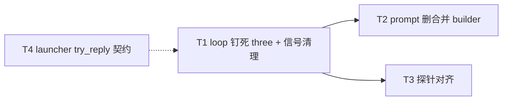

# 0023 · 等待环事件化钉死 · 废弃 one/two 与遗留信号

<!-- 本文件由 spec 工具维护：frontmatter 为结构化源数据（含 tasks DAG），正文为组级 rust-RFC 9 段总览。 -->

## Summary

把用户侧「EMIT 后等待 harness」钉成单一事件环，并清掉与之并行的遗留旋钮：

1. **AwaitEvent**——`poll`：`reply` 交主 loop 决定；`timer` 触发**一次性**心跳（judge→intent→act），动作做完即回 AwaitEvent，不在心跳内嵌套再等。
2. **动作前确认**——心跳 LLM 返回后、执行 `send_message`/`interrupt`/`give_up`/`keep_waiting` 副作用之前，非阻塞 `try_reply`；有 reply 则**作废该等待动作**，写入 history 说明，交回主 loop 读回复（避免 `give_up` 永不 poll 丢回复）。
3. **时间轴唯一**——会话相对时间统一为 history 的 `[+Ns]`；已删除主 decide 的 `<wait_cost>` / `wait_sec` 双通道。
4. **决策分层只保留 three**——主 loop 与心跳默认且唯一为 judge→intent→act；废弃 `decide_mode`/`waiting_mode` 的 `one`/`two` 与对应合并 builder。
5. **信号收敛**——等待与主路径的 intent–action 缺口统一记 `WAIT_GAP`（去掉无消费者的 `MAIN_GAP`）；删除从未读取的 `_TURN_WAIT_BUDGET_SEC`。
6. **探针对齐**——旧 peek-via-control / two-vs-three 探针改写或删除，避免教错 IO 边界。

内外窗口与等待菜单形状仍以既有 IO 边界为准：内=`message`（含 in-flight `emit_message`），外=`interrupt` + 会话收场；菜单 `keep_waiting|send_message|interrupt|give_up`。

## Motivation

**当时状态。** 心跳与开放 intent 菜单落地后，主路径已事件化，但仍残留多套并行物：① 主 decide 曾用 `<wait_cost>` 再报一轮墙钟秒，与 history `[+Ns]` 双轴；② `run_session` 暴露 `decide_mode`/`waiting_mode`∈{one,two,three}，生产调用从不传、恒为 three，one/two 与 `build_user_turn` / `*_judge_intent_turn` 仅服务旧测与探针；③ `_TURN_WAIT_BUDGET_SEC` 常量无读者；④ act 自报 gap 时主路径写 `MAIN_GAP:`、等待写 `WAIT_GAP:`，看板与规格语言只认后者；⑤ 部分 `probe_*.py` 仍假设 control 旁路 peek 或 two 模式。

**要改什么。** 契约上只承认一条等待环与一条决策分层；代码与探针不得再提供第二套时间轴、第二套 mode、第二套 gap 前缀。已删的 `wait_cost` 不得回归；动作前 `try_reply` 成为硬步骤而非可选优化。

**为何现在做。** 事件环与 abort-before-act 已在实现侧可用；若不立刻废弃 one/two 与死信号，文档与探针会继续把实验旋钮当成活设计，训练信号与体感解释再次分叉。

## Guide-level explanation

- 用户对 harness **发一条需等待的 message**（主 loop EMIT）→ 进入 AwaitEvent。
- **先到 reply**：主 loop 看见内容再 judge/intent/act（与心跳同构的三跳）。
- **先到 timer**：跑一轮心跳三跳；若决定插话则 `emit_message` 后**继续 AwaitEvent**（下一笔 reply 仍归主 loop）；若 interrupt/give_up 则按外窗口/收场结束等待。
- 心跳思考期间 reply 可能已进缓冲：框架在动手前偷看一眼；有则告诉 history「本想 X，但回复已到，未执行，回主 loop」。
- 观察者只看 history 的 `[+Ns]` 与 `WAIT_GAP` / 耐心曲线；不必再找 `wait_cost` 或 `MAIN_GAP`。
- 写探针或单测时：**不要**再传 `waiting_mode="two"` / `decide_mode="one"`；Fake/Scripted 无 begin/poll 则仍走阻塞 `send`（能力叉，非第二套等待语义）。

## Reference-level explanation

### 事件环（契约）

```text
begin(message)
loop AwaitEvent:
  kind, val = poll(heartbeat_sec)
  if kind == reply:
    return to main decide(val)
  # timer → HeartbeatOnce
  action, msg, gap = judge → intent → act   # 仅 three
  if try_reply() is Some(ready):
    stamp history: aborted before acting (action) …
    return to main decide(ready)
  match action:
    send_message → emit_message(msg); continue AwaitEvent
    interrupt    → control(interrupt); return to main (user_control)
    give_up      → terminal give_up
    keep_waiting → continue AwaitEvent
```

- `HarnessLauncher.try_reply`：非阻塞排空/窥视 stdout 队列中已到的终态 reply；无则 `None`。
- Fake/Scripted：无 `begin/poll/emit_message/control` → 不进入本环，`route`→阻塞 `send`（测试确定性）。
- 放弃三层仍保留且职责不同：persona 选 `give_up`；`patience<=0`；`_MAX_HEARTBEATS` 硬顶。

### 决策分层（唯一）

| 位置 | 分层 | 产出 |
|---|---|---|
| 主 loop | judge → intent → act | `verdict`（写状态）+ 开放 intent + `action_space` 动作 + `gap`→`WAIT_GAP` |
| 心跳 | 同构三跳 | `judgment` + 开放 intent + 等待菜单 + `gap`→`WAIT_GAP` |

废弃：`decide_mode`/`waiting_mode` 参数；`build_user_turn`；`build_main_judge_intent_turn`；`build_waiting_judge_intent_turn`。`run_session` 不再接受 mode 旋钮（或接受但非法即报错——实现取删除参数）。

### 时间与信号

- History：`_SessionClock` 统一 `[+Ns]`（含 waiting 记忆与 abort 说明）。
- 禁止：`<wait_cost>`、`wait_sec` 注入主上下文。
- Gap：一律 `WAIT_GAP: intent=… action=…`；删除 `MAIN_GAP:`。
- 删除未使用的 `_TURN_WAIT_BUDGET_SEC`；修正仍指向 `build_user_turn` 的过时注释。
- `stalled`→`unclear` 别名：随 one/two 一并删除（prompt 已不教 stalled）。

### DAG 与文件分配



| Task | 职责 | files（组内互斥） |
|---|---|---|
| T1 | `run_session`/`_main_decide`/`_heartbeat_once` 只留 three；清 `MAIN_GAP`、预算常量、`stalled`；单测改默认调用 | `loop.py`, `test_loop.py`, `test_heartbeat.py` |
| T2 | 删除 one/two builder；prompt 单测改打 `build_main_*` / `build_waiting_*` | `prompt.py`, `test_prompt.py` |
| T3 | 探针去掉 two 对比与 peek-via-control 心智；保留 three + 0022 菜单 | 下列 `probe_*.py` |
| T4 | `try_reply` 非阻塞契约（已落地，快照钉死） | `launcher.py` |

e2e / 探针路径：`tools/dev/probes/probe_wait_progress.py`（改写或删 two 臂）、`probe_peek_decision_trace.py`、`probe_persona_wait_matrix.py`、`probe_ontrack_new_harness.py`、`probe_wait_signals_to_evolution.py`。

### 与相邻活快照的关系（复述要点）

- **IO 边界**：内 message / 外 interrupt / 菜单四项 / 开放 intent+gap——本组不改菜单形状，只改等待时序与遗留旋钮。
- **等待体感**：有条件耗心、progress/prior_activity、任务量耐心——本组不改衰减公式，只保证事件环与之兼容。
- **旁路 progress**：stdout 非 reply 仍可进 `last_progress`；用户不得经 control 做 peek。

## Drawbacks

- 丢掉 one/two 后，少一次「合并 judge+intent 省 LLM 调用」的现成 A/B 旋钮；若以后要压调用量需新开实验叉，而不是复活公共 API。
- 探针改写有短期成本；不改则继续误导。
- `try_reply` 与随后 `poll` 对同一缓冲的竞态依赖 launcher 单线程排空约定；多读者未在范围内。

## Rationale and alternatives

- **唯一 three + AwaitEvent**：与「主 loop 拥有 reply、心跳只拥有 timer」的职责划分一致；one/two 破坏同构且生产未用。
- **动作前 try_reply 而非推送中断**：物理上仍是 poll 驱动；逻辑上回复归属主 loop。备选「LLM 中可取消」成本高、与现 launcher 队列模型不合。
- **统一 WAIT_GAP**：备选保留 MAIN_GAP 并改看板——多一个前缀无收益。
- **保留 Fake 阻塞 send**：备选让 Fake 也实现 begin/poll——增加测试面，对体感真实性无帮助。

## Prior art

- 用户侧 IO 边界与等待菜单（内外窗口、四项菜单、开放 intent）。
- 等待体感心跳底座（progress、有条件耗心）。
- launcher 旁路 progress 与 control wire 兼容。
- UI/agent 事件环：timer 心跳 + 完成事件归主状态机（常见于长任务客户端）。

## Unresolved questions

（无强制留题；实现时若发现生产仍依赖 `waiting_mode=` 外部调用再开例外——当前仓内生产路径未传。）

## Future possibilities

- 若 LLM 费用成为瓶颈，另开「实验 fork」探针仓内对比合并跳，不回流 `run_session` 公共参数。
- 心跳 prompt 内的「本请求已等 Ns」散文若与 `[+Ns]` 混淆，可再收成单一数字源。
- 0012 正文若仍写「或 two 合并」，随本组落地改一句对齐（跨组文档追随，非本组文件）。

