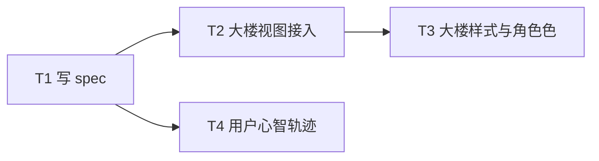

# 0034 · 前端 Agent Company 大楼视图与用户心智轨迹

<!-- 本文件由 spec 工具维护：frontmatter 为结构化源数据（含 tasks DAG），正文为组级 rust-RFC 9 段总览。 -->

## Summary

本组把历史上被后续前端重构覆盖掉的「Agent Company 左侧大楼」观测形态以当前 API/类型重新接入，而不是整体恢复旧小镇或旧大楼提交。默认入口仍是当前列式看板；新增 `view=building` 模式，通过顶部「看板 / 大楼」切换进入 2.5D 公司大楼视图。大楼按需求面角色分层展示：用户、分诊、发散、设计、准入，以及对齐 spec-0032 的交付面（OpenAgents/PR/main 推进）。右侧仍复用现有 SidePanel，包括 Issues/Main 与交付面 PR 面板。

同时，本组在用户会话详情中新增简洁版「用户心智轨迹」：读取后端现有 `sim_trace`，每个 turn 默认一行摘要，展开后按 Judge / Intent / Act 三段展示用户内部判断、原始意图、动作收敛与私有核实过程。该改动不新增后端 API，不改变 session 存储结构。

## Motivation

当前远端前端是列式看板，信息密度高但缺少「公司/楼层」的空间隐喻；历史中曾有两个方向：小镇地图（`37b8960`）和公司大楼（`aca2569`/`b4e72b`）。用户明确要的是「左边一栋楼 / Agent Company」，不是斯坦福小镇地图。直接回滚旧提交不可取：旧实现只支持 `user/developer` 或旧角色集，会覆盖当前三平面 issue、Owner、divergent、交付面、commit/detail 等能力。

另一方面，当前用户详情只展示 transcript，难以解释用户为什么给低分、为什么开 issue、等待中到底想做什么。后端从 spec-0024 起已经落盘 `sim_trace`，包含每轮 `perceive/verdict/action/message/patience/trust/persona_trace`，无需新增接口即可前端展示。把心智轨迹作为详情解释层，能帮助观察用户模拟是否真实、是否被 prompt 引导坍塌，也能帮助后续设计师/人工判断 harness 的问题来自用户误解、harness 缺能力还是交互卡顿。

## Guide-level explanation

用户仍然默认打开列式看板：

```text
http://localhost:5173/
```

新增大楼视图：

```text
http://localhost:5173/?view=building
```

页面顶部增加「看板 / 大楼」切换。大楼视图左侧是 2.5D 建筑，楼层从上到下按角色展示。点击楼层后，右侧楼层工作区展示该角色当前 live agent 或归档工位；点击工位继续复用现有 SidePanel 展示完整详情。无 running agent 时，大楼自动展示最近归档轮次，避免用户看见空楼；在「+ 已完成」全部轮次汇总下，楼层也会展示可点击的最近归档工位。

用户会话详情的结构调整为：

```text
Persona
场景
体感评价
完整对话
用户心智轨迹
```

「用户心智轨迹」默认只显示每轮一行 summary；展开某一轮后显示：

```text
① Judge：perceive / verdict 或 waiting judgment
② Intent：原始愿望
③ Act：action / message / gap
私有核实过程（如有）：tool / tool_result / tool_error
```

## Reference-level explanation

### 大楼视图数据模型

`App.tsx` 在现有轮询基础上增加 `getConfig()`，读取 roster；保留 `getDelivery()` 交付面数据并传入 `SidePanel`。新增 `ViewMode = "dashboard" | "building"`，把 `view=building` 与 `floor=<role>` 写入 URL query，刷新不丢状态。

大楼视图由 `BuildingView` 组合：

```text
BuildingView
  ├─ BuildingTower       # SVG 2.5D 楼体，按角色楼层显示容量/在岗/归档数
  └─ FloorWorkspace      # 当前楼层工位、归档工位、最近动态
buildingModel.ts         # mode/floor models/日志摘要/历史归档选择
```

`resolveBuildingMode()` 的 live 判定以 `agent.running` 为准，而不是 `agents.length`。这解决了后端 `/api/agents` 可能保留 `running=false` 完成槽位时，大楼误判为 live 模式、用户归档工位不可点的问题。

### 角色与交付面语义

大楼保留 `developer` role 作为兼容字段，但 UI 文案改为「交付面」：

- 楼层名：交付面。
- subtitle：OpenAgents PR / main 推进。
- 工作区 label：DELIVERY / OpenAgents / PR 流。

原因是 spec-0032 已将开发者侧换轨为 OpenAgents vigil，当前执行进度应以 PR/needs-human/main merge 为核心，而不是进程内 developer agent。

### 用户心智轨迹

前端类型新增：

```ts
PersonaCallTrace
SimTurn
SimTrace
SessionDetail.sim_trace?: SimTrace | null
```

`SessionDetailView` 的 `MindTrace` 组件按 `SimTurn.persona_trace[].role` 查找：

- main 阶段：`main_judge` / `main_intent` / `main_act`
- waiting 阶段：`waiting_judge` / `waiting_intent` / `waiting_act`

summary 只显示稳定字段：turn、phase、verdict/judgment、intent 截断、action。展开后按三段展示 parsed 内容；如果 parsed 缺失则用 `turn.perceive` / `turn.action` / `turn.message` 兜底。私有核实步骤来自 `persona_trace[].steps`，用现有 `ProcessStream` 渲染，避免新建过程流组件。

### DAG / file allocation



| Task | 职责 | files |
|------|------|-------|
| T1 | 写 0034 活快照 | `docs/specs/0034-frontend-agent-company-building.md` |
| T2 | 接入 BuildingView、TopBar 切换、App URL 状态、当前角色/交付面语义 | `App.tsx`, `TopBar.tsx`, `BuildingView.tsx`, `components/building/*`, `types.ts` |
| T3 | 大楼 CSS、发散/owner 颜色、楼层文字可读性 | `styles.css` |
| T4 | SessionDetail 心智轨迹 | `SessionDetail.tsx` |

注：按 spec 规范，组内 Task 文件保持互斥。`types.ts` 中的 `SimTrace` DTO 归 T2，`styles.css` 中的大楼与心智轨迹样式归 T3；T4 仅消费这些契约，在 `SessionDetail.tsx` 中组合展示。

### 验证路径

```bash
cd frontend
npm run build
```

手动验收：

- `http://localhost:5173/` 默认列式看板不变。
- `http://localhost:5173/?view=building` 展示 Agent HQ 大楼。
- 顶部可切换「看板 / 大楼」。
- 发散楼层颜色清晰，不与文字重合。
- 无 running agent 时自动展示最近归档轮次，归档工位可点击。
- 用户 session 详情先展示完整对话，再展示可折叠用户心智轨迹。
- 有 `sim_trace` 时能展开 Judge / Intent / Act；无 `sim_trace` 时不显示该块且不报错。

## Drawbacks

- 大楼视图与列式看板共存会增加前端维护面。
- 当前心智轨迹仍是简洁版，主要展示 parsed 字段和私有步骤数；尚未做高级过滤、搜索、时间轴对齐。
- 大楼样式从历史版本迁移，CSS 较多且仍在全局 `styles.css` 中；未来可再抽成命名空间文件。
- `developer` 在类型层仍是 role 名，但 UI 语义已转为交付面，存在轻微命名不一致。

## Rationale and alternatives

### 为什么不恢复小镇

用户要的是左边一栋楼的 Agent Company，而不是 `37b8960` 的小镇地图。小镇实现还依赖旧 `user/developer` 双角色模型，直接恢复会破坏当前三平面/Owner/OpenAgents 交付面能力。

### 为什么不替换默认看板

列式看板仍然是信息密度最高、调试最稳定的视图。大楼视图更适合演示和空间化理解，应作为 `view=building` 可选视图，而不是替换默认入口。

### 为什么不改后端 API

后端已经提供大楼所需的数据：`/api/agents`、`/api/history`、`/api/config`、`/api/overview`、`/api/delivery`、`/api/sessions/{id}`。用户心智轨迹已在 session `sim_trace` 中，无需新增接口。

## Prior art

- 0011：AgentBoard 卡通页，说明过 agent 活动需要更直观的身份与状态表达。
- 0026：前端观测看板重构，建立设计 token、浅/深主题、角色房间与 persona 展示。
- 0029：三平面 issue 流与 Owner 房间。
- 0032：开发者侧换轨 OpenAgents，前端新增交付面 PR 观测；本组把大楼 developer 楼层语义同步为交付面。
- 历史提交 `aca2569` / `b4e72b`：公司大楼视图原型。

## Unresolved questions

- 是否把大楼 CSS 从 `styles.css` 抽成独立文件并命名空间化。
- 是否将 `developer` role 在前端类型层重命名为 `delivery`，或继续兼容后端历史字段。
- 用户心智轨迹是否需要高级交互：按阶段过滤、搜索、只看 gap / stuck / private tools。
- 是否在 live user 详情中也展示 partial mind trace，而不仅是归档 session 详情。

## Future possibilities

- 在大楼中为交付面楼层直接嵌入 PR/needs-human 状态，而不只依赖 SidePanel。
- 将用户心智轨迹与完整对话做左右联动：点击 transcript turn 自动展开对应 mind turn。
- 在用户楼层工位卡上显示最新 intent/action 摘要。
- 将 waiting history 人话化后，在心智轨迹中区分「等待决策」与「主 loop 决策」。
