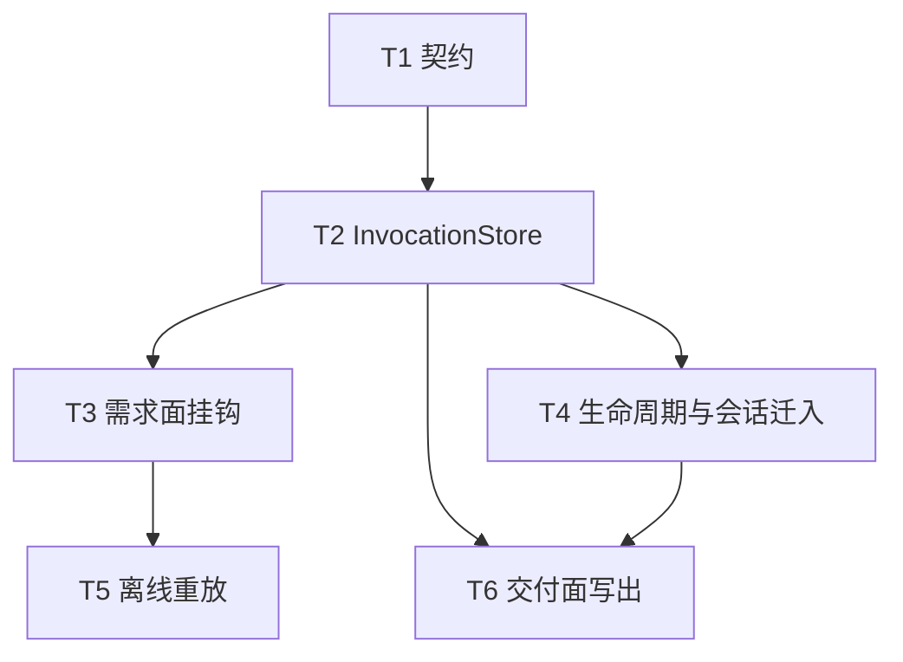

# 0049 · 角色调用输入输出持久化与跨面归因

<!-- 本文件由 spec 工具维护：frontmatter 为结构化源数据（含 tasks DAG），正文为组级 rust-RFC 9 段总览。 -->

## Summary

> 0071 清理后的当前映射：包内 ordinary controller 保留 role_runs 和阶段恢复的证据寿命；根目录单例 run.sh 已退出。下文有关单例重置与旧入口寿命的描述为设计时背景，不是当前启动方式。新运行与已有 v2 管理由统一入口管理。

第一性原理：**日志必须能还原出这一次实验**，否则无法事后判定问题出在用户模拟、需求面某一角色，还是交付面某一角色。

因此一次闭环进程对应一个 `run_id`，其权威目录是 `backend/data/role_runs/<run_id>/`。其中同时保存：

- 用户模拟会话（既有 `SessionStore`：`sim_trace` / `persona_trace` / `harness_steps`）；
- 需求面每一次 `run_agent_def` 的填好 `message` 与 submit 结构化产出；
- 交付面每一次 `run_agent` 的填好 prompt/`context` 与末行 JSON；
- 最小 `manifest.json`（模型名、agent_def pin、编制、各轮 harness SHA）。

该目录不被删除。OpenAgents 不另建记录库，只往 `ROLE_RUNS_DIR` 按同一 schema 写交付面调用。看板 `data/live/` 是**本实验进程内**的易失投影，不是跨实验档案。

**从种子起跑的单位是实验，不是 round。** 一次实验内部的第 2、第 3 轮必须接着已经进化的 `origin/main`，禁止打回 v0。新实验才从种子（v0 / 显式 seed pin）起。当前 `./run.sh` 在进程开头对**共享** Gitea 调 `_reset_to_initial`，是「全机只有一个实验」时用毁掉上一实验的仓来给下一进程腾地方——这是单例缺陷，不是正确的 round 语义。0049 不把该行为升格为目标模型；0047 用每实验独立 Gitea 消灭它。在旧入口仍存在期间，若启动时仍复位共享 Gitea，也不得连带删除 `role_runs/`。

分析单位：用户侧是一局 session；角色侧是一次 `run_agent_def` / `run_agent`。不是工具环全文，不是 Gitea 票面，不是截断后的看板过程流。判断角色可用冻结 `input.prompt` 重放并 diff `output.structured`。实现者不重放写文件。

## Motivation

要审计「哪一环节出了问题」，观察者必须能拿着**当时**的输入和结构化产出，而不是共享目录被下一个实验进程清掉之后还剩什么。

用户模拟今天已经把 persona 各阶段的 system/user/raw/parsed 和与 harness 的过程摘要写入 `data/sessions/<id>.json`。**同一次** `./run.sh` 进程里多 round 不会删这些文件（`_reset_to_initial` 只在进程开头调一次，不在 `run_round` 之间调）。但当前仍是全机一份 `backend/data` 加一份 Gitea：再开一个 `./run.sh` 进程会强推 v0、关遗留 issue、删除 `sessions/*.json` 并 `clear_live`。这把「新实验」做成了「毁掉上一实验」。并行实验运行时规定每实验独立 Gitea 与 `sessions/`、`stop` 不删、`destroy` 才删，但尚未实现。需求面/交付面则连本实验进程内都几乎没有对等文件。

需求面现状（ahe-beta，2026-09-01 代码）：

1. **唯一派发入口**是 `architect/agent_runtime.py` 的 `run_agent_def`。四个 driver（`triage.py` / `architect.py` / `divergent.py` / `owner.py`）各自拼好 `message` 后调用它，再 `read_submit` 取结构化数组写 Gitea。`message` 就是当时的完整输入；submit 回显就是当时的结构化产出。二者都只活在该次函数栈里。
2. **看板过程流不是实验记录。** `loop/live_tracer.py` 把工具入参截到约 200 字、工具结果约 500 字；`loop/live.py` 的 agent log 上限 500 条。`archive_agent` 写入 `data/live/history.json` 的仍是这份截断投影。每次 `./run.sh` 开头 `clear_live`。
3. **Token 用量 JSONL 只含计量。** `usage.py` 逐次记录 tokens 与 role/round，fail-open，不含 prompt 与产出。一次用量事件对应一次 LLM HTTP；一次角色调用内部可以有多次用量事件。
4. **Gitea 只留产品。** proposal body、Owner 评论、标签是治理结果，不是填好的 `message`，也不是被 driver 丢掉的非法 submit。
5. **现有重放脚本重建输入，而不是重放冻结输入。** `scripts/replay_roles_offline.py` 等从 sessions + FakeTracker 再跑一遍 driver。agent 定义或 tracker 视图一变，拼出的 `message` 就变。

交付面现状（OpenAgents `ahe-beta/v0.1`，由 AHE-Beta `start_vigil` 拉起）：

1. **唯一派发入口**是 `openagents/runtime/engine.py` 的 `run_agent`。`task`、`context`、校验后的 dict 在此次调用内完整存在。
2. **既有遥测明确不以 transcript 为分析对象。** 工具名 jsonl、token jsonl 留在 worktree；机器可读全文在 `protocol_output`（OpenAgents 字段名，本组 schema 不沿用该键），容器缺省零宿主挂载，`--rm` 后宿主拿不到。
3. **implementer 的结构化产出就是校验后的末行 JSON。** 文件编辑发生在同一次 `backend.run` 内部。v1 不重放写文件，不采集 diff。

围堵与过拟合约束仍然有效：设计师与容器内 coding agent 不得把任务轨迹读进下一轮决策。`role_runs` 与 `sessions` / `harness_runs` 同类，必须进 jail 拒绝表；vigil 只挂本 `run_id` 的 `delivery/`。

因此本组把「一次实验进程」的可审计切片做成 `role_runs/<run_id>/`：用户会话迁入同一包，角色调用按 schema 写入。这与「每实验独立 sessions、stop 不删」同向；实验运行时落地后该目录就是实验根下的 telemetry/sessions，而不是第二套权威。

## Guide-level explanation

一次闭环进程开始时，`run.py` 生成 `run_id`，设置 `AHE_BETA_RUN_ID` 与 `ROLE_RUNS_DIR=backend/data/role_runs/<run_id>`。`SessionStore` 写 `ROLE_RUNS_DIR/sessions/`。用量 JSONL 写 `ROLE_RUNS_DIR/usage.jsonl`。看板若仍读 `data/sessions`，则该路径只是指向**当前** `run_id` 的 sessions 的别名（符号链接或同等），换 `run_id` 只改别名，不删上一包。

实验内各 round 接着进化后的 main，不复位。**禁止**删除 `role_runs/` 下任何已有 `run_id`。旧单例入口若仍在启动时对共享 Gitea 强推 v0，那是给**新的实验进程**腾仓，不得写成「每一轮从种子起」；且该路径仍不得删记录目录。看板 live 只服务当前进程，换实验进程时清空 live 可以，清空上一实验的 `role_runs` 不可以。

需求面每调用一次 `run_agent_def`，往 `demand/` 写一条 JSON。交付面 vigil 只 rw 挂载 `delivery/` 到容器内 `/role_runs`。用户局结束仍走既有 `SessionStore.save`，只是根目录换到本包内，不双写两份 persona_trace。

审计者打开一个 `run_id` 目录应能回答：用户在各局如何判断与动作、harness 过程摘要是什么、triage/architect/owner/drafter/… 各自吃了什么输入、交出了什么 structured。把某条 demand 记录的 `input.prompt` 喂给改写后的 agent 定义，diff `output.structured`，即环节消融。实现者记录 `replayable=false`，脚本跳过。

示例（需求面角色调用；会话 JSON 仍是 SessionStore 既有形状）：

```json
{
  "schema_version": 1,
  "invocation_id": "9f3c…",
  "run_id": "a1b2…",
  "round": 3,
  "side": "demand",
  "role": "owner",
  "subject": {"kind": "round", "id": "3"},
  "replayable": true,
  "input": {"prompt": "你是投资与组合治理 Owner。…", "context": "", "placeholders": {}},
  "output": {"structured": {"decisions": [{"issue": 12, "disposition": "hold"}]}, "status": "success", "error": null},
  "env": {"model": "…", "agent_def_pin": "sha256:…", "captured_at": "2026-09-01T08:00:00+00:00"}
}
```

操作者保留 `backend/data/role_runs/<run_id>/` 即保留该次实验的可还原切片。再开一个实验进程不得擦掉它。

## Reference-level explanation

### 第一性原理：还原清单

「还原实验」在 v1 指：不依赖「共享 Gitea 还没被下一个实验进程打回 v0」，仅凭该 `run_id` 目录即可做环节审计。

| 要回答的问题 | v1 靠什么 | 不靠什么 |
|---|---|---|
| 用户为何 Accept / 放弃 | `sessions/*.json` 的 `persona_trace` 与 `sim_trace` | live 看板 |
| 用户与产品怎么来回 | 同文件 `harness_steps`（既有长度上限仍在） | harness 内部完整 transcript |
| 需求面某角色是否偏保守 | `demand/` 的 `input.prompt` + `output.structured` | Gitea 评论、截断 live log |
| 交付面某角色是否偏保守 | `delivery/` 同上 | 容器内 worktree、工具参数 |
| 当时用哪套定义/模型、哪版 harness | `manifest.json`（pin 与 round SHA） | 宿主脏工作区 |
| 花了多少 token | `usage.jsonl` | 估算 |

v1 **不能**还原：实现者改过的文件树、完整工具环、被截断前的 harness 工具全文。issue 正文若已写入 Gitea，关票不等于删历史。单例上后一个实验进程若仍强推 v0，当前 Gitea main 不再代表上一实验；审计上一实验必须看该 `run_id` 包与当时记录的 round SHA，不能只看此刻共享仓。

0047 落地后：本包成为该 `experiment_id` 下的 sessions/telemetry；`destroy` 才允许删。本组不实现 0047 CLI。

### 术语（防抢词）

| 本组 | 本组含义 | 不得当成 |
|---|---|---|
| 角色调用 / invocation | 一次 `run_agent_def` 或一次 `run_agent` | 一次 LLM HTTP（usage 事件）；一次工具步 |
| `run_id` | `AHE_BETA_RUN_ID`，一次闭环进程 | `docker run`；`agent.run`；`data/live/run.json` |
| `side` | `demand` \| `delivery` | issue `plane` → `report`/`proposal`/`ready` |
| `input.prompt` | 需求面 = 填好的 `message`；交付面 = substitute 后的 `task` | 单独再存 `systemprompt.md` |
| `output.structured` | 需求面 submit 或回显；交付面 `OUTPUT_SCHEMA` dict | OpenAgents 键名 `protocol_output`；0043 artifact |
| `role_runs/<run_id>` | 一次实验的可还原切片（会话 + 角色调用 + manifest + usage） | `evaluate_role_traces.py` 的合规 JSONL；`harness_runs` 工作副本 |
| jail 的禁读目录名 | `sessions` / `harness_runs` / `role_runs` | 对外名称仍是「实验切片 / 调用记录」 |

`output.status` 的 `protocol_error` / `backend_error` 沿用 OpenAgents `run_agent` 既有字面量。

### 角色调用 schema（demand / delivery）

单位：一次角色调用。v1 **记录**字段与前一版相同：`schema_version`、`invocation_id`、`run_id`、`round`、`side`、`role`、`subject`、`replayable`、`input.{prompt,context,placeholders}`、`output.{structured,status,error}`、`env.{model,agent_def_pin,captured_at}`。

v1 **不记录**：完整 chat transcript、工具参数/命令正文/文件内容、patch hunk、Gitea token、API key。`input` 若误含已知环境变量里的密钥，写出前按精确子串替换为 `${ENV_NAME}`；替换失败则整条 skip（仍 fail-open）。

用户会话**不**改写成 invocation schema，避免与 SessionStore 双协议。权威仍是 SessionStore 文件，只是根目录迁入本包。

### 目录

```
backend/data/role_runs/
  <run_id>/
    manifest.json        # 模型名、roster、agent_def pin、round SHA 列表；不含密钥
    usage.jsonl          # 本 run 的用量事件（AHE_BETA_USAGE_PATH）
    sessions/            # SessionStore（index.json + <session_id>.json）
    index.jsonl          # 角色调用索引 {invocation_id, side, role, status, path}
    demand/
      <utc>_<role>_<invocation_id>.json
    delivery/
      <utc>_<role>_<invocation_id>.json
```

`InvocationStore` 在 `ahe_beta/invocation.py`：fail-open、原子写 JSON、index 追加。未设置 `ROLE_RUNS_DIR` 时角色调用 API no-op；会话路径仍必须由 `run.py` 显式传入本包，避免再落到会被删的旧根。

`run.py` 在导入用量模块之前（或 `main` 最早处）设置：

- `AHE_BETA_RUN_ID`
- `ROLE_RUNS_DIR=<DATA>/role_runs/<run_id>`
- `AHE_BETA_USAGE_PATH=<ROLE_RUNS_DIR>/usage.jsonl`

`SessionStore` 构造为 `ROLE_RUNS_DIR/sessions`。`data/sessions` 若被看板硬编码，只允许作为指向当前 sessions 的别名，换 run 时改别名。SWE-bench 等同样调用 `_reset_to_initial` / `SessionStore(DATA/sessions)` 的入口必须同一约定（与 `run.py` 同改或共用 helper）；不得再写会被复位清空的共享根。

`_reset_to_initial`：不得在 `run_round` / 实验内轮次边界调用。旧单例 `run.py` 若仍在**进程启动**时调用它（共享 Gitea 上开始另一个实验进程），**禁止** `unlink`/`rmtree` `role_runs`，也禁止再按共享 `DATA/sessions/*.json` 删除已迁入本包的会话。`clear_live` 只清当前进程看板投影。目标态（实验运行时）是新实验独立 Gitea + seed pin，不再对别人的仓强推 v0。字段契约仍以 `issue_schema` 为准；本实验进行中的产品状态以该实验的 Gitea 为准。

`manifest.json` 由 T2 提供读写；T4 在轮次结束把 orchestrator 已观测的 origin/main SHA 追加进 `rounds`。缺 SHA 时该键为 `null`，不得编造。

### 需求面挂钩

只改 `run_agent_def` 一处写存储；四个 driver 只增加 `subject=`（及可选 `replayable=True`）。triage 的 subject 为当前 report 号；architect/divergent/owner 若是整批则 `kind=round` 且 `id=str(round_no)`。不要从 `message` 启发式抽票号。超时写 `status=timeout` 再抛；未调 submit 写 `status=no_submit`。离线重放判断角色只喂 `input.prompt`。

### 交付面挂钩与围堵例外

`run_agent` 的 `finally` fail-open 写出。容器内 `ROLE_RUNS_DIR=/role_runs`，只挂 `…/<run_id>/delivery`。不挂 `sessions/`、`demand/`、父目录。keep-alive 且 `run_id` 变化则重建容器。实现者 `replayable=false`。

### 过拟合隔离

jail 禁读目录名增加 `role_runs`。设计师不得把本包当证据读。

### 重放

`scripts/replay_role_invocations.py --run-dir data/role_runs/<id> --side demand --role owner --agent-def backend/agent_defs/owner`：只重放 `replayable=true` 的 demand 记录。e2e：`backend/scripts/e2e-spec-0049-role-invocation-io-store.sh`。不替代 `evaluate_role_traces.py`。用户侧审计直接读本包 `sessions/`，不经本脚本。

### Task DAG 与文件分配



T3 与 T4 可并行。T6 在 OpenAgents `ahe-beta/v0.1` 实现写出；本仓黄金夹具与契约测试。

## Drawbacks

磁盘：会话全文加角色 prompt，多轮可达数十到数百 MB。操作者自行归档旧 `run_id`。

密钥与隐私：会话与 issue 正文可能含用户数据；仅做已知 env 精确脱敏。目录 gitignore，当实验产物。

围堵：delivery 子目录 rw 挂载是对零挂载的例外；sessions 不进容器。

实现者文件树仍不可从 v1 还原。harness 工具摘要仍受既有截断。单例共享 Gitea 被后一实验进程打回 v0 之后，审计者必须按 `run_id` 看包和 SHA，不能只看当前 Gitea main。

看板硬编码 `data/sessions` 时依赖别名；别名失败则本轮看板空、本包仍在（fail-open 偏向保存）。

## Rationale and alternatives

**选用「一个 run_id 一份目录，会话迁入而不是双写」**，因为还原实验需要用户侧与角色侧同寿命、同切片；双写会漂。SessionStore 形状已可审计用户，不必改成 invocation schema。

**实验从种子起，round 从上一 round 的 main 起。** 新实验独立，才需要种子；实验不独立是因为抢同一 Gitea，不是因为 round 没有打回 v0。不能再以删除 sessions 充当隔离。本组在旧单例入口上只保证记录不被误删；消灭共享 Gitea 上的启动强推是实验运行时的事。

备选 A：Gitea 评论当日志。票面不是 prompt；未 submit 不会出现。

备选 B：升格 live/history。截断、500 条、每次清空。

备选 C：完整 transcript。体积与过拟合；交付面已列为非目标。

备选 D：只在 OpenAgents worktree 写 jsonl。统一落盘失败。

备选 E：会话仍写共享 `data/sessions`，仅约定「请先拷走」。软约定无法防止下一个实验进程删除，违反第一性原理。已否决。

备选 F：等 0047 实现后再保存会话。0047 未落地期间连续 `./run.sh` 仍会丢用户记录；审计需求等不了。已否决。

备选 G：schema 键用 `plane` / `protocol` / `task`。抢词。已否决。

## Prior art

`usage.py` 的 fail-open 与 contextvars 归属。`SessionStore` 已证明会话 JSON 足以审计用户模拟，缺的是寿命。0047 规定每实验独立 sessions 且 `destroy` 才删——本组在旧入口上用 `run_id` 目录先行对齐该寿命模型。0046 用 fresh target 保护冻结交接，不改 `./run.sh`。OpenAgents 将 `protocol_output` 与展示 summary 分列。LangSmith 以 span 保存完整消息；本组更窄。

## Unresolved questions

无。操作者已拍板：日志必须能还原实验；用户会话与角色调用同包持久；存 structured 而非工具环；权威目录在 ahe-beta。keep-alive 与 run_id 变化时重建容器。0047 未落地不构成推迟保存的理由。

## Future possibilities

看板按 `run_id` 浏览历史切片。v2 implementer `diff_stat`。把 demand structured 投影成 `evaluate_role_traces.py` 输入。0047 实验根直接把 `ROLE_RUNS_DIR` 指到 `<experiments-root>/<id>/`。完整 transcript 仅 `ROLE_RUNS_TRANSCRIPT=1`。把 round SHA 对应的 harness 树打成可选 bundle（0047 archive 的 Git bundle），本组 v1 不收录。
