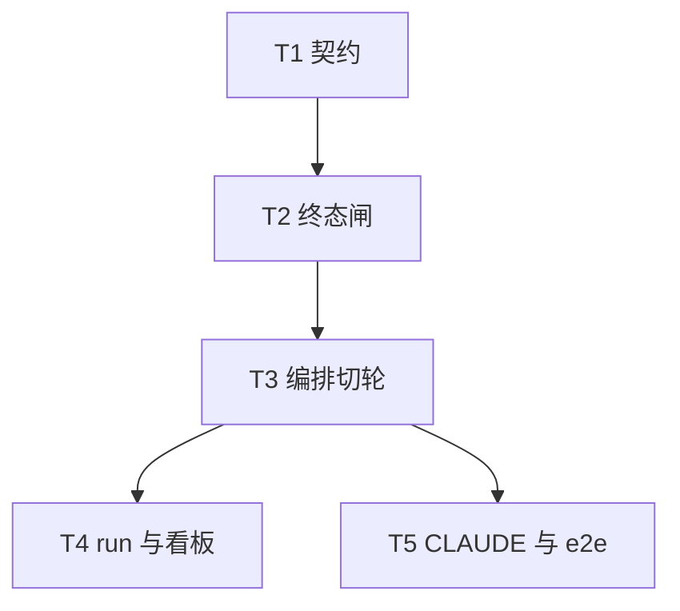

# 0050 · 轮次交付封口与收益归因

<!-- 本文件由 spec 工具维护：frontmatter 为结构化源数据（含 tasks DAG），正文为组级 rust-RFC 9 段总览。 -->

## Summary

一次实验里，**只有封过口的产品**才能被下一轮用户测量；否则体感无法归因到「这一轮改动」。

编排因此改为两段轮次：

- **非末轮**：用户测当前 `main` → 提案 → Owner 准入 → **等到本轮准入票全部终态** → 才开下一轮用户。
- **末轮**：只跑用户交互，**不再跑需求、不再往交付队列放票**。这轮体感就是上一轮已封口产物的收益测量。

卡死（`needs-human`、看门狗、等待超时）= 本轮没有合法封口 → **实验停在这一轮，不开下一轮用户**。

同一轮内用户会话仍可并行，同一轮多张票交付面仍可并行。禁止的是下一轮用户与本轮交付重叠。

## Motivation

训练信号是用户体感，测试是 held-out benchmark。要问「第 N 轮改动有没有正收益」，必须比较：

- 第 N 轮用户：在产品 A 上的体感
- 第 N+1 轮用户：在产品 B 上的体感

其中 B 必须是「第 N 轮决定做、并且已经做完」的产品，不能是 A 和若干未完成 PR 的随机混合物。

现行编排不是这样。需求面 `Orchestrator.run_round` 在 Owner 打上 `openagents` 交接令牌之后立刻结束，只再读一次 `main` HEAD 当作观测游标，**不等合并**。交付面 `openagents vigil` 是实验一开始就拉起的常驻进程：票出现就领，写代码、开 PR、合并，与需求面轮次没有会合点。打开 RFC 之后单票更长，还把「需求面 `TOTAL_ROUNDS` 先结束、交付面继续跑」写成了缺省 keep-alive。

后果：第 2 轮用户开始时，第 1 轮票可能还在写。他们测到的是「当时 `origin/main` 碰巧合进去的子集」。体感曲线对不上轮次，无法说某轮有正收益，也无法说某轮把产品改坏了。

更早的时候开发者还在编排进程里、一轮内直推 `main`，轮次边界和产品边界大致重合。换到常驻 vigil 之后，开发从一轮里拿掉了，轮次变成「出票节拍」，产品进化变成「旁边一直在改」。对墙钟吞吐有利，对归因有害。本组把会合点加回来：vigil 仍然是交付执行器，但**下一轮用户必须等本轮执行器把本轮票做完或明确失败**。

末轮若再走提案和准入，会产生一批永远没有「下一轮用户」来测量的改动。操作者定：末轮只测，不再进化。

## Guide-level explanation

`TOTAL_ROUNDS=3` 时实验长这样：

```
第 1 轮  用户测种子 A
         提案 + Owner 准入票 #10 #11
         等待：#10 #11 都关闭且无 needs-human
         此时 main = 产品 B（#10 #11 的合并结果）

第 2 轮  用户测产品 B          ← B 相对 A 的体感差 = 第 1 轮收益
         提案 + Owner 准入票 #20
         等待：#20 关闭且无 needs-human
         此时 main = 产品 C

第 3 轮  用户测产品 C          ← C 相对 B 的体感差 = 第 2 轮收益
         结束。不再提案、不再准入、不再等交付。
```

第 3 轮没有「第 3 轮改动的收益」，这是有意的：最后一轮专门用来出数。

`TOTAL_ROUNDS=1`：只测种子，不启交付面。

若第 1 轮等待时 #11 被打上 `needs-human`（或一直不关直到超时）：实验在第 1 轮失败退出，**第 2、第 3 轮用户不跑**。已经合进 `main` 的 #10 仍在仓里，但不进入「第 1 轮正收益」结论——本轮没有完整封口，没有对照实验。

看板能看出当前停在「用户 / 提案准入 / 等待交付 / 卡死」。卡死时交付面容器留着等人处理；干净跑完则拆掉。

## Reference-level explanation

### 轮次过程

`Orchestrator.run(n_rounds)`：

1. `i = 1 .. n_rounds`。
2. 解析 `origin/main`（无 origin 则本地 `main`），本轮所有用户会话 `launch` 该 SHA（会话级快照，同轮用户并行仍允许）。记 `user_sha`。
3. 跑用户会话（现有 a 段）。
4. 若 `i == n_rounds`：跑完整性绊线，回灌当前 HEAD，`on_round_end`，结束。不调 triage / divergent / architect / Owner，不调交付闸。
5. 否则：生成两拍 + `Owner.admit_once()`。等待集合 = 本次返回的 `AdmitOutcome.admitted`（仅本轮新打上 `openagents` 的票）。Owner 本轮 merge/decline/hold 的提案不进等待集：它们不是交付面工作项。
6. `wait_round_delivery(numbers=admitted)`。空名单立即成功（本轮没有放进交付队列，下一轮用户仍测同一 SHA，体感差应接近 0，这是合法结论：「本轮无交付」）。
7. 闸成功后再 `fetch` 解析 HEAD，记 `sealed_sha`，`on_round_end`。下一轮步骤 2 必须读到这个前进后的 `main`（或相同 SHA，若空等待集）。
8. 闸抛 `RoundDeliveryBlocked`：不再进入 `i+1`，异常传到 `run.py`。

`run_round` 保留为「用户 + 需求 + 闸」的非末轮路径，供既有单测默认调用；`run()` 在末轮不走需求段。

### 终态判定

读票用 tracker 已有取单票接口（Gitea `get_issue`；测试用 Fake 等价物）。每张等待集内的票：

| 观察 | 判定 |
|---|---|
| `state=closed` 且标签不含 `needs-human` | 成功终态（合并关票或等价关闭） |
| 标签含 `needs-human`（不论 open/closed） | 卡死 |
| 仍 open 且无 `needs-human` | 交付中，继续等 |
| 墙钟超过 `ROUND_DELIVERY_TIMEOUT_SEC`（缺省 14400）仍有交付中 | 卡死（vigil 哑掉 / 看门狗未落标签的兜底） |

任一张卡死 → 整闸失败，抛 `RoundDeliveryBlocked(numbers=…, reason=…)`。不把部分合并当成封口。

轮询间隔 `ROUND_DELIVERY_POLL_SEC`（缺省 15）。闸只读 Gitea，不 import OpenAgents，不读 vigil sqlite。

### 进程与 vigil

vigil 仍是常驻执行器，本轮多票可并行。它不再与下一轮用户抢时间。

- `TOTAL_ROUNDS=1`：不 `start_vigil`。
- 非末轮等待期间 vigil 必须在跑。
- `RoundDeliveryBlocked`：进程退出码非 0；`stop_vigil` **不**拆容器（keep-alive），live `phase=blocked`，记下卡死票号。
- 末轮用户正常结束后：不再有本实验交付工作，`stop_vigil` 拆容器。干净收官不再依赖「需求面先结束、交付面接着干」——非末轮已经等过了，末轮不再放票。

缺省 keep-alive 从「需求面收尾时交付还在跑」改为「仅卡死时留容器」。显式 `VIGIL_KEEP_ALIVE=1` 仍可在干净收官后留盒调试。

### 归因公式

设 `F(k)` 为第 k 轮全部用户会话体感的约定汇总（沿用现有 session 分数，本组不改评分细则）。

- `F(1)` 测 `user_sha[1]` = 种子（或本实验起始 `main`）。
- 对 `k = 1 .. n_rounds-1`，`F(k+1) - F(k)` 归因于第 k 轮等待集的交付结果（`user_sha[k] → sealed_sha[k]`）。
- `F(n_rounds)` 没有「第 n 轮交付」与之配对。

benchmark 仍全程 held-out，不进闸、不进切轮条件。

### 看板

`data/live/run.json` 增加 `phase`（`users` / `demand` / `delivery_wait` / `blocked` / `done`）与可选 `blocked_issues`。既有 `round_shas`：非末轮写入闸后 HEAD（`sealed_sha`）；末轮写入该轮用户所用 SHA。前端未改字段前仍能显示 SHA 列表。

### 与角色调用落盘的关系

若实验切片目录记各轮 SHA，非末轮应同时能区分 `user_sha` 与 `sealed_sha`。本组不改那套存储的文件归属。

### Task DAG 与文件分配



T4 与 T5 可并行。e2e：`backend/scripts/e2e-spec-0050-round-delivery-gate.sh`。

## Drawbacks

墙钟变长：非末轮把 RFC/实现/评审算进轮次。以前那些时间与下一轮用户重叠，现在串到切轮之前。这是归因的代价。

卡死即停实验：一张 `needs-human` 浪费后面几轮用户预算。这是操作者选的，避免用残缺产物去得出「本轮有/无收益」的假结论。

末轮不进化：`TOTAL_ROUNDS` 次用户里只有 `n-1` 次交付。以前末轮也会出票但没有测量轮；现在明确少一轮进化、多一轮干净测量。

等待是轮询 Gitea，不是 vigil 回调。最多延迟一个 poll 间隔。超时缺省 4 小时，超长 RFC 可能误判卡死，用环境变量加长。

## Rationale and alternatives

**会合点放在「下一轮用户之前」，而不是「vigil 内部队列空」。** 等待集是本轮 `admitted`，不是全仓所有 ready。上一实验残留票应在进程启动复位里清掉；本实验只对自己放进去的票负责。

**卡死停跑，而不是带标记继续。** 带标记继续仍会让下一轮用户踩到部分合并，体感无法解释。停跑把「本轮没封口」变成实验结果，而不是脏数据。

**末轮只用户，而不是再加一轮纯测量。** 末轮本身就是测量轮，不必发明第二种轮次类型。

备选 A：保持两面不同步，只在日志里记下「本轮用户 SHA vs 当时未合 PR」。能事后解释污染，不能产生干净的轮次收益。已否决。

备选 B：SHA 任意前进就算封口（部分票合入）。下一轮测的是子集，归不进「本轮改动」。已否决。

备选 C：需求面 `finally` 等到 vigil 全局空再退出，轮次中间仍重叠。只修了实验收尾，没修轮间归因。已否决。

备选 D：把开发者重新嵌回编排进程、一轮内直推 `main`。能封口，但丢掉 PR/评审/围堵盒。已否决。

备选 E：卡死后仍开下一轮、体感标 invalid。看板会有数据，但操作者已要求不开下一轮。已否决。

## Prior art

实验设计要求一次只改一组处理、测完整处理后再测下一组；A/B 与 feature freeze 同样把「发布」和「测量」错开。持续交付里 trunk 可以一直合，但「这一版相对上一版的指标」仍以 release 或实验桶为界，而不是以墙上任意时刻的 main 为界。本组把 vigil 当持续交付执行器，把 round 当实验桶。

OpenAgents vigil 的 `needs-human` 已是交付面公开终态，本仓交付看板按该标签计数。闸复用同一标签，不发明第二套卡死协议。

## Unresolved questions

无。操作者已定：非末轮等本轮准入票全部终态；卡死停实验；末轮只跑用户交互；不追加额外测量轮。

## Future possibilities

闸改为 Gitea webhook / vigil 完成事件，去掉轮询。卡死票人工放行后从 `blocked` 恢复下一轮（现网是失败退出）。把 `F(k+1)-F(k)` 画进看板。超时按票龄而不是整闸一个墙钟。并行实验运行时把闸的等待集限制在本实验 Gitea，避免误等别人的票。


