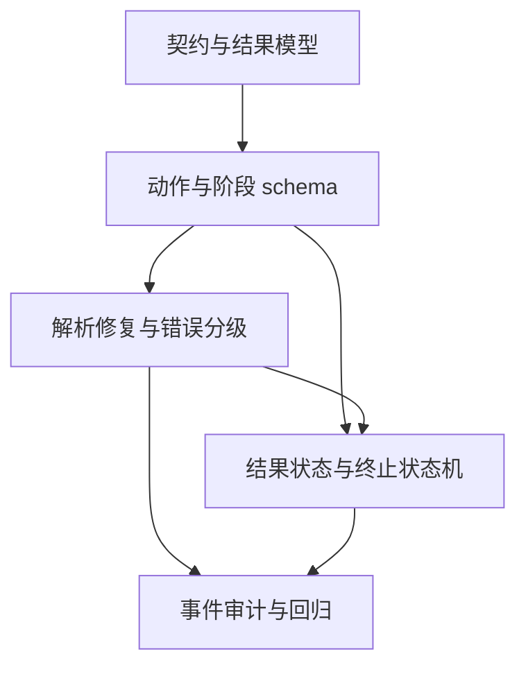

# 0053 · Persona 语义动作契约与可审计终止状态机

<!-- 本文件由 spec 工具维护：frontmatter 为结构化源数据（含 tasks DAG），正文为组级 rust-RFC 9 段总览。 -->

## Summary

本组修复用户模拟中“模型输出触发协议错误、协议错误覆盖客观结果、终止后状态不一致”这一整条失真链。当前动作目录把 `channel=EMIT` 错当成“必须有非空 message”，导致语义合法的 `accept` 被判为 `missing_message`；`gap` 又在所有 act 阶段被全局强制，`waiting_act` 的偶发多余消息则直接终止会话。最终一次格式问题被汇总为 `evaluator_invalid`，掩盖了用户 verdict、代码执行结果和容器生命周期。

本组将动作定义改为**语义契约**：每个动作显式声明消息是 `required`、`optional` 还是 `forbidden`，每个阶段只校验自身需要的字段；将原始模型响应、规范化决策、协议状态、用户 verdict、客观 evaluator 结果和生命周期状态分开保存；对可恢复格式错误执行有界修复，对真正歧义才 fail-closed；正常终止先完成证据刷盘再停止容器。该组不放宽越权动作、不把模型自跑测试当官方客观验收，也不引入后处理 verdict 分类器。

## Motivation

最近两次同配置实验提供了可重放证据：上一轮四个 persona 中只有一个被记为 `valid_accept`，另外三个在用户已经完成正常交互后因为 `accept` 空消息而变成 `evaluator_invalid`；本次三个落盘 session 中两个再次触发同一问题，另一个触发 `invalid_gap`，PyVista 会话在等待阶段触发 `unexpected_message` 并未形成完整 session。没有 persona 明确选择 `give_up`，但最终结果却看起来像用户放弃或技术失败。

根因是协议层混合了四个不应混合的判断：模型有没有生成可解析对象、用户选择了什么动作、代码客观执行是否通过、容器是否完成收尾。统一的“动作必须带 message”规则和全局 `gap` 字段无法表达终止动作的实际语义；异常处理又在第一次协议错误处直接写入 `evaluator_invalid`。这会让验收侧反向塑造用户行为，削弱实验对真实交互和开发能力的测量。

目标不是让模型随便输出，而是让框架只对**安全相关的歧义**严格，对与动作语义无关的格式噪声可解释、可修复、可审计，并且永远不覆盖已经获得的客观证据。

## Guide-level explanation

一次用户会话的决策链保持 `judge → intent → act`，但每层职责明确：

1. `judge` 产生用户可感知的 `perceive` 和粗粒度自标注，不决定平台动作。必要时用户在私有内层工具中读文件、看 diff 或运行命令；这些证据摘要只回到用户自己的上下文。
2. `intent` 只表达用户此刻真正想做什么，不因为当前菜单或 help text 不支持就提前收缩愿望。
3. `act` 将意图收敛为动作。动作目录由语义契约驱动，不能通过自然语言关键词猜测越权动作。
4. 终止动作写入用户终止事件；`accept` 的可选说明称为 `terminal_note`，不发送给 harness，也不伪造一条 harness-facing user turn。
5. 框架分别记录协议结论、用户结论、客观结论和生命周期结论。只有明确的 persona `give_up` 才产生 `abandoned`。

概念上的结果对象如下：

```json
{
  "interaction_status": "completed | protocol_repaired | protocol_unrecoverable",
  "user_verdict": "accepted | accepted_with_reservations | abandoned | issue_filed | unknown",
  "objective_status": "passed | failed | not_run | unavailable",
  "lifecycle_status": "active | flushing | stopped | crashed"
}
```

四个字段相互独立。例如“用户接受、目标测试通过、模型首个响应格式修复过”应记录为 `accepted + passed + protocol_repaired`，不能压扁成 `evaluator_invalid`。

## Reference-level explanation

### 语义动作契约

动作目录保留 executor、channel、effect，但新增与 channel 正交的 `message_policy`，并按动作定义字段：

| 动作 | effect | 消息 | `gap` | harness 行为 |
|---|---|---|---|---|
| `send_message` | advance | required | optional | 发送一条自然语言消息 |
| `accept` | terminate | optional | optional | 不发送；进入正常收尾 |
| `accept_with_reservations` | terminate | required | optional | 不发送；保留意见写入审计 |
| `file_issue` | terminate | required | required | 不发送；进入 issue 收尾 |
| `give_up` | terminate | optional | optional | 不发送；记录 abandoned |
| `keep_waiting` | advance | forbidden | optional | 不发送，等待下一心跳 |
| `interrupt` | advance | forbidden | optional | 中断当前 harness 请求 |

`channel` 只说明是否存在外部信道；它不再推导消息是否必填。`terminal_note` 与 `message` 分开命名，终止说明不会被误认为 harness 请求。`file_issue` 的正文仍是用户自由文本，不强迫 persona 填平台模板。

动作解析必须使用阶段允许的 action space。缺失、越权或冲突动作保持 fail-closed；不得把 `free` 通过关键词猜成某个终止动作。私有 `read_file`/`run_shell` 等工具永远不出现在外层 action space。

### 阶段局部 schema

不得再用一个全局 act schema 要求所有阶段都返回 `action`、`message`、`gap`。至少使用下列局部契约：

```text
main_judge:   {perceive: string, verdict: enum}
main_intent:  {intent: string, needs_final_check: boolean, check_goal?: string}
main_act:     {action: enum, message?: string, gap?: boolean, terminal_note?: string}
waiting_judge:{perceive: string, judgment: enum}
waiting_intent:{intent: string}
waiting_act:  {action: enum, message?: string, gap?: boolean}
issue:        {issue: string}
rating:       {score: integer, reason: string}
```

字段是否出现、是否为空和是否能被忽略，都由当前 action/阶段的契约决定。终止动作不因缺少无关 `gap` 而失败；静默动作带有非空外发消息时仍明确拒绝。

### 协议处理与错误分级

框架必须保留四份材料：模型原文 `raw_response`、解析对象 `parsed`、规范化对象 `normalized`、校验结果 `validation`。处理顺序为：解析 → 局部 schema 校验 → 语义归一化 → action-space 校验 → 执行动作。

错误分类如下：

- `recoverable_format`：JSON 包裹、空白、可安全转换的字段类型。有限次数重试，写入 `repair_attempt`，成功后 `interaction_status=protocol_repaired`。
- `inferable_semantics`：例如 `accept` 没有附加说明。按动作契约直接规范化，不再要求模型凭空补一句话。
- `unrecoverable_protocol`：动作越权、多个互斥动作、关键字段含义无法判定。有限重试后设置 `protocol_unrecoverable`，但保留此前的用户和客观证据。

协议重试不得无限循环，也不得把协议错误改名为 `evaluator_invalid`。`evaluator_invalid` 仅表示 evaluator 自身判定输入或结果无效；模型格式问题使用独立的 `interaction_status`。

### 结果与验收边界

客观 evaluator 只消费实际导出的 patch、官方测试结果和退出码。它不得用 persona 的私有 pytest 结果替代，也不得因 persona parser 失败而被伪造为 passed/failed。若终止发生前没有可执行 patch，写 `objective_status=not_run`；evaluator 不可用写 `unavailable`。

用户可以在测试未通过时接受，这是有效的产品信号；此时记录 `user_verdict=accepted` 与 `objective_status=failed`，不得将其改写成技术通过。相反，客观测试通过但 accept 协议需修复，也应保留 `objective_status=passed`。

### 终止与容器生命周期

正常终止采用显式状态机：

```text
ACTIVE
  -> TERMINAL_REQUESTED
  -> FLUSHING
  -> OBJECTIVE_SNAPSHOT
  -> AUDIT_COMMIT
  -> CONTAINER_STOPPING
  -> STOPPED
```

`FLUSHING` 必须完成最后一条 persona 决策、harness 请求终态、evaluator 结果和审计事件的持久化；之后才允许停止容器。强制停止或进程异常走 `finally/watchdog`，至少写出 `crashed`/`stopped`、未完成请求和容器保留策略。停止不删除容器、日志或 trace，除非操作者另行授权。

### 事件溯源审计

session 事件链至少包含以下事件：

```text
container_started
persona_raw_response
persona_parsed
persona_normalized
validation_result
repair_attempt
harness_request_started
harness_request_terminal
objective_evaluator_result
user_terminal_action
container_stopping
container_stopped
```

每个事件带 `session_id`、`turn_id`、单调 `seq`、UTC 时间、状态前后值和必要的退出码；正文可以限长，但原文摘要、错误码和时间不可省略。实验级 `journal` 与 `live` 快照必须在正常和异常路径由同一收尾函数更新，最终 manifest 的状态必须与 journal 一致。

### 回归门禁

现有 v2/v3 八个用户交互作为离线 fixture，而不是重新依赖远端模型。门禁至少断言：

- 空 message 的 `accept` 不再产生 `missing_message`；
- `accept` 不生成虚假的 harness turn；
- `keep_waiting` 空消息合法，带消息明确报错；
- `gap` 不再成为终止动作的全局必填；
- `invalid_gap`、`unexpected_message` 有独立协议状态，不覆盖 objective 结果；
- 只有明确的 `give_up` 才是 `abandoned`；
- 正常终止和强制停止都能写出完整生命周期事件；
- journal、live snapshot、session JSON 的最终状态一致；
- objective `passed/failed/not_run/unavailable` 与 interaction 状态可以组合存在。

### Task DAG / 文件分配



同组任务的文件集合互不相交。T1 只固定规范；T2/T3/T4 依次实现运行时语义；T5 收口实验级状态与历史回放。

## Drawbacks

动作契约从全局规则改成按语义定义，短期会增加 schema、解析器和测试数量；这是把隐含分支显式化的必要成本。协议修复和多维结果也会让单个 session JSON 比现在更大。保留容器和原始响应会增加磁盘占用，但对可审计实验是必要证据。

允许 `accept` 无附加消息意味着某些终止动作缺少自然语言解释；该信息由 `user_verdict` 和审计事件补足，不再强迫模型生成没有意义的客套话。对于真正歧义的输出仍会 fail-closed，因此不能保证所有模型错误都被自动挽救。

## Rationale and alternatives

选择 `message_policy` 而不是简单把 `accept` 改成 `SILENT`，是因为 accept 可能有可选的用户说明；选择阶段局部 schema 而不是把所有字段改成 optional，是为了既避免无关字段造成假失败，又保留对关键动作的严格约束。

选择分离 `interaction_status`、`user_verdict` 和 `objective_status`，是因为它们回答三个不同问题：协议是否完成、用户做了什么判断、代码是否客观有效。把三者压成一个 enum 会继续制造“格式错误等于功能失败”的假象。

选择有界修复而不是无限重试，是为了避免模型卡在自我纠错循环；选择事件溯源而不是只更新最终 JSON，是为了能复盘框架如何解释一次原始模型响应。

不采用以下替代方案：

- 全局放宽 `message`/`gap`：会让真正需要正文的 `send_message`、`file_issue` 失去约束；
- 将所有协议错误都转成 accepted：会产生假接受；
- 用第二个 LLM 后处理 verdict：会引入新的分类误差并遮蔽原始证据；
- 超时立即删除容器：会丢失后台进程、未刷新的 trace 和 forensic 证据；
- 让 persona 自己跑测试作为客观验收：测试选择和环境可能被污染，不能替代官方 evaluator。

## Prior art

Spec-0031 已把用户模拟拆为 judge → intent → act，并将私有查验放入用户内层；本组沿用该分层，但补上动作语义与终止收尾的正式契约。Spec-0048 规定最终检查和收敛路径；本组不改变用户是否接受的产品语义，只修复其协议表示。Spec-0051 规定 session 容器与客观证据；本组复用其容器边界，并要求协议事件不能覆盖 objective evidence。Spec-0047、0050 规定实验运行与 delivery gate；本组只补齐 session 与实验停止时的状态一致性，不改变并发或交付 DAG。

SWE-bench 官方 harness 仍是客观执行的唯一来源：persona 交互结束后，候选 patch 在新鲜实例环境中运行官方 evaluator，结果独立于用户主观 verdict。

## Unresolved questions

本组不阻塞实现，但保留三个后续决策：

1. 是否为 `terminal_note` 增加独立的最大长度和敏感信息清理规则；
2. 是否在实验级 manifest 中追加事件链摘要 hash，而不是只在 session 内保留 seq；
3. 对不可恢复协议错误是否提供只读 forensic replay 入口。该入口不能重新执行 harness，也不能修改原 session。

## Future possibilities

同一语义契约可推广到 triage、architect 和 delivery agent，统一“结构化产出状态”和“业务结果状态”的分离。事件链稳定后，可增加 UI 对原始响应、规范化动作、修复记录和客观结果的逐层展开；若需要合规级防篡改，可在现有事件字段上追加签名链。任何新增动作都必须先声明 executor、channel、effect、message_policy 和字段契约，再接入 action space 与回归矩阵。
