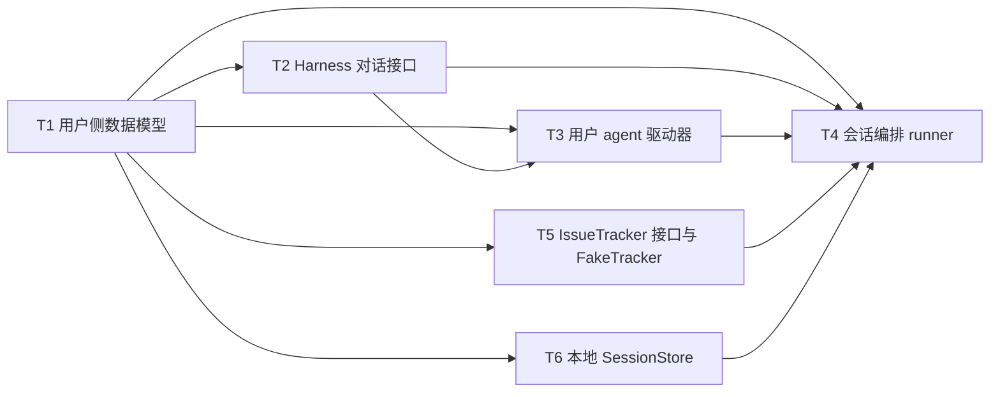

# 0001 用户 agent 使用 harness 的最小链路

> 本文件由 `spec render` 自动生成，请勿手工编辑。
> 内容来源：本组 `metadata.yaml` 与 `tasks/T*.yaml`（关联 issue #0）。

## 总览

本组实现进化闭环的 **a｜用户侧**：让 user agent 扮成真实用户，按 persona + 种子场景多轮使用 harness，产出两类信号——**体感评分**（训练信号）与 **issue**（bug/需求）。本组只搭「最小链路」，且全部用 Fake 后端，不依赖真 Gitea / 真 harness，可独立测；真后端由 0002（Gitea）、0003（harness）补齐。

数据流脊柱（贯穿 T1…T6，后面每个任务都挂在这条线上）：

```
Persona / SeedScenario ─► UserAgent(T3) ⇄ HarnessInterface(T2) ─► Transcript
                                  │
                                  ├─► FeelingScore 1–4(+理由) ─► SessionStore(T6) 落本地
                                  └─► IssueDraft 0..n ─[IssueTracker(T5)]► Gitea ─► IssueRef
        run_session(T4) 收集上述 ─► Session（结构由 T1 定义）
```

读图即读任务：**T1** 定全部数据结构（地基，被其余任务共用）；**T2** 定与 harness 的对话契约；**T3** 是训练信号的产生点（扮得像不像真人决定信号真不真）；**T5** 定 issue 的去向；**T6** 定体感落地；**T4** 把它们编排成「跑一局」的唯一入口 `run_session`。下游：0003 的闭环直接复用 `run_session`。

## 任务编排



| 任务 | 标题 | 优先级 | 状态 | 依赖 |
|----|----|----|----|----|
| T1 | 用户侧数据模型 | P1 | pending | — |
| T2 | Harness 对话接口 | P1 | pending | T1 |
| T3 | 用户 agent 驱动器 | P1 | pending | T1, T2 |
| T4 | 会话编排 runner | P1 | pending | T1, T2, T3, T5, T6 |
| T5 | IssueTracker 接口与 FakeTracker | P1 | pending | T1 |
| T6 | 本地 SessionStore | P1 | pending | T1 |

## 各任务方案

### T1 · 用户侧数据模型（P1 / pending）

**涉及文件**

- `backend/auto_designer/models.py`
- `backend/tests/test_models.py`

**做什么**

定义用户侧最小链路的公共数据结构，被 T2/T3/T4 共用。本组仅覆盖进化闭环的「用户侧」：
以 Persona 与 SeedScenario 为给定输入，经多轮对话产出一局 Session（含体感评分与 issue 草稿）。
给定输入：Persona（用户画像）、SeedScenario（种子场景）。产出结构：Transcript（对话记录）、
FeelingScore（1–4 体感评分及理由）、IssueDraft（用户 agent 产出的问题草稿 title/body/labels）、
IssueRef（issue 提交至 Gitea 后的回执 number/url/state）、Session（一局的完整封装）。本任务只定义
结构本身，要求纯数据、可双向序列化；对话与评分逻辑分别由 T2/T3/T4 实现。

**为什么**

整条进化闭环的训练信号来自「模拟真实使用」。要让信号可复现、可统计、可喂给开发者侧，
必须先把一局使用会话的输入与产出固化成稳定结构，再谈驱动与编排。

**范围**

定义用户侧七个公共数据结构及其序列化契约，按在一局会话中的角色分层：
- 给定输入：Persona（用户画像）、SeedScenario（种子场景）。
- 过程产物：Transcript（多轮对话记录）。
- 会话产出：FeelingScore（1–4 体感评分 + 理由）、IssueDraft（问题草稿 title/body/labels）、IssueRef（Gitea 回执 number/url/state）。
- 顶层封装：Session（聚合上述六者的一局完整记录）。
仅含数据定义与 to_dict/from_dict；对话驱动、评分、提交、落盘逻辑分属 T2–T6，不在本任务。

**整体设计**

全部用 dataclass，纯数据、无行为，可双向 dict/json 序列化。体感与 Session 落本地 data/sessions/；
issue 不落本地，由 IssueDraft 经 IssueTracker 提交至 Gitea，回执为 IssueRef。

数据流（本组覆盖范围）：

```
Persona ─┐
         ├─► UserAgent ⇄ HarnessInterface ─► Transcript
SeedScenario ─┘                │
                               ├─► FeelingScore (1-4 + reason)
                               └─► IssueDraft (0..n) ─[IssueTracker]→ Gitea ─► IssueRef
          run_session 收集 ─► Session(含 transcript/feeling/issue_refs)
```

字段约定：
- Persona：身份、水平、领域、目标、说话风格（给定输入，来源归后续 distill spec）。
- SeedScenario：初始诉求/任务描述（给定输入，非测试用例）。
- Transcript：有序 (role, content) 轮次列表，role ∈ {user, harness}。
- FeelingScore：score:int(1..4) + reason:str，一局一个（会话末产出）。
- IssueDraft：title/body/labels，用户 agent 产出，一局 0..n 条。
- IssueRef：number/url/state，Gitea 建 issue 后的回执。
- Session：session_id/created_at/persona/scenario/transcript/feeling/issue_refs。

序列化契约：
- to_dict 产出纯 JSON 可序列化结构：嵌套 dataclass 递归转 dict，datetime 转 ISO-8601 字符串；from_dict 为其逆。
- from_dict 遇未知键忽略，以兼容字段前向演化（旧代码读新数据不崩）。
- 选 json 而非 yaml 落盘：Session 按局逐条追加，json 行利于体感曲线/回归基线的流式统计；人读性交给 summary/OVERVIEW 视图。

不变量与校验位置：
- 轻量不变量在 __post_init__ 断言：FeelingScore.score ∈ 1..4；Transcript 每轮 role ∈ {user, harness}。越界即构造期失败，不引入外部校验器。

持久化边界：
- 体感与 Session 落本地 data/sessions/（由 T6 落盘）；issue 不落本地——其权威存储是 Gitea，本地只持 IssueRef 回执，杜绝双写漂移。

**接口**

models.py 暴露上述 dataclass 及其 to_dict/from_dict；不依赖其它模块，处于依赖图最底层。

**取舍**

- dataclass vs pydantic/attrs：选 dataclass（奥卡姆，零依赖）；运行时强校验的缺失由 __post_init__ 断言 + 单测兜底，将来若需 schema 导出再评估 pydantic。
- json vs yaml 落盘：选 json（逐条可追加、统计友好），牺牲人读性，人读交给生成视图。
- Session 嵌套 vs 扁平+外键：选嵌套（一局自包含、单文件可回放），代价是跨局聚合需遍历，规模小可接受。
- issue 本地副本 vs 仅存回执：选仅存 IssueRef，以 Gitea 为单一权威源，避免本地与远端双写不一致。

**验收标准**

- 七个 dataclass 均可构造，且 to_dict→from_dict round-trip 后字段级一致。
- FeelingScore.score 越界（0/5）在构造期断言失败；Transcript role 非法值同样被拒。
- IssueDraft.labels 缺省空列表；Session 在 0 条 issue 时 issue_refs 为空列表。
- datetime 字段序列化为 ISO-8601 且可逆。

**测试**

单测：
- 每个 dataclass round-trip(to_dict/from_dict) 字段级一致，含嵌套 Session→Transcript/FeelingScore/IssueRef。
- FeelingScore 越界(0/5) 构造期断言失败；Transcript role ∉ {user,harness} 被拒。
- IssueDraft.labels 缺省空列表；Session.issue_refs 默认空列表。
- datetime 序列化为 ISO-8601 字符串且 from_dict 可还原。
- from_dict 遇未知键忽略不报错（前向兼容）。

**参考**

CLAUDE.md「方法：模拟用户使用→开发者迭代」用户侧(a)。

**待解问题**

IssueDraft 的产出机制（谁/何时生成）见 T3 open-questions；其字段形态对齐 Gitea 建 issue 入参
(title/body/labels)，本任务取此三元组。

### T2 · Harness 对话接口（P1 / pending）

**涉及文件**

- `backend/auto_designer/harness/interface.py`
- `backend/tests/harness/test_interface.py`

**做什么**

将被使用的 harness 抽象为统一的多轮对话协议（HarnessInterface），使用户侧与具体 agent 实现解耦。
该协议是「被进化对象」（harness）与「评测脚手架」（用户侧）之间的稳定边界：用户侧仅依赖协议，
具体后端是一个「可启动程序」（内部可为单或多 nexau，由其入口脚本编排），通过 launcher 接入（见 spec-0003）。
本任务只定义协议并提供测试后端 FakeHarness。

**为什么**

CLAUDE.md 要求 harness 兼容 nexau / claude code / codex。用户侧只应依赖一个稳定的对话协议，
具体后端可替换；否则每换一个 agent 都要改用户侧。这也是「被进化对象」与「评测脚手架」解耦的边界。

**范围**

做什么：
- 定义 HarnessInterface 多轮对话协议（typing.Protocol），方法集为 send / reset / close。
- 提供测试后端 FakeHarness，支持以「回复脚本」或「回调」两种方式注入确定性回复，并记录收发序列供断言。
- 定义协议的状态机语义与调用契约（生命周期、幂等性、异常约定），使 T3/T4 可仅依赖协议编程。
不做什么：
- 不实现任何真实后端；launcher 启动 harness 程序并适配成本协议归 spec-0003。
- 协议不含流式输出、工具调用回执、token/用量统计、并发会话等扩展面（见 tradeoffs）。
- 不负责会话内容的语义（用户话术、终止判定属 T3；编排与落盘属 T4/T6）。

**整体设计**

协议契约（类型层面）：
HarnessInterface 用 typing.Protocol（structural typing）定义，三方法：
- send(message: str) -> str：发送一条用户消息，返回 harness 本轮的完整回复（非流式，单次返回整段文本）。message 非空由调用方保证；返回必为 str（可为空串，表示后端本轮无输出）。
- reset() -> None：丢弃当前会话的全部状态，使后端回到「新一局起点」。幂等：连续 reset 等价单次。
- close() -> None：释放后端资源（进程/连接/句柄）。幂等：重复 close 不报错。

状态机与时序：
- 合法生命周期为 (reset? · send* · close)。约定 reset 为开局显式动作，由编排方（T4 run_session）在每局起始调用，不在协议内自动触发，以保持协议无隐式状态。
- close 之后再调用 send/reset 的行为约定为「未定义，允许后端抛异常」；FakeHarness 选择抛 RuntimeError 以暴露误用。
- send 的调用序与 Transcript 的 user 轮次一一对应；harness 回复对应 harness 轮次。协议不持有 Transcript，转写由 T3 负责。

边界与错误处理：
- 协议层不规定重试与超时；后端可在 send 内部抛异常，异常向上传播由编排层（T4）决定处理策略，本协议不吞异常。
- 空回复（"")是合法返回，不等同于错误；调用方不得以空串推断失败。

关键决策（新决策，奥卡姆）：
- reply 取「整段非流式 str」而非迭代器/事件流：用户侧按轮记录 Transcript，逐轮整段即足；流式留待真实 nexau 接入暴露需求再扩。
- reset 显式而非隐式（不在 send 首次调用时自动复位）：保持协议无隐式状态，开局责任归属唯一（T4），便于测试。

FakeHarness 设计：
- 两种注入：script（有序 list[str]，按 send 次序逐条弹出，耗尽后的策略见 tradeoffs）或 callback（Callable[[str], str]，按入参动态产回复）。两者互斥，构造时择一。
- 内部记录 sent: list[str]（收到的全部 message）与调用计数，供单测断言收发序列与次数。
- reset 清空 sent 与脚本游标；close 置「已关闭」标志，之后 send/reset 抛 RuntimeError。

**接口**

HarnessInterface(Protocol):
- send(message: str) -> str
- reset() -> None
- close() -> None
FakeHarness(script: list[str] | None, callback: Callable[[str], str] | None)：script 与 callback 互斥，二者均空时回复退化为固定占位串。暴露只读属性 sent: list[str] 供断言。真实后端 launcher 见 spec-0003。

**取舍**

- 方法面只留 send/reset/close 三件套 vs 一开始就纳入流式/工具调用/用量统计：选三件套（奥卡姆）。后两类需求需真实 nexau 接入后才能定形，过早抽象会锁死错误的契约。
- 直接复用 harbor 的 episode/rollout 批式接口 vs 另立逐轮对话协议：选另立。harbor 接口为批式 rollout 设计，其输入输出粒度是 episode 而非单轮，套到「逐轮真人对话 + 用户自判终止」上需大量适配且语义错位。
- send 返回 str vs 返回结构体（含 metadata/usage）：选 str。当前用户侧只需回复文本写入 Transcript；附加元数据无消费方，YAGNI。
- reset 显式 vs send 隐式复位：选显式。隐式复位会把「开局」语义分散进 send，破坏单一职责并使「续局」无法表达。
- FakeHarness 脚本耗尽策略：选「耗尽后抛 IndexError 以暴露测试用例轮数设定不足」，而非静默循环或返回空串——后两者会掩盖 T3 终止逻辑跑飞（应由 max_turns 截断而非脚本兜底）。

**验收标准**

- HarnessInterface 三方法均有完整类型标注，且 FakeHarness 通过 isinstance/结构匹配满足该 Protocol。
- FakeHarness 以 script 注入时，多轮 send 按序返回脚本各条；以 callback 注入时，返回 callback(message)。
- script 与 callback 同时传入时构造期报错（互斥校验）。
- reset 后 sent 清空、脚本游标归零；可重新开局逐轮收发。
- close 后调用 send 或 reset 抛 RuntimeError；重复 close 不报错（幂等）。
- send 返回类型恒为 str，空回复以空串表达且不被判为错误。

**测试**

单测：
- script 注入：连续 send 三次按序返回脚本三条；sent 记录与传入 message 序列一致。
- callback 注入：send(x) 返回 callback(x)，验证动态回复随入参变化。
- 互斥校验：同时传 script 与 callback 构造期抛错；两者皆空时返回固定占位串。
- reset：send 两轮后 reset，sent 清空且脚本游标复位，再 send 从脚本首条开始。
- close：close 后 send 抛 RuntimeError、reset 抛 RuntimeError；连续两次 close 不抛错。
- 边界：script 耗尽后再 send 抛 IndexError（暴露轮数设定不足）；send 返回空串时不视为错误。

**参考**

CLAUDE.md 架构「被进化对象：harness 作为可启动程序」与「兼容 nexau / claude code / codex」。真实后端 launcher：spec-0003。typing.Protocol（PEP 544，结构化子类型）。

### T3 · 用户 agent 驱动器（P1 / pending）

**涉及文件**

- `backend/auto_designer/user/user_agent.py`
- `backend/tests/user/test_user_agent.py`

**做什么**

模拟真实用户：依据 Persona 与 SeedScenario 驱动与 harness 的多轮对话，由 agent 自主判定对话终止时机，
并在会话结束时产出体感评分（FeelingScore，1–4 及理由）。这是训练信号的产生点，信号的真实性取决于
该驱动器对真实使用行为（追问、绕路、卡顿、放弃）的拟真程度，而非机械跑满固定轮数。issue 产出在本任务
仅实现最小桩，具体机制待定。

**为什么**

这是训练信号的产生点。信号「真不真」取决于这个驱动器扮演得「像不像真人」——
会追问、会绕路、会卡住、会受够了放弃，而不是机械跑满固定轮数。

**范围**

做什么：
- 实现 persona 驱动的多轮对话循环：给定 Persona+SeedScenario，逐轮经 LLM 生成用户消息、调 harness.send 读回复、写入 Transcript。
- 实现「用户自判终止」：解析 LLM 输出中的结束信号即停，并以 max_turns 硬上限兜底。
- 会话结束后经 LLM 产出一条合法 FeelingScore（1–4 + reason）。
- issue 产出实现最小桩：会话末由 LLM 产 0..n 条 IssueDraft（方案 a，见 open-questions），不锁死机制。
不做什么：
- 不实现具体 LLM 客户端（模型后端由调用方注入），不定义提示词工程细节之外的模型路由/重试。
- 不提交 issue（提交归 T5/T4），不落盘（归 T6/T4），不构造 harness 后端（归 T2/T4）。
- 不做逐轮体感打分（决定见 tradeoffs：会话末一次性产出）。

**整体设计**

UserAgent 由注入的 LLM 后端驱动（本组不实现具体模型客户端）。LLM 后端抽象为一个可调用对象，
接收结构化对话上下文、返回文本，UserAgent 负责把 Persona/SeedScenario/Transcript 组织成提示并解析输出。

一局主循环（伪流程，非实现代码）：

```
reset 由编排层(T4)负责；UserAgent 仅消费已就绪的 harness
turn = 0
loop:
  user_msg, end_flag = parse(llm(persona, scenario, transcript))   # 生成本轮用户话 + 是否结束
  若 end_flag → break                                              # 自判：达成 / 放弃 / 受够
  reply = harness.send(user_msg)
  transcript.append(user 轮); transcript.append(harness 轮)
  turn += 1
  若 turn >= max_turns → break                                     # 兜底防不收敛
结束后:
  feeling = parse_feeling(llm(...))        # 1..4 + reason，会话末一次
  drafts  = parse_drafts(llm(...))         # 0..n 条 IssueDraft（最小桩，方案 a）
return (transcript, feeling, drafts)
```

接口契约（类型层面）：
- LLM 后端约定为 Callable，输入为已组织的上下文（persona/scenario/transcript 摘要），输出为文本；
  UserAgent 内部以三类解析器消费同一后端：消息生成解析（取 user_msg + end_flag）、体感解析（取 score:int + reason:str）、issue 解析（取 list[IssueDraft]）。
- 终止信号编码（新决策，奥卡姆）：约定 LLM 在消息输出中携带一个显式结束标记（如末行固定 sentinel 或约定字段），解析到即置 end_flag。沿用约定字符串而非引入函数调用/JSON schema 强约束，避免对模型后端形态过度假设；解析失败时按「未结束」处理并由 max_turns 收口。
- max_turns 计入「user 轮」数；达到上限时即便 LLM 未发结束信号也强制结束，保证可终止性。

边界与错误处理：
- max_turns <= 0 在构造期断言失败（无意义配置）。
- 体感解析越界（不在 1..4）依赖 FeelingScore.__post_init__（T1）在构造期失败；UserAgent 不重复校验，单一校验点。
- issue 解析得 0 条为合法（多数会话无 issue），返回空列表。
- harness.send 抛异常时不在本层吞掉，向上传播交 T4 决定（与 T2 协议约定一致）。

时序约束：
- 体感与 issue 均在循环**结束后**产出，符合「会话末一个总分」的需求决定；不在循环内逐轮打分。

**接口**

UserAgent(llm: Callable[..., str], persona: Persona, max_turns: int)
- run(scenario: SeedScenario, harness: HarnessInterface) -> tuple[Transcript, FeelingScore, list[IssueDraft]]
max_turns > 0 由构造期断言保证；run 不调用 harness.reset/close（生命周期归编排层 T4）。

**取舍**

- 体感/issue 会话末一次产出 vs 逐轮产出：选会话末（采纳决定）。信号更干净、实现更简，且对齐「一局一个总分」的 FeelingScore 形态；代价是丢失「第几轮开始变差」的细粒度，后续若需要再开 spec 升级为逐轮。
- 自判终止 vs 固定轮数：选自判 + max_turns 兜底。固定轮数无法表达「达成即停 / 受够放弃」的真实行为，使训练信号失真；纯自判则有不收敛风险，故以 max_turns 收口。
- 终止信号用约定 sentinel/字段 vs 强制 JSON/工具调用 schema：选约定文本（奥卡姆）。后者对模型后端形态做强假设，与「兼容多种 agent/模型」相悖；解析失败安全降级为「未结束」。
- issue 产出方案 a（in-character 末尾产出）vs b（独立分析器读 transcript 归纳）vs c（两步：标摩擦点+归纳）：本组选 a 的最小桩，不锁死。a 实现最省且足以打通链路；b/c 更准但引入额外组件，待 dev 侧 spec 对接需求时再定。
- LLM 后端注入为通用 Callable vs 绑定具体客户端类：选注入 Callable，使单测可用 mock 固定脚本、运行时换真实模型，符合依赖倒置。

**验收标准**

- 用 FakeHarness + mock LLM 可跑通一局多轮对话，Transcript 轮次与 harness 收发序列一致。
- 自判终止生效：mock LLM 在第 k 轮发结束信号时，会话恰好进行 k 轮。
- max_turns 兜底生效：mock LLM 永不发结束信号时，user 轮数恰为 max_turns。
- 会话末产出合法 FeelingScore（score ∈ 1..4，含 reason）；越界分数在构造期失败。
- issue 桩产出 0..n 条 IssueDraft，0 条时返回空列表。
- max_turns <= 0 构造期断言失败。
- run 全程不调用 harness.reset/close。

**测试**

单测（mock LLM 返回固定脚本）：
- 三轮后发结束信号 → 会话恰好三轮，Transcript 含 3 个 user 轮 + 3 个 harness 轮。
- 永不结束 → user 轮数恰为 max_turns（截断生效）。
- 体感解析：score 落在 1..4 且携带 reason；构造合法 FeelingScore。
- FakeHarness 收到的 message 序列与 Transcript 的 user 轮内容逐条一致。
- issue 桩：mock 产 0 条 → 返回空列表；产 2 条 → 返回 2 条 IssueDraft 且字段完整。
- 边界/失败：max_turns <= 0 构造期断言失败；体感解析得 5（越界）经 FeelingScore 构造期失败；结束信号缺失时按未结束处理并由 max_turns 收口。
- harness.send 抛异常时 run 不吞异常，向上传播。

**参考**

CLAUDE.md 用户侧(a)：体感评分 + issue。会话末总分的决定见本 spec 需求澄清。

**待解问题**

issue 产出机制待定（用户已确认「类似往 github 提 issue，具体 TBD」）。候选：
(a) UserAgent 直接 in-character 产出 IssueDraft；
(b) 单独分析器读完 transcript 再归纳；
(c) 两步：标摩擦点 + 归纳。
本组先实现 (a) 的最小桩（LLM 末尾产 0..n 条 draft），不锁死，待后续 dev 侧 spec 对接需求时定。

### T4 · 会话编排 runner（P1 / pending）

**涉及文件**

- `backend/auto_designer/user/session.py`
- `backend/tests/user/test_session.py`

**做什么**

用户侧的最小可用入口：单一无状态函数将 Persona、SeedScenario、HarnessInterface 与 UserAgent
编排为一局会话，收集 Transcript、FeelingScore 与 IssueDraft，返回结构化的 Session。所有依赖由参数注入，
runner 自身不构造任何后端，便于测试替换与上层（loop 编排、metrics 统计）复用。

**为什么**

闭环编排（loop/）和统计（metrics/）都需要一个稳定的「跑一局」入口。把组装逻辑收在 runner，
上层只管喂输入、收 Session，不关心内部怎么对话。

**范围**

做什么：
- 提供单一无状态入口函数 run_session，编排一局完整会话。
- 负责 harness 的生命周期（开局 reset、收尾 close），调用 UserAgent.run 取 (Transcript, FeelingScore, drafts)。
- 将每条 IssueDraft 经 IssueTracker 提交，收集 IssueRef；组装 Session 并经 SessionStore 落盘后返回。
- 全部依赖经参数注入，runner 自身不构造任何后端。
不做什么：
- 不构造 harness / llm / tracker / store（由调用方注入）。
- 不做跨会话并发/批量编排（归 loop/ 层），不做 issue 曲线统计（归 metrics/ 层）。
- 不实现对话逻辑（T3）、提交逻辑（T5）、持久化逻辑（T6）本身，只做编排与生命周期管理。

**整体设计**

单一入口函数，无状态、依赖注入：

```
run_session(persona, scenario, harness, user_agent, tracker, store) -> Session:
    harness.reset()                                          # 开局（生命周期归编排层）
    try:
        transcript, feeling, drafts = user_agent.run(scenario, harness)
    finally:
        harness.close()                                      # 无论成败都释放后端资源
    issue_refs = [tracker.create_issue(d) for d in drafts]   # 逐条提交至 tracker
    session = Session(persona, scenario, transcript, feeling, issue_refs)
    store.save(session)                                      # 体感 + session 落本地
    return session
```

生命周期与时序契约：
- reset 在 user_agent.run 之前调用，对应 T2「开局责任归编排层」的约定；UserAgent 自身不 reset/close。
- close 置于 finally（新决策，奥卡姆）：UserAgent.run 抛异常时仍保证 harness 资源释放，避免后端句柄泄漏；异常本身继续向上传播。
- 提交与落盘在 run 成功返回后进行；run 抛异常时不产生 IssueRef、不落盘（保持「失败局不留半成品」）。
- issue_refs 顺序与 drafts 顺序一一对应；0 条 draft 时 issue_refs 为空列表。

错误处理边界：
- tracker.create_issue 或 store.save 抛异常时，本层不吞，直接向上传播（编排/重试策略归 loop 层）。
- run_session 不做重试、不做幂等去重；同一局重复调用产生重复提交，调用方负责不重复调用。

依赖注入面：
- harness 满足 HarnessInterface（T2），user_agent 为 UserAgent（T3），tracker 满足 IssueTracker（T5），store 为 SessionStore（T6）。
- 测试以 FakeHarness + mock LLM + FakeTracker + 临时目录 SessionStore 全替换；运行时注入真实 launcher/Gitea/本地盘。

**接口**

run_session(persona: Persona, scenario: SeedScenario, harness: HarnessInterface, user_agent: UserAgent, tracker: IssueTracker, store: SessionStore) -> Session
纯函数、无返回副本之外的全局状态；harness 生命周期（reset/close）由本函数负责，close 在 finally 中保证执行。

**取舍**

- 纯函数 + 依赖注入 vs SessionRunner 类持有依赖：选纯函数（奥卡姆）。本组无跨会话共享状态，类只会引入无谓的生命周期；并发/批量需求出现时在 loop/ 层包装，不污染本入口。
- harness 生命周期归 run_session vs 归 UserAgent：选 run_session。reset/close 是编排关注点，放 UserAgent 会让其同时承担「对话」与「资源管理」双职责，违背单一职责且妨碍 T3 单测（须 mock 生命周期）。
- close 放 finally vs 放正常流末尾：选 finally。后者在 run 抛异常时会泄漏后端资源；finally 保证释放且不掩盖异常。
- 失败局是否落盘 vs 仅成功落盘：选仅成功落盘。半成品 Session（缺 feeling/transcript）落盘会污染体感曲线与回归基线，宁可丢失失败局记录，由 loop 层按需补记。
- 提交失败是否回滚已落盘 session vs 不回滚：本组提交在落盘前、且失败即向上抛，落盘根本不发生，无需回滚逻辑（顺序天然规避）。

**验收标准**

- 用 Fake(harness/tracker/store) + mock LLM 端到端返回完整 Session（含 persona/scenario/transcript/feeling/issue_refs）。
- harness.reset 与 harness.close 各恰调一次，且 reset 先于 user_agent.run、close 在其后（或异常时仍执行）。
- 每条 draft 经 tracker.create_issue 得到带号 IssueRef，issue_refs 顺序与 drafts 对应。
- 0 条 draft 时 issue_refs 为空列表且 store 仍落盘该局。
- store 已写盘该 Session（可经 load 还原）。
- 提前放弃的会话其 user 轮数 < max_turns，且仍返回完整 Session。
- user_agent.run 抛异常时 harness.close 仍被调用，且不落盘、不提交。

**测试**

集成测（FakeHarness + mock LLM + FakeTracker + 临时目录 store）：
- 正常结束：run_session 返回 Session，含 transcript/feeling/issue_refs；断言字段齐全。
- 生命周期：harness.reset/close 各调一次，调用顺序为 reset → run → close。
- 提交：2 条 draft → tracker 产 2 条带号 IssueRef，顺序与 drafts 一致；0 条 draft → issue_refs 为空列表。
- 落盘：run_session 后经 store.load(session_id) 还原等价 Session。
- 提前放弃：mock LLM 早发结束信号，断言 user 轮数 < max_turns 且 Session 完整。
- 失败路径：mock UserAgent.run 抛异常 → harness.close 仍被调用、异常向上传播、store 未写盘、tracker 未收到提交。

**参考**

CLAUDE.md 用户侧(a)。下游：loop/ 编排 a→b→c、metrics/ 统计 issue 曲线。本函数为 0003 闭环复用的唯一入口。

### T5 · IssueTracker 接口与 FakeTracker（P1 / pending）

**涉及文件**

- `backend/auto_designer/tracker/base.py`
- `backend/auto_designer/tracker/fake.py`
- `backend/tests/tracker/test_fake.py`

**做什么**

将 issue 的提交去向抽象为 IssueTracker 接口，使用户侧不绑定具体 tracker 后端。本任务定义接口并提供
内存实现 FakeTracker，使 run_session 在无 Gitea 环境下可端到端测试；真实 GiteaTracker 实现归 spec-0002。

**为什么**

issue 最终提交至 Gitea，但用户侧逻辑与单测不应依赖一个运行中的服务。以接口隔离后端：
测试用 FakeTracker，运行时注入 GiteaTracker，二者对 run_session 等价。

**范围**

做什么：
- 定义 IssueTracker 协议（typing.Protocol），方法集为 ensure_labels / create_issue / add_comment / set_state。
- 明确各方法的类型契约、发号与状态语义，使其与 Gitea 后端语义对齐（FakeTracker 与 GiteaTracker 对 run_session 等价）。
- 提供内存实现 FakeTracker：自增发号、维护 issue 表与标签集，供单测与无 Gitea 环境端到端跑通。
不做什么：
- 不实现真实 GiteaTracker（HTTP 客户端、鉴权、重试）——归 spec-0002。
- 不照搬 Gitea 全量 API（里程碑、指派、搜索、分页等不纳入）。
- 不负责何时产 IssueDraft（归 T3）、何时调用提交（归 T4）。

**整体设计**

协议契约（类型层面）：IssueTracker 用 typing.Protocol（structural typing）定义：
- ensure_labels(names: list[str]) -> None：确保给定标签均存在。幂等：已存在的标签不重复创建；Gitea 后端在此先建标签并解析 id，FakeTracker 仅维护名称集合。
- create_issue(draft: IssueDraft) -> IssueRef：依据 draft.title/body/labels 建 issue，返回带号回执 IssueRef(number, url, state)。新建 issue 初始 state 为 "open"。
- add_comment(number: int, body: str) -> None：向指定 issue 追加评论。number 不存在时抛 KeyError（FakeTracker 约定），Gitea 后端对应 404。
- set_state(number: int, state: str, reason: str) -> None：改状态。state ∈ {"open", "closed"}，reason 记录变更原因（对齐 Gitea state_reason 语义）。number 不存在时抛 KeyError。

发号与一致性语义：
- number 由后端单调递增发放，从 1 起，每实例独立计数（FakeTracker 语义对齐 Gitea 的实例内自增）。
- IssueRef.url 由后端按其 number 合成（FakeTracker 用占位前缀 + number 拼出确定性 url，供断言）。
- create_issue 不去重：相同 draft 多次提交得到不同 number（与 Gitea 行为一致，去重责任在调用方）。

边界与错误处理：
- 对不存在的 number 调用 add_comment/set_state 抛 KeyError（新决策，奥卡姆：以标准异常表达「未找到」，不自定义异常类型）。
- set_state 传入非法 state（不在 {open,closed}）抛 ValueError。
- ensure_labels 传入空列表为合法 no-op。

FakeTracker 实现：
- 内存结构：_counter: int（发号游标）、_issues: dict[int, dict]（number → {title, body, labels, state, reason, comments}）、_labels: set[str]。
- create_issue 递增 _counter、写入 _issues、返回 IssueRef；语义对齐 Gitea 但无网络/持久化。
- 暴露只读查询（如按 number 取 issue 快照）供单测断言 comment/state 生效。

**接口**

IssueTracker(Protocol):
- ensure_labels(names: list[str]) -> None
- create_issue(draft: IssueDraft) -> IssueRef
- add_comment(number: int, body: str) -> None
- set_state(number: int, state: str, reason: str) -> None
FakeTracker()：内存实现，发号自 1 起单调递增；暴露按 number 读取 issue 快照的只读查询供断言。

**取舍**

- 协议方法只取四项（建/评论/改状态/建标签）vs 照搬 Gitea 全量 API：选四项（奥卡姆）。这是 issue 闭环的最小充分集；里程碑/指派/搜索等无当前消费方，待 dev 侧需要再扩。
- typing.Protocol（结构化）vs ABC 抽象基类（名义继承）：选 Protocol。FakeTracker 与 GiteaTracker 无需显式继承即满足契约，降低耦合，便于测试替身。
- 「未找到」用标准 KeyError vs 自定义 TrackerNotFound 异常：选 KeyError（奥卡姆）。当前无需区分错误类别，标准异常足够；若后续需统一错误码再引入异常层级。
- FakeTracker 每实例独立发号 vs 全局发号：选每实例独立。与 Gitea「按仓库实例计数」语义一致，且使单测互不串号、可独立断言。
- create_issue 去重 vs 不去重：选不去重，与 Gitea 一致，去重责任归调用方，避免在接口层引入隐式幂等假设。

**验收标准**

- IssueTracker 四方法均有完整类型标注，FakeTracker 结构匹配满足该 Protocol。
- create_issue 返回 IssueRef，number 从 1 起单调递增，初始 state 为 "open"，url 由 number 确定性合成。
- add_comment 后该 issue 评论列表含该 body；set_state 后 state/reason 被更新。
- ensure_labels 幂等：重复传入同名标签不重复创建；空列表为 no-op。
- 对不存在 number 调用 add_comment/set_state 抛 KeyError；set_state 非法 state 抛 ValueError。
- 同一 draft 两次 create_issue 得到两个不同 number（不去重）。

**测试**

单测：
- create_issue 连续两次发号 1、2，返回 IssueRef 字段（number/url/state="open"）正确。
- add_comment：提交后按 number 读快照，评论列表含该 body。
- set_state：closed + reason 后快照状态更新；再 set_state open 可还原。
- ensure_labels 幂等：同名标签两次调用后标签集无重复；空列表 no-op。
- 边界/失败：不存在 number 调 add_comment/set_state 抛 KeyError；set_state 传非法 state 抛 ValueError。
- 不去重：相同 draft 两次 create_issue 得到不同 number。

**参考**

CLAUDE.md 架构「状态去向：issue → Gitea」。GiteaTracker 实现：spec-0002。IssueDraft/IssueRef 结构：T1。typing.Protocol（PEP 544）。

### T6 · 本地 SessionStore（P1 / pending）

**涉及文件**

- `backend/auto_designer/user/session_store.py`
- `backend/tests/user/test_session_store.py`

**做什么**

将一局 Session 持久化到本地：全量文件 + 一个总索引。索引承载体感曲线与回归基线所需的最小信息
（session_id、体感分、时间），无需打开全量文件即可统计。

**为什么**

体感是训练信号，必须可追溯、可统计。Session 全量留作证据，索引供 loop/metrics 画 issue/体感曲线、
供 dev 侧取回归基线。

**范围**

做什么：
- 将一局 Session 全量持久化为 root/<session_id>.json（证据文件）。
- 维护单一总索引 root/index.json，每局追加一条最小统计记录 {session_id, score, created_at, n_issues}。
- 提供按 id 读回全量、读总索引的能力，供 loop/metrics 画体感与 issue 曲线、供 dev 侧取回归基线。
不做什么：
- 不做数据库/外部存储；不做查询引擎（按字段过滤/聚合归 metrics 层消费索引）。
- 不处理并发写索引的竞态（单进程 MVP，并发归 loop 层并行时再解决）。
- 不负责 Session 的产生（归 T4）与序列化契约本身（归 T1 的 to_dict/from_dict）。

**整体设计**

SessionStore(root: str | Path) 提供：
- save(session: Session) -> None：写 root/<session_id>.json（经 Session.to_dict 全量序列化），并向 root/index.json 追加一条 {session_id, score, created_at, n_issues}。root 不存在时自动创建。
- load(session_id: str) -> Session：读 root/<session_id>.json 经 Session.from_dict 还原全量。文件不存在抛 FileNotFoundError。
- index() -> list[dict]：读 root/index.json 全部条目；索引不存在时返回空列表。

索引派生语义：
- score 取自 session.feeling.score；created_at 取自 session.created_at（ISO-8601 字符串）；n_issues 取 len(session.issue_refs)。索引条目是全量文件的派生投影，全量文件为唯一权威，索引可由全量重建。

写入边界与时序：
- 写全量文件与追加索引为两步；约定「先写全量文件、后追加索引」（新决策，奥卡姆）：若中途失败，至多出现「有全量文件但索引缺该条」，可由全量重建索引；反之「有索引无证据」不可恢复，故避免。
- 索引追加用「读-改-写」单文件：load 现有 index → append 新条 → 整体写回。MVP 单进程足够。
- 同一 session_id 重复 save 覆盖全量文件，但索引会追加重复条目（新决策：save 不做索引去重，去重责任归调用方/metrics 消费侧；保持 save 简单且与 T4「不重复调用」约定一致）。

错误处理：
- load 不存在的 id 抛 FileNotFoundError（标准异常，不自定义）。
- index() 在索引文件缺失时返回空列表而非抛错（首次运行无索引为合法初始态）。

**接口**

SessionStore(root: str | Path)
- save(session: Session) -> None
- load(session_id: str) -> Session
- index() -> list[dict]
root 不存在时由 save 自动创建；load 不存在 id 抛 FileNotFoundError；index 缺失时返回空列表。

**取舍**

- 一文件一局 + 单总索引 vs 数据库（sqlite 等）：选文件（奥卡姆）。规模小、写少读少，文件零依赖且全量即证据；规模增大或需复杂查询时再迁移。
- 单 index.json 全量「读-改-写」vs 追加式 JSONL 索引：选单 JSON 文件，便于 index() 一次性读回为 list[dict]；代价是每次 save 重写整文件，规模小可接受。若局数膨胀至重写成本显著，再切 JSONL 追加。
- 索引派生自全量、全量为权威 vs 索引为权威：选全量权威。索引可由全量重建，避免双权威漂移；这也决定了「先写全量后追加索引」的顺序。
- save 索引去重 vs 不去重：选不去重（奥卡姆）。去重需先扫索引，增加每次 save 成本；重复 save 由 T4「不重复调用」约定规避，去重归消费侧。
- 并发安全（文件锁）vs 不处理：本任务不处理，单进程 MVP；并发由 loop 层并行编排时统一解决，避免在存储层过早引入锁复杂度。

**验收标准**

- save(session) 写出 root/<session_id>.json 全量文件，并在 root/index.json 追加一条含 {session_id, score, created_at, n_issues}。
- root 目录不存在时 save 自动创建。
- load(session_id) 还原与原 Session 字段级等价（依赖 T1 round-trip）。
- index() 返回的条目 score 等于 session.feeling.score、created_at 为 ISO-8601、n_issues 等于 issue_refs 长度。
- load 不存在 id 抛 FileNotFoundError；首次 index()（无索引文件）返回空列表。
- 同一 session 两次 save：全量文件被覆盖，索引出现两条（不去重）。

**测试**

单测：
- save 后全量文件与 index 均出现该局；index 条目字段（session_id/score/created_at/n_issues）正确。
- load 还原等价 Session（字段级一致，含 transcript/feeling/issue_refs）。
- root 不存在时 save 自动建目录后成功写入。
- index() 在无索引文件时返回空列表；多局 save 后 index() 按写入顺序返回多条。
- n_issues 与 issue_refs 长度一致（0 条 issue 时 n_issues=0）。
- 边界/失败：load 不存在 id 抛 FileNotFoundError；同一 session 两次 save 后全量被覆盖、索引含两条。

**参考**

CLAUDE.md 架构「状态去向：体感 + session → 本地」；观测指标「issue 数量随时间曲线」。下游 loop/metrics 消费索引。Session 序列化契约：T1。
