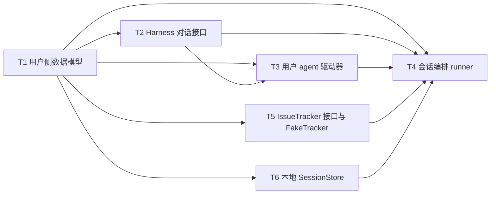

# 0001 用户 agent 使用 harness 的最小链路

> 本文件由 `spec render` 自动生成，请勿手工编辑。
> 内容来源：本组 `metadata.yaml` 与 `tasks/T*.yaml`（关联 issue #0）。

## 总览

本组实现进化闭环的 **a｜用户侧**：让 user agent 扮成真实用户，按 persona + 种子场景多轮使用 harness，产出两类信号——**体感评分**（训练信号）与 **issue**（bug/需求）。本组只搭「最小链路」，且全部用 Fake 后端，不依赖真 Gitea / 真 harness，可独立测；真后端由 0002（Gitea）、0003（harness）补齐。

数据流脊柱（贯穿 T1…T6，后面每个任务都挂在这条线上）：

```
Persona / SeedScenario ─► UserAgent(T3) ⇄ HarnessInterface(T2) ─► Transcript
                                  │
                                  ├─► FeelingScore 1–4(+理由) ─► SessionStore(T6) 落本地
                                  └─► IssueDraft 0..n ─[IssueTracker(T5)]► Gitea ─► IssueRef
        run_session(T4) 收集上述 ─► Session（结构由 T1 定义）
```

读图即读任务：**T1** 定全部数据结构（地基，被其余任务共用）；**T2** 定与 harness 的对话契约；**T3** 是训练信号的产生点（扮得像不像真人决定信号真不真）；**T5** 定 issue 的去向；**T6** 定体感落地；**T4** 把它们编排成「跑一局」的唯一入口 `run_session`。下游：0003 的闭环直接复用 `run_session`。

## 任务编排



| 任务 | 标题 | 优先级 | 状态 | 依赖 |
|----|----|----|----|----|
| T1 | 用户侧数据模型 | P1 | pending | — |
| T2 | Harness 对话接口 | P1 | pending | T1 |
| T3 | 用户 agent 驱动器 | P1 | pending | T1, T2 |
| T4 | 会话编排 runner | P1 | pending | T1, T2, T3, T5, T6 |
| T5 | IssueTracker 接口与 FakeTracker | P1 | pending | T1 |
| T6 | 本地 SessionStore | P1 | pending | T1 |

## 各任务方案

### T1 · 用户侧数据模型（P1 / pending）

**涉及文件**

- `src/auto_designer/models.py`
- `tests/test_models.py`

**做什么**

定义用户侧最小链路的公共数据结构，被 T2/T3/T4 共用。本组仅覆盖进化闭环的「用户侧」：
以 Persona 与 SeedScenario 为给定输入，经多轮对话产出一局 Session（含体感评分与 issue 草稿）。
给定输入：Persona（用户画像）、SeedScenario（种子场景）。产出结构：Transcript（对话记录）、
FeelingScore（1–4 体感评分及理由）、IssueDraft（用户 agent 产出的问题草稿 title/body/labels）、
IssueRef（issue 提交至 Gitea 后的回执 number/url/state）、Session（一局的完整封装）。本任务只定义
结构本身，要求纯数据、可双向序列化；对话与评分逻辑分别由 T2/T3/T4 实现。

**为什么**

整条进化闭环的训练信号来自「模拟真实使用」。要让信号可复现、可统计、可喂给开发者侧，
必须先把一局使用会话的输入与产出固化成稳定结构，再谈驱动与编排。

**范围**

定义用户侧核心数据结构：Persona、SeedScenario（均为给定输入）、Session/Transcript、FeelingScore(1-4+理由)、IssueDraft(github 风格 title/body/labels)。

**整体设计**

全部用 dataclass，纯数据、无行为，可双向 dict/json 序列化。体感与 Session 落本地 data/sessions/；
issue 不落本地，由 IssueDraft 经 IssueTracker 提交至 Gitea，回执为 IssueRef。

数据流（本组覆盖范围）：

```
Persona ─┐
         ├─► UserAgent ⇄ HarnessInterface ─► Transcript
SeedScenario ─┘                │
                               ├─► FeelingScore (1-4 + reason)
                               └─► IssueDraft (0..n) ─[IssueTracker]→ Gitea ─► IssueRef
          run_session 收集 ─► Session(含 transcript/feeling/issue_refs)
```

字段约定：
- Persona：身份、水平、领域、目标、说话风格（给定输入，来源归后续 distill spec）。
- SeedScenario：初始诉求/任务描述（给定输入，非测试用例）。
- Transcript：有序 (role, content) 轮次列表，role ∈ {user, harness}。
- FeelingScore：score:int(1..4) + reason:str，一局一个（会话末产出）。
- IssueDraft：title/body/labels，用户 agent 产出，一局 0..n 条。
- IssueRef：number/url/state，Gitea 建 issue 后的回执。
- Session：session_id/created_at/persona/scenario/transcript/feeling/issue_refs。

**接口**

models.py 暴露上述 dataclass 及其 to_dict/from_dict；不依赖其它模块，处于依赖图最底层。

**取舍**

选 dataclass 而非 pydantic：奥卡姆，零额外依赖，校验逻辑（如 score∈1..4）放构造后的轻量断言即可。
代价是没有运行时强校验，靠单测兜底。

**验收标准**

各 dataclass 可构造、可序列化为 dict/json；FeelingScore 限定 1-4；单测覆盖序列化与边界。

**测试**

单测：每个 dataclass round-trip(to_dict/from_dict) 一致；FeelingScore 越界(0/5)断言失败；
IssueDraft labels 缺省为空列表。

**参考**

CLAUDE.md「方法：模拟用户使用→开发者迭代」用户侧(a)。

**待解问题**

IssueDraft 的产出机制（谁/何时生成）见 T3 open-questions；其字段形态对齐 Gitea 建 issue 入参
(title/body/labels)，本任务取此三元组。

### T2 · Harness 对话接口（P1 / pending）

**涉及文件**

- `src/auto_designer/harness/interface.py`
- `tests/harness/test_interface.py`

**做什么**

将被使用的 harness 抽象为统一的多轮对话协议（HarnessInterface），使用户侧与具体 agent 实现解耦。
该协议是「被进化对象」（harness）与「评测脚手架」（用户侧）之间的稳定边界：用户侧仅依赖协议，
具体后端是一个「可启动程序」（内部可为单或多 nexau，由其入口脚本编排），通过 launcher 接入（见 spec-0003）。
本任务只定义协议并提供测试后端 FakeHarness。

**为什么**

CLAUDE.md 要求 harness 兼容 nexau / claude code / codex。用户侧只应依赖一个稳定的对话协议，
具体后端可替换；否则每换一个 agent 都要改用户侧。这也是「被进化对象」与「评测脚手架」解耦的边界。

**范围**

定义 HarnessInterface 协议：多轮对话(send(message)->reply、reset、close)；提供 FakeHarness 测试后端。真实后端（launcher 启动 harness 程序并接成本协议）归 spec-0003。

**整体设计**

HarnessInterface 用 typing.Protocol 定义，三个方法：
- send(message: str) -> str：发一条用户消息，返回 harness 这一轮的完整回复。
- reset() -> None：清空会话状态，开新一局。
- close() -> None：释放后端资源。

本组只提供 FakeHarness：可注入「回复脚本」或回调，供 T3/T4 单测在无真实模型下跑通多轮。
真实后端是一个可启动程序（内部 1 或 N 个 nexau），由 spec-0003 的 launcher 启动并适配成本协议——
HarnessInterface 对其为黑盒，不感知内部 agent 数量与编排。

用户侧只 import HarnessInterface，不 import 具体后端——后端在 runner 入口注入。

**接口**

HarnessInterface(Protocol): send/reset/close。FakeHarness(script|callback)。真实后端 launcher 见 spec-0003。

**取舍**

方法面故意只留 send/reset/close 三件套（奥卡姆）：流式、工具调用、token 统计等先不进协议，
等真实 nexau 接入暴露需求再扩，避免过早抽象。
备选：直接复用 harbor 的 episode 接口——但那是为 rollout 设计的批式接口，套到「逐轮真人对话」上别扭，故另立轻协议。

**验收标准**

HarnessInterface 协议有类型标注；FakeHarness 可多轮收发并被 mock（按脚本/回调返回）；reset 后状态清空。

**测试**

单测：FakeHarness 按注入脚本逐轮返回；reset 后重置；send 调用顺序与内部记录一致。

**参考**

CLAUDE.md 架构「被进化对象：harness 作为可启动程序」。真实后端 launcher：spec-0003。

### T3 · 用户 agent 驱动器（P1 / pending）

**涉及文件**

- `src/auto_designer/user/user_agent.py`
- `tests/user/test_user_agent.py`

**做什么**

模拟真实用户：依据 Persona 与 SeedScenario 驱动与 harness 的多轮对话，由 agent 自主判定对话终止时机，
并在会话结束时产出体感评分（FeelingScore，1–4 及理由）。这是训练信号的产生点，信号的真实性取决于
该驱动器对真实使用行为（追问、绕路、卡顿、放弃）的拟真程度，而非机械跑满固定轮数。issue 产出在本任务
仅实现最小桩，具体机制待定。

**为什么**

这是训练信号的产生点。信号「真不真」取决于这个驱动器扮演得「像不像真人」——
会追问、会绕路、会卡住、会受够了放弃，而不是机械跑满固定轮数。

**范围**

实现 persona 驱动的多轮对话：给定 Persona+SeedScenario，逐轮生成用户消息、读 harness 回复、由 agent 自判会话结束；结束时产出 FeelingScore(1-4+理由)。issue 产出留最小桩(github 风格 draft)，机制 TBD。

**整体设计**

UserAgent 由一个 LLM 后端驱动（注入，不在本组实现具体模型客户端）。一局循环：

```
loop:
  user_msg = llm(persona, scenario, transcript)        # 生成这一轮用户话
  若 user_msg 标记结束 → break                          # 自判：达成/放弃/受够
  reply = harness.send(user_msg); 记进 transcript
结束后:
  feeling = llm 给 1-4 + reason                          # 会话末总分
  issues  = llm 产出 0..n 条 IssueDraft（机制待定，见 open-questions）
```

「自判结束」靠提示词让 LLM 在话里带一个结束信号（如特定标记/字段），驱动器解析到即停；
另设硬上限 max_turns 兜底防不收敛。体感与 issue 都在会话**结束后**一次性产出（符合「会话末一个总分」的决定）。

**接口**

UserAgent(llm, persona, max_turns).run(scenario, harness) -> (Transcript, FeelingScore, list[IssueDraft])

**取舍**

体感与 issue 都放会话末、不逐轮：信号更干净、实现更简单（采纳的决定），代价是丢失「第几轮开始变差」的细粒度，
后续若需要再开 spec 升级为逐轮。
自判结束 vs 固定轮数：选自判（更像真人），用 max_turns 兜底防跑飞。

**验收标准**

用 FakeHarness 跑通一局多轮对话；自判结束生效(达成/放弃/受够);末尾产出合法 FeelingScore;单测以 mock LLM 固定输出验证流程。

**测试**

mock LLM 返回固定脚本：① 三轮后发结束信号→会话恰好三轮；② 永不结束→max_turns 截断；
③ 体感分落在 1-4；④ FakeHarness 收到的消息序列与 transcript 一致。

**参考**

CLAUDE.md 用户侧(a)：体感评分 + issue。会话末总分的决定见本 spec 需求澄清。

**待解问题**

issue 产出机制待定（用户已确认「类似往 github 提 issue，具体 TBD」）。候选：
(a) UserAgent 直接 in-character 产出 IssueDraft；
(b) 单独分析器读完 transcript 再归纳；
(c) 两步：标摩擦点 + 归纳。
本组先实现 (a) 的最小桩（LLM 末尾产 0..n 条 draft），不锁死，待后续 dev 侧 spec 对接需求时定。

### T4 · 会话编排 runner（P1 / pending）

**涉及文件**

- `src/auto_designer/user/session.py`
- `tests/user/test_session.py`

**做什么**

用户侧的最小可用入口：单一无状态函数将 Persona、SeedScenario、HarnessInterface 与 UserAgent
编排为一局会话，收集 Transcript、FeelingScore 与 IssueDraft，返回结构化的 Session。所有依赖由参数注入，
runner 自身不构造任何后端，便于测试替换与上层（loop 编排、metrics 统计）复用。

**为什么**

闭环编排（loop/）和统计（metrics/）都需要一个稳定的「跑一局」入口。把组装逻辑收在 runner，
上层只管喂输入、收 Session，不关心内部怎么对话。

**范围**

编排一局会话：加载 Persona+SeedScenario → 用 UserAgent 驱动 HarnessInterface → 收集 Transcript+FeelingScore+IssueDraft → 返回结构化 Session。这是 user 侧最小可用入口。

**整体设计**

单一入口函数，无状态：

```
run_session(persona, scenario, harness, user_agent, tracker, store) -> Session:
    harness.reset()
    transcript, feeling, drafts = user_agent.run(scenario, harness)
    harness.close()
    issue_refs = [tracker.create_issue(d) for d in drafts]   # 提交至 Gitea
    session = Session(persona, scenario, transcript, feeling, issue_refs)
    store.save(session)                                       # 体感+session 落本地
    return session
```

依赖全部从参数注入（harness 后端、user_agent 的 llm、tracker、store 均由调用方给），runner 自身不构造任何后端——
便于测试用 Fake(FakeHarness + FakeTracker + 临时目录 store)，便于上层注入真实 Gitea。

**接口**

run_session(persona, scenario, harness, user_agent, tracker, store) -> Session

**取舍**

做成纯函数 + 依赖注入而非 SessionRunner 类：本组无需跨会话共享状态，函数最省（奥卡姆）；
若将来要做并发/批量跑多局，再在 loop/ 层包装，不污染本入口。

**验收标准**

端到端返回完整 Session;用 Fake(harness/tracker/store) 可跑;transcript/体感齐全、每条 draft 经 tracker 得到 IssueRef、session 已落盘;单测覆盖正常结束与提前放弃。

**测试**

集成测：FakeHarness + mock LLM + FakeTracker + 临时目录 store 跑 run_session，断言
① Session 含 transcript/feeling/issue_refs；② harness.reset/close 各调一次；
③ 每条 draft 经 tracker 得到带号 IssueRef；④ store 已写盘；⑤ 提前放弃时轮数 < max_turns。

**参考**

CLAUDE.md 用户侧(a)。下游：loop/ 编排 a→b→c、metrics/ 统计 issue 曲线。

### T5 · IssueTracker 接口与 FakeTracker（P1 / pending）

**涉及文件**

- `src/auto_designer/tracker/base.py`
- `src/auto_designer/tracker/fake.py`
- `tests/tracker/test_fake.py`

**做什么**

将 issue 的提交去向抽象为 IssueTracker 接口，使用户侧不绑定具体 tracker 后端。本任务定义接口并提供
内存实现 FakeTracker，使 run_session 在无 Gitea 环境下可端到端测试；真实 GiteaTracker 实现归 spec-0002。

**为什么**

issue 最终提交至 Gitea，但用户侧逻辑与单测不应依赖一个运行中的服务。以接口隔离后端：
测试用 FakeTracker，运行时注入 GiteaTracker，二者对 run_session 等价。

**范围**

定义 IssueTracker 接口(ensure_labels/create_issue/add_comment/set_state，create_issue 返回 IssueRef)；提供 FakeTracker 内存实现，供单测与无 Gitea 环境跑通。GiteaTracker 实现归 spec-0002。

**整体设计**

IssueTracker 用 typing.Protocol 定义：
- ensure_labels(names) -> None：确保标签存在（Gitea 后端需先建标签拿 id）。
- create_issue(draft: IssueDraft) -> IssueRef：建 issue，返回带号回执。
- add_comment(number, body) -> None：追加评论。
- set_state(number, state, reason) -> None：改状态(open/closed + reason)。

FakeTracker 用内存 dict 维护自增 number 计数器与 issue 表，语义对齐 Gitea（每实例递增发号）。

**接口**

IssueTracker(Protocol): ensure_labels/create_issue/add_comment/set_state。FakeTracker() 内存实现。

**取舍**

接口方法只取 issue 闭环所需四项，不照搬 Gitea 全量 API（奥卡姆）；后续 dev 侧需要更多再扩。

**验收标准**

接口含类型标注；FakeTracker 可建 issue 返回带号 IssueRef、追加 comment、改 state；单测覆盖建/查/改。

**测试**

单测：create_issue 发号递增并回 IssueRef；add_comment/set_state 生效；ensure_labels 幂等。

**参考**

CLAUDE.md 架构「状态去向：issue → Gitea」。GiteaTracker 实现：spec-0002。

### T6 · 本地 SessionStore（P1 / pending）

**涉及文件**

- `src/auto_designer/user/session_store.py`
- `tests/user/test_session_store.py`

**做什么**

将一局 Session 持久化到本地：全量文件 + 一个总索引。索引承载体感曲线与回归基线所需的最小信息
（session_id、体感分、时间），无需打开全量文件即可统计。

**为什么**

体感是训练信号，必须可追溯、可统计。Session 全量留作证据，索引供 loop/metrics 画 issue/体感曲线、
供 dev 侧取回归基线。

**范围**

把 Session 落地：全量写 data/sessions/<session_id>.json，并维护 data/sessions/index.json(session_id+体感分+时间)供体感曲线与回归基线统计。

**整体设计**

SessionStore(root) 提供：
- save(session) -> None：写 root/<session_id>.json（全量），并向 root/index.json 追加一条
  {session_id, score, created_at, n_issues}。
- load(session_id) -> Session：按 id 读回全量。
- index() -> list[dict]：读总索引，供统计。

写索引用「读-改-写」单文件，MVP 单进程足够；并发留后续。

**接口**

SessionStore(root): save(session) / load(session_id) -> Session / index() -> list[dict]。

**取舍**

一文件一局 + 单总索引（奥卡姆），不引数据库；统计走索引、证据走全量文件。
并发写索引的竞态留到 loop 层并行时再解决，本任务不处理。

**验收标准**

save(session) 写全量文件并更新 index；可按 id 读回；index 条目含体感分与时间戳；单测覆盖写/读/索引。

**测试**

单测：save 后全量文件与 index 均出现该局；load 还原等价 Session；index() 含体感分与时间戳。

**参考**

CLAUDE.md 架构「状态去向：体感 + session → 本地」；下游 loop/metrics 曲线。
