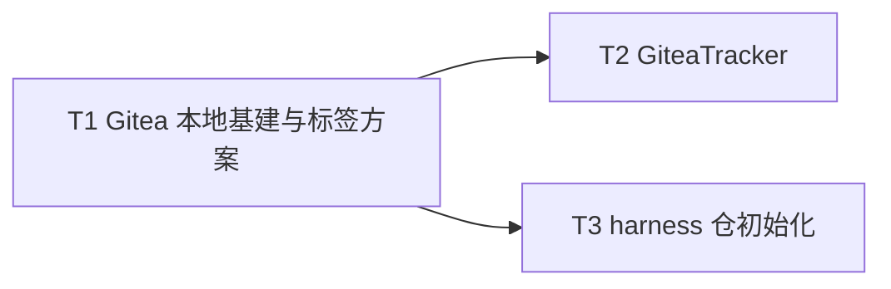

# 0002 Gitea 接入与基建

> 本文件由 `spec render` 自动生成，请勿手工编辑。
> 内容来源：本组 `metadata.yaml` 与 `tasks/T*.yaml`（关联 issue #0）。

## 任务编排

| 任务 | 标题 | 优先级 | 状态 | 依赖 |
|----|----|----|----|----|
| T1 | Gitea 本地基建与标签方案 | P1 | pending | — |
| T2 | GiteaTracker | P1 | pending | T1 |
| T3 | harness 仓初始化 | P1 | pending | T1 |

## 各任务方案

### T1 · Gitea 本地基建与标签方案（P1 / pending）

**涉及文件**

- `infra/gitea/docker-compose.yml`
- `infra/gitea/README.md`
- `infra/gitea/bootstrap.sh`

**做什么**

提供本地 Gitea 服务的基建与一键初始化：docker-compose(Gitea + sqlite) 起服务，bootstrap 脚本建
admin、生成 access token、建工作仓与标签方案。这是 GiteaTracker(T2) 与 harness 仓初始化(T3) 的前置。

**为什么**

issue 与 harness 仓都落在 Gitea。需要一个可复现、低运维的本地实例（sqlite 单文件、单二进制），
以及一条把「空服务」变成「可用工作区(有 token、有仓、有标签)」的幂等初始化路径。

**范围**

提供本地 Gitea(docker + sqlite) 的 docker-compose 与一键 bootstrap：起服务、建 admin、生成 write:issue+write:repository 的 access token、建工作仓与标签(bug/feature)。bootstrap 产出连接信息(URL/owner/repo/token)供 GiteaTracker 读取。

**整体设计**

- docker-compose.yml：单 gitea 服务，`GITEA__database__DB_TYPE=sqlite3`，数据挂本地卷，暴露 HTTP 端口。
- bootstrap.sh：① 等服务就绪；② `gitea admin user create` 建 admin（幂等）；
  ③ `gitea admin user generate-access-token --scopes write:issue,write:repository --raw` 拿 token；
  ④ 经 API 建工作仓；⑤ ensure 标签 bug/feature。产出写 `infra/gitea/.env`(URL/owner/repo/token，gitignore)。
- 标签方案：bug、feature 为驱动 dev 侧分流的最小集（bug→release 快修，feature→feature 分支）。

**接口**

产物契约：`infra/gitea/.env` 含 GITEA_URL/OWNER/REPO/TOKEN，被 GiteaTracker(T2) 与 bootstrap_harness(T3) 读取。

**取舍**

sqlite 而非 postgres：单实例自用足够、零额外服务（奥卡姆）；高并发写再换。
token 走 CLI 生成而非 UI 手点：可脚本化、可幂等。

**验收标准**

docker compose up 后 Gitea 可访问；bootstrap.sh 幂等产出 token 与标签；README 写明启动/拿 token 步骤；标签含 bug、feature。

**测试**

本任务以 README 记录的手动验证为主：compose up → bootstrap → 用产出 token curl 建一条 issue 成功。
（脚本逻辑的自动化测试随 T2/T3 的 mock 覆盖。）

**参考**

Gitea Docker 安装 https://docs.gitea.com/installation/install-with-docker ；
CLI https://docs.gitea.com/administration/command-line 。CLAUDE.md 架构「状态去向」。

### T2 · GiteaTracker（P1 / pending）

**涉及文件**

- `src/auto_designer/tracker/gitea.py`
- `tests/tracker/test_gitea.py`

**做什么**

GiteaTracker 是 spec-0001 IssueTracker 接口的真实后端：一个打 Gitea /api/v1 的薄 REST 客户端。
运行时注入到 run_session，使用户 agent 的 issue 草稿真正提交到 Gitea。

**为什么**

用户侧已用 IssueTracker 接口与 FakeTracker 解耦；本任务补上真实后端，且只做薄封装——
Gitea 已负责发号/状态/comment，客户端只翻译接口调用为 HTTP 请求。

**范围**

实现 spec-0001 的 IssueTracker 接口：薄 REST 客户端(requests)打 /api/v1，含 ensure_labels(建/查 label 拿 id)、create_issue(POST issues, 回 IssueRef)、add_comment、set_state。配置(URL/owner/repo/token)由构造注入。

**整体设计**

GiteaTracker(base_url, owner, repo, token)，鉴权头 `Authorization: token <token>`。映射：
- ensure_labels(names)：GET labels 拿现有 → 缺的 POST 建 → 缓存 name→id。
- create_issue(draft)：POST `/repos/{owner}/{repo}/issues`，body={title, body, labels:[id...]}；
  解析响应 number/html_url/state → 返回 IssueRef。
- add_comment(number, body)：POST `/repos/{owner}/{repo}/issues/{number}/comments`。
- set_state(number, state, reason)：PATCH `/repos/{owner}/{repo}/issues/{number}`，body={state, ...}。
配置由构造注入（来自 T1 的 .env），客户端不读环境、不起服务。

**接口**

GiteaTracker(base_url, owner, repo, token) 实现 IssueTracker(ensure_labels/create_issue/add_comment/set_state)。

**取舍**

薄 requests 客户端而非 py-gitea SDK：只需 4 个端点，零额外重依赖（奥卡姆），请求形状可控。
labels 需先转 id（Gitea 建 issue 收 label id 而非名），故 ensure_labels 维护 name→id 缓存。

**验收标准**

对照接口实现四方法；create_issue 真打 Gitea 回带号 IssueRef；labels 经 id 映射；单测用 mock HTTP（responses/respx）覆盖请求构造与解析，不依赖真服务。

**测试**

单测(mock HTTP)：create_issue 发对 URL/头/body 并解析出 IssueRef；ensure_labels 缺则建、有则复用；
add_comment/set_state 打对端点；token 进 Authorization 头。

**参考**

Gitea API https://docs.gitea.com/api/ 。接口定义：spec-0001/T5。

### T3 · harness 仓初始化（P1 / pending）

**涉及文件**

- `scripts/bootstrap_harness.py`
- `tests/test_bootstrap_harness.py`

**做什么**

把 seed_harness/ 作为 v0 推送到 Gitea，建立 harness 独立仓，供 dev 侧开发者 agent 走真实分支与合并。
harness 的演化历史从此存在该仓，不污染 auto-designer 本仓。

**为什么**

CLAUDE.md 定 harness 为独立 git 仓、托管于 Gitea、走真实分支/合并。本任务负责「从种子到可用仓」的
一次性初始化，是 dev 侧(spec-0003) launcher 与 developer_agent 的前置。

**范围**

把 seed_harness/ 作为 v0 推到 Gitea 成独立仓：建仓 → 提交 seed_harness 内容 → 建 release 分支。为 dev 侧(spec-0003)的开发者 agent 提供可走真实分支/合并的 harness 仓。

**整体设计**

bootstrap_harness.py：读 T1 产出的连接信息(.env) →
① 经 Gitea API 建 harness 仓（缺则建，幂等）；
② 用 git 把本仓 seed_harness/ 内容作为初始提交推到该仓 main；
③ 建 release 分支（指向 main）。feature 分支由开发者 agent 按需创建。
仅初始化，不含演化逻辑（那归 spec-0003）。

**接口**

python scripts/bootstrap_harness.py  → 在 Gitea 建出含 seed 内容、带 release 分支的 harness 仓。

**取舍**

seed 内容用 git 推送而非 API 逐文件上传：保留真实 git 历史，契合「走真实分支/合并」。
与 T2 共享 T1 的连接信息，不重复造配置。

**验收标准**

脚本在 Gitea 建出 harness 仓、含 seed_harness 内容、有 release 分支；可幂等重跑；单测以 mock Gitea API 覆盖建仓/推送调用。

**测试**

单测(mock Gitea API + 临时 git)：建仓调用正确；seed_harness 内容进初始提交；release 分支建出；
重跑不报错（幂等）。

**参考**

CLAUDE.md 架构「被进化对象：harness 作为可启动程序」。seed_harness 布局与 launcher：spec-0003。
