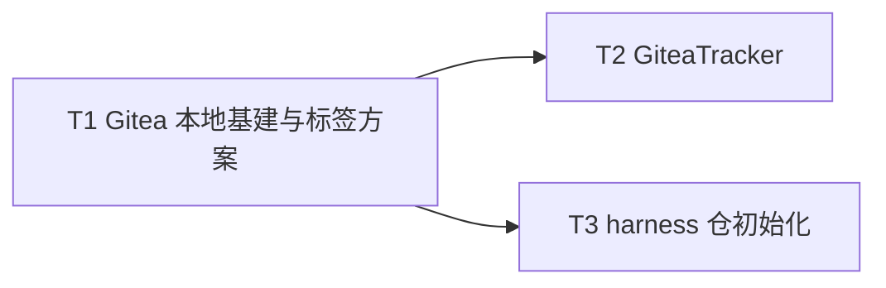

# 0002 Gitea 接入与基建

> 本文件由 `spec render` 自动生成，请勿手工编辑。
> 内容来源：本组 `metadata.yaml` 与 `tasks/T*.yaml`（关联 issue #0）。

## 总览

本组补齐 **a 段的真实后端与基建**：0001 用 Fake 把接口立了起来，本组把「桩」换成「真」——起一个本地 Gitea（issue 与 harness 仓的家），并实现 0001/T5 `IssueTracker` 接口的真后端 `GiteaTracker`。

与 0001 的接力关系：

```
0001：IssueTracker 接口 + FakeTracker（桩，仅供测试）
        └─► 0002/T2 GiteaTracker（真后端，运行时注入 run_session）
0002/T1 本地 Gitea（docker + sqlite，bootstrap 产出 URL/owner/repo/token）
        ├─► T2 GiteaTracker 读连接信息，打 /api/v1
        └─► T3 把 harness_template 推成独立 harness 仓（供 0003 开发者 agent 走真实分支/合并）
```

**T1** 是一切前置（没有 Gitea 就没有 issue 去向、也没有 harness 仓）；**T2** 让用户 agent 产的 issue 真正进 Gitea；**T3** 把 v0 种子变成可演化的 harness 仓。本组完成后，a 段即可脱离 Fake 真跑。

## 任务编排



| 任务 | 标题 | 优先级 | 状态 | 依赖 |
|----|----|----|----|----|
| T1 | Gitea 本地基建与标签方案 | P1 | pending | — |
| T2 | GiteaTracker | P1 | pending | T1 |
| T3 | harness 仓初始化 | P1 | pending | T1 |

## 各任务方案

### T1 · Gitea 本地基建与标签方案（P1 / pending）

**涉及文件**

- `infra/gitea/docker-compose.yml`
- `infra/gitea/README.md`
- `infra/gitea/bootstrap.sh`

**做什么**

提供本地 Gitea 服务的基建与一键初始化：docker-compose(Gitea + sqlite) 起服务，bootstrap 脚本建
admin、生成 access token、建工作仓与标签方案。这是 GiteaTracker(T2) 与 harness 仓初始化(T3) 的前置。
最终产物是一份连接信息文件 `infra/gitea/.env`(URL/owner/repo/token)，作为 T2/T3 的唯一配置入口。

**为什么**

issue 与 harness 仓都落在 Gitea。需要一个可复现、低运维的本地实例（sqlite 单文件、单二进制），
以及一条把「空服务」变成「可用工作区(有 token、有仓、有标签)」的幂等初始化路径。把初始化固化为脚本，
避免手点 UI 带来的不可复现与配置漂移；幂等保证重跑安全，是 CI 与多次本地启动的前提。

**范围**

做什么：
- 提供 `docker-compose.yml`：单 Gitea 服务、sqlite 后端、数据挂命名卷、暴露固定 HTTP 端口。
- 提供 `bootstrap.sh`：等待就绪 → 建 admin → 生成带 `write:issue,write:repository` scope 的 access token → 建工作仓 → ensure 标签集 {bug, feature}。
- 产出 `infra/gitea/.env`(GITEA_URL/OWNER/REPO/TOKEN)，gitignore，作为 T2/T3 的配置契约。
- 提供 `README.md`：启动、拿 token、重置数据卷的步骤。
不做什么：
- 不做生产化部署（无 TLS、无外部 DB、无反向代理、无高可用）。
- 不实现 IssueTracker 客户端逻辑（归 T2）、不推 harness 种子内容（归 T3）。
- 不管理 token 轮换/过期策略、不做多用户/多组织权限模型。
- 不在脚本内编排 T2/T3；本任务仅产出连接信息，消费方自行读取。

**整体设计**

组件与职责
- `docker-compose.yml`：单 `gitea` 服务，`GITEA__database__DB_TYPE=sqlite3`，数据目录挂命名卷持久化，
  暴露 HTTP 端口(默认 3000)与 SSH 端口(可选)。固定端口由 .env 或 compose 内常量给定，禁止随机端口（T2/T3 需稳定 URL）。
- `bootstrap.sh`：纯 shell + `docker compose exec` 调 gitea CLI + `curl` 调 REST，无额外语言运行时依赖。

初始化时序（每步幂等）
① 就绪探测：轮询 `GET /api/v1/version` 直至 200 或超时；超时即非零退出并打印诊断。
② 建 admin：`gitea admin user create --admin --username --password --email`；已存在时 CLI 报错，脚本捕获并视为成功（幂等）。
③ 生成 token：`gitea admin user generate-access-token --username <admin> --scopes write:issue,write:repository --raw`；
   token 仅在生成时可见，写入 .env；重跑若 token 名已存在则按既有 .env 复用，不重复生成。
④ 建工作仓：`POST /api/v1/admin/users/{owner}/repos` 或 `/user/repos`，auto_init=true；仓已存在(409)视为成功。
⑤ ensure 标签：`GET /repos/{owner}/{repo}/labels` 取现有 → 缺失项 `POST` 建之，标签集 {bug, feature}，含固定颜色。

连接信息契约（产出文件）
- 文件：`infra/gitea/.env`，KEY=VALUE 行格式，键集固定为 {GITEA_URL, OWNER, REPO, TOKEN}。
- GITEA_URL 不含尾斜杠、不含 `/api/v1` 后缀（API 路径前缀由 T2 客户端拼接）。
- 该文件是 T1 与 T2/T3 之间的唯一契约面；键名、语义不得在未同步 T2/T3 的情况下变更。

边界与错误处理
- 服务不可达/就绪超时：① 步非零退出，提示检查 compose 状态，不进行后续步骤。
- admin/仓/标签已存在：分别按「捕获 CLI 错误」「409」「按名去重」处理为幂等成功，不报错中断。
- token 生成失败或 scope 不足：非零退出；脚本不静默写入空 token，避免 T2 拿到无效凭证后才暴露。
- .env 已存在：默认复用其中 TOKEN（token 不可二次读取），其余键以脚本探测结果对齐；提供显式重置入口（删卷 + 删 .env）。

关键决策
- sqlite + 单服务：最小运维面，契合自用单实例（奥卡姆）。
- 固定端口而非随机：T2/T3 依赖稳定 URL，随机端口会破坏连接信息契约。
- 标签集 {bug, feature} 为驱动 dev 侧分流的最小集（bug→release 快修，feature→feature 分支），不预置更多标签。

**接口**

产出文件契约 `infra/gitea/.env`：
- GITEA_URL：Gitea 根 URL，无尾斜杠、无 /api/v1 后缀（如 http://localhost:3000）。
- OWNER：工作仓 owner（admin 用户名）。
- REPO：工作仓名。
- TOKEN：带 write:issue,write:repository scope 的 access token。
消费方：GiteaTracker(T2) 与 bootstrap_harness(T3) 读取此四键，本组其它任务不得依赖未列入的键。
脚本入口：`bash infra/gitea/bootstrap.sh`（幂等）；`docker compose -f infra/gitea/docker-compose.yml up -d` 起服务。

**取舍**

- 数据库 sqlite vs postgres vs mysql：选 sqlite —— 单文件、随 Gitea 进程零额外服务，运维面最小（奥卡姆）；
  代价是并发写能力弱、不利横向扩展，自用单实例场景可接受，高并发写再换 postgres。
- token 生成 CLI vs Web UI 手点 vs API 用户名密码换：选 CLI `generate-access-token --raw` —— 可脚本化、可幂等、
  输出干净便于写 .env；UI 手点不可复现，API 换 token 需先有凭证、引入鸡生蛋问题。
- 端口固定 vs 随机分配：选固定 —— T2/T3 的连接信息契约要求稳定 URL；随机端口需额外回写发现机制，增加复杂度。
- 连接信息 .env 文件 vs 环境变量 vs 配置中心：选 .env 文件 —— 落盘可被多个消费方(T2/T3)读取、可 gitignore、
  零依赖；纯环境变量在多进程/多次启动间不持久，配置中心对单实例是过度设计。

**验收标准**

- `docker compose up -d` 后 Gitea 在固定端口可访问，`GET /api/v1/version` 返回 200。
- `bootstrap.sh` 首次运行产出 `infra/gitea/.env`，含 GITEA_URL/OWNER/REPO/TOKEN 四键且值非空。
- `bootstrap.sh` 二次运行不报错、不重复建 admin/仓/标签（幂等），TOKEN 维持有效。
- 工作仓存在，标签集含且仅初始含 {bug, feature}。
- 用产出 TOKEN `curl` 调 `POST /repos/{OWNER}/{REPO}/issues` 建一条 issue 返回 201。
- GITEA_URL 不含尾斜杠与 /api/v1 后缀；.env 被 gitignore 不入库。
- README 记录启动、拿 token、重置数据卷三条路径。

**测试**

本任务产物为基建脚本，以 README 记录的手动/CI 验证为主，逐条：
- 就绪与建 issue：compose up → bootstrap → 用产出 token curl 建一条 issue 成功(201)。
- 幂等：连跑两次 bootstrap，第二次退出码 0、不新增重复 admin/仓/标签。
- 失败路径（服务不可达）：在 Gitea 未起时跑 bootstrap，① 步就绪超时后非零退出并打印诊断，不写入半成品 .env。
- 鉴权 scope：用产出 token 调一个超出 scope 的端点应被 Gitea 拒（403），证明 token scope 收敛到 write:issue,write:repository。
- 契约校验：.env 恰含四键，GITEA_URL 无尾斜杠/无 /api/v1 后缀。
脚本逻辑的细粒度自动化测试随 T2/T3 的 mock 覆盖，本任务不重复构造 Gitea mock。

**参考**

Gitea Docker 安装 https://docs.gitea.com/installation/install-with-docker ；
CLI（含 admin user create / generate-access-token）https://docs.gitea.com/administration/command-line ；
API（labels/issues 端点）https://docs.gitea.com/api/ 。CLAUDE.md 架构「状态去向：issue → Gitea」。

### T2 · GiteaTracker（P1 / pending）

**涉及文件**

- `src/auto_designer/tracker/gitea.py`
- `tests/tracker/test_gitea.py`

**做什么**

GiteaTracker 是 spec-0001/T5 IssueTracker 接口的真实后端：一个打 Gitea /api/v1 的薄 REST 客户端。
运行时注入到 run_session，使用户 agent 的 issue 草稿真正提交到 Gitea，返回带号 IssueRef。
与 FakeTracker 对 run_session 行为等价、可互换。

**为什么**

用户侧已用 IssueTracker 接口与 FakeTracker 解耦；本任务补上真实后端，且只做薄封装——
Gitea 已负责发号、状态机、comment 存储，客户端只把接口调用翻译为 HTTP 请求并解析响应，
不在客户端重建任何状态，杜绝与远端的双写漂移。

**范围**

做什么：
- 实现 spec-0001/T5 的 IssueTracker 接口四方法：ensure_labels / create_issue / add_comment / set_state。
- 薄 REST 客户端(requests)打 `/api/v1`，鉴权 `Authorization: token <token>`。
- ensure_labels：建/查 label 并维护 name→id 映射缓存；create_issue 返回解析后的 IssueRef。
- 配置(base_url/owner/repo/token)由构造注入，来源是 T1 产出的 .env。
不做什么：
- 不读环境变量、不读 .env、不起服务（注入由调用方负责，保持纯客户端）。
- 不实现 issue 列表/搜索/里程碑/指派等接口外端点（奥卡姆，dev 侧需要再扩）。
- 不做本地缓存 issue 内容、不做离线队列/重试编排（失败即抛，由调用方决定）。
- 不负责标签的语义定义（标签集 {bug,feature} 由 T1 预置）。

**整体设计**

类型契约
- 构造：`GiteaTracker(base_url: str, owner: str, repo: str, token: str)`。
- 输入 IssueDraft(title:str, body:str, labels:list[str])、输出 IssueRef(number:int, url:str, state:str) 复用 spec-0001/T1 定义，本任务不新增数据类。
- 内部维护 `_label_ids: dict[str, int]`（name→id 缓存），仅 ensure_labels 写入、create_issue 读。

端点映射（路径相对 `{base_url}/api/v1`）
- ensure_labels(names: list[str]) -> None：`GET /repos/{owner}/{repo}/labels` 取现有 name→id → 缺失项
  `POST /repos/{owner}/{repo}/labels`(name + 默认 color) → 合并进 `_label_ids`。
- create_issue(draft) -> IssueRef：先确保 draft.labels 已在缓存（未缓存则触发 ensure_labels）→
  `POST /repos/{owner}/{repo}/issues`，body={title, body, labels:[id...]} → 从响应取 {number, html_url, state} 构造 IssueRef。
- add_comment(number: int, body: str) -> None：`POST /repos/{owner}/{repo}/issues/{number}/comments`，body={body}。
- set_state(number: int, state: str, reason: str | None) -> None：`PATCH /repos/{owner}/{repo}/issues/{number}`，
  body={state}（state ∈ {open, closed}）；reason 若给定追加为 comment（Gitea PATCH 不收 reason 字段）。

关键时序
- create_issue 对未知 label 的处理：构造 issue body 前若发现 draft.labels 含未缓存名，先调 ensure_labels 补齐，
  保证 issue 带正确 label id 一次提交成功，不依赖调用方先手动 ensure。

边界与错误处理
- Gitea 不可达（连接异常/超时）：requests 抛出，GiteaTracker 不吞，原样上抛由调用方处理（run_session 记录失败、不伪造 IssueRef）。
- token 失效/权限不足：响应 401/403，客户端将非 2xx 响应统一转为显式异常（含状态码与端点），不静默返回空 IssueRef。
- 标签竞态（并发下重复建）：POST label 返回 409/422 时回退为 GET 重新读取该 name 的 id，保证 ensure_labels 幂等。
- 响应缺字段：解析 IssueRef 时 number/html_url/state 任一缺失即抛解析异常，避免下游拿到半成品回执。
- 「重复建 issue」：本客户端不做去重——issue 去重语义不存在于 IssueTracker 契约，每次 create_issue 即新建一条；
  防重复由用户侧产出逻辑(spec-0001/T3)负责，客户端保持无状态翻译。

关键决策
- 客户端无状态（除 label id 缓存）：状态权威在 Gitea，客户端只翻译，避免双写。
- 统一错误转换：非 2xx → 带上下文异常，使鉴权/不可达失败在调用点即可见，而非延迟到解析阶段。

**接口**

类 `GiteaTracker(base_url: str, owner: str, repo: str, token: str)`，实现 spec-0001/T5 `IssueTracker` 协议：
- ensure_labels(names: list[str]) -> None
- create_issue(draft: IssueDraft) -> IssueRef
- add_comment(number: int, body: str) -> None
- set_state(number: int, state: str, reason: str | None) -> None
所有方法在非 2xx 响应时抛出带状态码与端点的异常；不返回 None 掩盖失败。

**取舍**

- 薄 requests 客户端 vs py-gitea SDK vs 自研异步客户端：选薄 requests —— 仅需 4 个端点，零额外重依赖、
  请求形状完全可控、便于 mock（奥卡姆）；SDK 引入版本耦合与多余表面，异步对单局会话无收益。
- label 用 name→id 缓存 vs 每次现查 vs 调用方传 id：选缓存 —— Gitea 建 issue 收 label id 而非名，
  缓存避免每局重复 GET；现查浪费请求，要求调用方传 id 会把 Gitea 细节泄露到用户侧。
- 错误处理统一抛异常 vs 返回 Result/可空回执：选抛异常 —— 鉴权失败/不可达是不可恢复的环境问题，
  显式抛出使失败在调用点暴露；可空回执易被下游忽略导致静默丢 issue。
- set_state 的 reason 落为 comment vs 丢弃 vs 自定义字段：选落为 comment —— Gitea PATCH issue 不收 reason，
  以 comment 保留关闭理由可追溯；丢弃会损失信息，自定义字段 Gitea 不支持。

**验收标准**

- 实现 IssueTracker 协议四方法且带类型标注，可作为 GiteaTracker 注入 run_session 替换 FakeTracker。
- create_issue 向 `/repos/{owner}/{repo}/issues` 发出含 title/body/label-id 的 POST，解析响应回带号 IssueRef(number/url/state)。
- ensure_labels 对已存在 label 复用 id、对缺失 label 新建，并幂等（重复调不重复建）。
- add_comment、set_state 命中对应端点；token 进 `Authorization: token <token>` 头。
- 非 2xx 响应（401/403/404/422）抛出含状态码与端点的异常，不返回空回执。
- 单测全程 mock HTTP，不依赖运行中的 Gitea。

**测试**

单测(mock HTTP，responses/respx)，逐条：
- create_issue 发对 URL、`Authorization: token` 头与 body(title/body/labels=[id])，并从响应解析出 IssueRef(number/url/state)。
- ensure_labels：label 缺失则 POST 建、已存在则复用 id；连续两次调用不重复 POST（幂等）。
- create_issue 遇 draft.labels 含未缓存名时自动触发 ensure_labels 后再建 issue（一次成功带正确 id）。
- add_comment / set_state 命中对应端点与方法(POST/PATCH)，set_state 带 reason 时额外发一条 comment。
- 失败路径：mock 返回 401（token 失效）与 404（仓不存在）时抛带状态码的异常；mock 连接异常（不可达）时异常上抛不被吞。
- 标签竞态：mock POST label 返回 409 时回退 GET 取既有 id，ensure_labels 仍成功。

**参考**

Gitea API（issues / labels / comments 端点）https://docs.gitea.com/api/ 。
接口与数据结构定义：spec-0001/T5（IssueTracker/FakeTracker）、spec-0001/T1（IssueDraft/IssueRef）。
连接信息来源：本组 T1 的 `infra/gitea/.env`。

### T3 · harness 仓初始化（P1 / pending）

**涉及文件**

- `scripts/bootstrap_harness.py`
- `tests/test_bootstrap_harness.py`

**做什么**

把 harness_template/ 作为 v0 推送到 Gitea，建立 harness 独立仓，供 dev 侧开发者 agent 走真实分支与合并。
harness 的演化历史从此存在该仓，不污染 auto-designer 本仓。脚本一次性初始化、可幂等重跑。

**为什么**

CLAUDE.md 定 harness 为独立 git 仓、托管于 Gitea、走真实分支/合并。本任务负责「从种子到可用仓」的
一次性初始化，是 dev 侧(spec-0003) launcher 与 developer_agent 的前置。把初始化脚本化保证可复现，
幂等保证重跑（CI、重置后重建）安全。

**范围**

做什么：
- 读 T1 产出的 `infra/gitea/.env` 连接信息。
- 经 Gitea API 建 harness 仓（仓名独立于工作仓，缺则建，幂等）。
- 用 git 把本仓 `harness_template/` 内容作为初始提交推到该仓默认分支(main)。
- 建 release 分支指向 main。
不做什么：
- 不创建 feature 分支（由开发者 agent 按需创建，归 spec-0003）。
- 不含任何 harness 演化逻辑、不跑 harness、不接 developer_agent（归 spec-0003）。
- 不定义 harness_template 内容/布局本身（归 spec-0003，本任务只搬运）。
- 不管理 Gitea 服务生命周期、不生成 token（归 T1）。

**整体设计**

入口与配置
- `scripts/bootstrap_harness.py`，读 `infra/gitea/.env` 的 {GITEA_URL, OWNER, TOKEN}；harness 仓名为固定常量
  （独立于 T1 工作仓，避免 issue 仓与 harness 仓混用）。

初始化时序（每步幂等）
① 建仓：`POST /api/v1/user/repos`(name=harness, auto_init=false, private 可选)；仓已存在(409)视为成功。
② 推种子：在临时工作目录初始化 git 仓 → 复制本仓 `harness_template/` 全部内容 → `git add` + 单条初始提交 →
   以 `https://{token}@{host}/{owner}/{repo}.git` 为 remote `git push` 到 main。
③ 建 release 分支：经 API `POST /repos/{owner}/{repo}/branches`(new_branch_name=release, old_branch_name=main)
   或 push 一条 release ref；分支已存在视为成功。

数据/协议契约
- 输入：本仓 `harness_template/` 目录树（内容定义在 spec-0003）+ T1 的 .env 四键中的 {GITEA_URL,OWNER,TOKEN}。
- 输出：Gitea 上一个含 seed 内容、默认分支 main、附 release 分支的 harness 仓。
- 推送鉴权：token 经 remote URL 注入，不写入 harness 仓内容、不落临时文件外的盘。

边界与错误处理
- Gitea 不可达 / token 失效：建仓 API 抛 4xx/连接异常，脚本非零退出并打印端点与状态码，不进行后续 push。
- 仓已存在但内容已演化：默认不强推覆盖——②若远端 main 已有提交，push 非 fast-forward 时不 `--force`，脚本报告
  「仓已初始化」并跳过推种子，仅确保 release 分支存在（保护开发者 agent 已产生的演化历史）。
- 重复运行（幂等）：建仓 409、push 已是最新、release 已存在三种情况均视为成功退出码 0。
- harness_template 缺失/为空：前置校验本仓 `harness_template/` 存在且非空，否则非零退出，避免推空仓。

关键决策
- git push 而非 API 逐文件上传：保留真实 git 历史与单条初始提交，契合「走真实分支/合并」。
- 默认不强推：一旦 harness 仓进入演化，重跑 bootstrap 不得回退历史；幂等以「存在即跳过」实现而非覆盖。
- 复用 T1 连接信息：不重复造配置，OWNER/TOKEN 单一来源。

**接口**

`python scripts/bootstrap_harness.py`：
- 输入：`infra/gitea/.env`(GITEA_URL/OWNER/TOKEN) + 本仓 `harness_template/` 目录。
- 行为：在 Gitea 建出 harness 仓，默认分支 main 含 harness_template 内容，附 release 分支。
- 退出码：成功(含幂等重跑)为 0；连接/鉴权失败、harness_template 缺失为非 0。
- 副作用边界：仅写 Gitea 远端与临时工作目录；不修改本仓、不修改 .env。

**取舍**

- seed 推送 git push vs API 逐文件上传 vs tar 上传：选 git push —— 保留真实 git 历史与提交对象，
  契合开发者 agent「走真实分支/合并」；逐文件上传无统一提交、丢历史语义，tar 上传 Gitea 无对应原子接口。
- 重跑策略「存在即跳过」vs 强推覆盖 vs 报错退出：选存在即跳过 —— 保护演化历史、保证幂等；强推会丢开发者 agent 产出，
  报错退出会让 CI/重置流程脆弱。
- harness 仓独立 vs 与 issue 工作仓同仓：选独立仓 —— issue 与 harness 演化关注点分离、权限与历史互不干扰；
  同仓会让 issue 流与代码演化混杂。
- 配置复用 T1 .env vs 脚本自带参数 vs 独立配置：选复用 .env —— OWNER/TOKEN 单一来源、与 T2 一致，不重复造配置面。

**验收标准**

- 脚本在 Gitea 建出独立 harness 仓，默认分支 main 含 harness_template 全部内容（单条初始提交）。
- 仓附 release 分支，指向初始 main。
- 幂等：连跑两次退出码均 0，第二次不重复建仓、不强推覆盖、不报错。
- 仓已存在且 main 已演化时，第二次运行不回退历史，仅确保 release 分支存在。
- harness_template 缺失/为空时非零退出，不推空仓。
- token 经 remote URL 注入，不落入 harness 仓内容。
- 单测以 mock Gitea API + 临时 git 覆盖建仓/推送/建分支调用，不依赖真服务。

**测试**

单测(mock Gitea API + 临时 git)，逐条：
- 建仓调用命中 `POST /user/repos`、参数含 harness 仓名；harness_template 内容进单条初始提交并 push 到 main。
- release 分支经 API/ref 建出，指向初始 main。
- 幂等：建仓 mock 返回 409、push 已最新、release 已存在三种情况下脚本退出码 0、不重复建。
- 保护历史：mock 远端 main 已有额外提交（非 fast-forward）时，脚本不 `--force`，报告已初始化并仅确保 release 分支。
- 失败路径：mock 建仓返回 401（token 失效）/连接异常（Gitea 不可达）时脚本非零退出、不进行 push。
- 前置校验：本仓 harness_template 缺失/为空时脚本非零退出，不发起任何远端写。

**参考**

CLAUDE.md 架构「被进化对象：harness 作为可启动程序」、「dev 侧走真实分支/合并」。
harness_template 布局、launcher 与开发者 agent：spec-0003。连接信息来源：本组 T1 的 `infra/gitea/.env`。
Gitea API（repos/branches 端点）https://docs.gitea.com/api/ 。
