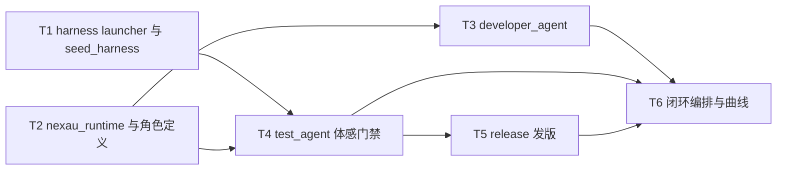

# 0003 开发者侧与闭环

> 本文件由 `spec render` 自动生成，请勿手工编辑。
> 内容来源：本组 `metadata.yaml` 与 `tasks/T*.yaml`（关联 issue #0）。

## 任务编排

| 任务 | 标题 | 优先级 | 状态 | 依赖 |
|----|----|----|----|----|
| T1 | harness launcher 与 seed_harness | P1 | pending | 0001/T2 |
| T2 | nexau_runtime 与角色定义 | P1 | pending | — |
| T3 | developer_agent | P1 | pending | T2, 0002/T2 |
| T4 | test_agent 体感门禁 | P1 | pending | T1, T2, 0001/T4 |
| T5 | release 发版 | P1 | pending | T4, 0002/T3 |
| T6 | 闭环编排与曲线 | P1 | pending | T3, T4, T5, 0001/T4, 0001/T6 |

## 各任务方案

### T1 · harness launcher 与 seed_harness（P1 / pending）

**涉及文件**

- `src/auto_designer/harness/launcher.py`
- `seed_harness/entry.py`
- `seed_harness/params.yaml`
- `seed_harness/agents/main.md`
- `tests/harness/test_launcher.py`

**做什么**

把「被进化的 harness」接成 spec-0001 的 HarnessInterface：launcher 按 git ref 取出某版 harness、
启动其自带 entry、按黑盒逐轮协议适配为 send/reset/close。seed_harness 给出 v0（单 nexau）作为起点。

**为什么**

harness 是独立可启动程序（可单/多 agent），用户侧只认 HarnessInterface。launcher 是二者的粘合层；
seed_harness 提供进化的 v0 起点。二者一起定义了「harness 程序」的启动与 I/O 契约。

**范围**

定义 harness 可启动程序契约并提供 v0 种子：launcher 按 git ref 把 harness 仓 checkout 到 data/harness_runs/<ref>/，启动其 entry，按黑盒协议(逐轮收发)适配成 HarnessInterface；seed_harness 给出 entry.py + params.yaml + 单 agent 定义作为 v0。

**整体设计**

启动契约：harness 程序经 entry 启动后，从 stdin 逐行读 JSON {message}，向 stdout 逐行写 JSON {reply}；
内部 1 或 N 个 nexau 如何编排由 entry 自定。launcher：
- checkout(ref)：git 把 harness 仓某 ref 取到 data/harness_runs/<ref>/。
- 起子进程跑 entry（命令由 params.yaml 声明）；send 写一行/读一行；reset 重启子进程；close 终止。
seed_harness/v0：entry.py 起单个 nexau，按上述协议收发；params.yaml 声明启动命令；agents/main.md 为该 agent 定义。

**接口**

HarnessLauncher(harness_repo).launch(ref) -> HarnessInterface。启动契约：JSONL over stdio({message}/{reply})。

**取舍**

子进程 + JSONL over stdio（而非 import/HTTP）：把 harness 当黑盒外部程序，最大解耦，支持任意内部编排与
将来换 CC/codex；代价是进程/序列化开销，自用规模可接受。

**验收标准**

launcher 能取某 ref 启动 entry 并经 HarnessInterface 多轮收发、可 reset/close；seed_harness 是合法 v0(单 nexau)；单测用一个最小假 entry 验证启动与 I/O 协议。

**测试**

单测：用一个最小假 entry(回显/脚本) 验证 launch→send/reply 逐轮、reset 重启、close 终止；
checkout 写到 data/harness_runs/<ref>/。

**参考**

HarnessInterface：spec-0001/T2。harness 仓来源：spec-0002/T3。CLAUDE.md 架构「harness 作为可启动程序」。

### T2 · nexau_runtime 与角色定义（P1 / pending）

**涉及文件**

- `src/auto_designer/nexau_runtime.py`
- `agent_defs/user_agent/prompt.md`
- `tests/test_nexau_runtime.py`

**做什么**

单一 nexau 适配层：把一份角色定义(prompt+工具)加载成可调用的 agent，供 user/developer/test 三角色共用。
本任务并落地 user_agent 角色定义作为首个消费者，验证适配可跑。

**为什么**

MVP 只接 nexau 一种运行时，三角色仅 prompt/工具不同。把「加载定义并运行」收敛成一处，
避免每个角色各写一套；user_agent 定义补上 spec-0001 中被抽象为「注入 LLM」的那一块。

**范围**

单一 nexau 适配：加载一份 agent 定义(prompt+工具)并运行，供 user/developer/test 三角色共用；先落 user_agent 角色定义作为首个消费者，验证适配可跑。

**整体设计**

nexau_runtime 提供 load(agent_def_dir) -> Agent，Agent.run(input) -> output（对 nexau 的薄封装）。
角色定义是 agent_defs/<role>/ 下的 prompt(+工具配置)。user_agent/prompt.md 给出「扮用户」的角色定义，
对接 spec-0001 UserAgent 所需的 LLM 后端。developer/test 角色定义分别在 T3/T4 落地。

**接口**

nexau_runtime.load(agent_def_dir) -> Agent；Agent.run(input) -> output。

**取舍**

薄封装不抽象多运行时（YAGNI）：CC/codex 接入是后续目标，现在只服务 nexau。

**验收标准**

nexau_runtime 可加载一份定义并执行一次调用(可 mock nexau)；user_agent 定义合法；单测覆盖加载与调用。

**测试**

单测(mock nexau)：load 读取角色定义；Agent.run 透传输入/返回输出；user_agent 定义可被 load。

**参考**

角色与运行时：CLAUDE.md 架构「单一运行时：nexau」。UserAgent 消费方：spec-0001/T3。

### T3 · developer_agent（P1 / pending）

**涉及文件**

- `src/auto_designer/dev/developer_agent.py`
- `agent_defs/developer_agent/prompt.md`
- `tests/dev/test_developer_agent.py`

**做什么**

开发者 agent：从 Gitea 取一条 open issue，按 label 分流到对应分支策略，用 nexau 修改 harness bundle 并提交。
MVP 单 agent 串行，是闭环 b 段的核心。

**为什么**

issue 要变成 harness 的真实改动。label(bug/feature) 驱动分支策略——bug 走 release 快修、feature 走
独立分支孵化——正是 CLAUDE.md 用「分支模型」化解「增量打补丁 vs 结构性改动」张力的落点。

**范围**

开发者 agent：从 Gitea 取一条 open issue(按 label 分流：bug→release 快修分支、feature→feature 分支)→ checkout harness 仓建分支 → 用 nexau 改 harness bundle → commit/push。MVP 单 agent 串行处理。

**整体设计**

一次处理一条 issue：
① 经 IssueTracker(GiteaTracker) 取一条 open issue；
② 按 label 定分支：bug → 从 release 切快修分支；feature → 切 feature 分支；
③ checkout harness 仓该分支到工作目录；
④ nexau(developer_agent 定义) 读 issue + harness bundle，产出修改；
⑤ commit/push 到该分支，并在 issue 上 comment 关联分支。
不负责合并/发版（归 T5），不负责判定好坏（归 T4）。

**接口**

DeveloperAgent(tracker, harness_repo, nexau_agent).work_one() -> 处理一条 issue，返回所建分支与提交。

**取舍**

单 agent 串行（MVP）：并发多 agent 与分支冲突解决留后续（奥卡姆）。
分流只认 bug/feature 两标签，够驱动两条分支路径；更细的优先级/类型后续再加。

**验收标准**

给定一条 issue,能在 harness 仓建对应分支并产出一次修改提交;bug/feature 分流正确;单测用 mock(nexau+Gitea+临时 git)覆盖取 issue→建分支→提交流程。

**测试**

单测(mock nexau + FakeTracker/Gitea + 临时 git)：bug→release 派生分支、feature→feature 分支；
产出一次提交并推送；issue 上留关联 comment。

**参考**

nexau_runtime：T2。IssueTracker：spec-0001/T5、GiteaTracker spec-0002/T2。harness 仓：spec-0002/T3。

### T4 · test_agent 体感门禁（P1 / pending）

**涉及文件**

- `src/auto_designer/dev/test_agent.py`
- `agent_defs/test_agent/prompt.md`
- `tests/dev/test_test_agent.py`

**做什么**

测试 agent：用候选 harness ref 跑固定集的 N 局用户会话，算平均体感并与当前 release 基线比较，
不退化则放行。这是发版门禁，且只用体感——benchmark 不参与判定。

**为什么**

发版要有客观闸门，且必须守住 train/test 分离：门禁只看体感回归，benchmark 全程 held-out。
测试 agent 复用用户侧 run_session——「评一个 harness」就是「让用户 agent 用它跑几局看体感」。

**范围**

测试 agent：对候选 harness ref 用 launcher 起服务、跑 run_session×N(固定 persona+场景集)算平均体感,与当前 release 基线比,不退化则放行。N 与判定方式(单点 vs 分布)为待定项,先取均值不低于基线。

**整体设计**

evaluate(candidate_ref) -> Verdict：
① launcher.launch(candidate_ref) 得 HarnessInterface；
② 对固定 (persona, scenario) 集跑 run_session×N(每个场景 N 局)，收集体感分；
③ 取均值与 release 基线均值比较：不低于基线(容差内)→放行，否则否决。
基线来自 release 版同一固定集的历史体感（经 SessionStore 索引取）。N 与判定方式(单点均值 vs 分布检验)
列为 spec 待定项，MVP 先用均值。

**接口**

TestAgent(launcher, fixed_set, baseline, n).evaluate(candidate_ref) -> Verdict(pass: bool, mean, baseline)。

**取舍**

体感是噪声信号：单局方差大，故跑 N 局取均值；N 与是否用分布检验留待定项，先简单均值不低于基线。
只用体感门禁(不掺 benchmark)：守住 held-out，代价是门禁可能放过 benchmark 上变差的改动——这正是设计
接受的：benchmark 只事后观测、不投票。

**验收标准**

对一个候选 ref 跑 N 局得平均体感并与基线比较,返回放行/否决;N 可配;单测用 FakeHarness+mock LLM 覆盖通过与退化两种判定。

**测试**

单测(FakeHarness + mock LLM)：候选均值≥基线→pass；<基线→fail；N 可配；基线缺失时的处理明确。

**参考**

run_session：spec-0001/T4。基线数据：spec-0001/T6。launcher：T1。CLAUDE.md 约束「发版门禁只用体感」。

### T5 · release 发版（P1 / pending）

**涉及文件**

- `src/auto_designer/dev/release.py`
- `tests/dev/test_release.py`

**做什么**

发版：体感门禁通过的候选分支合入 harness 仓 release 分支并打 tag；tag 即用户侧下一轮 pin 的版本。
否决则不动 release。

**为什么**

闭环要有「定版」动作把候选变成可被用户侧使用的稳定版本。tag 提供可 pin、可回溯的版本标识；
release 分支是用户侧默认运行的线。

**范围**

发版：体感门禁通过后,把候选分支合入 harness 仓 release 分支并打 tag(版本号),作为用户侧下一轮 pin 的版本;否决则不合并。

**整体设计**

release(candidate_branch, verdict) ：
- verdict.pass：在 harness 仓把 candidate_branch 合入 release 分支，打 tag(递增版本号)，关联 issue 置 closed。
- 否则：不合并、不打 tag；可在 issue 上 comment 否决原因。
版本号单调递增；tag 名即版本。仅操作 harness 仓 git，不含评测逻辑(归 T4)。

**接口**

release(harness_repo, candidate_branch, verdict) -> ReleaseResult(released: bool, tag?)。

**取舍**

发版=合并+tag 的轻动作，不引版本管理框架（奥卡姆）；版本号用单调计数，语义化版本后续再说。

**验收标准**

通过的候选被合入 release 并打出 tag;否决的不动 release;单测用临时 git 仓覆盖合并+打 tag 与否决两路径。

**测试**

单测(临时 git 仓)：pass→candidate 合入 release 且出现新 tag；fail→release 与 tag 不变。

**参考**

门禁 Verdict：T4。harness 仓：spec-0002/T3。CLAUDE.md 方法 b「合并和发版」。

### T6 · 闭环编排与曲线（P1 / pending）

**涉及文件**

- `src/auto_designer/loop/orchestrator.py`
- `src/auto_designer/loop/metrics.py`
- `tests/loop/test_orchestrator.py`
- `tests/loop/test_metrics.py`

**做什么**

orchestrator 把用户侧(a)、开发者侧(b)、回灌(c) 串成可重复的进化轮次；metrics 从 Gitea 与本地 session
统计 issue 数量随时间的曲线与体感趋势。这是整个系统的总装与观测。

**为什么**

前面各部件都是零件，orchestrator 是总装：定义一轮 a→b→c 怎么跑、跑几轮。metrics 落实 CLAUDE.md 要求的
「issue 数量~时间曲线」，用于判断探索(新 issue)与收敛(解决)是否平衡。

**范围**

orchestrator 串 a(用户会话产 issue+体感)→b(开发者改、测试门禁、发版)→c(新版回到 a);metrics 从 Gitea+本地 session 统计 issue 数量随时间的曲线与体感趋势。

**整体设计**

orchestrator.run_round(release_ref)：
a) 对固定/采样 (persona, scenario) 跑 run_session（harness=launch(release_ref)），产 issue 入 Gitea、体感入 SessionStore；
b) developer_agent.work_one() 改 harness 分支 → test_agent.evaluate(candidate) → release(...) 得新 release_ref；
c) 返回新 release_ref，供下一轮 a 使用。
各部件经依赖注入，便于 mock 跑通一轮。
metrics：从 Gitea 拉 issue 的 created/closed 时间 → issue 数~时间(开/关/净未解)序列；从 SessionStore 索引取体感趋势。

**接口**

orchestrator.run_round(release_ref) -> new_release_ref；run(n_rounds)。metrics.issue_curve()/feeling_trend()。

**取舍**

顺序单轮编排(MVP)：a 全跑完再 b，不做流水线/并发（奥卡姆）；规模化后再优化。
metrics 只读已有数据源(Gitea + SessionStore)，不自建存储。

**验收标准**

orchestrator 能跑通一轮 a→b→c(各部件可 mock);metrics 产出 issue 数~时间序列与体感趋势;单测覆盖一轮编排与曲线统计。

**测试**

单测：注入 mock 部件跑 run_round，断言 a→b→c 调用次序与新 ref 回灌；metrics 对构造数据产出正确
issue 数~时间序列与体感趋势。

**参考**

run_session：spec-0001/T4。SessionStore：spec-0001/T6。developer/test/release：T3/T4/T5。
CLAUDE.md「闭环」「观测指标」。
