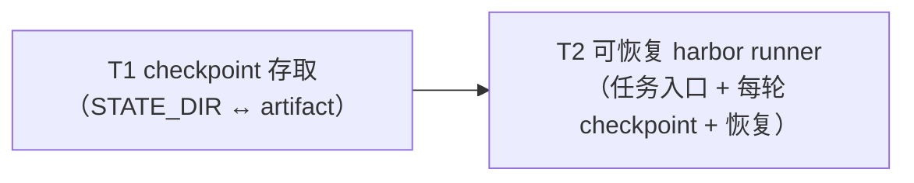

# 0004 Harbor 运行与可恢复 checkpoint

> 本文件由 `spec render` 自动生成，请勿手工编辑。
> 内容来源：本组 `metadata.yaml` 与 `tasks/T*.yaml`（关联 issue #0）。

## 总览

本组给闭环加上**可恢复运行时**：所有 agent 在**单沙盒一波跑**（方案 A，整条 run = 1 个 harbor task），用 harbor 的 task→artifact 通道把 checkpoint 吐出沙盒、再喂回实现恢复。它横跨 a/b/c：checkpoint 在**单元边界**维护用户侧状态（已完成 session / 体感）、开发者侧状态（issue 分派、候选分支）与其他编排中间态（轮次 / 阶段 / release_ref / 待合并）。

分层是本组关键，且与 spec-0001/T2「逐轮对话另立协议」一致：harbor 只包**外层 rollout 生命周期**；**内层**用户↔harness 的逐轮真人对话仍走 spec-0001 自立协议，不碰 harbor 批式 episode 接口。

```
harbor task（方案A：整条 run = 1 task）────────────────────────
 输入: pinned harness 版本 + persona/场景集 + 上次 checkpoint artifact
 沙盒内: restore(checkpoint) → orchestrator 逐轮(0003/T6)
         每轮末 save_checkpoint → 经 harbor artifact 吐出沙盒
 输出: 每轮增量 checkpoint artifact（最新者供下次恢复）
 内层 user↔harness 逐轮对话: spec-0001 自立协议（非 harbor 批接口）
```

支撑件：**T1** 定义 checkpoint 存取与自包含 STATE_DIR（gitea + sessions + metrics + run_state）；**T2** 可恢复 harbor runner，在 orchestrator 外层加恢复与每轮 checkpoint。本组约束：**恢复按单元边界幂等重跑**（整会话重跑、开发者从分支 head 续作、release 见 tag 跳过），不快照 agent 进程内存。

## 任务编排



| 任务 | 标题 | 优先级 | 状态 | 依赖 |
|----|----|----|----|----|
| T1 | checkpoint 存取（STATE_DIR ↔ artifact） | P1 | pending | 0001/T6 |
| T2 | 可恢复 harbor runner（任务入口 + 每轮 checkpoint + 恢复） | P1 | pending | T1, 0003/T6 |

## 各任务方案

### T1 · checkpoint 存取（STATE_DIR ↔ artifact）（P1 / pending）

**涉及文件**

- `backend/auto_designer/loop/checkpoint.py`
- `backend/auto_designer/loop/run_state.py`
- `backend/tests/loop/test_checkpoint.py`
- `backend/tests/loop/test_run_state.py`

**做什么**

把一轮闭环所需的全部可恢复状态收敛为单一自包含 STATE_DIR，连同 run_state 游标一起 dump/load，作为 harbor
task 的 checkpoint artifact 内容。是 Gitea/SessionStore 等权威源的整体快照，不另立第二权威。

**为什么**

全程在单沙盒一波跑、沙盒易失，恢复依赖把状态吐出沙盒。需要一个明确「什么进 checkpoint、怎么自包含、怎么原子写」
的契约，否则恢复不可靠、与权威源漂移。

**范围**

做什么：
- 定义 STATE_DIR 布局：聚合 Gitea data(sqlite+repos)、data/sessions/、data/metrics.jsonl、run_state.json 于单一目录，自包含、可整体打包。
- 实现 checkpoint 存：原子打包 STATE_DIR → checkpoint artifact（可下载出沙盒）。
- 实现 checkpoint 取：从 artifact 还原 STATE_DIR。
- 定义并读写 run_state：编排游标 + 三侧中间态标记，作为「无法从产物直接观测」之外的兜底。
不做什么：
- 不驱动轮次循环、不调 orchestrator（属 0004/T2 runner）。
- 不实现 harbor 任务调度与 artifact 通道（harbor 底座职责）。
- 不快照 agent 进程内存 / 会话中途态（恢复按单元边界重跑，见 T2）。
- 不与 Gitea/SessionStore 双写权威：checkpoint 是这些权威源的整体快照，不引入第二权威。

**整体设计**

STATE_DIR 布局（单一自包含目录）：
- gitea/        — Gitea data 目录（sqlite + harness 仓），issue 与 harness 版本的权威源。
- sessions/     — spec-0001 SessionStore 落地（体感 + transcript + issue 回执），体感曲线与回归基线。
- metrics.jsonl — append-only：issue 数~时间与体感趋势观测。
- run_state.json— 编排游标 + 三类「中间态」标记（见下）。

run_state 内容（维护「整个过程的状态」）：
- 编排游标：round（轮次）、phase（a/b/c）、current_release_ref。
- 用户侧状态：本轮 fixed_set 中已完成的 (persona, scenario) session key 集合（对应 sessions/ 中已落地的 Session）。
- 开发者侧状态：已分派 issue → 候选分支 ref 的映射、候选是否已过门禁、是否已合并/打 tag。
- 其他中间态：本轮 test verdict、待合并队列等编排内瞬态。
注：用户/开发者 agent 的「状态」指其在**单元边界上的持久进度**（已完成 session、候选分支 commit），非 nexau
进程内存或会话中途态——后者不入 checkpoint，恢复时整单元重跑（见 T2）。

存取契约：
- save：原子打包（tmp + rename / 先写后置位），产出自包含 artifact；部分写不得污染上一个可用 checkpoint。
- load：还原 STATE_DIR 到指定根；校验自包含（四类齐全）后才置为可用。
- run_state 读写：JSON、原子写；空 STATE_DIR 读 → 初始 run_state(round=0)。

关键决策及理由：
- 单一 STATE_DIR 自包含：checkpoint = 一次整体快照，避免多源分别导出导致的不一致；与「从沙盒下载 checkpoint 即可」一致。
- checkpoint 是权威源的快照而非第二权威：Gitea/SessionStore 仍是 issue/体感的唯一权威，不引入双写漂移。
- run_state 只记「不可观测」的游标与分派：能从产物（session 文件存在、分支 head、tag 存在）推断的进度优先推断，run_state 兜底，降低游标过期风险。
- 原子写：沙盒可能在写 checkpoint 中途死，必须保证上一个 checkpoint 始终可用。

**接口**

类型契约：
- save_checkpoint(state_dir: Path, dest: Path) -> Path（artifact 路径）。
- load_checkpoint(artifact: Path, state_dir: Path) -> None。
- RunState 数据结构：round:int、phase:str、current_release_ref:str、done_session_keys:set[str]、issue_assignments:dict[int,str]、pending:list。
- read_run_state(state_dir: Path) -> RunState；write_run_state(state_dir: Path, run_state: RunState) -> None。

**取舍**

- 单 STATE_DIR 整体打包 vs 分源增量导出：选整体（奥卡姆、自包含、易恢复）；代价是 checkpoint 体积大，靠每轮一次、版本即用即清缓解。
- run_state 记游标 vs 纯从产物推断：选「优先推断 + run_state 兜底」——纯推断最鲁棒但有些编排瞬态（待合并、本轮 verdict）无产物，纯游标又易过期，故折中。
- checkpoint 落点：本组只定义存取契约与 artifact 形态，落点（harbor artifact 通道）由 0004/T2 与 harbor 决定，不在此绑定。

**验收标准**

- save_checkpoint 产出自包含 artifact，含 gitea/、sessions/、metrics.jsonl、run_state.json 四者。
- load_checkpoint 还原后 STATE_DIR 与保存前等价（round-trip）。
- save 原子：中途失败不破坏既有可用 checkpoint。
- run_state round-trip：写后读回相等，含 done_session_keys 与 issue_assignments；空 STATE_DIR 读 → round=0 不抛错。

**测试**

- save→load round-trip：构造 STATE_DIR（四类齐全）→ save → 新目录 load → 结构与内容等价。
- 自包含校验：缺任一类时 load 报错、不静默置为可用。
- 原子性：模拟 save 中途中断，既有 checkpoint 仍可 load。
- run_state read/write round-trip：含集合/映射字段；空 STATE_DIR 读 → 初始 run_state(round=0)。

**参考**

SessionStore（sessions/ 落地）：spec-0001/T6。Gitea（issue 与 harness 仓权威源）：spec-0002。
metrics：spec-0003/T6。runner 消费方：0004/T2。
CLAUDE.md「体感 + session → 本地 data/sessions/」「issue → Gitea」。

**待解问题**

checkpoint artifact 与 harbor artifact 通道的具体绑定（对象格式 / 大小上限）在 0004/T2 与 harbor 接入时定。

### T2 · 可恢复 harbor runner（任务入口 + 每轮 checkpoint + 恢复）（P1 / pending）

**涉及文件**

- `backend/auto_designer/loop/runner.py`
- `backend/tests/loop/test_runner.py`

**做什么**

可恢复的 harbor 运行入口：作为一个 harbor task（方案 A，整条 run = 1 task）在沙盒内驱动 orchestrator 逐轮跑；
每轮边界吐一个增量 checkpoint artifact；新 task 喂最新 checkpoint 即从断点幂等续跑。

**为什么**

全部 agent 在单沙盒一波跑、资源可加，但沙盒易失；靠 harbor 的 task→artifact 通道把 checkpoint 吐出沙盒、再喂回
实现恢复。orchestrator(0003/T6) 是纯编排（run_round 无隐藏状态），恢复逻辑放在其外层的 runner，保持
orchestrator 可单测、不被 checkpoint 关注点污染。

**范围**

做什么：
- 实现 harbor task 入口（方案 A）：一个 task 包整条 run；输入 = pinned 初始 harness 版本 + persona/场景集 + 上次 checkpoint artifact（可空，首跑）。
- 启动时：若有 checkpoint，load 还原 STATE_DIR；读 run_state 得断点（轮次/阶段/release_ref/已完成单元）。
- 逐轮驱动 orchestrator.run_round；每轮边界：write_run_state → save_checkpoint → 经 harbor artifact 通道吐出沙盒（可下载）。
- 幂等续跑：已完成单元跳过——用户侧整 session 重跑（按产物/done_session_keys）、开发者侧从候选分支 head 续作、release 见 tag 即跳过。
不做什么：
- 不实现 orchestrator/各部件（属 0003 与 0001）；runner 只在其外层加恢复与 checkpoint。
- 不复用 harbor 批式 episode 接口承载逐轮真人对话——逐轮对话仍走 spec-0001 自立协议（与 0001/T2 决策一致）；harbor 只包外层 rollout 生命周期。
- 不做沙盒内多容器 / Gitea 进程编排（部署形态），不做并发流水线（MVP 顺序单轮）。
- 不快照 agent 进程内存 / 会话中途态。

**整体设计**

分层（harbor task 包外层，逐轮协议在内层）：

```
harbor task（方案A：整条 run = 1 task）
  输入: pinned harness 版本 + persona/场景集 + 上次 checkpoint artifact
  沙盒内 runner:
    restore: load_checkpoint(artifact) → STATE_DIR；read_run_state → 断点
    loop:    for round: orchestrator.run_round(release_ref) → new_release_ref
             每轮末: write_run_state → save_checkpoint → 经 harbor artifact 吐出沙盒
  输出 artifact: 每轮增量 checkpoint（最新者供下次恢复）
  内层 user↔harness 逐轮对话: spec-0001 自立协议（非 harbor 批接口）
```

恢复语义（每轮 checkpoint + 单元幂等）：
- 只能恢复到「已吐成 artifact」的最近一轮；沙盒意外死、未吐部分丢，代价 = 当前轮在途的若干 session / 一个 issue 修复（几次 LLM 调用），可接受。
- 续跑按单元边界幂等跳过：① 用户侧 session 存在即跳过（整会话重跑，不恢复中途）；② 开发者侧从候选分支 head 续作；③ release 见 tag 即跳过。
- 优先从产物（session 文件、分支 head、tag）推断完成度，run_state 作兜底游标。

资源与生命周期：沙盒规格（vCPU/RAM/disk）按需上调；harness 多版本即用即清（只留当前 + 基线），sessions/checkpoint 滚动，控制磁盘。

关键决策及理由：
- 方案 A（整条 run = 1 task）而非每轮一 task：沙盒内一波跑，harbor 只负责起任务 / 周期收 artifact / 挂回 artifact 重启，最薄；每轮增量吐 checkpoint 已提供恢复点，无需 harbor 侧 task 链。
- 恢复逻辑在 runner（orchestrator 外层）：orchestrator.run_round 保持纯函数、无隐藏状态（0003/T6 决策），checkpoint/恢复不侵入编排，二者各自可单测。
- 逐轮对话不走 harbor 批接口：守住 0001/T2「另立逐轮协议」决策，harbor 只承载外层 rollout 生命周期。

**接口**

类型契约：
- run(initial_release_ref: str, fixed_set, checkpoint_artifact: Path | None) -> Path（最终 checkpoint artifact）：harbor task 入口。
- 内部：restore(checkpoint_artifact) -> (state_dir, RunState)；每轮 emit_checkpoint(state_dir) -> Path。
- 依赖注入 orchestrator(0003/T6) 与 checkpoint 存取(0004/T1)。

**取舍**

- 整 run 一 task vs 每轮一 task：选整 run（方案 A，奥卡姆，harbor 侧最薄）；代价是单 task 跑很长，靠每轮 artifact 提供中间恢复点弥补。
- 恢复在 runner vs 内嵌 orchestrator：选 runner 外层——orchestrator 保持纯编排、可单测；代价多一层。
- 单元重跑粒度（整会话 vs 会话中途恢复）：选整会话重跑——中途态复杂、收益小；代价是丢一会话需整跑。
- checkpoint 节奏（每轮 vs 每步）：选每轮（对齐 harbor 批粒度、artifact 数可控）；代价是最坏丢一轮在途。

**验收标准**

- 首跑（checkpoint=None）：从 initial_release_ref 起跑 n 轮，每轮末产出一个 checkpoint artifact，最终返回最新 artifact。
- 恢复跑（给定上次 checkpoint）：还原 STATE_DIR、从断点轮续跑，不重复已完成 session、不重复已发版 tag。
- orchestrator 经注入可 mock：runner 只验证 restore→loop→emit 时序与幂等跳过，不验证编排内部。
- 逐轮对话不经 harbor 批接口（仅外层 task/artifact 用 harbor）。

**测试**

- 首跑：mock orchestrator.run_round，断言每轮调用 save_checkpoint 一次、返回最新 artifact。
- 恢复：构造「第 k 轮已完成」的 checkpoint → run 从 k+1 轮起；断言已完成 session/tag 不重复执行（幂等跳过）。
- 沙盒中途死模拟：仅最近一轮 artifact 可用 → 从该轮恢复、不从更晚的不完整态恢复。
- 资源清理：多版本 harness 即用即清断言（只留当前 + 基线）——若实现该策略。

**参考**

orchestrator.run_round/run：spec-0003/T6。checkpoint 存取 / run_state：0004/T1。
逐轮对话自立协议（非 harbor 批接口）：spec-0001/T2。SessionStore：spec-0001/T6。
harbor（rollout 底座）：CLAUDE.md「harbor 作为 rollout 底座」。

**待解问题**

harbor task 输入/输出与 artifact 通道的具体 API、沙盒规格上限，在 harbor 实际接入时定。
