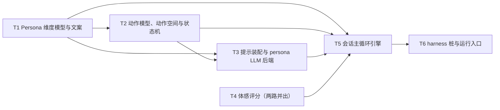

# 0005 用户侧重型实现：控制信封模拟器与体感评分

> 本文件由 `spec render` 自动生成，请勿手工编辑。
> 内容来源：本组 `metadata.yaml` 与 `tasks/T*.yaml`（关联 issue #0）。

## 总览

本组实现进化闭环 **a｜用户侧** 的重型版：以「控制信封」架构替代 spec-0001/T3 的最小桩，让 user agent
更拟真地多轮使用 harness（能力分叉、追问、绕路、放弃），并补齐 spec-0001 的训练信号
**FeelingScore（1–4 体感分）**。落点 `backend/auto_designer/user/sim/`，与 0001 最小实现**并存、不覆盖**。

数据流脊柱（贯穿 T1…T6）：

```
Persona 维度(T1) ─► 动作空间/状态机(T2) ◄─ 提示装配 + LLM 后端(T3)
                              │  每轮 persona 三层决策
                              ▼
                    会话主循环引擎(T5) ⇄ harness 桩(T6)
                              │  会话末
                              ▼
                  体感评分 两路并出(T4) ─► FeelingScore 1–4（训练信号）
```

读图即读任务：**T1** 定 persona 静态系数；**T2** 定每轮「能做什么 + 情绪如何演化」（纯主观状态机）；
**T3** 把上下文喂 LLM 并取结构化判断、含会话末自评请求；**T5** 把它们编排成「跑一局」；**T4** 在会话末
产出训练信号（LLM 自评为主 + 框架派生兜底/校验）；**T6** 提供离线可跑的 harness 桩与运行入口。

**本轮纯主观（客观线不实现）**：本组只取用户体感作训练信号；客观真值线（gold / GAP / ESCAPED_BUG /
control-plane）整体推迟，不写 state、不进体感、harness 桩只回文本。能力分叉改由「persona 能力 + 文本感知」
驱动，bug 直接体现在 harness 回复文本里。这与项目「训练信号=用户体感、benchmark held-out」一致；客观真值
线的观测留待后续 spec。

**与 0001 及闭环的关系**：本组是 0001 用户侧(a) 的重型实现/演进。真正接入闭环所需的契约并轨
（引擎 `run_session` ↔ 0001/T4、harness 桩 ↔ 0001/T2 `HarnessInterface`、9 维 Persona 与
`FeelingScore` 与 `models` 并轨、LLM 后端收敛 0003/T2 `nexau_runtime`、`issue_artifact` → `IssueDraft`）
集中记在各 Task 的 open-questions，归后续 Task/组。

## 任务编排



| 任务 | 标题 | 优先级 | 状态 | 依赖 |
|----|----|----|----|----|
| T1 | Persona 维度模型与文案 | P1 | pending | — |
| T2 | 动作模型、动作空间与状态机 | P1 | pending | T1 |
| T3 | 提示装配与 persona LLM 后端 | P1 | pending | T1, T2 |
| T4 | 体感评分（两路并出） | P1 | pending | 0001/T1 |
| T5 | 会话主循环引擎 | P1 | pending | T1, T2, T3, T4 |
| T6 | harness 桩与运行入口 | P2 | pending | T5 |

## 各任务方案

### T1 · Persona 维度模型与文案（P1 / pending）

**涉及文件**

- `backend/auto_designer/user/sim/dimensions.py`
- `backend/auto_designer/user/sim/clauses.py`
- `backend/tests/user/sim/test_dimensions.py`

**做什么**

控制信封的 persona 模型：9 维（D1 评估能力 / D2 领域深度 / D3 验收阈值 / D4.1-4.3 委派·监督·纠偏 /
D5 自主性 / D6 授权 + 派生 trust），以及维度→英文注入文案的确定性查表（clauses）。persona 为会话级
静态系数，会话开始定死、循环中不变。是 spec-0001/T1 自由文本 Persona 的结构化重型版。

**为什么**

训练信号「真不真」取决于 persona 扮得「像不像真人」。自由文本 Persona 难以稳定驱动能力分叉
（同一 harness 轨迹下浅层用户接受、专家识破）。结构化维度 + 确定性派生使 persona 可复现、可采样、
可 codegen，并把「能感知什么」与「验收到什么程度」量化为可被动作空间与状态机消费的系数。

**范围**

定义 9 维结构化 persona（D1 评估能力/D2 领域深度/D3 验收阈值/D4.1-4.3 交互/D5 自主性/D6 授权 + trust）及其确定性派生（derive_d3/derive_trust/derive_d6/finalize_persona），与维度→英文注入文案的查表（clauses）。persona 为会话级静态系数，不在循环中变化。

**整体设计**

维度分五层：A 能力底座(D1,D2)、B 验收(D3 派生 D1×D2)、C 交互(D4.1/4.2/4.3)、D 会话配置(D5,D6 半派生)、
E 派生(trust = f(D1,D2))。自由采样维度由调用方给定；派生维度由 finalize_persona 确定性填齐：
- derive_d3：D1 定基线档，D2.depth 资深+1/新手-1（枚举序内 clamp）。
- derive_trust：BLIND→blind、EXPERT→skeptical、其余 balanced。
- derive_d6：D5 定基线，task_risk 高收紧一档、collaborative+低风险放开可跑。
clauses 为每个维度取值给一句英文注入文案，compile_block_p 拼成 BLOCK-P（喂 persona LLM，不掺状态数值）。

**接口**

Persona(persona_id, d1, d2, d41, d42, d43, d5, d3=, d6=, trust=)   # frozen dataclass
finalize_persona(p: Persona, task_risk: str = "low") -> Persona      # 填齐派生维度
compile_block_p(p: Persona) -> str                                   # 维度 → BLOCK-P 文案

**取舍**

- 9 维结构化 vs spec-0001/T1 自由文本五元组：选结构化（驱动能力分叉、可复现/可采样），代价是建模成本；
  与 models.Persona 的并轨留待接入闭环（见 open-questions）。
- 派生维度确定性查表 vs LLM 推断：选确定性，保证可复现与可 codegen，杜绝采样噪声进入静态系数。

**验收标准**

finalize_persona 对任意自由采样维度产出完整不可变 persona；派生映射确定性可复现；compile_block_p 对每个维度取值产出对应文案，无缺漏键。

**测试**

单测：
- finalize_persona：对各档 D1/D2/D5 组合，派生 d3/trust/d6 与查表一致、可复现。
- derive_d3：senior 抬一档、novice 降一档且在枚举序内 clamp（不越界）。
- compile_block_p：每个维度取值都命中文案、无 KeyError；frozen persona 不可变。

**参考**

spec-0001/T1 Persona 字段约定。CLAUDE.md：persona 来自真实数据、不依据 benchmark 构造。
参考实现见本组 prototype（dimensions.py / clauses.py）。

**待解问题**

接入闭环时 9 维 Persona 与 spec-0001 models.Persona（五元组）如何并轨：扩展 models.Persona、
还是加 9 维↔五元组转换层？本组先自包含，留待 dev 侧对接时定。

### T2 · 动作模型、动作空间与状态机（P1 / pending）

**涉及文件**

- `backend/auto_designer/user/sim/actions.py`
- `backend/auto_designer/user/sim/action_space.py`
- `backend/auto_designer/user/sim/state.py`
- `backend/tests/user/sim/test_action_space.py`
- `backend/tests/user/sim/test_state.py`

**做什么**

控制信封的确定性机制层：动作目录（每个动作钉死 executor×channel×effect 三轴 + 终止原因）、动作空间
派生（局面 ∩ 能力掩码D1 ∩ 授权D6 ∪ 耐心门解锁的终止动作 ∪ accept）、自由产出归类与越权投影与
channel↔message 强校验、以及 patience/trust 状态机（只吃主观 verdict）。本轮纯主观，不含客观真值线。

**为什么**

把「用户这一轮能做什么、做完情绪怎么变」从 LLM 自由发挥收敛为可控、可复现的纯代码机制：能力掩码
保证低能力 persona 不会越级核查（G1 不偷看真值），耐心/信任状态机把情绪积分成可终止的轨迹。

**范围**

动作目录（executor×channel×effect 五属性钉死）+ 动作空间派生（phase ∩ 能力掩码D1 ∩ 授权D6 ∪ 耐心门终止 ∪ accept）+ 自由产出归类/越权投影/channel 校验 + patience/trust 状态机（只吃主观 verdict）。本轮不实现客观真值线（objective/gold/GAP/control-plane），状态只由主观 verdict 驱动。

**整体设计**

- 动作目录(actions)：send_task/refine_request/give_feedback/verify_self/ask_harness_run/
  request_evidence/grant_autorun/accept/give_up/file_issue，各钉死 executor∈{PERSONA_LOCAL,HARNESS,
  FRAMEWORK}、channel∈{EMIT,SILENT}、effect∈{ADVANCE,VERIFY,TERMINATE}；channel↔message 一致性强校验。
- 动作空间(action_space)：LEGAL_BY_PHASE ∩ cap_mask(D1) ∩ authz(D6)，耐心<=0 解锁 D4.3 选定的终止动作，
  有可接受产物加 accept；resolve_action 把 LLM 的 free/越权产出归类并投影回合法集。
- 状态机(state)：apply_verdict 仅按主观 verdict 改 patience/trust（satisfied↑信任、failed_blame_harness↓
  耐心↓信任…）；persona 派生系数(make_coef) 决定演化速率。客观真值不参与状态演化（本轮不实现客观线）。

**接口**

derive_action_space(phase, persona, state, has_artifact) -> list[str]
resolve_action(ret: dict, space: list[str], persona) -> tuple[action_id, message]
apply_verdict(state, verdict, coef) -> State

**取舍**

- executor×channel 双轴钉死 vs 单一 run_once 动作：选双轴，根除「自己跑 vs 让 harness 跑」的归属歧义。
- 能力掩码 gate 动作 + 感知输入 vs 只 gate 动作：选都 gate，防强模型「心算」源码越过低能力档（G1）。
- 本轮纯主观（不实现客观线）vs 含 gold/GAP：选纯主观。训练信号只取用户体感，客观真值线（GAP/
  ESCAPED_BUG/control-plane）整体推迟，避免过早引入 oracle 依赖；后续如需观测再开 spec。

**验收标准**

派生动作空间随 phase/D1/D6/patience 正确增删；resolve_action 保证结果在空间内且 channel↔message 一致；apply_verdict 仅按主观 verdict 改 patience/trust；状态演化全程不读任何客观真值。

**测试**

单测：
- derive_action_space：OPENING 只含 send_task；ACTIVE 随 D1 能力掩码增删 verify_self/request_evidence；
  READ_ONLY/WRITE_NO_RUN 授权剔除 ask_harness_run/grant_autorun；patience<=0 解锁对应终止动作；有产物加 accept。
- resolve_action：free → 归类到合法动作；越权 → 同 effect 投影；SILENT 清空 message、EMIT 空则兜底；最终 assert_channel 通过。
- apply_verdict：satisfied/ failed_blame_harness/ failed_blame_self/ unsure 对 patience/trust 的增减符合系数。
- 纯主观：状态机仅依赖 verdict，构造不含任何客观字段的输入即可驱动全部分支。

**参考**

spec-0001/T2 黑盒对话协议（channel 语义对齐）。CLAUDE.md benchmark held-out。
参考实现见本组 prototype（actions/action_space/state.py）。

**待解问题**

客观真值线（objective/gold/GAP/control-plane）本轮不实现，整体推迟到后续观测 spec；届时按「只走旁路、
不写 state/persona、不进体感」的 held-out 约束补回。

### T3 · 提示装配与 persona LLM 后端（P1 / pending）

**涉及文件**

- `backend/auto_designer/user/sim/prompt.py`
- `backend/auto_designer/user/sim/persona_client.py`
- `backend/tests/user/sim/test_prompt.py`

**做什么**

提示装配与 persona LLM 后端。prompt：system = BLOCK-G（固定角色/铁律/输出契约）+ BLOCK-P（persona 实例，
T1 编译），KV-cache 友好（不变前缀在前）；每轮 user 消息 <task><history><harness_output><self_observation>
<action_space><mood>；会话末 build_rating_turn 自评请求。persona_client：PersonaClient 协议双后端——
ApiPersonaClient（OpenAI 兼容网关，reasoning 模型加固）/ ScriptedPersonaClient（离线脚本，含自评分支）。

**为什么**

persona 的主观判断必须由 LLM 在角色内产生，且输出要可被框架结构化消费（OUTPUT CONTRACT）。提示分层
把稳定前缀与善变状态分离以省 token；双后端让无 key 环境（CI/demo）也能跑通整条 loop，真实推理与框架
编排解耦。会话末自评请求是 T4 LLM 自评体感分的入口。

**范围**

system（BLOCK-G 固定 + BLOCK-P persona 实例，KV-cache 友好）+ 每轮 user 消息 + 会话末自评请求 build_rating_turn。PersonaClient 协议双后端：ApiPersonaClient（OpenAI 兼容网关）/ ScriptedPersonaClient（离线脚本，含自评分支）。后续可收敛到 0003/T2 nexau_runtime。

**整体设计**

- prompt：BLOCK_G 固定（ROLE / GROUND RULES G1-G5 / ACTION SEMANTICS / OUTPUT CONTRACT），
  build_system = BLOCK_G + compile_block_p(persona)；build_user_turn 拼每轮上下文，mood 仅离散标签
  （full/lowered/low/exhausted + trust）不进数值；build_rating_turn 覆盖动作契约、只要 {"score","reason"}。
- persona_client：PersonaClient.respond(system, user) -> dict。ApiPersonaClient 走 LLM_BASE_URL/
  LLM_API_KEY，enable_thinking=False 抑制 CoT、content 空回落 reasoning_content、退避重试、容错 JSON。
  ScriptedPersonaClient 读 system 的 D1/D3 档 + user 的 harness_output/mood 分叉，并对 <rate_experience> 自评。
- make_client：有网关/OPENAI_API_KEY 用 Api，否则回落 Scripted。

**接口**

build_system(persona) -> str; build_user_turn(task, history, harness_output, action_space, state) -> str
build_rating_turn(task, history, state) -> str
PersonaClient(Protocol).respond(system: str, user: str) -> dict   # {perceive,verdict,action,message} 或 {score,reason}
make_client() -> PersonaClient

**取舍**

- 约定文本 OUTPUT CONTRACT vs 强制 JSON schema / tool-calling：选约定文本 + 容错解析，避免对模型形态
  强假设（对齐「兼容多种 agent/模型」），解析失败安全降级。
- 自带 openai client vs 收敛到 0003/T2 nexau_runtime：当前自带（sim 可独立跑）；接入闭环时收敛到单一
  nexau 运行时（单一运行时约束），见 open-questions。

**验收标准**

build_system 前缀稳定；build_rating_turn 产出要求 {score,reason} 的 JSON 指令；ScriptedPersonaClient 对 <rate_experience> 返回 1–4 自评；_parse_json 容错（剥 fence/抽首个 {}）解析失败不崩。

**测试**

单测：
- build_system 前缀稳定（同 persona 多次一致）；build_user_turn 含全部 section；build_rating_turn 含 1–4 指令与 {"score","reason"}。
- ScriptedPersonaClient：开局发 send_task；<rate_experience> 返回 1–4；exhausted → file_issue/give_up；能力档分叉符合预期。
- _parse_json：剥 ```json fence、抽取首个 {...}、解析失败回落安全 dict 不抛。

**参考**

spec-0001/T3 LLM 后端注入为 Callable。CLAUDE.md 单一运行时 nexau（0003/T2）。
参考实现见本组 prototype（prompt.py / persona_client.py）。

**待解问题**

接入闭环时 PersonaClient 是否收敛到 0003/T2 nexau_runtime（单一运行时约束）：现有 ApiPersonaClient
与 nexau_runtime.Agent 后端形态不同（respond(system,user)->dict vs run(input)->str），需一层适配，待对接时定。

### T4 · 体感评分（两路并出）（P1 / pending）

**涉及文件**

- `backend/auto_designer/user/sim/feeling.py`
- `backend/tests/user/sim/test_feeling.py`

**做什么**

对齐 spec-0001 训练信号 FeelingScore 的产出。控制信封引擎原生只产 verdict / end_reason /
signals，缺 1–4 体感分；本任务补齐会话末两条产出路径并统一为 FeelingScore：① LLM 自评——
persona 在角色内按本人验收阈值打 1–4 + 理由，对齐 spec-0001/T3「会话末经 LLM 产出 FeelingScore」；
② 框架派生——从 end_reason 与主观 verdict / trust 确定性聚合，可复现。前者为主信号，后者作交叉
校验兼 LLM 解析失败兜底。两路输入均为主观信号，客观真值（gold）全程 held-out 不参与。

**为什么**

整条自进化的训练信号是用户体感（FeelingScore 1–4）。控制信封引擎此前只产结构化 verdict 与终止
原因，与 spec-0001 训练信号契约的缺口正在于此；补齐体感分是把该引擎接入闭环用户侧的前置。
两路并出的动机：LLM 自评贴近真实满意度但有噪声、可能解析失败；框架派生可复现且永远可得，互为
校验与兜底。

**范围**

把控制信封会话末态产出对齐 spec-0001 的训练信号 FeelingScore（1–4 + reason，构造期断言越界、可双向序列化）。两路并出：① parse_feeling_llm 解析 persona LLM 会话末自评（spec-0001/T3 产出方式）；② derive_feeling 从主观末态（end_reason/failed_blame_harness 次数/trust）确定性聚合，作交叉校验与 LLM 解析失败兜底。全程不读客观真值（gold held-out）。

**整体设计**

两路均在会话末产出一次，互不耦合：

① LLM 自评（parse_feeling_llm）
- prompt（0005/T3 build_rating_turn）让 persona 跳出对话，按本人验收阈值(G4)给 1–4 + 一句理由，
  覆盖动作 OUTPUT CONTRACT 只要 {"score","reason"}。
- 容错解析：缺 score / 非整数 / 越界 → 返回 None（越界经 FeelingScore.__post_init__ 断言失败被
  捕获），交由调用方回落派生分，不崩 loop。

② 框架派生（derive_feeling）—— 只吃主观末态：

| end_reason              | base |
|-------------------------|------|
| accepted                | 4    |
| max_turns / issue_filed | 2    |
| abandoned               | 1    |

其余 end_reason 落 2。摩擦修正：accepted 但 failed_blame_harness>=2 或末态 trust=skeptical → 降为 3。

FeelingScore 契约对齐 spec-0001/T1：score:int(1..4) + reason，__post_init__ 越界即失败，
to_dict/from_dict 双向序列化（from_dict 忽略未知键，前向兼容）。

held-out 边界：两路输入均为主观信号（end_reason / verdict / trust），不读 objective 的 gold。

**接口**

FeelingScore(score: int, reason: str)            # __post_init__ 断言 1<=score<=4；to_dict/from_dict
parse_feeling_llm(ret: dict) -> FeelingScore | None   # 解析 LLM 自评；无效（缺字段/非整数/越界）返回 None
derive_feeling(end_reason: str, turns: list) -> FeelingScore  # turns 仅 duck-type 读 verdict/trust

**取舍**

- 两路并出 vs 只取一路：选并出。只取 LLM 自评则解析失败即无信号、且不可复现；只取派生则丢失 persona
  角色内的真实满意度。并出以 LLM 为主、派生兜底兼校验，代价是多一次 LLM 调用与一个冗余字段。
- 派生分由代码聚合 vs 让 LLM 直接打分：spec-0001/T3 字面要求 LLM 产出；但控制信封每轮已产 verdict，
  再让 LLM 额外打 1–4 与之冗余且引入噪声。折中：保留 LLM 自评对齐 spec，同时代码派生作可复现交叉校验。
- 复用 0001 models.FeelingScore vs sim 内自定义：当前 sim 自包含定义（零跨包耦合、可独立测）；接入闭环
  时再改用 models.FeelingScore，见 open-questions。
- 越界处理 assert+捕获为 None vs 直接抛：选前者。既守住「越界即非法」的单一校验点（T1 __post_init__），
  又不让一次坏自评崩掉整局。

**验收标准**

FeelingScore 越界(0/5)构造期断言失败、to_dict/from_dict round-trip 一致；parse_feeling_llm 对合法 {score,reason} 产出 FeelingScore，缺字段/非整数/越界返回 None；derive_feeling 对 accepted→4(摩擦多降3)/max_turns,issue_filed→2/abandoned→1；两路均不依赖 gold。

**测试**

单测：
- FeelingScore round-trip(to_dict/from_dict) 字段级一致；越界(0/5) 构造期断言失败。
- parse_feeling_llm：合法 {score,reason}→FeelingScore；缺 score / score 非整数 / 越界(5) → None；
  reason 缺省空串。
- derive_feeling：accepted+少失败→4；accepted+failed_blame_harness>=2→3；accepted+trust=skeptical→3；
  max_turns→2；issue_filed→2；abandoned→1；未知 end_reason→2。
- held-out：构造仅含主观字段的 turns，确认派生分不读任何 gold 字段。

**参考**

spec-0001/T1 FeelingScore 数据契约；spec-0001/T3「会话末经 LLM 产出 FeelingScore」。
CLAUDE.md 用户侧(a)：体感评分作训练信号、benchmark held-out。参考实现见本组 prototype（feeling.py）。

**待解问题**

接入闭环时是否将 sim 的 FeelingScore 收敛为复用 spec-0001 models.FeelingScore（去重、单一数据契约）？
两路分歧时（如 1 vs 2）训练信号取 LLM 自评、派生还是融合，待 dev 侧体感门禁（0003/T4）对接时定。
评分细则（阈值/权重）为 CLAUDE.md 待定项#1，本组给出首版粗映射，待真实数据校准。

### T5 · 会话主循环引擎（P1 / pending）

**涉及文件**

- `backend/auto_designer/user/sim/loop.py`
- `backend/tests/user/sim/test_loop.py`

**做什么**

控制信封会话主循环，是 spec-0001/T3「用户 agent 驱动器」的重型实现：把 persona 模型(T1)、动作空间
与状态机(T2)、提示与 LLM 后端(T3)、体感评分(T4) 编排成一局完整会话。每轮按「派生动作空间 → persona
三层决策(perceive/verdict/action/message) → resolve 归类与投影 → 状态写回 → 终止判定」推进；会话末两路
并出体感分。本轮纯主观（不含客观真值线）；逐轮真人对话走自立协议，不套 harbor 批式 episode 接口。

**为什么**

spec-0001/T3 的最小桩用「sentinel + max_turns」驱动多轮，拟真度有限。控制信封以「能力掩码 + 耐心/信任
状态机」更真实地刻画追问、绕路、卡顿、放弃等真实使用行为——训练信号的真实性正取决于此。
本任务把分散部件总装为唯一的「跑一局」引擎，供上层接入用户侧(a) 与 dev 侧体感门禁复用。

**范围**

控制信封主循环（≈ spec-0001/T3 UserAgent.run 的重型实现）：每轮 派生动作空间→persona 三层决策(perceive/verdict/action/message)→resolve→状态写回→终止判定；SessionResult 聚合 turns/signals/issue_artifact + 会话末两路体感（feeling=LLM自评 主信号 / feeling_derived=框架派生）。本轮不实现客观真值线（无 gold/GAP/control-plane 硬覆盖）；harness 回复只取文本。逐轮真人对话自立协议（不走 harbor 批接口）。

**整体设计**

每轮流水线（turn < MAX_TURNS）：

```
① 物理接收   harness_output (文本)                  (harness 桩, T6)
② 派生动作空间 phase ∩ capD1 ∩ authzD6 ∪ 耐心门 ∪ accept   (T2)
③ persona 三层 LLM → {perceive, verdict, action, message}  (T3 client)
④ resolve     自由产出归类 + 越权投影 + channel 校验    (T2)
⑤ 状态写回    apply_verdict 只吃主观 verdict           (T2)
⑥ 终止判定    Effect.TERMINATE → 记 end_reason 并 break
⑦ 路由        EMIT → 驱动 harness 出下一轮；verify_self → 注入私有自观察
```

会话末（循环外）：先 derive_feeling 产派生分；再发 build_rating_turn 取 LLM 自评，
parse_feeling_llm 解析，失败回落派生分。两者分别落 SessionResult.feeling / feeling_derived。

signals 为行为信号（如低能力用户无法自修而放弃），从 persona 与会话轨迹派生；本轮不含任何依赖客观
真值的信号（GAP/ESCAPED_BUG/control-plane 推迟，见 T2 open-questions）。

**接口**

run_session(persona: Persona, client: PersonaClient, harness, task: str) -> SessionResult
SessionResult(persona_id, end_reason, turns: list[TurnLog], signals: list[str],
              issue_artifact: str | None,
              feeling: FeelingScore | None,          # LLM 自评（主信号）
              feeling_derived: FeelingScore | None)  # 框架派生（交叉校验/兜底）
注：此为引擎原生签名；与 spec-0001/T4 run_session(persona, scenario, harness, user_agent,
tracker, store) 的契约对齐留待接入闭环时做（见 open-questions）。

**取舍**

- 控制信封引擎 vs spec-0001/T3 最小桩：选引擎。最小桩仅 sentinel+max_turns，无法表达能力分叉与
  情绪演化，训练信号失真；引擎更贴真实使用，代价是复杂度与多模块依赖。
- 自立逐轮协议 vs 复用 harbor 批式 episode：选自立。harbor 接口粒度是 episode，套到「逐轮真人对话 +
  用户自判终止」语义错位（与 spec-0001/T2、0004 决策一致）。
- 体感末态产出 vs 逐轮打分：选末态一次（对齐 FeelingScore「一局一个总分」），丢失「第几轮变差」的
  细粒度，后续若需再升级。

**验收标准**

给定 persona+client+harness+task 跑出 SessionResult；自判终止与 MAX_TURNS 兜底均生效；会话末 feeling 与 feeling_derived 均为合法 FeelingScore（LLM 解析失败时 feeling 回落 derived）；体感与状态全程只依赖主观信号，不读客观真值。

**测试**

单测/集成（离线 ScriptedPersonaClient + 脚本化 harness）：
- 跑通一局：给定 persona+client+harness+task 返回 SessionResult，turns 与收发序列一致。
- 自判终止：persona 在第 k 轮发终止动作 → 恰好 k 轮；永不终止 → 轮数达 MAX_TURNS 截断。
- 体感两路：会话末 feeling 与 feeling_derived 均为合法 FeelingScore；LLM 自评解析失败时 feeling 回落 derived。
- 纯主观：构造无任何客观字段的 harness 文本回复即可跑通；状态/体感不依赖 gold。
- 能力分叉：低能力 persona 跑通常规用例即 accept（高体感）；高能力 persona 逼证据至耐心耗尽 → file_issue（低体感）。

**参考**

spec-0001/T3 用户 agent 驱动器（最小桩）、T2 黑盒对话协议、T4 会话编排 run_session。
spec-0004 分层（harbor 只包外层 rollout，逐轮对话自立）。参考实现见本组 prototype（loop.py）。

**待解问题**

harness 已统一为 spec-0001/T2 HarnessInterface(send/reset/close)（本组 T6）。接入闭环仍需把引擎原生
run_session(persona, client, harness, task) 适配为 spec-0001/T4 的 run_session(persona, scenario,
harness, user_agent, tracker, store)：turns 投影为 Transcript、issue_artifact 转 IssueDraft 经
IssueTracker、9 维 Persona 与 FeelingScore 与 models 并轨。此适配归后续 Task/组。

### T6 · harness 桩与运行入口（P2 / pending）

**涉及文件**

- `backend/auto_designer/user/sim/harness_adapter.py`
- `backend/auto_designer/user/sim/scenarios.py`
- `backend/auto_designer/user/sim/demo.py`
- `backend/auto_designer/user/sim/run_live.py`
- `backend/tests/user/sim/test_harness_adapter.py`

**做什么**

脚本化 harness 桩与运行入口。harness_adapter.ScriptedHarness / scenarios.SplitBillHarness 直接实现
spec-0001/T2 的 HarnessInterface（send/reset/close）：send(message) -> str，按预设轨迹复刻能力分叉场景
（timeutils DST / split_bill 丢分钱），bug 体现在回复文本里（如 sum=99.99），由 persona 凭能力自行识别——
本轮 send 只回文本、无 gold/exit_code（无客观线）。demo（离线脚本后端、无 key 可跑）与 run_live（真实
NexAU 网关）两个入口，并排打印两路体感分与行为信号。

**为什么**

要离线、确定性地验证整条控制信封 loop（CI/demo 无 key 可跑），并演示同一 harness 轨迹下能力分叉如何产生
不同体感——这是把引擎讲清楚、可回归的最小载体。生产中此适配层替换为真实 CLI harness。

**范围**

脚本化 harness（ScriptedHarness/SplitBillHarness）直接实现 HarnessInterface（send/reset/close）：send→str
按预设轨迹演示能力分叉场景，bug 仅以回复文本体现（send 不回 gold/exit_code，对齐本轮无客观线、harness 只输出
text）；reset 重置脚本步进、close 幂等空操作。demo（离线脚本后端，无 key 可跑）与 run_live（真实 NexAU 网关）
两个运行入口，并排打印两路体感分与行为信号。生产中此适配层替换为真实 CLI harness（同样实现 HarnessInterface，
归 0003/T1 launcher）。

**整体设计**

- harness 桩：实现 HarnessInterface（send/reset/close）。send 按预设步骤回应，仅消费 message 是否「要求运行
  / 探不可整除边界」分叉轨迹，返回纯文本（str）；reset 把脚本步进归零；close 置已关闭标志（无真资源）、幂等，
  close 后再 send/reset 抛 RuntimeError（对齐 FakeHarness 暴露误用）。bug 体现在文本中（如 split_bill(100,3)
  -> sum=99.99），高能力 persona 读文本即可识别，低能力 persona 看常规用例（sum=100）即接受——分叉完全由
  persona 能力 + 文本感知驱动，无需 gold。
- demo：make_client（无 key → ScriptedPersonaClient），两 persona（SHALLOW+FEEDBACK / EXPERT+FILE_ISSUE）
  各跑全新 harness 轨迹，print_result 并排打印 turns / 两路体感 / 行为信号 / issue artifact。
- run_live：固定 ApiPersonaClient（走 repo .env 网关）对真实 user-agent 跑 SplitBillHarness。

**接口**

ScriptedHarness / SplitBillHarness 实现 spec-0001/T2 HarnessInterface：
  send(message: str) -> str   # 本轮只回文本(无 gold/exit_code)
  reset() -> None             # 重置脚本步进, 幂等
  close() -> None             # 置已关闭标志(无真资源)；幂等，close 后再 send/reset 抛 RuntimeError
demo.main() / run_live.main()   # 两个 __main__ 运行入口

**取舍**

- 脚本化 harness vs 真实 CLI harness：本组用脚本化（确定性、可回归、无外部依赖），但与真实接入统一实现
  spec-0001/T2 的 HarnessInterface（send/reset/close）；真实 CLI 接入归 0003/T1 launcher。
- send 回 str vs 回三元组(含 exit_code/gold)：选 str。本轮不实现客观线，无 gold/exit_code 消费方；
  与 spec-0001/T2 send->str 契约一致，桩可直接喂给依赖 HarnessInterface 的消费方。

**验收标准**

ScriptedHarness/SplitBillHarness 满足 HarnessInterface（isinstance 通过、send/reset/close 齐备）；与 FakeHarness 行为一致：close 后再 send/reset 抛 RuntimeError、重复 close 幂等不抛；demo 无 key 用 ScriptedPersonaClient 跑通两 persona 并打印 llm-rated/derived 两路体感；run_live 在配好网关时可对真实 user-agent 跑；harness 桩对'要求运行/探边界'分支产出预期文本轨迹。

**测试**

单测/烟测：
- 契约对齐：isinstance(ScriptedHarness()/SplitBillHarness(), HarnessInterface) 为真；reset 后脚本从首步重来；close 后 send/reset 抛 RuntimeError、重复 close 幂等不抛（对齐 FakeHarness）。
- harness 桩：首轮贴代码未跑；要求运行 → 回显常规用例(无报错)；探不可整除边界 → 文本暴露丢分钱/DST 错误；send 返回 str。
- demo 无 key 跑通两 persona，输出含 llm-rated 与 derived 两路体感分；断言能力分叉（浅层 accept / 专家 file_issue）。

**参考**

spec-0001/T2 HarnessInterface + FakeHarness（send/reset/close）、spec-0003/T1 harness launcher（真实接入）。
参考实现见本组 prototype（harness_adapter / scenarios / demo / run_live.py）。

**待解问题**

桩已实现 HarnessInterface（send/reset/close）；真实 CLI harness 接入仍归 0003/T1 launcher。控制平面（进程
exit_code）与客观真值线是否后续补回，归后续观测 spec，本轮不涉及。
