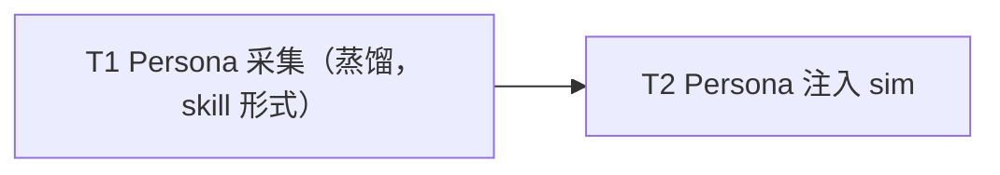

# 0006 Persona 管线：采集（蒸馏）与注入 sim

> 本文件由 `spec render` 自动生成，请勿手工编辑。
> 内容来源：本组 `metadata.yaml` 与 `tasks/T*.yaml`（关联 issue #0）。

## 总览

本组实现 persona 管线：把「从真实数据采集 persona」与「把 persona 注入控制信封 sim」串成一条链，
为 0005 的用户侧重型实现供给真实画像。对应 CLAUDE.md「蒸馏模块」，落实约束「persona 来自真实数据、
不依据 benchmark 或轨迹构造」。

数据流脊柱：

```
真实使用数据(第一人称自述 · GitHub 足迹 · Stack Overflow · 未来源)
        │  采集/归纳（T1，轮辐式：共享卡契约 + 薄抽取 skill）
        ▼
   persona 卡库（6 维行为卡：D1–D6 + authenticity/era/provenance）
        │  注入（T2，card_to_persona：grounded 轴透传 + 覆盖派生）
        ▼
   spec-0005 dimensions.Persona ─► 0005/T5 run_session 跑一局 ─► 体感 + issue
```

读图即读任务：**T1** 定「采集什么、卡长什么样」——不另造 skill，而是收编既有的真实抽取方法（此前写在 NexAU 仓库里、非 NexAU 自身的方法），并按
**轮辐式**组织：唯一公共契约 `card-schema.md`（6 维卡 schema + 枚举 + D5 词表 + 注入分布 + 真实性门原则，
source-agnostic）+ 各「薄抽取 skill」只描述「从某类来源提取 + ground 哪几维」、只依赖契约、彼此不依赖。本步
先落契约 + `extract-selfreport-persona`（第一人称自述，唯一 ground 信任轴 D4 且带 card_to_persona 覆盖规则）；
cc/so/未来源作同契约的后续薄 skill 插入。库 schema 即该契约。**T2** 定「卡如何变成 sim 能跑的 Persona」
（唯一桥接层 card_to_persona）。

**覆盖派生（关键约束）**：6 维卡是「正交 ground 的真实画像」，每维各自有证据；sim 9 维里 d3/trust/d6 原是
「从 D1/D5 派生」。注入时 **卡里 grounded 的 验收 D2 → sim d3、信任 D4 → sim trust 直接写入、不被 derive_*
改写**（这两个正是 sim 的派生维），finalize_persona 只填卡未 ground 的派生维——否则 expert×over-trust
（selfreport 例 C / Karpathy）会被模拟成 skeptical×rigorous 的反面。此约束在 extract-selfreport-persona
reference 例 C 已写明（card_to_persona），并要求 0005/T1 把 finalize_persona 降为 fallback-only（本组同改）。
注：卡 D6 自主 → sim D5Autonomy 是采样维（直接写入，本无 derive）；sim 的派生维 D6Authz 卡中无对应来源，
仍按 D5Autonomy + task_risk 派生（见 T2）。

与 0005 的关系：本组是 0005（控制信封用户模拟器）的上游供给。6 维卡 ↔ sim 9 维 ↔ spec-0001 models.Persona
的最终并轨记在各 Task open-questions，待真实数据与下游需求收敛后定。

## 任务编排



| 任务 | 标题 | 优先级 | 状态 | 依赖 |
|----|----|----|----|----|
| T1 | Persona 采集（蒸馏，skill 形式） | P1 | pending | — |
| T2 | Persona 注入 sim | P1 | pending | T1, 0005/T1 |

## 各任务方案

### T1 · Persona 采集（蒸馏，skill 形式）（P1 / pending）

**涉及文件**

- `tools/persona-distill/card-schema.md`
- `tools/persona-distill/extract-selfreport-persona/SKILL.md`
- `tools/persona-distill/extract-selfreport-persona/reference.md`
- `tools/persona-distill/extract-selfreport-persona/recruitment/seeds.md`
- `backend/auto_designer/distill/library.py`
- `backend/tests/distill/test_library.py`

**做什么**

采集（蒸馏）侧按**轮辐式**组织，不另造大 skill：① 唯一公共契约 card-schema.md（source-agnostic）——
6 维行为卡 schema（D1–D6 + authenticity + era + provenance）+ 维度枚举 + D5.area 受控词表 + 注入分布 +
双向真实性门原则，采既有 selfreport skill 的最新约定（每维 source+basis+confidence、provenance 并集、value 键）；
② 薄抽取 skill extract-selfreport-persona——只描述「从第一人称自述（博客/访谈/演讲/推文长贴）提取 + ground
哪几维」，只引用契约、不依赖任何其它 skill。本步先落这两者；cc/so/未来源作同契约的后续薄 skill 插入。交付物：
③ persona 卡库的读写 library.py（按契约存取卡记录），供 0006/T2 注入消费。

**为什么**

整条进化的训练信号取自「模拟真实使用」分布上的用户体感；其真实性根植于 persona 是否来自真实数据。
既有真实抽取方法（此前写在 NexAU 仓库里，非 NexAU 自身的方法）已沉淀「证据或弃 / 维度正交 / 双向真实性门」——
重写必失真，故收编。更关键是**可扩展性**：这些 skill 现状是把公共 schema 只写在 cc、so/selfreport 反向引用 cc
（skill→skill 依赖），这正是 basis/provenance
在三者间漂移的根因。轮辐式把公共部分抽成唯一契约、各 skill 只依赖契约且彼此独立——契约改一处全员生效，
加新来源只是新增一个薄 skill，不碰别人。

**范围**

按轮辐式落地采集侧并定义 persona 卡库格式。本步范围：① card-schema.md（唯一公共契约：卡 schema + 枚举 + D5 词表 + 注入分布 + 真实性门原则，source-agnostic）；② extract-selfreport-persona（薄 skill，从第一人称自述提取，引用契约）；③ library.py 读写。不接具体数据源、不做卡→sim 注入映射（归 T2）。cc/so/未来源作同契约的后续薄 skill，留待补入（见 open-questions）。

**整体设计**

- 轮辐式结构（tools/persona-distill/）：
    card-schema.md            唯一公共契约（hub），source-agnostic
    extract-selfreport-persona/   薄 skill（spoke），只依赖契约
    (后续) extract-github-persona / extract-so-persona / …  各自薄 skill，同样只依赖契约
  铁律：skill 只依赖契约，**彼此不依赖**（杜绝 skill→skill 与多副本漂移）。
- card-schema.md（公共契约）：
    6 维行为卡：D1 评估能力 | D2 验收门槛(primary+flags) | D3 交互(delegation·supervision·on_offtrack) |
      D4 信任 | D5 领域(area+depth+stack+weak) | D6 自主期望
    每维携 {value | (primary,flags), source(grounded|injected), basis(observed|stated|stated+observed), confidence}；
    meta：authenticity / era{value,basis} / provenance（并集：layers? · sources? · self_report? · reputation? +
    evidence_quotes[{quote,source}]）。另含：D1–D6 枚举取值、D5.area 受控词表、注入分布、双向真实性门原则。
- extract-selfreport-persona（薄 skill）：从第一人称自述提取，强 ground D2/D3/D4/D6（验收/交互/信任/自主），
  D1/D5 为 medium 需佐证；含 stated→confidence 规则与 performative/promotional/second-hand 真实性门；
  枚举/词表/注入/卡形状一律引用 card-schema.md，不再内嵌。
- library.py：一个库文件承载多条卡记录；纯数据，可双向序列化、对未知键前向兼容（演化友好）；提供
  load / get(id) / add 最小读写。
- 卡格式与 sim 9 维 Persona 解耦：卡是「采集到的真实画像（正交 ground）」，到 sim 维度的映射（含 grounded
  覆盖派生）归 0006/T2。

**接口**

PersonaLibrary(root|path)
- load() -> list[dict]            # 读全库（卡记录）
- get(persona_id: str) -> dict    # 按 id 取一条卡
- add(record: dict) -> None       # 追加一条卡记录
卡 schema 由 card-schema.md（唯一契约）定义；与 spec-0001 models.Persona 的并轨见 open-questions。

**取舍**

- 轮辐式公共契约 vs 各 skill 自带 schema：选轮辐式。各自带必漂移（既有 skill 现状 basis/provenance 已在三者间
  漂移）；契约一处改全员生效，新来源只插一个薄 skill、彼此解耦可扩展。代价是要先把公共部分抽成契约。
- 收编真实方法 vs 另写 persona-distill skill：选收编。真实抽取已沉淀「证据或弃/正交/双向真实性门」，重写
  必失真且违背「persona 来自真实数据」；代价是带进跨仓制品需 vendored 并标注来源。
- 先 selfreport vs 三源齐上：选 selfreport 首切片。它唯一 ground 信任轴 D4、且带 card_to_persona 覆盖派生
  规则（正是 0006/T2 所需）；cc/so 作同契约后续薄 skill 插入，避免首切片体量过大。

**验收标准**

card-schema.md 为唯一 source-agnostic 公共契约（卡 schema + 枚举 + D5 词表 + 注入分布 + 真实性门原则）；extract-selfreport-persona 为薄 skill，只引用契约、无 skill→skill 依赖、无悬空引用；library 按契约读写多条卡库、可按 id 取、对未知键前向兼容；卡记录不含任何 benchmark/轨迹派生字段；D5.area 为受控词表单 token。

**测试**

单测：
- PersonaLibrary 读写：add 后 load 含该条、get(id) 取回等价记录；空库 load 返回空列表。
- 卡 schema round-trip：含 source/basis/confidence 与 provenance 并集字段的记录 to/from dict 字段级一致；
  遇未知键忽略不报错（前向兼容）。
- 约束校验：卡记录不含 benchmark/轨迹派生字段（字段白名单断言）；D5.area ∈ card-schema.md 受控词表。

**参考**

既有真实抽取方法（此前写在 NexAU 仓库，非 NexAU 自身方法；公共 schema 原出处）：extract-cc-user-persona
（GitHub，枚举/D5.area 词表/注入分布 canon）、extract-so-user-persona（Stack Overflow）、
extract-selfreport-persona（第一人称自述；reference 例 C 写明 card_to_persona 须以 grounded D2/D4 覆盖
derive_trust/derive_d3）。本组将其公共部分收敛为 card-schema.md 契约。
CLAUDE.md「蒸馏模块」「persona 来自真实数据、不依据 benchmark 或轨迹构造」；spec-0001/T1 Persona 字段约定。

**待解问题**

- cc/so（及未来源）作「只依赖 card-schema.md 的薄 skill」何时补入：本步先契约 + selfreport，余者后续插入。
- 是否把这些 skill 的源仓（NexAU 仓库，仅是它们此前的存放处）也重构为轮辐式（公共契约 + 薄 skill，补 basis/
  统一 provenance/补 card_to_persona 覆盖注记）？此为改其源仓，属另一件事；本仓 card-schema.md 统一以
  selfreport 最新约定为准。
- 6 维行为卡与 spec-0001 models.Persona（五元组）/ sim 9 维如何最终并轨？映射方式见 0006/T2。
- 是否同时蒸馏「种子场景库」(SeedScenario)？CLAUDE.md 蒸馏模块含场景库，本组先聚焦 persona，场景库另议。

### T2 · Persona 注入 sim（P1 / pending）

**涉及文件**

- `backend/auto_designer/user/sim/persona_io.py`
- `backend/tests/user/sim/test_persona_io.py`

**做什么**

把采集到的 persona 卡（0006/T1 6 维行为卡）注入控制信封 sim：card_to_persona 将一条卡映射为 sim 的
dimensions.Persona —— 卡里 grounded 的轴直接透传，finalize_persona 仅填卡未 ground 的派生维度（即
「覆盖派生」：grounded 的验收/信任/授权不被 derive_* 改写）。产物直接交 spec-0005/T5 run_session 使用。
是「采集」与「sim 引擎」之间的唯一桥接层。

**为什么**

采集产出的是「正交 ground 的真实画像」，sim 消费的是「9 维结构化系数」，两者格式不一，需一层显式、可测
的映射。更关键：sim 的 d3/trust/d6 原是「从 D1/D5 派生」，若注入时一律 finalize，会把卡里真实 ground 的
信任/验收/授权改写成合成值——例如 expert×over-trust 的 Karpathy（selfreport 例 C）会被模拟成 skeptical×rigorous
的反面，直接污染训练信号的真实性。故注入层必须让 grounded 值覆盖派生。

**范围**

把 persona 卡（0006/T1）注入 sim：card_to_persona 映射卡 → dimensions.Persona，grounded 轴透传、finalize_persona 只填卡未 ground 的派生维度（覆盖派生）；处理 6 维卡↔9 维的字段对齐、枚举并轨（surface↔shallow 等）、缺省与校验。不改卡格式（归 T1）；sim 维度模型仅做「finalize 降为 fallback-only」的配套修正（契约见 0005/T1，本组依赖）。不构造 harness/client（0005/T6）。

**整体设计**

- card_to_persona(record: dict) -> dimensions.Persona：按字段映射把卡翻成 sim 维度：
    卡 D1 评估能力          → D1Eval                （surface↔shallow 并轨）
    卡 D5 领域(area/depth/stack/weak) → D2Domain + D2Depth
    卡 D2 验收门槛(primary) → D3Accept
    卡 D3 交互(delegation/supervision/on_offtrack) → D41Grain / D42Supervise / D43Correct
    卡 D4 信任(over-trust/balanced/skeptical) → trust(blind/balanced/skeptical；over-trust↔blind)
    卡 D6 自主期望(advisory/collaborative/agentic) → D5Autonomy（采样维，直接写入）
  卡里 source=grounded 的轴直接写入对应 sim 维；其中 D2→d3、D4→trust 落在 sim 的派生维上（见覆盖派生），
  其余（D1/D5/D3/D6）落在采样维上、本就直接写入；缺的派生维调 0005/T1 finalize_persona 填齐。
- 覆盖派生（核心）：sim 的派生维只有 d3/trust/d6 三个。其中 d3(来自卡 D2)、trust(来自卡 D4) 在卡已 ground
  时直接写入、不被 derive_d3/derive_trust 改写——否则 expert×over-trust（selfreport 例 C / Karpathy）被模拟成
  skeptical×rigorous 的反面。依赖 0005/T1 把 finalize_persona 降为 fallback-only（只填卡未提供的派生维）。
- sim D6Authz（授权尺度，派生维）卡中无对应轴（卡 D6 是 autonomy_expectation，语义是「期望 agent 扮什么」
  而非「授权它能做什么」）→ 卡不 ground 它，仍由 finalize 按 D5Autonomy + task_risk 派生填齐。
- 非法/缺失枚举值显式报错（不静默兜底），把采集质量问题暴露在注入边界；批量入口 card_to_personas(library)。

**接口**

card_to_persona(record: dict) -> Persona        # 单条卡 → sim Persona；grounded 轴透传、其余 finalize 派生
card_to_personas(library: PersonaLibrary) -> list[Persona]

**取舍**

- grounded 覆盖派生 vs 一律 finalize：选覆盖。一律 finalize 会丢弃卡里真实 ground 的信任/验收/授权，把
  正交真实画像压成 sim 的派生面（违背训练信号真实性，见 selfreport 例 C）；代价是注入层要按 source 区分
  grounded/injected。
- 显式映射表 vs 卡与 sim 同构（免映射）：选显式映射。卡保留真实画像原貌、sim 用受控枚举，映射层吸收差异。
- 非法值报错 vs 安全缺省：选报错（缺省会把劣质采集悄悄变成"看似合法"的 persona，污染信号）。

**验收标准**

card_to_persona 对合法卡产出完整不可变 Persona：grounded 的 d3(卡 D2)/trust(卡 D4) 原样保留、卡未 ground 的派生维（d3/trust/d6 中缺的）经 finalize_persona 填齐；expert×over-trust 卡注入后 trust 仍为 over-trust 映射值（不被 derive_trust 改写成 skeptical）；缺字段/非法枚举显式报错；注入结果可直接喂 0005/T5 run_session 跑通一局。

**测试**

单测：
- 覆盖派生（核心）：selfreport 例 C / Karpathy（D1=expert、D4=over-trust、D2=ship-fast，均 grounded）注入后
  Persona.trust = over-trust 映射值（非 derive_trust(expert)=skeptical）、d3 非 rigorous —— 即 grounded 值未被改写。
- 透传+派生：grounded 轴透传；未提供的派生轴由 finalize 正确填齐、可复现。
- 枚举并轨/校验：surface↔shallow 等映射正确；非法/缺失枚举值 → 显式报错（不静默兜底）。
- 端到端：注入产物喂 0005/T5 run_session（离线 ScriptedPersonaClient + 脚本化 harness）跑通一局。
- 批量：card_to_personas 把多条卡映射为等长 Persona 列表。

**参考**

extract-selfreport-persona reference 例 C：card_to_persona 须以 grounded D2/D4 覆盖 derive_trust(expert)=skeptical /
derive_d3(expert)=rigorous，否则真实人物被模拟成其反面。spec-0005/T1 dimensions.Persona 与 finalize_persona
（fallback-only 契约，本组依赖）、spec-0005/T5 run_session 入口；0006/T1 卡 schema。

**待解问题**

- 依赖 0005/T1 把 finalize_persona 降为 fallback-only（本组同改）；若未就绪则覆盖派生无法生效。
- 6 维卡 → 9 维枚举映射表细则随 0006/T1 最终 schema 收敛；sim D6Authz 作注入轴的派生规则待定。
- 若后续卡 schema 与 sim 维度并轨（共用一套 Persona），本注入层可退化为薄校验或被移除。
