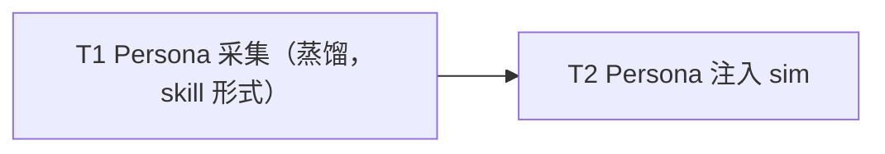

# 0006 Persona 管线：采集（蒸馏）与注入 sim

> 本文件由 `spec render` 自动生成，请勿手工编辑。
> 内容来源：本组 `metadata.yaml` 与 `tasks/T*.yaml`（关联 issue #0）。

## 总览

本组实现 persona 管线：把「从真实数据采集 persona」与「把 persona 注入控制信封 sim」串成一条链，
为 0005 的用户侧重型实现供给真实画像。对应 CLAUDE.md「蒸馏模块」，落实约束「persona 来自真实数据、
不依据 benchmark 或轨迹构造」。

数据流脊柱：

```
真实使用数据(CC/codex/nexau 日志 · issue · 反馈)
        │  采集/归纳（T1，蒸馏 skill + persona 库 schema）
        ▼
   persona 库（真实画像原貌）
        │  注入（T2，库记录 → sim 9 维 dimensions.Persona）
        ▼
   spec-0005/T5 run_session 跑一局 ─► 体感 + issue
```

读图即读任务：**T1** 定「采集什么、产物长什么样」（skill + 库 schema），守住 persona 不被 benchmark/轨迹
污染；**T2** 定「采集到的 persona 如何变成 sim 能跑的 Persona」（唯一桥接层，经 0005/T1 finalize_persona 填齐派生）。

与 0005 的关系：本组是 0005（控制信封用户模拟器）的上游供给。两组的 Persona 表示是否最终并轨（库 schema ↔
sim 9 维 ↔ spec-0001 models.Persona）记在各 Task open-questions，待真实数据与下游需求收敛后定。

## 任务编排



| 任务 | 标题 | 优先级 | 状态 | 依赖 |
|----|----|----|----|----|
| T1 | Persona 采集（蒸馏，skill 形式） | P1 | pending | — |
| T2 | Persona 注入 sim | P1 | pending | T1, 0005/T1 |

## 各任务方案

### T1 · Persona 采集（蒸馏，skill 形式）（P1 / pending）

**涉及文件**

- `tools/persona-distill/SKILL.md`
- `backend/auto_designer/distill/library.py`
- `backend/tests/distill/test_library.py`

**做什么**

CLAUDE.md「蒸馏模块」：从真实使用数据（CC/codex/nexau 真实日志、issue tracker、社区反馈）蒸馏出
persona 库。persona 来自真实数据、不依据 benchmark 或轨迹构造，以保证体感信号真实、避免训练目标与
测试目标互污染。交付物：① persona-distill skill（指导如何从原始数据归纳 persona 画像，可能以 skill 形式
随仓提供）；② persona 库的稳定 schema 与读写（library.py），一条记录承载一个画像，供 0006/T2 注入消费。

**为什么**

整条进化的训练信号取自「模拟真实使用」分布上的用户体感；该分布的真实性根植于 persona 是否来自真实
数据。把采集独立成模块/skill，既固化「persona 不依据 benchmark 构造」这条约束的落点，又把"如何归纳
画像"沉淀为可复用的方法（skill），与下游 sim 的消费解耦。

**范围**

从真实使用数据（CC/codex/nexau 真实日志、issue tracker、社区反馈）蒸馏出 persona 库（CLAUDE.md「蒸馏模块」）。persona 来自真实数据、不依据 benchmark 或轨迹构造，以保证体感信号真实、避免训练/测试目标互污染。交付物：① 一份 persona-distill skill（指导如何从原始数据归纳 persona 画像）；② persona 库的稳定 schema 与读写（library.py）：一条记录承载画像字段，可被 0006/T2 注入层消费。本任务定义采集产物与库格式，不绑定具体数据源接入。

**整体设计**

- persona-distill skill：一份 SKILL.md，描述采集来源（真实日志/issue/反馈）、归纳流程（从使用片段抽取
  身份/水平/领域/目标/说话风格等画像维度）、与「不引入 benchmark/轨迹特征」的硬约束。skill 产出喂 library。
- persona 库 schema（library.py）：一个库文件承载多条 persona 记录；每条为画像字段的纯数据，可双向
  序列化、对未知键前向兼容（演化友好）。提供读全库 / 按 id 取 / 追加的最小读写。
- 库格式与 sim 9 维 Persona 解耦：库是「采集到的原始画像」，到 sim 维度的映射归 0006/T2（注入层）。

**接口**

PersonaLibrary(root|path)
- load() -> list[dict]            # 读全库
- get(persona_id: str) -> dict    # 按 id 取一条
- add(record: dict) -> None       # 追加一条采集结果
库记录字段与 schema 由本任务定义（见 open-questions：是否对齐 spec-0001 Persona 五元组）。

**取舍**

- skill 形式 vs 纯代码自动管线：采集涉及对真实数据的判断与归纳，难以纯规则化；先以 skill 沉淀方法
  （人/agent 据此产出），代码侧只固化库 schema 与读写。后续可加自动抽取器，不锁死。
- 库为独立 schema vs 直接复用 spec-0001 models.Persona：先独立（采集关注「真实画像」原貌，可能比
  五元组更丰富），与 sim 维度的对齐交 T2；是否最终并轨见 open-questions。

**验收标准**

persona 库 schema 可双向序列化、对未知键前向兼容；library 读写一个多条 persona 库文件、可按 id 取；skill 描述清楚采集来源与归纳产物；产物不含任何 benchmark/轨迹派生字段。

**测试**

单测：
- PersonaLibrary 读写：add 后 load 含该条、get(id) 取回等价记录；空库 load 返回空列表。
- schema round-trip：记录 to/from dict 字段级一致；遇未知键忽略不报错（前向兼容）。
- 约束校验：库记录不含 benchmark/轨迹派生字段（按字段白名单断言）。

**参考**

CLAUDE.md「蒸馏模块」「persona 来自真实数据、不依据 benchmark 或轨迹构造」；spec-0001/T1 Persona
字段约定（来源标注归后续 distill spec —— 即本组）。

**待解问题**

- 采集最终是 skill（人/agent 据此归纳）还是含自动抽取器的代码管线？本组先 skill + 库 schema，自动化待定。
- persona 库 schema 是否对齐/扩展 spec-0001 models.Persona 五元组，还是更丰富的原貌格式？与 0006/T2 注入
  的映射方式一并定。
- 是否同时蒸馏「种子场景库」(SeedScenario)？CLAUDE.md 蒸馏模块含场景库，本组先聚焦 persona，场景库另议。

### T2 · Persona 注入 sim（P1 / pending）

**涉及文件**

- `backend/auto_designer/user/sim/persona_io.py`
- `backend/tests/user/sim/test_persona_io.py`

**做什么**

把采集到的 persona（0006/T1 库格式）注入控制信封 sim：load_persona 将一条库记录映射为 sim 的
dimensions.Persona（填好 9 维自由采样维度后经 finalize_persona 派生 d3/trust/d6），产物直接交
spec-0005/T5 run_session 使用。是「采集」与「sim 引擎」之间的唯一桥接层。

**为什么**

采集产出的是「真实画像原貌」，sim 消费的是「9 维结构化系数」，两者格式不一。需要一层显式、可测的
映射把库记录翻译成 sim 可跑的 Persona，否则采集与引擎无法对接。把映射单列，既隔离两侧的演化，又让
「真实画像 → 可执行 persona」这一步可验证。

**范围**

把采集到的 persona（0006/T1 库格式）注入控制信封 sim：load_persona 将库记录映射为 sim 的 dimensions.Persona（9 维自由采样维度 + finalize_persona 填齐派生），交 0005/T5 run_session 使用。处理库格式↔9 维的字段对齐、缺省与校验；不改库格式（归 T1）、不改 sim 维度模型（归 0005/T1）。

**整体设计**

- load_persona(record: dict) -> dimensions.Persona：按字段映射把库记录翻成 sim 的自由采样维度
  （d1/d2/d41/d42/d43/d5 + persona_id），再调 0005/T1 finalize_persona 填齐派生维度（d3/trust/d6）。
- 映射策略：库画像字段（身份/水平/领域/目标/说话风格…）→ 9 维枚举。无法直译的字段走显式映射表 +
  安全缺省；非法/缺失枚举值显式报错（不静默兜底），把"采集质量问题"暴露在注入边界。
- 批量入口 load_personas(library) 把整库映射为 list[Persona]，供 0005/T5 逐一跑会话。
- 仅做映射：不改库 schema（0006/T1）、不改 sim 维度模型（0005/T1）、不构造 harness/client（0005/T6）。

**接口**

load_persona(record: dict) -> Persona              # 单条库记录 → sim dimensions.Persona（已 finalize）
load_personas(library: PersonaLibrary) -> list[Persona]

**取舍**

- 显式映射表 vs 库与 sim 直接同构（免映射）：选显式映射。库保留真实画像原貌、sim 用受控枚举，两者
  职责不同；映射层吸收差异，代价是需维护一张对照表。
- 非法值报错 vs 安全缺省：选报错（缺省会把劣质采集悄悄变成"看似合法"的 persona，污染信号）；可缺省的
  仅限语义上确有默认的维度。

**验收标准**

load_persona 对合法库记录产出完整不可变 dimensions.Persona（派生维度经 finalize_persona 填齐）；缺字段/非法枚举值显式报错；注入结果可直接喂 0005/T5 run_session 跑通一局；round-trip（库→Persona）字段对齐无丢失。

**测试**

单测：
- load_persona：合法库记录 → 完整不可变 Persona，派生 d3/trust/d6 经 finalize_persona 正确填齐。
- 非法/缺失枚举值 → 显式报错（不静默兜底）；可缺省维度走安全默认。
- 端到端：注入产物喂 0005/T5 run_session（离线 ScriptedPersonaClient + 脚本化 harness）跑通一局。
- 批量：load_personas 把多条库记录映射为等长 Persona 列表。

**参考**

spec-0005/T1 dimensions.Persona 与 finalize_persona；spec-0005/T5 run_session 入口；0006/T1 库 schema。

**待解问题**

库画像字段 → 9 维枚举的映射表细则待定（依赖 0006/T1 最终 schema）。若后续库 schema 与 sim 维度并轨
（共用一套 Persona），本注入层可退化为薄校验或被移除。
