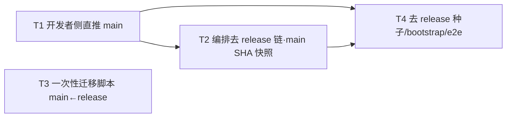

# 0007 · 开发者侧改为纯 trunk(main) 自进化

<!-- 本文件由 spec 工具维护：frontmatter 为结构化源数据（含 tasks DAG），正文为组级 rust-RFC 9 段总览。 -->

## Summary

> 0071 清理后的当前映射：一次性迁移任务 T3 已退出 living task 列表，原脚本及测试归档，历史设计通过 Git 与 research/inventory.json 追溯。下文 release→main 迁移段落是原设计背景，不是当前操作入口；现行交付由 OpenAgents PR 合并，main SHA 观测仍保留。

去掉 harness 仓的 `release` 常驻分支、发版、体感门禁与回退，改纯 **trunk（单 `main`）** 自进化：user agent 永远使用最新 `main`（会话开始锁定其 HEAD SHA、整局跑该快照），dev agent 不分 bug/feature、直接 commit 到 `main`。每次成功推进给 `main` 打轻量 `vK` tag，**仅作观测锚点，不是发版**。一往无前，不回退。

一轮闭环（节点后标负责任务）：

```
a  user 会话(每局锁 main HEAD SHA, launcher 按 SHA checkout) ─产→ issue(Gitea) + 体感(SessionStore)
        │
b       └ dev agent(T1)  领一条 open issue → checkout main → 改 agents/main.md
                          → commit → git tag vK → git push origin main vK（无 branch/merge/门禁）
        │
c  orchestrator(T2) 回灌「main 最新 SHA」给下一轮 a；vK tag = 观测锚点
   迁移(T3) main ← release + 删分支；种子/bootstrap/e2e 去 release(T4)
```

## Motivation

**现状（背景就地复述，本 spec 自包含）。** harness 源码是托管于 Gitea 的独立 git 仓，原设计为 `release` 常驻分支 + 发版（`vK` tag）+ 体感门禁：dev 在 `fix/issue-N` 分支改 `agents/main.md`，`--no-ff` 合入 `release`、打 tag、推送；测试 agent 跑 N 局算平均体感、与 `release` 基线比较做回归门禁；orchestrator 把新 tag 作为下一轮用户侧的 harness。最近 commit `f27cc8c`「无门禁直接发版」移除了体感门禁与回退逻辑（`release.py` / `test_agent.py` 已删除）。

**门禁一去，`release` 退化为 `main` 的滞后副本，带来四个问题：**

1. **不挡任何东西** —— 门禁已删，`release` 分支不再承担任何把关职责。
2. **用户用滞后快照** —— user agent 跑的是 `release`（上一次切版的快照），dev 修好的 bug 要等下一次切版才对用户生效。
3. **削弱闭环核心信号** —— 训练信号是体感；切版滞后让体感 delta 无法干净归因到最近一次 commit，issue 曲线被切版节奏（而非真实改动）扭曲。
4. **仓状态混乱** —— `main` 冻在 557B 空种子、`release` 16KB 才是真进化版；`main` 是 `release` 的祖先（`release ⊃ main`，领先约 17 个提交）；遗留 4 条孤儿 `fix/issue-*` 分支与 re-seed 双 seed 历史；Gitea 默认分支仍指向冻结的 `main`。

**为什么改 trunk。** 项目约束是「训练信号（体感）与测试（benchmark held-out）分离，发版门禁只用体感、benchmark 全程不参与」。门禁既已移除，`release` 的唯一残余作用只是滞后。纯 trunk 让 dev 的每次 commit 立刻成为下一局用户所用的版本，使体感 delta 能干净归因到最近改动——这正是闭环最需要的纯净信号。坏 commit 不靠门禁拦截，而靠后续多轮迭代回正（梯度下降式）。

## Guide-level explanation

改完后各视角：

- **用户侧（a）**：每局会话开始记下 harness 仓 `main` 的 HEAD SHA，整个多轮会话固定跑这个 SHA（launcher 已支持按 SHA checkout，单会话内 harness 不会在脚下变）；体感分数与产出的 issue 都归因到该 SHA。下一局自然取到 dev 推进后的更新 `main`——对用户永远是「最新 main」。
- **开发者侧（b）**：单个 dev agent，不区分 bug/feature。`work_one` 领一条 open issue，端到端 `git checkout main → 改 agents/main.md → commit → git tag vK → git push origin main vK`。没有 branch、没有 merge、没有门禁。仓状态是 ground truth：新 `vK` tag 出现 = 成功，成功即 close 该 issue。`vK` 仅作版本戳。
- **观测（替代 release 的唯一正经用途）**：每次成功推进给 `main` 打 `vK` tag；体感回归 = 比较不同 `vK` tag 的体感**分布**（纯观测，不门禁、不挡）；benchmark held-out，指向某个 `vK` 的 SHA 事后判定。
- **分支模型**：只有 `main` 一条线，Gitea 默认分支保持 `main`（默认展示的就是真正在进化的版本）。`release`、孤儿 `fix/issue-*`、已合并分支全部删除。**一往无前，不回退。**

## Reference-level explanation

### 现状代码锚点（迁移前）

- `dev/agentic_developer.py:79` `branch=f"fix/issue-{issue.number}"`；`:132-135` 注入给 nexau 的流程 `git checkout -B {branch} release` → `git merge --no-ff {branch}` → `git tag` → `git push origin {branch} release {tag}`；`DevOutcome`（定义于 `:27-34`，含 `released: bool`）；`:103-104` `released = bool(new_tags)`（新 tag 出现即成功，沿用为 ground truth）。
- `loop/orchestrator.py:39` `run_round(self, release_ref)`；`:42` 整个 fixed_set 用同一 `release_ref` launch；`:54` `ref = outcome.tag`（release 链式回灌）；`:63` `run(initial_ref)`。
- `loop/run_state.py:24` `current_release_ref: str`（编排游标）。
- `harness/launcher.py:109-139` `_resolve_sha` + `_checkout`：**已**按 commit SHA 解析并按 SHA 缓存 checkout（`release` 这类会变分支，内容一变即落新目录，绝不复用陈旧 checkout）。→ **本 spec 无需改动 launcher。**
- `run.py:81` `_git(HARNESS_REPO, "branch", "release")`、`:226` `initial_ref="release"`；`scripts/bootstrap_harness.py:106-110` 建 `release` 分支。
- `agent_defs/developer_agent/systemprompt.md`：强制「第一步先建分支再改文件」`git checkout -B fix/issue-<N> release` + merge release + push branch/release/tag。

### 目标方案

| 关注点 | 现状 | 目标 |
|---|---|---|
| dev git 流程 | `fix/issue-N` 分支 + `--no-ff` merge `release` + tag + push branch/release/tag | `checkout main` → 改 → commit → `tag vK` → `push origin main vK` |
| `DevOutcome.released` | "已发版（new tag）" | 语义改为 "committed（已推 main）"；判定仍为「新 tag 出现」 |
| orchestrator 回灌 | `release_ref` 链：`ref = outcome.tag` | 去链；每局解析 `main` HEAD SHA、按该 SHA launch（会话级快照）；回灌 = 「main 最新 SHA」 |
| `run_state.current_release_ref` | 当前 release 版本 | 语义改为「当前 main SHA」（观测游标） |
| 分支 | `main` + `release` + 孤儿 + 已合并 | 仅 `main` |
| 门禁/回退/merge/release 链 | 存在（门禁已先删） | 全部去除 |
| launcher | 按 SHA checkout | **不动**（已满足会话级 SHA 快照） |

### DAG



T3（一次性迁移）与 T1 无代码依赖，可并行；T4 总装 e2e，依赖 T1、T2。

### 文件分配（各 Task `files` 互斥）

- **T1**：`dev/agentic_developer.py`、`agent_defs/developer_agent/systemprompt.md`、`tests/dev/test_agentic_developer.py`
- **T2**：`loop/orchestrator.py`、`loop/run_state.py`、`tests/loop/test_orchestrator.py`、`tests/loop/test_run_state.py`
- **T3**：`scripts/migrate_trunk_main.py`、`tests/test_migrate_trunk_main.py`
- **T4**：`run.py`、`scripts/bootstrap_harness.py`、`tests/test_bootstrap_harness.py`

### e2e 脚本

`backend/auto_designer/experiment/controllers/ordinary.py` —— 真实端到端跑一轮闭环（a→b→c，真 nexau + 真 Gitea + 本地 git 仓）。T4 改其种子（只种 `main`）、`initial_ref="main"` 与结果打印（「main SHA / 分支」取代「release_ref 链」）。

## Drawbacks

- **无门禁兜底**：dev 推坏 commit，`main` 立刻劣化、下一局用户即受影响，只靠后续多轮迭代回正；短期体感可能抖动。
- **不回退**：放弃「随时回到稳定版」的能力，历史上「稳定 release」的概念消失，benchmark 只能锚到任意 `vK`/SHA 而非一个被祝福的发布版。
- **`vK` 语义稀释**：tag 失去发版含义后可能堆积成纯计数器，需靠观测看板赋予意义。
- **一次性迁移有破坏性**：`git branch -f` 与删远端分支不可逆，迁移脚本须幂等且对错误仓状态安全。

## Rationale and alternatives

选纯 trunk，因为它让体感 delta 干净归因到最近 commit——闭环训练信号最纯，且与「门禁已移除」的现状一致、最简（奥卡姆）。

- **备选 A：保留 `release`，每轮自动 fast-forward 到 `main`。** 行为等价于 trunk，却多一层永远等于 `main` 的无意义分支与同步逻辑，违奥卡姆。
- **备选 B：重新引入体感门禁挡回退。** 与项目硬约束「发版门禁只用体感、benchmark held-out、体感只作训练信号/观测」相容性差，且门禁刚在 `f27cc8c` 被有意移除——重新加回是倒退。
- **备选 C：每 dev 用短命分支 + 即时合并。** 仍引入 merge 提交噪声、却无任何并发收益（当前 dev 串行），徒增复杂度。

故选 dev 直推 `main`。

## Prior art

- **Trunk-based development**：业界持续集成实践，单一主干、短迭代、避免长命分支，与本设计的「单 `main` + 不回退」一致。
- **项目原设计**：CLAUDE.md「harness 源码为独立 git 仓，`release` + `feature` 分支，tag 即发布版本」——本 spec 将其收敛为单 `main`，是对该设计在「门禁移除」后的修正。
- **直接前置**：commit `f27cc8c`「无门禁直接发版」移除体感门禁与回退，是本 spec 的触发点。

## Unresolved questions

- **`vK` tag 的粒度**：每条成功 issue 打一个 vs 每轮打一个？（当前实现：每条成功 issue 一个 `vK`，见 `agentic_developer.py:80,105`。）需用户确认。
- **体感/issue→SHA 归因的落盘**：MVP 是否仅靠「按 `main` HEAD SHA launch」隐式保证单会话快照即可，还是需把 SHA 显式写进 session 记录以支撑「按 `vK` 比体感分布」的观测？
- **迁移清单与执行者**：待删的 4 条孤儿 `fix/issue-*` 与 4 条已合并分支的确切名单，以及远端默认分支切换由脚本自动还是人工执行。

## Future possibilities

- 体感分布回归看板：按 `vK` tag 对比体感分布（纯观测，不门禁）。
- benchmark held-out 评测挂钩到选定 `vK` 的 SHA，事后验证体感驱动进化是否带来真实能力提升。
- 坏 commit 的「软回退」观测：标记（而非 `revert`）退化点，保持「一往无前」的同时可视化退化。
- 多 dev 并发直推 `main` 的冲突合并策略（当前串行各领不同 issue）。
