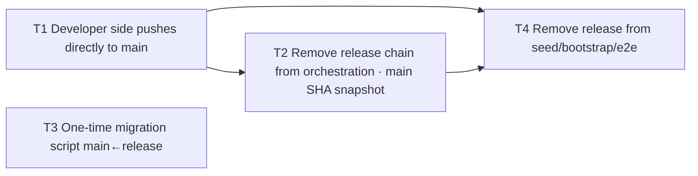

# 0007 · Change the developer side to pure trunk(main) self-evolution

<!-- This file is maintained by the spec tool: the frontmatter contains structured source data (including the tasks DAG), and the body is a nine-section group-level rust-RFC overview. -->

## Summary

> Current mapping after 0071 cleanup: the one-time migration task T3 has exited the living task list; the original scripts and tests have been archived, and the historical design is traceable through Git and research/inventory.json. The release→main migration paragraphs below describe the original design background and are not the current operational entry point; current delivery is handled by OpenAgents PR merges, while main SHA observation is retained.

Remove the harness repository's persistent `release` branch, releases, experience gates, and rollback, and switch to pure **trunk (single `main`)** self-evolution: the user agent always uses the latest `main` (locking its HEAD SHA at the start of a session and running the entire session on that snapshot), while the dev agent does not distinguish bugs from features and commits directly to `main`. After each successful advancement, create a lightweight `vK` tag on `main`, **for observation anchoring only, not a release**. Keep moving forward without rollback.

One closed loop (responsible task shown after each node):

```
a  user session (pin main HEAD SHA per session, launcher checks out by SHA) ─produces→ issue(Gitea) + user experience(SessionStore)
        │
b       └ dev agent(T1)  claim an open issue → checkout main → modify agents/main.md
                          → commit → git tag vK → git push origin main vK (no branch/merge/gate)
        │
c  orchestrator(T2) feeds the latest main SHA back to the next round of a; vK tag = observability anchor
   migration(T3) main ← release + delete branches; remove release from seed/bootstrap/e2e(T4)
```

## Motivation

**Current state (background restated here; this spec is self-contained).** The harness source is an independent Git repository hosted on Gitea. The original design used a persistent `release` branch plus releases (`vK` tag) and an experience gate: dev modified `agents/main.md` on the `fix/issue-N` branch, `--no-ff` merged it into `release`, created a tag, and pushed; the test agent ran N sessions, calculated the average experience score, and compared it with the `release` baseline for a regression gate; the orchestrator used the new tag as the harness for the next user-side round. The recent commit `f27cc8c` "release directly without a gate" removed the experience gate and rollback logic (`release.py` / `test_agent.py` have been deleted).

**Once the gate was removed, `release` degraded into a lagging copy of `main`, creating four problems:**

1. **It blocks nothing** — the gate has been removed, so the `release` branch no longer performs any gating function.
2. **Users run a lagging snapshot** — the user agent runs `release` (the snapshot from the previous cut); bugs fixed by dev do not take effect for users until the next cut.
3. **It weakens the core closed-loop signal** — the training signal is the experience score; the lag between cuts prevents the experience delta from being cleanly attributed to the latest commit, and the issue curve is distorted by the cutting cadence rather than by the actual changes.
4. **The repository state is confusing** — `main` is frozen at the 557B empty seed, while `release` at 16KB is the actual evolved version; `main` is an ancestor of `release` (`release ⊃ main`, approximately 17 commits behind); four orphan `fix/issue-*` branches and the re-seed double-seed history remain; Gitea's default branch still points to the frozen `main`.

**Why change to trunk.** The project constraint is that the training signal (experience score) and testing (benchmark held-out) are separated, and the release gate uses only the experience score, with the benchmark never participating. Once the gate has been removed, the sole remaining purpose of `release` is to lag behind. Pure trunk makes every dev commit immediately become the version used by the next user session, allowing the experience delta to be cleanly attributed to the latest change — exactly the clean signal the closed loop needs most. Bad commits are not stopped by a gate; subsequent rounds of iteration correct them, in a gradient-descent-like process.

## Guide-level explanation

After the change, the perspectives are as follows:

- **User side (a)**: At the start of each session, record the HEAD SHA of `main` in the harness repository, and run the entire multi-turn session against that SHA (the launcher already supports checkout by SHA, so the harness cannot change underfoot within a session); both the experience score and the resulting issues are attributed to that SHA. The next session naturally picks up the updated `main` after dev advances it — users always receive the "latest main".
- **Developer side (b)**: A single dev agent handles both bugs and features. `work_one` claims an open issue and completes `git checkout main → modify agents/main.md → commit → git tag vK → git push origin main vK` end to end. There are no branches, merges, or gates. The repository state is the ground truth: the appearance of a new `vK` tag means success, and success closes the issue. `vK` is only a version marker.
- **Observation (the only legitimate serious use replacing release)**: Create an `vK` tag on `main` after each successful advancement; experience regressions are observed by comparing the **distributions** of experience scores across different `vK` tags (observation only, with no gate or blocking); the benchmark is held out, and its result is determined retrospectively for the SHA associated with a given `vK`.
- **Branch model**: There is only one line, `main`, and Gitea's default branch remains `main` (the default view is the version that is actually evolving). Delete `release`, orphan `fix/issue-*` branches, and all merged branches. **Keep moving forward without rollback.**

## Reference-level explanation

### Current code anchors (before migration)

- `dev/agentic_developer.py:79` `branch=f"fix/issue-{issue.number}"`; the process injecting `:132-135` into nexau `git checkout -B {branch} release` → `git merge --no-ff {branch}` → `git tag` → `git push origin {branch} release {tag}`; `DevOutcome` (defined in `:27-34`, containing `released: bool`); `:103-104` `released = bool(new_tags)` (the appearance of a new tag means success and remains the ground truth).
- `loop/orchestrator.py:39` `run_round(self, release_ref)`; `:42` launches the entire fixed_set with the same `release_ref`; `:54` `ref = outcome.tag` (release chain feedback); `:63` `run(initial_ref)`.
- `loop/run_state.py:24` `current_release_ref: str` (orchestration cursor).
- `harness/launcher.py:109-139` `_resolve_sha` + `_checkout`: **already** resolves by commit SHA and caches checkout by SHA (a changing branch such as `release` creates a new directory whenever its contents change, and never reuses a stale checkout). → **This spec requires no launcher changes.**
- `run.py:81` `_git(HARNESS_REPO, "branch", "release")`, `:226` `initial_ref="release"`; `scripts/bootstrap_harness.py:106-110` creates the `release` branch.
- `agent_defs/developer_agent/systemprompt.md`: enforces "create the branch first, then modify files" `git checkout -B fix/issue-<N> release` + merge release + push branch/release/tag.

### Target design

| Concern | Current | Target |
|---|---|---|
| dev Git workflow | `fix/issue-N` branch + `--no-ff` merge `release` + tag + push branch/release/tag | `checkout main` → modify → commit → `tag vK` → `push origin main vK` |
| `DevOutcome.released` | "released (new tag)" | Semantics changed to "committed (pushed to main)"; determination remains "a new tag appears" |
| orchestrator feedback | `release_ref` chain: `ref = outcome.tag` | Remove the chain; for each session, resolve the `main` HEAD SHA and launch by that SHA (session-level snapshot); feedback = "latest main SHA" |
| `run_state.current_release_ref` | Current release version | Semantics changed to "current main SHA" (observation cursor) |
| Branches | `main` + `release` + orphan + merged | Only `main` |
| Gates/rollback/merge/release chain | Present (the gate was already removed) | Remove all |
| launcher | Checkout by SHA | **Do not change** (already provides a session-level SHA snapshot) |

### DAG



T3 (one-time migration) has no code dependency on T1 and can run in parallel; T4, the integrated e2e, depends on T1 and T2.

### File allocation (each Task `files` is mutually exclusive)

- **T1**: `dev/agentic_developer.py`, `agent_defs/developer_agent/systemprompt.md`, `tests/dev/test_agentic_developer.py`
- **T2**: `loop/orchestrator.py`, `loop/run_state.py`, `tests/loop/test_orchestrator.py`, `tests/loop/test_run_state.py`
- **T3**: `scripts/migrate_trunk_main.py`, `tests/test_migrate_trunk_main.py`
- **T4**: `run.py`, `scripts/bootstrap_harness.py`, `tests/test_bootstrap_harness.py`

### e2e script

`backend/ahe_beta/experiment/controllers/ordinary.py` —— Run one real end-to-end closed loop (a→b→c, with real nexau + real Gitea + a local Git repository). T4 changes its seed (seed only `main`), `initial_ref="main"`, and the result output ("main SHA / branch" replaces the "release_ref chain").

## Drawbacks

- **No gate fallback**: if dev pushes a bad commit, `main` immediately deteriorates and users are affected in the next session; correction relies only on subsequent rounds of iteration, so the experience score may fluctuate in the short term.
- **No rollback**: the ability to "return to a stable version at any time" is abandoned; the historical concept of a "stable release" disappears, and the benchmark can only be anchored to any `vK`/SHA rather than to a blessed release version.
- **Diluted meaning of `vK`**: after the tag loses its release meaning, it may accumulate as a pure counter and require an observation dashboard to give it meaning.
- **The one-time migration is destructive**: `git branch -f` and deleting remote branches are irreversible; the migration script must be idempotent and safe against erroneous repository states.

## Rationale and alternatives

Pure trunk is selected because it cleanly attributes the experience delta to the latest commit — the closed-loop training signal is purest — while matching the current state in which the gate has been removed and being the simplest option (Occam's razor).

- **Alternative A: retain `release` and automatically fast-forward it to `main` each round.** This is behaviorally equivalent to trunk, but adds a meaningless branch that is always equal to `main` and synchronization logic, contrary to Occam's razor.
- **Alternative B: reintroduce the experience gate to block regressions.** This is poorly compatible with the project's hard constraints that the release gate use only the experience score, the benchmark remain held out, and the experience score serve only as a training signal/observation; moreover, the gate was intentionally removed in `f27cc8c`, so adding it back would be a regression.
- **Alternative C: use a short-lived branch for each dev agent and merge immediately.** This still introduces merge-commit noise without any concurrency benefit (dev is currently serial), increasing complexity for no gain.

Therefore, dev pushes directly to `main`.

## Prior art

- **Trunk-based development**: an industry continuous-integration practice using a single mainline and short iterations while avoiding long-lived branches, consistent with this design's "single `main` + no rollback".
- **The project's original design**: CLAUDE.md stated that "the harness source is an independent Git repository, with `release` + `feature` branches, and a tag is the released version" — this spec consolidates that into a single `main` as a correction to the design after the gate was removed.
- **Direct trigger**: commit `f27cc8c` "release directly without a gate" removed the experience gate and rollback, triggering this spec.

## Unresolved questions

- **Granularity of `vK` tags**: one for each successful issue versus one per round? (Current implementation: one `vK` per successful issue; see `agentic_developer.py:80,105`.) User confirmation is required.
- **Persistence of experience/issue→SHA attribution**: for the MVP, is the implicit guarantee provided by launching via the `main` HEAD SHA and using a session-level snapshot sufficient, or must the SHA be written explicitly into the session record to support observing experience-score distributions by comparing `vK` tags?
- **Migration checklist and executor**: the exact names of the four orphan `fix/issue-*` branches and four merged branches to delete, and whether switching the remote default branch is performed automatically by the script or manually.

## Future possibilities

- Experience-distribution regression dashboard: compare experience-score distributions by `vK` tag (observation only, no gate).
- Attach benchmark held-out evaluation to the SHA of a selected `vK`, retrospectively verifying whether experience-driven evolution produces genuine capability improvements.
- "Soft rollback" observation for bad commits: mark (rather than `revert`) degradation points, visualizing degradation while preserving the "keep moving forward" approach.
- Conflict-merging strategy for multiple dev agents pushing directly to `main` concurrently (currently serial, with each claiming a different issue).
