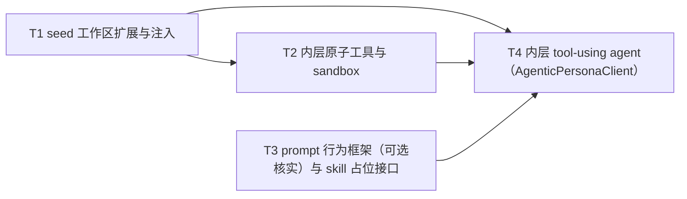

# 0008 用户 agent 内层 tool-using（自有环境核实）

> 本文件由 `spec render` 自动生成，请勿手工编辑。
> 内容来源：本组 `metadata.yaml` 与 `tasks/T*.yaml`（关联 issue #8）。

## 总览

本组把 spec-0005 用户侧的「单次 `respond()` 主观判断」升级为**可在自有环境核实的内层 tool-using agent**：
让模拟用户像真人一样，在起疑时用**自己的工具栈**（读码 / 跑命令 / 写脚本）在自有 sandbox **真执行**，
使 `verdict` grounded 在真实结果而非脑补。**外层控制信封（动作空间 / 状态机 / 体感 / 终止）原样不动**，
唯一接缝是 `PersonaClient.respond(system, user) -> dict`。落点 `backend/auto_designer/user/sim/`，是 0005/T3 的演进。

数据流脊柱（编号即执行序：先立工作区 T1，再内层执行 T2/T4，T3 并行）：

```
seed 场景 + 工作区 (T1: SeedScenario.workspace ─► materialize ─► 全新项目目录)
   │  注入链 sim_user 桥接每局 materialize → client.bind_session(persona, workspace_dir)（run_session 不动）
   ▼
外层控制信封 (0005/T5 run_session, 原样不动)
   │  接缝 respond(system,user) -> {perceive,verdict,action,message}
   ▼
内层 tool-using agent (T4 AgenticPersonaClient)
   ├─ 工具 = tool_stack(D1) ─► 原子工具 read_file/run_shell/write_file(+web_search 占位) 在 Sandbox(workspace) 真跑 (T2)
   ├─ prompt 行为框架: 可选核实（CAN=D1 工具门控, WILL=trust/D3/起疑, 默认不查） (T3)
   └─ skill 占位: D2 领域 playbook 扩展（通用、非 bug 特定, held-out） (T3)
```

读图即读任务：**T1** 先立工作区底座（现仓 seed 场景全仓只有 `description: str`，磁盘上没有项目可跑）——给
`SeedScenario` 加可选 workspace，每局 materialize 一个 in-repo 基线项目 fixture 当 sandbox 的 cwd；**T2** 造内层
agent 的「手」——原子工具 + sandbox（以工作区为 cwd）+ 按 D1 门控的工具集；**T3** 把 system prompt 的核实语义
从「义务」改为「可选、有成本」，并立 skill 占位接口（与 T1/T2 并行）；**T4** 把单次 `respond()` 换成有界
tool-calling 内层循环（控制反转只局部发生在这个接缝内）。执行序由 `depends-on` 表达且与编号一致：
**T1 → T2 → T4**，T3 并行。

**动机**：0005 的能力分叉靠 prompt G1「请 LLM 自律不偷看答案」+ 文本感知，脆弱——强模型会「心算」bug、
或靠脑补伪造负向感知。本组让能力分叉落在**工具可达性（D1 机械门控）+ 真实执行结果 + 是否起疑（可选核实）**上：
blind 无工具只能凭文本，shallow 能跑但写不出测试套件，competent/expert 能自写测试，而 expert 的「构造刁钻边界」
是不可化约的技巧差、归 prompt 行为。

**仍是纯主观、benchmark 仍 held-out**：真实执行结果对任何人都一样、**不是 gold**（与 0005 推迟的客观真值线
`gold/GAP/ESCAPED_BUG/control-plane` 无关，工作区亦不含 gold 测试）；能力分叉 = 工具门控 + 主观解读 + 是否起疑；
体感/状态仍只吃主观 `verdict`。核实是 persona 的角色内**可选**动作——真人（含专家）不会每次都跑，只在起疑且值得
时才查；默认不查。

**与 harness 完全解耦（关键）**：本组只动用户侧。harness 仍是 advisory（只输出文本建议），用户把助手提议的代码
贴进**自己的工作区拷贝**再跑——这正是真人对只会建议的助手的真实行为，无需 harness 先长出工具。「让 harness 真
编辑同一工作区、验证目标变成 harness 真实改动」是完全解耦的**第二期**，独立成上游 spec。

**与 0005 及闭环的关系**：本组是 0005/T3 LLM 后端的演进，外层 0005/T5 引擎零改动。`web_search` 工具、skill
真内容、依赖供给（venv/pip，MVP 用 stdlib-only 场景绕过）本轮**仅占位 / 留钩子**（skill 受「通用领域方法、绝不
bug/benchmark 特定」红线约束，对接 0006 蒸馏）；是否清理已渐冗余的外层 `verify_self`/`pending_self_obs`、是否给
内层喂显式状态信号、git 工作区来源、与 0003/T2 `nexau_runtime` 的 tool-calling 形态并轨，集中记在各 Task
open-questions，归后续 Task/组。

## 任务编排



| 任务 | 标题 | 优先级 | 状态 | 依赖 |
|----|----|----|----|----|
| T1 | seed 工作区扩展与注入 | P1 | done | — |
| T2 | 内层原子工具与 sandbox | P1 | done | T1 |
| T3 | prompt 行为框架（可选核实）与 skill 占位接口 | P1 | done | — |
| T4 | 内层 tool-using agent（AgenticPersonaClient） | P1 | done | T1, T2, T3 |

## 各任务方案

### T1 · seed 工作区扩展与注入（P1 / done）

**涉及文件**

- `backend/auto_designer/user/sim/workspace.py`
- `backend/seed_workspaces/billing-split/project/billing/core.py`
- `backend/seed_workspaces/billing-split/manifest.yaml`
- `backend/auto_designer/models.py`
- `backend/auto_designer/loop/sim_user.py`
- `backend/tests/user/sim/test_workspace.py`

**做什么**

本组的底座任务：给 SeedScenario 加一个可选 workspace 字段，让 seed 场景能携带一个 in-repo 基线项目（不再只有纯文本 description）；新增 workspace.py 的 materialize() 每局把 fixture 拷成一个临时全新目录，供内层 sandbox 当 cwd。落首个 fixture billing-split（stdlib-only，无第三方依赖），并把工作区目录顺着 sim_user 桥接注入 run_session。编号即执行序：本任务最先做，T2 的 sandbox / T4 的内层 agent 才有真实项目可跑。

**为什么**

现仓 seed 场景全仓只有 `description: str`，磁盘上没有任何可执行的项目——内层 agent（T2 工具 / T4 内层循环）若要「真执行核实」，必须有一个真实的项目上下文落脚，否则只能在空 tempdir 里跑孤立片段、跑不起有依赖或多模块的代码。本任务是 T2/T4 内层执行的底座：先把工作区立起来，后续工具、sandbox、agent 才有地方运行；这也是为什么它排在最前（编号=执行序）。与 harness 完全解耦——工作区只服务用户侧的自有核实，harness 仍只输出文本建议。

**范围**

1) models.py：SeedScenario 增 `workspace: WorkspaceSpec | None = None`（默认 None 时退化为今天的纯文本行为，全部既有路径不破）。2) workspace.py：定义 WorkspaceSpec（fixture 名/相对路径、setup 步骤占位）+ materialize(spec, dest) -> str，MVP 仅 copytree 落一个全新隔离目录并返回其路径。3) seed_workspaces/billing-split/：in-repo fixture——一个最小 stdlib-only 项目（manifest.yaml 描述元信息，project/billing/core.py 为可跑代码）。4) sim_user.py：把 materialize 出的工作区目录顺着桥接传进 run_session（作为后续 Sandbox 的 cwd 来源）。不实现依赖供给（venv/pip）、不实现 git 来源——仅本地 fixture copytree。

**整体设计**

注入链（关键：run_session 与 respond 两个签名都不动）：seed 场景（SeedScenario.workspace: WorkspaceSpec）─► loop/sim_user.py 桥接每局调 workspace.materialize(spec) 落地 ─► 得到全新项目目录 workspace_dir ─► 由 sim_user 在会话级守卫式绑定到内层 client（`if hasattr(client, "bind_session"): client.bind_session(persona=sim_persona, workspace_dir=ws)`）─► 内层 T4 AgenticPersonaClient 把它交给 Sandbox(workspace=workspace_dir) 当 cwd（T2）。为何走 bind 而非 run_session 参数：loop.py 不在本组任何任务的 files 内（信封不动），且 run_session 只喂 system/user 文本、不传 persona 对象，而内层 client 需要每局变化的 persona(选工具集) + workspace(建 Sandbox)——这两样只能在 sim_user 这层会话级注入；bind_session 对 Scripted/Api 是 no-op（无此方法）。每局一份全新拷贝，互不污染；session 结束可清理。MVP 用 stdlib-only fixture 把 materialize 压到「只 copytree」，依赖供给（cached venv / pip install）推到 setup 钩子的后续实现。fixture 放 backend/seed_workspaces/ 下作为版本化资产，与 benchmark held-out 红线无关（工作区不含 gold 测试）。

**接口**

WorkspaceSpec：dataclass，字段 `fixture: str`（seed_workspaces 下的目录名）、`setup: list[str] = []`（命令钩子，占位，本轮不执行）；带 to_dict/from_dict（与 models 其余 dataclass 一致，供 SeedScenario 序列化）。materialize(spec: WorkspaceSpec, dest_root: str | None = None) -> str：把 seed_workspaces/<fixture>/project 拷到一个新建的隔离目录，返回该目录绝对路径；dest_root 缺省用 tempfile.mkdtemp()。SeedScenario：新增 `workspace: WorkspaceSpec | None = None`（to_dict/from_dict 兼容旧数据：缺字段→None）。sim_user 桥接：scenario.workspace 非空时 materialize，并守卫式 `client.bind_session(persona=sim_persona, workspace_dir=ws)`；run_session 签名不变。

**取舍**

MVP 只支持本地 fixture + stdlib-only：换来 materialize 极简（copytree）、可重现、零网络；代价是带第三方依赖的场景暂不可跑（留 setup 钩子）。fixture 入仓增加仓体积，但保证每局环境确定。workspace=None 的退化路径保证对既有纯文本场景零破坏，渐进式落地。

**验收标准**

SeedScenario(workspace=None) 时所有既有行为不变；to_dict/from_dict 对有/无 workspace 都往返一致（旧 dict 缺字段→None）。给定 billing-split spec，materialize 返回一个全新存在的目录，内含 project/billing/core.py 且可被 python 直接 import/执行（stdlib-only）。两次 materialize 返回不同目录、互不影响（隔离性）。sim_user 在 scenario.workspace 非空时 materialize 并对暴露 bind_session 的 client 调用之（绑定 persona+workspace_dir）；run_session 签名不变。manifest.yaml 可被解析、描述 fixture 元信息。

**测试**

test_workspace.py：(a) materialize 落地后目录存在、含预期文件、可执行 core.py；(b) 两次 materialize 隔离（改一份不影响另一份）；(c) WorkspaceSpec 默认 setup 为空且本轮不执行、to_dict/from_dict 往返；(d) SeedScenario.workspace 默认 None、老构造方式仍可用、序列化往返兼容旧数据；(e) sim_user 桥接：有 workspace 且 client 暴露 bind_session 时按 (persona, workspace_dir) 调用之（用 fake client 断言入参），无 workspace 或 client 无 bind_session 时不调用、不报错。

**参考**

扩展 0001/T1 models.py 的 SeedScenario；注入发生在 0005/T5 调用方 sim_user 桥接（每局 materialize 后守卫式 bind_session 进内层 client），run_session 引擎本体与签名不动。被本组 T2（Sandbox 以此目录为 cwd）、T4（AgenticPersonaClient.bind_session 取用）消费。fixture 资产置于 backend/seed_workspaces/。

**待解问题**

1) 依赖型场景的供给：setup 钩子用 cached venv 还是每局 pip？何时做（后续 Task/组）。2) 工作区来源是否需支持 git clone / 指定 commit（对接更真实的项目快照）。3) 临时目录清理策略与磁盘占用上限。4) manifest.yaml 的字段标准（语言/入口/期望命令）是否要与 0003 第二期 harness 编辑工作区的形态对齐。

### T2 · 内层原子工具与 sandbox（P1 / done）

**涉及文件**

- `backend/auto_designer/user/sim/tools.py`
- `backend/auto_designer/user/sim/sandbox.py`
- `backend/tests/user/sim/test_tools.py`

**做什么**

造内层 agent 的「手」：三个原子工具 read_file / run_shell / write_file（外加 web_search 占位、本轮不实现），以及一个最小 sandbox 执行环境（tempfile + subprocess），以 T1 materialize 出的工作区目录为 cwd。工具集按 persona D1 机械门控（tool_stack(D1)）：能力低的人物拿不到 write_file，从机制上挡住「自写测试套件」这类高能力动作。

**为什么**

0005 的能力分叉靠 prompt「请 LLM 自律别偷看答案」+ 纯文本感知，脆弱：强模型会心算 bug、或脑补伪造负向感知。把分叉钉在「工具可达性 + 真实执行结果」上更硬：blind 无工具只能凭文本，shallow 能读能跑但写不出测试，competent/expert 才拿 write_file 能自写测试。原子工具是不可再分的最小可组合单元——run_tests/construct_edge_cases 这类是「原子工具 + LLM 推理」涌现出的复合行为，不该做成工具（否则语义臃肿、易出实现问题）。

**范围**

1) tools.py：实现 read_file / run_shell / write_file 三个原子工具（统一签名、统一返回 {ok, stdout/content, error}）；web_search 仅留函数/schema 占位、调用即返回未实现。定义 tool_stack(d1) -> list[tool]：按 D1 给出可用工具子集（复用 0005/T2 的 cap_mask 思路做门控）。2) sandbox.py：Sandbox(workspace: str | None = None)——workspace 给定时以其为 cwd（来自 T1 materialize），缺省时建一个空 tempdir；提供受限 run_shell（超时、捕获 stdout/stderr、工作目录隔离）与文件读写，约束在 workspace 子树内。非安全沙箱（不做 Docker/seccomp），仅最小隔离执行上下文。

**整体设计**

Sandbox 持有一个工作目录（workspace 或新建 tempdir），所有工具调用相对它解析路径、禁止逃逸到子树外。run_shell 经 subprocess 执行、带 timeout 与输出截断。tool_stack(D1)：blind→[]（无工具），shallow→[read_file, run_shell]，competent/expert→[read_file, run_shell, write_file]（+ web_search 占位永远不真实启用）。门控在「给 LLM 暴露哪些工具」这一层就发生（机制保底），不依赖 prompt 自律。工具本身工作区无关：workspace=None 时用空 tempdir 即可独立建、独立单测——故对 T1 是顺序/测试层面的软依赖（让 sandbox 测试能跑真实 fixture），而非硬代码依赖。

**接口**

read_file(sandbox, path) -> {ok, content|error}；run_shell(sandbox, cmd, timeout=...) -> {ok, stdout, stderr, returncode}；write_file(sandbox, path, content) -> {ok|error}；web_search(query) -> {ok: False, error: "not_implemented"}（占位）。Sandbox(workspace: str | None = None)，属性 cwd；方法 resolve(path)（防逃逸）、cleanup()。tool_stack(d1: D1) -> list[ToolSpec]，ToolSpec 含 name/schema/callable，供 T4 暴露给 LLM 并供 T3 prompt 渲染工具清单。

**取舍**

非安全沙箱：MVP 取最小隔离（cwd 限定 + 超时），不抗恶意代码——可接受，因为执行的是助手提议的代码、用户自愿在自己机器上跑，威胁模型与生产沙箱不同；强隔离（Docker/nsjail）留后续。原子工具而非复合工具：换来语义清晰、易测、可组合，代价是高能力行为靠 LLM 编排涌现、不可直接断言「跑了测试」。D1 机械门控简单可靠，但粒度粗（三档）。

**验收标准**

三个原子工具在 Sandbox 内可用且路径不逃逸子树；run_shell 超时与非零退出码被正确捕获。Sandbox(workspace=dir) 以 dir 为 cwd、能跑 T1 的 billing-split fixture 里的代码；workspace=None 时退化为空 tempdir 仍可独立工作。tool_stack：blind 得空集、shallow 无 write_file、competent/expert 含 write_file；web_search 始终返回未实现。

**测试**

test_tools.py：(a) read/write/run 在 sandbox 内正常工作；(b) 路径逃逸（../../）被拒；(c) run_shell 超时/非零码返回结构正确；(d) Sandbox(workspace=临时 billing-split 拷贝) 能 import/跑 core.py；(e) tool_stack 各 D1 档位返回正确工具子集；(f) web_search 返回 not_implemented。用真实 tempdir + 小脚本，不 mock subprocess。

**参考**

能力门控复用 0005/T2 的 cap_mask（D1）。工作区来自本组 T1 materialize（Sandbox 的 cwd）。被本组 T4 AgenticPersonaClient 消费（暴露 tool_stack 给内层 LLM、用 Sandbox 真执行）；工具清单由 T3 渲染进 system prompt。construct_edge_cases 等复合行为归 T3 的 prompt 行为框架。

**待解问题**

1) run_shell 是否需要资源上限（内存/CPU/网络禁用）做更强隔离。2) web_search 真实实现的接口与配额（后续）。3) 是否需要 apply_patch/diff 类工具，还是 write_file 足够。4) D1 门控三档是否够，或需更细的工具-能力映射表。

### T3 · prompt 行为框架（可选核实）与 skill 占位接口（P1 / done）

**涉及文件**

- `backend/auto_designer/user/sim/prompt.py`
- `backend/auto_designer/user/sim/clauses.py`
- `backend/auto_designer/user/sim/skills.py`
- `backend/tests/user/sim/test_inner_prompt.py`

**做什么**

把内层 system prompt 的核实语义从「义务」改为「可选、有成本」：核实是 persona 的角色内动作，只在起疑且值得时才查，默认不查（真人含专家都不会每次都跑）。在 BLOCK-G 写清工具的「可选核实」框架，在 BLOCK-P 按 D1（能不能查/会用哪些工具）与 D3/trust（会不会查、阈值多严）刻画核实倾向；并立 skill 占位接口（select_skills，D2 驱动）让专家 persona 能挂领域 playbook（本轮只占位、纯 prompt 引导）。与 T1/T2 并行，产物喂给 T4。

**为什么**

内层 agent 有了工具（T2）后，必须告诉 LLM「这些工具在什么角色逻辑下使用」——否则要么从不核实（退化回 0005 纯文本），要么每轮都核实（不真实、烧成本）。真人的核实是可选且有成本的决策：起疑 + 值得 才查。能力分叉（CAN）已由 T2 机械门控保底，但「会不会查、查多狠」（WILL）这层个性差异要靠 prompt 行为框架表达。skill 接口为 D2 高深度 persona 预留扩展位，但必须受「通用领域方法、绝不 bug/benchmark 特定」红线约束。

**范围**

1) prompt.py / clauses.py：改 BLOCK-G——声明可用工具（来自 T2 tool_stack）、把核实定性为「可选、有成本的角色内动作」，给出何时值得核实/何时直接主观判断的原则（不强制）。改 BLOCK-P——按 D1 渲染「你能做哪些核实/拿到哪些工具」，按 D3 与当前 trust/起疑状态渲染「你此刻的核实倾向」。2) skills.py：select_skills(persona) -> list[Skill] 占位（D2 驱动），Skill 仅含 name + prompt 片段；本轮返回内置极简集合或空，不接真实 playbook 库。3) 把工具清单与 skill 片段拼进内层 system 段的装配函数（供 T4 调用）。

**整体设计**

CAN（能力，机械）：T2 tool_stack(D1) 决定暴露哪些工具——prompt 只如实描述，不靠它门控。WILL（意愿，prompt）：BLOCK-P 用 D3（验收严格度）+ trust/consecutive_blame 状态渲染倾向句，例如低 trust/高 D3 → 更倾向核实，反之直接接受。核实定性为「可选成本动作」：默认走主观判断，只有起疑且收益值得才动用工具。skill 注入点在 T4 内层循环的 system 段，本任务只立接口与装配位；skill 片段是通用方法论（如「先复现再定位」），严禁含具体 bug/答案。clauses 把这些做成可单测的纯函数（输入 persona+state，输出文本片段）。

**接口**

build_inner_system(persona, tools, skills, state) -> str：装配内层 system（含 BLOCK-G 可选核实框架 + BLOCK-P 个性倾向 + 工具清单 + skill 片段）。clause_verification_policy(persona, state) -> str；clause_capability(persona, tools) -> str。select_skills(persona) -> list[Skill]；Skill(name: str, prompt: str)。这些函数被 T4 在每次构建内层 prompt 时调用。

**取舍**

纯 prompt 引导 WILL：实现轻、可演进，但不如机制硬——LLM 可能不完全遵循倾向；用 T2 机械门控保 CAN 的底，prompt 只补 competent↔expert 之间「会不会用、用多狠」的软差异。skill 仅占位：避免过早设计 playbook 库，但短期专家与普通能力的 prompt 差异有限。把核实定性为可选会让低意愿 persona 很少核实——这是期望行为（真实），不是 bug。

**验收标准**

build_inner_system 对不同 D1 渲染不同工具清单（blind 无工具、competent/expert 含 write_file）；对不同 D3/trust 渲染不同核实倾向句（低 trust/严 D3 更倾向核实）。BLOCK-G 明确「核实可选、有成本、默认主观判断」。select_skills 占位可调用、返回结构正确且片段不含任何 bug/答案特定内容。装配产物可被 T4 直接用作内层 system。

**测试**

test_inner_prompt.py：(a) 各 D1 档位工具清单文案正确；(b) clause_verification_policy 随 D3/trust 变化（高严格/低信任 → 倾向核实，反之接受）；(c) BLOCK-G 含「可选/有成本」措辞；(d) select_skills 返回 Skill 列表、片段为通用方法（断言不含 benchmark/bug 关键字占位校验）；(e) build_inner_system 端到端拼装包含工具清单与 skill 段。纯文本断言、不调 LLM。

**参考**

演进 0005/T3 prompt（BLOCK-G/BLOCK-P）与 0005/T1 persona 维度（D1/D2/D3）。工具清单来源 0008/T2 tool_stack。skill 红线（通用、非 benchmark 特定）对接 0006/T1 蒸馏。产物被本组 T4 内层循环装配 system 时调用。

**待解问题**

1) skill 真实库的来源与组织（手写 vs 从成功会话蒸馏，受 held-out 约束）。2) WILL 纯 prompt 是否够，还是需要给内层喂显式「核实预算/成本」信号做更硬的约束。3) 倾向句的粒度（连续 vs 离散档位）。4) 是否要把外层已渐冗余的 verify_self 语义与内层可选核实统一表述。

### T4 · 内层 tool-using agent（AgenticPersonaClient）（P1 / done）

**涉及文件**

- `backend/auto_designer/user/sim/persona_client.py`
- `backend/tests/user/sim/test_persona_client_agentic.py`

**做什么**

把 PersonaClient 的单次「纯函数判断」respond() 换成一个有界 tool-calling 内层循环 AgenticPersonaClient：内层 LLM 拿 T3 装配的 system + T2 的工具集，在 T1 materialize 的工作区 sandbox 里真执行核实，循环若干步后产出与现协议完全一致的输出（perceive/verdict/action/message）。控制反转只局部发生在这个接缝内——外层控制信封（0005/T5 run_session、动作空间、状态机、体感、终止）原样不动。

**为什么**

这是本组的收口任务：前三个任务把底座（T1 工作区）、手（T2 工具/sandbox）、行为框架（T3 prompt）都备齐，T4 把它们接成一个真正会用工具核实的内层 agent。关键约束是「只换接缝、不动信封」：PersonaClient.respond(system, user) -> dict 这个协议是唯一改动点，外层引擎对内层是 LLM 心算还是真跑工具无感知，从而风险被收敛在一个类里、可灰度可回退。

**范围**

1) persona_client.py：新增 AgenticPersonaClient 实现 PersonaClient 协议。respond() 内部跑有界循环：构建内层 system（调 T3 build_inner_system）→ 喂 LLM → 解析 tool_call → 在 Sandbox（T2，cwd=T1 工作区）执行 → 回灌结果 → 直到 LLM 给出最终结构化输出或到步数上限。从 harness 文本里抽取助手提议的代码落进工作区拷贝再跑（用户对 advisory 助手的真实行为）。保留既有 ApiPersonaClient/ScriptedPersonaClient 不破坏。2) 输出契约与 0005 完全一致（perceive/verdict/action/message），交回外层 resolve_action/apply_verdict。

**整体设计**

循环：respond(system,user) → tool_stack(D1)+build_inner_system → 内层多轮 [LLM→tool_call→Sandbox.run→observe]，有步数/超时上限兜底 → LLM 产出最终 JSON（与现协议同字段）→ 校验后返回。会话级上下文：persona 与工作区由 sim_user 桥接经 bind_session(persona, workspace_dir) 在每局开始绑定（run_session 不传 persona、签名不动）；respond 用绑定的 workspace 建 Sandbox(workspace=dir)，artifact 抽取把 harness_output 里的代码写进该工作区再核实，verdict grounded 在真实执行结果。失败兜底：LLM 不产出合法 JSON / 工具异常 / 超步数时，退化为一次主观判断（保证永远返回合法输出，外层不崩）。无工具的 blind persona、或未 bind_session（无 workspace）时自然退化为纯文本判断（等价旧行为）。

**接口**

AgenticPersonaClient(llm, *, max_inner_steps: int = ..., timeout: float = ...) 实现 respond(system: str, user: str) -> dict（同 PersonaClient 协议，返回 {perceive, verdict, action, message}）；另有 bind_session(persona, workspace_dir: str | None) 由 sim_user 每局调用绑定会话级 persona+工作区（未绑定则退化纯文本）。内部依赖：T2 tool_stack/Sandbox、T3 build_inner_system、T1 工作区（经 sim_user bind_session 注入）。对外层 0005/T5 run_session 与 respond(system,user) 两个签名均零改动。

**取舍**

内层 LLM 多轮调用 → 延迟与 token 成本上升；用 max_inner_steps/timeout + 「可选核实默认不查」（T3）控制。tool-calling 输出不稳 → 强制最终结构化 JSON + 失败退化为主观判断兜底。只换接缝的好处是风险隔离、可与 ScriptedPersonaClient 并存做 CI；坏处是端到端真跑需要真实 LLM，集成测试用 FakeToolLLM + FakeSandbox 离线覆盖循环逻辑。

**验收标准**

AgenticPersonaClient.respond 返回字段与现协议一致、可被外层 resolve_action/apply_verdict 直接消费。给定一个会触发工具调用的 FakeToolLLM 脚本：循环正确执行 tool_call→observe→最终输出；blind persona（空工具）退化为纯文本判断。超步数/非法输出/工具异常时退化为合法主观判断、外层不崩。端到端经 run_session + T1 billing-split fixture 跑通一局（FakeSandbox 或真 Sandbox），外层引擎无改动。

**测试**

test_persona_client_agentic.py：(a) FakeToolLLM 多步 tool_call → FakeSandbox observe → 最终 JSON，断言循环步数与最终契约；(b) blind/空工具退化纯文本；(c) 超 max_inner_steps 兜底返回合法输出；(d) LLM 吐非法 JSON 时退化主观判断；(e) 集成：run_session + T1 fixture，断言外层状态机/终止不受影响、输出可被 resolve_action 消费；(f) ScriptedPersonaClient 仍工作（不回归）。

**参考**

演进 0005/T3 的 LLM 后端（PersonaClient.respond 接缝）；外层 0005/T5 run_session 引擎零改动。依赖本组 T2 tool_stack/Sandbox、T3 build_inner_system、T1 工作区注入。tool-calling 形态可与 0003/T2 nexau_runtime 的内层循环参考并轨（见 open-questions）。

**待解问题**

1) 是否清理已渐冗余的外层 verify_self/pending_self_obs（核实已下沉内层）。2) 是否给内层喂显式状态信号（patience/trust）以让核实意愿更可控。3) max_inner_steps/timeout 默认值与成本上限。4) 与 0003/T2 nexau_runtime tool-calling 形态是否统一一套循环实现。5) 真实 LLM 的 tool-calling schema（function calling vs 文本协议）选型。
