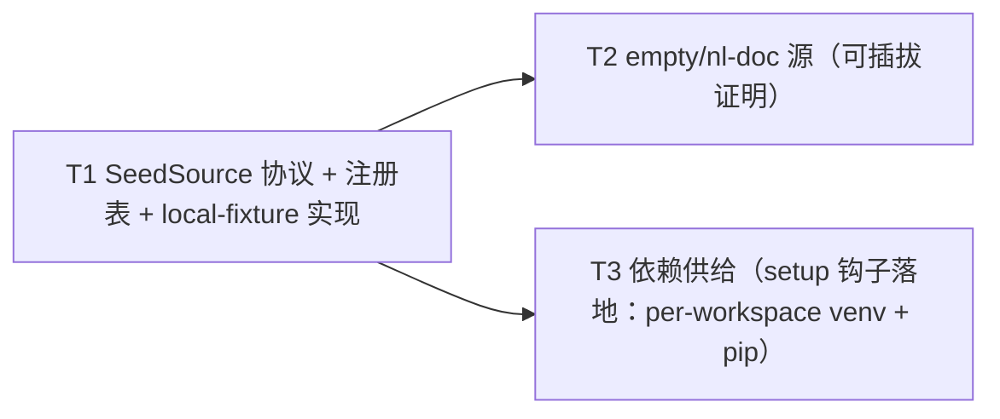

# 0009 种子工作区供给可插拔（SeedSource 接缝）

> 本文件由 `spec render` 自动生成，请勿手工编辑。
> 内容来源：本组 `metadata.yaml` 与 `tasks/T*.yaml`（关联 issue #9）。

## 总览

本组承接 spec-0008/T1：彼时 `SeedScenario.workspace` 经 `WorkspaceSpec{fixture, setup}` + `materialize()` 落地，供给路径是**唯一且硬编码的本地 copytree**。随着任务源增多（NL2Repo 式空仓起步、未来 SWE-bench / Terminal-Bench 等），**供给侧需可插拔**；而**消费港口**——`SeedScenario.description` 文本 + 一个被 `Sandbox`/`sim_user` 当 cwd 的工作区目录——保持冻结、零改动。

本组把「工作区供给」抽象为按 `kind` 注册的 `SeedSource` 协议：把既有 `materialize` 降为首个 `local-fixture` 实现（行为等价、向后兼容），并新增一个轻量 `empty` 源（新建空目录，可选写入需求说明文件，覆盖 NL2Repo 式「仅说明文档」起步）以证明**可加性**——新增一个源 = 落一个新模块（被自动发现注册）+ 注册侧/消费侧零改动。`workspace.materialize()` 退化为薄壳委托给注册表，故 `sim_user` 桥接与 `Sandbox` 调用点一行不改。

**明确非目标**（仅作为下游 spec 的扩展点记录，本组不实现）：Oracle / 客观判分（属平行评测系统，与用户主观核实解耦）；容器化「可运行句柄」运行时（`run(cmd)`/`cleanup`）；git@commit 取数。依赖供给（venv/pip）原亦列为非目标、拟推下游，现掰正收进本组 **T3**（见下）——因为「供给一个工作区」若不含「按其声明依赖可跑」，NL2Repo 式带依赖任务（如 funcy 需 pytest/whatever）在 stdlib-only 假设的 Sandbox 里根本跑不起来。本组动供给侧：凿接缝（T1）+ 一个已验证的第二实现（T2）+ 激活 `setup` 依赖供给（T3）；重型框架（容器/git@commit/Oracle）仍留下游、不提前造。

数据流脊柱（编号即执行序：先立接缝 T1，再加第二源 T2 证明可插拔，再由 T3 激活 `setup` 依赖供给使工作区可跑其声明依赖）：

```
seed 场景  SeedScenario.workspace = WorkspaceSpec{kind, fixture?, params, setup}
   │  按 kind 查 SeedSource 注册表（T1 立协议 + 注册表 + sources/ 自动发现）
   ▼
SeedSource.provision(spec, dest) -> workspace_dir
   ├─ kind="local-fixture": copytree in-repo fixture （T1，= 0008 行为）
   └─ kind="empty":        新建空目录，可选写需求文档 （T2，可加性证明）
   ▼
依赖供给：ensure_deps(dir, spec) 执行 spec.setup 备 per-workspace .venv （T3）
   │  → 消费侧 Sandbox.run_shell 探测 .venv 自动用之（python/pytest 命中依赖）
   ▼
消费港口不变：workspace.materialize() 薄壳委托 → sim_user 桥接 → Sandbox(workspace=dir) 当 cwd（0008 原样）
```

## 任务编排



| 任务 | 标题 | 优先级 | 状态 | 依赖 |
|----|----|----|----|----|
| T1 | SeedSource 协议 + 注册表 + local-fixture 实现 | P1 | done | — |
| T2 | empty/nl-doc 源（可插拔证明） | P2 | done | T1 |
| T3 | 依赖供给（setup 钩子落地：per-workspace venv + pip） | P1 | done | T1 |

## 各任务方案

### T1 · SeedSource 协议 + 注册表 + local-fixture 实现（P1 / done）

**涉及文件**

- `backend/auto_designer/user/sim/seed_source.py`
- `backend/auto_designer/user/sim/sources/__init__.py`
- `backend/auto_designer/user/sim/sources/local_fixture.py`
- `backend/auto_designer/models.py`
- `backend/auto_designer/user/sim/workspace.py`
- `backend/tests/user/sim/test_seed_source.py`
- `backend/tests/user/sim/test_workspace.py`

**做什么**

本组底座任务：把工作区供给从「唯一硬编码的本地 copytree」抽象为按 `kind` 注册的 `SeedSource` 协议。定义 `SeedSource.provision(spec, dest) -> workspace_dir` 与一个 `kind → SeedSource` 注册表（含 `sources/` 子包 import 期自动发现，使新增源无需改注册侧）；把 0008/T1 的 `materialize` 逻辑迁为首个 `local-fixture` 实现，`WorkspaceSpec` 增 `kind`（缺省 `local-fixture`）与通用 `params`，`workspace.materialize()` 退化为委托注册表的薄壳。编号即执行序：本任务先立接缝，T2 才能纯靠新增模块接入第二个源。

**为什么**

0008/T1 让 seed 场景能携带工作区，但供给路径写死在 `materialize` 的本地 copytree 上。后续要接入多样任务源（NL2Repo 式空仓起步、SWE-bench / Terminal-Bench 等），若每来一种都改 `materialize`，供给侧会退化为 if/else 拼盘。本任务把「按何种机制把 workspace 备好」抽成可插拔接缝；消费港口（`SeedScenario.description` + 被 `Sandbox` 当 cwd 的工作区目录）保持冻结，从而供给侧可独立演进、消费侧零波及。

**范围**

1) `seed_source.py`：定义 `SeedSource` 协议、`kind → SeedSource` 注册表、`register` 装饰器、顶层 `provision` 分派，并在 import 期遍历 `sources/` 子包触发各源自注册。2) `sources/local_fixture.py`：把 0008/T1 的 copytree 逻辑迁来，作为 `kind="local-fixture"` 首实现。3) `models.py`：`WorkspaceSpec` 增 `kind: str = "local-fixture"` 与 `params: dict = {}`（向后兼容，缺字段→缺省）。4) `workspace.py`：`materialize` 改为委托 `provision` 的薄壳，调用点不动。不实现任何新源（empty 归 T2）、不碰消费侧（sim_user / Sandbox）。

**整体设计**

接缝与分派：

```
WorkspaceSpec{kind, fixture?, params, setup}
        │ kind
        ▼
SeedSource 注册表  dict[str, SeedSource]   ◄── import 期遍历 sources/ 子包，各源自注册
        │ provision(spec, dest_root) -> workspace_dir
        ▼
LocalFixtureSource(kind="local-fixture")：copytree seed_workspaces/<fixture>/project（= 0008 行为）
```

- `SeedSource` 为 `Protocol`，约定 `kind: str` 与 `provision(spec: WorkspaceSpec, dest_root: str | None) -> str`（返回隔离工作区目录绝对路径）。
- 注册机制：`@register("<kind>")` 装饰器把实现写入模块级 `_REGISTRY`；`seed_source.py` 在 import 期用 `pkgutil.iter_modules` 遍历 `sources/` 子包逐一 import，触发各源自注册——这是「新增源 = 落一个模块」可加性的机制根基（T2 依赖之，无需改注册侧）。
- 顶层 `provision(spec, dest_root)`：按 `spec.kind` 查表分派；未命中抛 `ValueError`（消息列出已注册 kind）。
- 向后兼容：`WorkspaceSpec` 增 `kind: str = "local-fixture"` 与 `params: dict = {}`；`from_dict` 缺 `kind` → `local-fixture`、缺 `params` → `{}`，故 0008 落盘数据与 `billing-split` fixture 原样可用。`workspace.materialize(spec, dest_root)` 改为 `return provision(spec, dest_root)` 薄壳——`sim_user` 桥接与 `Sandbox` 调用点一行不改（消费港口冻结）。
- `local_fixture.py` 收纳原 copytree 逻辑（fixture 不存在报错、每局隔离拷贝），从 `workspace.py` 迁出；`workspace.py` 仅留兼容壳与 `seed_workspaces_root()` 等共用 helper。

**接口**

- `SeedSource`（protocol，`sim/seed_source.py`）：属性 `kind: str`；方法 `provision(spec: WorkspaceSpec, dest_root: str | None = None) -> str`。
- 注册表 API（`seed_source.py`）：`register(kind: str)` 装饰器；`get_source(kind) -> SeedSource`；`provision(spec, dest_root=None) -> str` 顶层分派；`available_kinds() -> list[str]`。`sources/` 子包 import 期自动发现注册。
- `WorkspaceSpec`（`models.py`）：新增 `kind: str = "local-fixture"`、`params: dict[str, Any] = field(default_factory=dict)`；保留 `fixture: str`（local-fixture 使用）、`setup`。`to_dict` 省略缺省项以保持旧序列化形状；`from_dict` 缺 `kind`→`local-fixture`、缺 `params`→`{}`。
- `LocalFixtureSource`（`sources/local_fixture.py`）：`kind="local-fixture"`；`provision` = 把 `seed_workspaces/<spec.fixture>/project` copytree 到新隔离目录并返回其绝对路径。
- `workspace.materialize(spec, dest_root=None) -> str`：保留为委托 `provision` 的兼容壳（不弃用，缓冲后续）。

**取舍**

- 选「子包自动发现 + 装饰器自注册」而非「集中 import 列表」：换来新增源对注册侧零改动（T2 只落一个文件即接入），代价是 import 期一次目录扫描 + 注册依赖 import 副作用——以「不手动 import 也能查到 local-fixture」的测试兜底。备选「集中列表」每加一源都要改一处公共文件，违背可加性目标，故弃。
- `WorkspaceSpec` 用扁平 `fixture` + 通用 `params: dict` 而非「每 kind 一个强类型子类」：换来加源不改 `WorkspaceSpec`、序列化形状稳定；代价是 source 内部需自校验所需字段（local-fixture 要求 `fixture` 非空）。
- 保留 `materialize` 薄壳而非改 0008 调用点：换来消费侧零改动、渐进迁移，代价是多一层间接（可接受）。

**验收标准**

注册表按 `kind` 分派到正确源；未知 kind 抛 `ValueError` 且消息含已注册 kind；`available_kinds()` 含 `local-fixture`。不手动 import `local_fixture` 时，import `seed_source` 后 `local-fixture` 已在注册表（自动发现生效）。`WorkspaceSpec.kind` 缺省 `local-fixture`、`params` 缺省 `{}`；`to_dict/from_dict` 往返一致；旧 dict（无 `kind`/`params`）→ `local-fixture` 且既有行为不变。对 `billing-split` provision 落地目录存在、含 `billing/core.py` 且 stdlib 可 import/运行，两次 provision 互相隔离。`materialize(spec)` 与 `provision(spec)` 等价。

**测试**

test_seed_source.py：(a) `provision` 按 kind 分派正确；未知 kind 抛 `ValueError` 且消息列出已注册 kind；(b) 自动发现——不手动 import `local_fixture`，import `seed_source` 后 `available_kinds()` 含 `local-fixture`；(c) local-fixture 平价——对 `billing-split` 落地目录存在、含 `billing/core.py`、stdlib 可执行，两次 provision 隔离，fixture 不存在报错；(d) `WorkspaceSpec` kind/params 缺省与 to_dict/from_dict 往返、旧 dict 兼容。  更新 test_workspace.py：补 `materialize` 薄壳与 `provision` 等价、既有 materialize 断言在新路径下仍通过。

**参考**

扩展 0008/T1（`workspace.py` 的 `materialize`、`WorkspaceSpec`，`models.py` 的 `SeedScenario`）。消费侧 0008/T1 的 `sim_user` 桥接与 0008/T2 的 `Sandbox(workspace=dir)` 原样复用、不在本任务 files 内。被本组 T2（落 `sources/empty.py` 经自动发现注册）消费。

**待解问题**

1) 依赖供给与 `WorkspaceSpec.setup` 钩子（0008 起仅占位、不执行）的落地：**已收进本组 T3**（每局建 per-workspace `.venv` + pip、Sandbox 探测 `.venv` 使用之），使带第三方依赖的任务（部分 NL2Repo、多数真实仓库）能在 Sandbox 里跑起来；cached venv 复用等细节见 T3 open-questions。
2) 后续重型源（容器化的 SWE-bench / Terminal-Bench、git@commit 快照）是否需把消费港口从「工作区目录」升级为「可运行句柄 {cwd, run(cmd), cleanup}」，以便 Provider 与（将来的）客观评测共享同一运行时能力。本组港口保持「目录 + 本地 shell」不变；是否升级、何时升级留下游评估，目的是让重型源接入时尽量不返工港口。

### T2 · empty/nl-doc 源（可插拔证明）（P2 / done）

**涉及文件**

- `backend/auto_designer/user/sim/sources/empty.py`
- `backend/tests/user/sim/test_seed_source_empty.py`

**做什么**

在 T1 接缝上接入第二个源 `empty`，作为「可插拔/可加性」的活体证明：新建一个隔离空工作区目录，`params` 含 `doc` 时把其文本写成一个需求说明文件（覆盖 NL2Repo 式「仅一份说明文档、从空仓起步」的场景）。关键约束——接入它**只新增 `sources/empty.py` 一个模块**，靠 T1 的子包自动发现注册，`seed_source.py` / `models.py` / `workspace.py` 与消费侧（sim_user / Sandbox）零改动。

**为什么**

接缝若不被第二个真实源验证，「可插拔」只是声明。`empty` 选作第二源有两重价值：一是零新基建（仍是本地目录，不引入容器 / git / 依赖供给），把验证成本压到最低；二是它直接表达「空工作区 + 一段自然语言诉求」这一最小任务形态——即 NL2Repo 式从零构建的注入形状，证明现有港口已能承载这类任务（其客观评测属非目标，归下游）。本任务以「加一个源 = 一个文件、核心零改」来锁死 T1 边界是否真的解耦。

**整体设计**

`sources/empty.py` 定义 `EmptySource`，`@register("empty")` 自注册（T1 的子包扫描在 import 期自动发现，无需任何中心登记）：

```
WorkspaceSpec{kind="empty", params={"doc"?: str, "doc_name"?: str}}
        │ provision(spec, dest_root)
        ▼
新建隔离目录（tempfile.mkdtemp 或 dest_root/<name>）
        └─ params.doc 非空 → 写 params.doc_name（缺省 "SPEC.md"）为该目录下的说明文件
返回目录绝对路径（空或仅含说明文件）
```

- 不读 `fixture`（empty 与本地 fixture 无关）；只认 `params`。`doc` 缺省为空 → 落纯空目录；给定 → 写一个需求说明文件，使内层 agent 有「读说明文档」的落脚。
- 隔离与返回契约同 local-fixture：每次 provision 一个全新目录、互不污染、返回绝对路径，从而 `Sandbox(workspace=dir)` 可直接当 cwd 复用。
- 可加性的硬证据：本任务 files 仅 `sources/empty.py` + 测试；T1 拥有的文件一律不在本任务 files 内（disjoint），却能在测试中验证 `empty` 已被注册——这正是 ports-and-adapters 边界成立的判据。

**接口**

- `EmptySource`（`sources/empty.py`）：`kind="empty"`；`provision(spec, dest_root=None) -> str` 新建隔离目录；`spec.params.get("doc")` 非空时写 `spec.params.get("doc_name", "SPEC.md")`。
- 经 `@register("empty")` 入 T1 注册表；调用方仍走 T1 顶层 `provision(spec)`，不直接依赖本类。
- 复用 T1 的 `WorkspaceSpec`（不新增字段）：`empty` 的输入完全落在既有 `kind` + `params` 上，印证 `params: dict` 的扩展位足够承载新源。

**取舍**

- 用通用 `params.doc`/`doc_name` 而非给 `empty` 引入专属 schema：保持 `WorkspaceSpec` 不随每个源膨胀；代价是 `params` 弱类型，靠 source 内部自校验与测试约束。
- 第二源选 `empty` 而非直接做 git/容器源：以最低成本验证接缝是否解耦；代价是未覆盖「重型供给」路径——那是有意为之，重型运行时句柄、git@commit 仍为本组非目标、留下游 spec；依赖供给（venv/pip）现由本组 T3 落地（`empty` 导入的带依赖任务如 funcy 靠 T3 备齐依赖方能真跑）。

**验收标准**

`provision(WorkspaceSpec(kind="empty"))` 返回一个存在的隔离空目录；带 `params={"doc": "..."}` 时目录下含对应说明文件且内容一致，`doc_name` 可覆盖文件名。两次 provision 目录隔离。**不修改 T1 任何文件**的前提下，import `seed_source` 后 `available_kinds()` 含 `empty`（自动发现注册生效）。该目录可作为 `Sandbox` 的 cwd 正常 run/读写（沿用 0008/T2 行为，不重测 Sandbox 内部）。

**测试**

test_seed_source_empty.py：(a) `provision(kind="empty")` 落地隔离空目录、存在且为空；(b) 带 `doc` → 目录含说明文件且内容一致，`doc_name` 覆盖生效；(c) 两次 provision 隔离；(d) 可加性证据——本测试不 import `empty` 模块本身、仅 import `seed_source`，断言 `available_kinds()` 含 `empty`（证明仅靠落模块即被自动发现）；(e) 序列化——`WorkspaceSpec(kind="empty", params={...})` to_dict/from_dict 往返一致。

**参考**

依赖 0009/T1 的 `SeedSource` 协议、`register`/`provision` 注册表与 `sources/` 自动发现机制，以及 T1 为 `WorkspaceSpec` 增的 `kind`/`params`。落脚的 `Sandbox`（0008/T2）原样复用、不在本任务 files 内。NL2Repo 式任务的客观评测（跑上游测试）为非目标，归下游 spec。

### T3 · 依赖供给（setup 钩子落地：per-workspace venv + pip）（P1 / done）

**涉及文件**

- `backend/auto_designer/user/sim/deps.py`
- `backend/tests/user/sim/test_deps.py`
- `backend/auto_designer/user/sim/sandbox.py`
- `backend/auto_designer/loop/orchestrator.py`

**做什么**

把 `WorkspaceSpec.setup`（0008 起仅占位、从不执行）真正落地，补上供给侧最后一环：一个源 provision 出工作区目录后，按 `setup` 命令在该目录里备好依赖环境（约定为 per-workspace `.venv` + pip 安装），并让消费侧 `Sandbox` 的 `run_shell` 自动使用该 venv。由此带第三方依赖的任务（如 NL2Repo 的 funcy 需 `pytest`/`whatever`）不再卡在「stdlib-only 假设」上——工作区从「有文件」升级为「按其声明依赖可跑」。新增 `deps.py`（setup 执行器）+ 在共享工作区落地点（orchestrator，materialize 之后、launch 之前）调用它，并让 `Sandbox` 探测 `.venv` 注入 PATH。不改 T1/T2 任何文件、不扩 `WorkspaceSpec` schema（复用既有 `setup`）。

**为什么**

0008/T1、0009/T1 都把「依赖供给」列为非目标、`WorkspaceSpec.setup` 只留占位不执行，于是当前 `Sandbox` 只能用宿主 ambient 环境跑 stdlib——带第三方依赖的任务（大多数真实仓库、部分 NL2Repo）无法真跑其声明的验证。以 funcy 为例：库本体是纯 stdlib，但其 `start.md` 声明验证需 `pytest 7.4.3` + 第三方 `whatever 0.7`，还要求 `pip install -e .`；没有依赖供给，用户 agent 在 Sandbox 里 `import whatever` 必 `ModuleNotFoundError`、`python setup.py test` 跑不起来。本任务补上这一环，让「供给一个工作区」真正意味着「供给一个能按其声明依赖运行的工作区」，是 0009 供给侧的收口（此前刻意推迟、现收进本组）。

**范围**

1) `deps.py`（新）：`ensure_deps(workspace_dir: str, spec: WorkspaceSpec) -> None`——`spec.setup` 非空时，在 `workspace_dir` 为 cwd 逐条执行 setup 命令（subprocess，带超时/输出捕获），失败即抛并附命令与 stderr。约定 setup 命令自建 per-workspace `.venv` 并把依赖装进去（如 `python -m venv .venv` → `.venv/bin/pip install -e .` / 装 pytest+whatever）；`ensure_deps` 本身不硬编码建 venv 逻辑，只忠实执行 setup（奥卡姆：机制留在数据里）。幂等：`.venv` 已就位可跳过重建（由 setup 命令或一个 marker 判定）。2) `sandbox.py`（0008/T2，跨组）：`run_shell` 探测 `<workspace>/.venv/bin`，存在则注入 `VIRTUAL_ENV` 并把它前置进 `PATH`，使 `python`/`pytest` 解析到 venv；无 `.venv` 时行为不变（退化为今天的 ambient）。3) `orchestrator.py`（0007/0008，跨组）：在共享工作区 materialize *之后、launch 之前* 调 `ensure_deps(workspace_dir, scenario.workspace)`，使 harness 与用户 agent 两侧共享的同一目录在开跑前依赖已就位。**非目标**（留后续）：容器/hermetic 隔离与网络策略；跨会话 venv 缓存/复用（本轮每局现装）；lockfile/版本求解；从需求文档自动推导 setup 命令（本轮 setup 由场景作者/未来 adapter 显式给出）；harness 子进程内 bash 使用该 venv（harness 为 0003 黑盒，其 bash 是否走 workspace venv 留 open-question）。

**整体设计**

供给链补最后一环（消费港口仍冻结：目录 + 本地 shell）：

```
SeedSource.provision(spec) -> workspace_dir      （T1/T2，落地文件）
        │  orchestrator：materialize 之后、launch 之前
        ▼
deps.ensure_deps(workspace_dir, spec)            （T3，执行 spec.setup 备依赖）
        │  约定 setup 建 <workspace_dir>/.venv 并 pip 装入
        ▼
两侧共享 workspace_dir 开跑：
   ├─ harness 子进程（SANDBOX_WORK_DIR=workspace_dir，0008/T1v2）
   └─ 用户 agent Sandbox(workspace=workspace_dir)（0008/T2）
            └─ run_shell 探测 .venv → 注入 VIRTUAL_ENV + PATH 前置 → python/pytest 用 venv
```

- 为何 hook 在 orchestrator 而非 provision 内：与 0008/T1v2 让 materialize 上移 orchestrator 同因——工作区要被 harness 与用户 agent 两侧共享，依赖必须在 launch *之前* 就位、且落在两侧同指的那个目录上；orchestrator 是唯一同时掌握 materialize 结果与 launch 时机的层。这也让 T3 只碰跨组的 orchestrator/sandbox，不动 0009-T1/T2 的 provision/materialize 文件（组内 files disjoint）。
- 为何复用 `setup: list[str]` 而非给 `WorkspaceSpec` 加结构化 deps 字段：0008/T1 已预留 `setup` 钩子，MVP 直接激活它即可，不扩 schema（不碰 T1 的 models.py）；setup 是「在工作区里把环境备好」的通用命令序列，venv 约定活在数据（命令）里而非代码里。
- 为何 per-workspace `.venv` 而非装进 ambient：每局隔离、可清理、不污染宿主/其它会话；代价是每局现装有耗时（缓存留 open-question）。
- Sandbox 探测 `.venv` 而非要求 agent 显式调 `.venv/bin/python`：让「工作区带 venv」对内层 LLM 透明——它照常 `run_shell("pytest ...")` 即命中 venv，符合真人在已配好环境的项目里的直觉。
- 退化与兼容：`spec.setup` 为空（含所有既有 fixture/empty 场景）时 `ensure_deps` 空操作、无 `.venv` 生成、Sandbox 走 ambient——对 0008/0009 既有行为零改动。

**接口**

- `deps.ensure_deps(workspace_dir: str, spec: WorkspaceSpec) -> None`（`user/sim/deps.py`）：`spec.setup` 空则直接返回；否则以 `workspace_dir` 为 cwd 逐条 subprocess 执行，非零退出抛异常（附命令、returncode、截断 stderr）；可选带总超时。
- `Sandbox`（`user/sim/sandbox.py`，0008/T2）：新增私有 env 组装——`run_shell` 执行前，若 `<workspace>/.venv/bin` 存在则设 `VIRTUAL_ENV=<workspace>/.venv` 且 `PATH=<workspace>/.venv/bin:$PATH`。对外接口签名不变。
- `orchestrator.run_round`（0007/0008，跨组）：在 `workspace_dir = materialize_workspace(...)` 之后、`launch(..., workspace_dir=workspace_dir)` 之前插入 `ensure_deps(workspace_dir, scenario.workspace)`（`scenario.workspace` 为 None 时跳过）。
- 不新增/不修改 `WorkspaceSpec` 字段（复用 `setup`）；不改 `SeedSource`/`provision`/`materialize` 签名；不改 harness stdio 协议。
- setup 命令示例（funcy，由场景/adapter 提供）：`["python -m venv .venv", ".venv/bin/pip install pytest==7.4.3 whatever==0.7", ".venv/bin/pip install -e ."]`。

**取舍**

- 激活既有 `setup` 而非新造 provisioner 框架：奥卡姆，最小改动打通依赖路径；代价是 setup 是弱类型 shell 命令、靠场景作者写对（无 lockfile 求解）。
- 每局现装 venv：环境确定、隔离、可清理；代价是耗时与网络依赖（pip 需可达源）——跨会话缓存/预热留 open-question，不在 MVP。
- 只让用户 agent 侧 Sandbox 用 venv、暂不管 harness bash：把改动限制在可控的消费侧，不侵入 0003 harness 黑盒；代价是若某任务要 harness 也按 venv 跑，需后续让 harness entry 也识别 workspace `.venv`（open-question）。
- 非安全/非 hermetic：sandbox 仍是 cwd+超时的最小隔离，venv 只解决「依赖可见」，不解决「恶意代码/网络隔离」——沿用 0008/T2 威胁模型，强隔离留下游。
- hook 在 orchestrator：实现简单且与共享工作区同源；代价是不经 orchestrator 的直连调用（如独立 smoke 脚本）需自行调 `ensure_deps`（可接受，属工具侧）。

**验收标准**

`spec.setup` 为空时 `ensure_deps` 空操作、不建 `.venv`、Sandbox 行为与今天一致（既有场景零回归）。给定一个 `setup` 会建 `.venv` 并 pip 装入某包的 spec：`ensure_deps` 后 `<workspace>/.venv` 存在且该包可被 venv 的 python import。`Sandbox(workspace=dir)` 在 `<dir>/.venv` 存在时，`run_shell("python -c 'import <pkg>'")` 成功、`run_shell` 内 `python` 解析到 `.venv`（PATH/VIRTUAL_ENV 注入生效）；无 `.venv` 时退化 ambient。orchestrator 在 materialize 之后、launch 之前调 `ensure_deps`（`scenario.workspace` 为 None 时不调）。setup 命令失败时 `ensure_deps` 抛错并携带足够诊断（命令+stderr）。端到端（可选、需网络）：以 funcy 式 setup 备好 `pytest`+`whatever` 后，Sandbox 内 `pytest` 能 import `whatever`。

**测试**

test_deps.py：(a) `setup` 为空 → `ensure_deps` 空操作、目录无 `.venv`；(b) setup 建 `.venv` + 装一个纯本地可控包（用离线/本地 wheel 或标准库脚本模拟，避免 CI 走网络）→ `.venv` 存在且目标可 import；(c) setup 某命令非零退出 → 抛错且消息含该命令与 stderr；(d) 幂等——`.venv` 已在时重复调不重复重建/不报错。更新 sandbox 测试（在 0008/T2 的 test_tools.py 或本任务 test_deps.py 内，按落点归属）：(e) 工作区含 `.venv/bin` 时 `run_shell` 的 `python` 命中 venv（造一个假 `.venv/bin/python` 或断言注入的 PATH/VIRTUAL_ENV）；无 `.venv` 时不注入。orchestrator 测试（跨组 test_orchestrator.py）：(f) materialize 之后、launch 之前调用 `ensure_deps`（spy 断言顺序），`scenario.workspace` 为 None 时不调。CI 约束：默认用例不依赖真实 pip 网络；需网络的 funcy 端到端标记为可选/手动。

**参考**

激活 0008/T1 预留的 `WorkspaceSpec.setup` 钩子；落地点在 0008/T1v2 的共享工作区 materialize 之后（orchestrator，run_session 之前）；消费于 0008/T2 的 `Sandbox`（run_shell 注入 venv）。依赖本组 T1 的 `provision`/`WorkspaceSpec`（不改其文件）。解决本组 T1 open-question #1、0008/T1 tradeoffs 记录的依赖供给缺口。funcy 等 NL2Repo 任务经 T2 `empty` 源导入后，靠本任务把其声明依赖备齐方能真跑验证（其客观判分仍为非目标）。

**待解问题**

1) 跨会话 venv 缓存/预热：每局现装耗时且需网络；是否按 (deps 指纹) 缓存复用一份 venv、或预构建镜像层。2) harness 子进程 bash 是否也应使用 workspace `.venv`（当前仅用户 agent Sandbox 用）：需 0003 harness entry 识别 workspace venv，涉及跨仓改动。3) 无网络/受限环境的依赖供给（离线镜像、vendored wheels）。4) setup 命令的来源：从需求文档（如 funcy start.md 的依赖清单）自动生成 setup，还是由场景/adapter 手写——前者需一个「文档→setup」的推导步骤，归后续。5) 依赖安装失败的策略：整局判失败，还是降级为「无该依赖的受限核实」。
