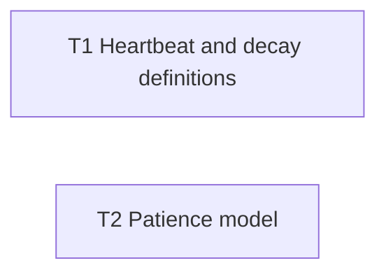

# 0012 · Realistic User Waiting Experience: Heartbeat Agency · Visible Progress · Task-Dependent Patience

<!-- This file is maintained by the spec tool: frontmatter is the structured source data (including the tasks DAG), and the body is a group-level nine-section rust-RFC overview. -->

## Summary

Upgrade the user agent's behavior when facing a slow/stalled harness from “silently waiting until timeout” to realistic mechanisms:

1. **Agency while waiting**—follow **judge → intent → act** after a heartbeat wake-up.
2. **Visible progress**—feed `last_progress` and cross-turn `prior_activity` into the waiting prompt.
3. **Conditional patience depletion**—`keep_waiting` reduces patience **only when this heartbeat has no new_progress**.
4. **WAIT_GAP + ATTRIBUTION**—record a gap when intent is not fulfilled; do not blame the harness for user-initiated interruption.
5. **Task-dependent initial patience**—personality level + slight variation based on task size.

**See 0022 for the current definitions of the waiting menu, internal/external channels, open intent, `emit_message`, and interrupt attribution** (this group no longer describes `invoke_control` / closed intent enums).

## Motivation

The turn-based approach in 0005 compresses a slow harness into “one final judgment,” losing the user experience during the wait; initial patience is unrelated to task size. This group introduces heartbeats, visible progress, conditional patience depletion, and task-size variation. 0022 handles the replacement of the menu and IO boundaries.

## Guide-level explanation

- Heartbeats apply only to real subprocesses; not Fake/Scripted.
- Three decision hops; context includes elapsed seconds, history, MANUAL, progress, and prior_activity.
- `keep_waiting`: deplete patience only when there is no new progress; reaching the cap or exhausting patience → give up (see 0022 for specific action IDs).
- Initial patience: slight OPENING `task_load` variation.
- ATTRIBUTION: do not blame the harness for self-initiated interrupt.

## Reference-level explanation

### Anchors

- Current heartbeat orchestration and menu code: see **0022/T1** (`loop.py` / `prompt.py` / `launcher.py`).
- Patience model: `state.py` (T2 in this group).

### DAG

### Adjacent groups

- **0022**: internal/external windows, waiting menu, open intent, `report_issue`, slash.
- **0013 / 0019/T1**: progress emission and side-channel reception.

## Drawbacks

Applies only to real subprocesses; three mode makes more LLM calls; constants are empirical values.

## Rationale and alternatives

Heartbeats + conditional patience depletion are preferable to “give up immediately on timeout” or “deduct patience on every keep.” Menu replacement is delegated to 0022 rather than redesigned in this group.

## Prior art

0005; long-running agent heartbeat; 0022 IO boundaries.

## Unresolved questions

Whether to recalibrate the thresholds and `TASK_LOAD_DELTA`.

## Future possibilities

Feed structured waiting sequences into 0016; adjust heartbeat frequency based on emotion.
