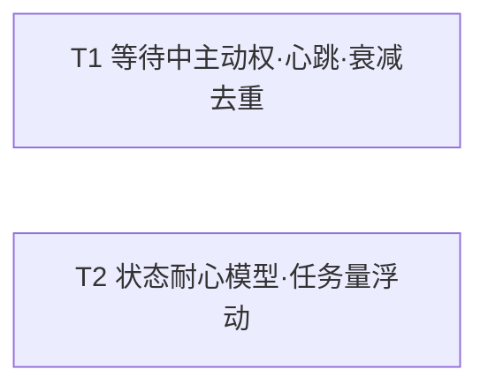

# 0012 · 用户侧等待体感真实化：等待中主动权 + 任务相关耐心

<!-- 本文件由 spec 工具维护：frontmatter 为结构化源数据（含 tasks DAG），正文为组级 rust-RFC 9 段总览。 -->

## Summary

把用户 agent 面对慢/卡 harness 时的行为，从「静默干等到超时」升级为两项拟真机制：**（1）等待中的主动权**——harness 单轮处理超时阈值后，通过心跳唤醒 user agent 做一次等待决策（继续等 / 调用 harness 控制面 / 放弃），而非被动挂起；**（2）任务相关的起始耐心**——同一 persona 面对不同任务量的活儿，起始耐心不同（该秒回的小任务对摩擦零容忍、有野心的大活愿意多来回）。同时统一「等待耗心」的衰减口径，消除心跳路径与阻塞路径对同一段等待的双记。

本组只增强用户侧行为（`backend/auto_designer/user/sim/`），不改动作空间的对外契约与体感评分，是 0005（控制信封模拟器）/0008（内层 tool-using）在「时间维度真实性」上的补齐。

## Motivation

**现状（就地复述，本 spec 自包含）。** 0005 建立的用户侧是「回合制」的：user agent 发一条消息 → 阻塞等 `harness.send()` 返回 → 据回复走动作空间与体感。这套模型隐含「harness 总能在合理时间内回一句」的假设。但被进化的 harness 是真实多轮 nexau code agent，单轮最坏墙钟可达 ~16 分钟（`_CALL_TIMEOUT×_RUN_RETRIES`），期间用户侧只有一条阻塞的 `send()`，既无可见性也无干预手段。

由此产生两个体感失真：

1. **等待被抹平成「结果的一部分」。** 真人等 10 分钟无动静会追问、会打断、会弃坑；回合制模型把这段煎熬压缩成「最终拿到回复时的一次主观判断」，丢掉了「等待过程本身就是体感杀手」这一真实信号。
2. **耐心与任务无关。** 0005 的起始耐心只由 persona 性格（D4.3）定档，同一个人无论接「改个错别字」还是「从零迁移一个包」，起始耐心一样——不符合真实：小任务对任何摩擦零容忍，大任务预期要真功夫、愿意多等。

此外，早期实现里「等待耗心」有两处独立扣减（心跳路径逐次扣、阻塞路径按极端超时扣），对同一段等待可能双记，使耐心衰减比设计更快。

**为什么现在做。** 训练信号是体感；「延迟/等待」是体感的重要维度且只会出现在体感的定性理由里（分数高低看不出）。要让这维信号真实进入闭环，用户侧必须能在等待中表达主动权、且耐心建模要贴合任务——否则设计师侧拿不到「延迟即痛点」的可靠信号（见 0016）。

## Guide-level explanation

改完后用户侧的行为：

- **等待中（新）。** 当且仅当 harness 是支持 `begin/poll/control` 的真实子进程会话时，单轮等待超阈（`_TURN_WAIT_BUDGET_SEC≈240s`）会**心跳唤醒** user agent：把「已等多久、对话历史、harness 手册」喂给 persona，让它在 `{keep_waiting, invoke_control, give_up}` 里选一个动作。
  - `keep_waiting`：回到 poll 继续等（在途计算不丢），并按性格逐次耗一点耐心；
  - `invoke_control`：调用 harness 手册所述的某个控制（如打断/续跑），控制名对框架不透明、原样透传给 `harness.control()`，由 harness 按自己的 MANUAL 校验；
  - `give_up`：这个人不再等了，走放弃终止。
  - 兜底：耐心耗尽自动转 `give_up`；心跳次数达上限（`_MAX_HEARTBEATS=8`）强制收束，防病态无限等。
  - Fake/Scripted harness 即时返回，不触发心跳——机制只在真实慢 harness 上生效。
- **起始耐心（增强）。** 开局时，persona 先对任务量给一个主观读数（`quick/normal/big/epic`），在性格基线上叠加一次性小浮动（`-1…+2`，钳到 ≥1）。范围压得很小，只微调、不盖过性格档位。
- **对外不变。** 动作空间、体感评分、终止判定（`patience<=0` 解锁终止）语义不变；等待只是新增了「过程中的动作」与「更贴任务的起点」。

## Reference-level explanation

### 现状代码锚点

- `user/sim/loop.py`：`_supervise_send`（心跳监督发送）、`_resolve_waiting`（自由产出归一到 `WAITING_ACTIONS`）、`_supports_heartbeat`（`begin/poll/control` 探测）、`_log_waiting`（记 waiting step）；常量 `_TURN_WAIT_BUDGET_SEC=240`、`_EXTREME_WAIT_SEC=480`、`_MAX_HEARTBEATS=8`、`WAITING_ACTIONS=[keep_waiting, invoke_control, give_up]`。
- `user/sim/state.py`：`Coef.patience_decay`（性格派生）、`init_state`（D4.3→耐心基线）、`TASK_LOAD_DELTA` + `apply_task_load`（任务量浮动，钳 ≥1）、`apply_verdict`（各 verdict 耗心规则）。
- `user/sim/prompt.py`：`build_waiting_turn`（等待决策 prompt）、OPENING 轮采集 `task_load`。

### 目标方案

| 关注点 | 现状（0005） | 目标（本组） |
|---|---|---|
| 慢 harness 等待 | 单条阻塞 `send()`，无可见性/干预 | 超阈心跳唤醒 → `{keep_waiting, invoke_control, give_up}` |
| harness 控制 | 无 | `invoke_control` 原样透传 `harness.control()`，手册为能力真相源 |
| 起始耐心 | 仅 D4.3 性格档位 | 性格档位 + 任务量微浮动（`-1…+2`，钳 ≥1） |
| 等待耗心 | 可能双记 | 心跳逐次按 `coef.patience_decay`；阻塞路径 `_EXTREME_WAIT` 仅对非 supervised 生效 |
| 无限等待 | 只靠超时 | 耐心耗尽 / `_MAX_HEARTBEATS` 双兜底 |

### DAG

T1、T2 无代码依赖，`files` 互斥（T1 落 `loop.py`/`prompt.py`，T2 落 `state.py`），可并行。

### 文件分配（各 Task `files` 互斥）

- **T1**：`user/sim/loop.py`、`user/sim/prompt.py`、`tests/user/sim/test_heartbeat.py`、`tests/user/sim/test_loop.py`
- **T2**：`user/sim/state.py`、`tests/user/sim/test_state.py`

### 与 harness 侧的接缝

心跳依赖 harness 句柄暴露 `begin/poll/control`（真实子进程会话），控制面的语义与 `[interrupted]` 回复由 harness 侧实现——见 0013「Harness 呈现与交互协议」。本组只消费该接缝，不定义协议本身。

## Drawbacks

- **只对真实子进程 harness 生效**：Fake/Scripted 走不到心跳分支，等待类体感在单测里需专门构造子进程或桩才能覆盖。
- **心跳唤醒有成本**：每次唤醒都是一次 persona LLM 调用，慢会话会额外产生若干次调用（`_MAX_HEARTBEATS` 封顶）。
- **任务量读数是主观的**：`task_load` 由 persona 自评，可能与「客观任务量」不符；本设计有意如此（体感即主观），但会给耐心起点引入 persona 噪声。
- **常量为经验值**：`_TURN_WAIT_BUDGET_SEC`/`_EXTREME_WAIT_SEC`/`_MAX_HEARTBEATS`/`TASK_LOAD_DELTA` 均为拍定的经验阈值，未据真实分布标定。

## Rationale and alternatives

选「心跳唤醒 + 主动权」而非把等待完全交给超时，是因为要让「等待过程」成为可观测、可决策的一等信号，而不是被结果吞掉——这直接服务闭环的体感训练信号。

- **备选 A：固定超时后直接判定放弃。** 最简，但抹平了「追问/打断/续等」的真实分化，且无法让 persona 用 harness 控制面——丢信号。
- **备选 B：等待耗心只在阻塞路径按极端超时扣。** 无法建模「等待中的分次挫败」，且与心跳路径冲突（双记根源）。故统一为心跳逐次扣、阻塞路径仅在非 supervised 补极端惩罚。
- **备选 C：起始耐心只按性格。** 即 0005 现状，忽略「同一个人不同任务耐心不同」的真实性；本组用小浮动补齐，且刻意压小范围以免盖过性格主导。

## Prior art

- **0005 控制信封模拟器 / 0008 内层 tool-using**：本组是其在时间维度上的延伸——0005 定义动作空间与体感、0008 让判断 grounded，本组让「等待」也成为可决策动作。
- **交互式 agent 的 heartbeat/keepalive**：长任务期间周期性回报进度、允许中途干预，是长运行 agent 的通行实践；此处把「干预权」交给模拟用户。
- **控制面对框架不透明**：呼应 harness「黑盒对话契约」原则——控制名由 harness 的 MANUAL 定义、框架不硬编码，保证 harness 可替换（CC/codex）。

## Unresolved questions

- **阈值标定**：`_TURN_WAIT_BUDGET_SEC`/`_MAX_HEARTBEATS`/`TASK_LOAD_DELTA` 是否应据真实使用日志的等待时长分布重标？
- **task_load 的采集方式**：靠 persona 主观自评 vs 由种子场景显式带任务量标签——哪个更少噪声？
- **控制面词表**：当前控制名完全由 harness MANUAL 决定、user agent 自由生成；是否需要一层「已知控制」提示以减少 persona 瞎点名后退回 `keep_waiting` 的浪费？

## Future possibilities

- 把等待时长与心跳决策序列显式落进 session 记录，供设计师侧「延迟即痛点」诊断（0016）与体感曲线归因。
- 更细的等待动作（如「先追问澄清再决定等不等」），而非当前三分。
- 据 persona 情绪状态动态调整心跳阈值（急躁的人更早被唤醒）。

