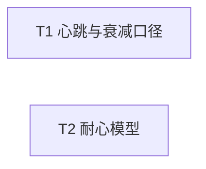

# 0012 · 用户侧等待体感真实化：心跳主动权 · 进度可见 · 任务相关耐心

<!-- 本文件由 spec 工具维护：frontmatter 为结构化源数据（含 tasks DAG），正文为组级 rust-RFC 9 段总览。 -->

## Summary

把用户 agent 面对慢/卡 harness 时的行为，从「静默干等到超时」升级为拟真机制：

1. **等待中的主动权**——心跳唤醒后走 **judge → intent → act**。
2. **可见进度**——等待 prompt 喂 `last_progress` 与跨轮 `prior_activity`。
3. **有条件耗心**——`keep_waiting` **仅当本心跳无 new_progress** 才扣耐心。
4. **WAIT_GAP + ATTRIBUTION**——意愿未兑现记 gap；用户自打断不归咎 harness。
5. **任务相关起始耐心**——性格档位 + 任务量微浮动。

**等待菜单、内外通道、开放 intent、`emit_message`、interrupt 归因的现行定义见 0022**（本组不再描述 `invoke_control` / 封闭 intent 枚举）。

## Motivation

0005 回合制把慢 harness 压成「最终一次判断」，丢掉等待过程体感；起始耐心与任务量无关。本组引入心跳、进度可见、有条件耗心与任务量浮动。菜单与 IO 边界的换代由 0022 完成。

## Guide-level explanation

- 真实子进程才心跳；Fake/Scripted 否。
- 决策三跳（或 two 合并）；上下文含秒数、history、MANUAL、progress、prior_activity。
- `keep_waiting`：无新进度才耗心；触顶或耐心耗尽 → 放弃（具体动作 ID 见 0022）。
- 起始耐心：OPENING `task_load` 微浮动。
- ATTRIBUTION：自 interrupt 勿怪 harness。

## Reference-level explanation

### 锚点

- 心跳编排与菜单现行代码：见 **0022/T1**（`loop.py` / `prompt.py` / `launcher.py`）。
- 耐心模型：`state.py`（本组 T2）。

### DAG

### 与相邻组

- **0022**：内外窗口、等待菜单、开放 intent、`report_issue`、slash。
- **0013 / 0019/T1**：progress 发射与旁路接收。

## Drawbacks

只对真实子进程生效；three 模式 LLM 调用多；常量经验值。

## Rationale and alternatives

心跳 + 有条件耗心优于「超时直接放弃」或「每次 keep 都扣心」。菜单换代不在本组重复设计，交给 0022。

## Prior art

0005；长运行 agent heartbeat；0022 IO 边界。

## Unresolved questions

阈值与 `TASK_LOAD_DELTA` 是否重标。

## Future possibilities

等待序列结构化喂 0016；按情绪调心跳频率。
