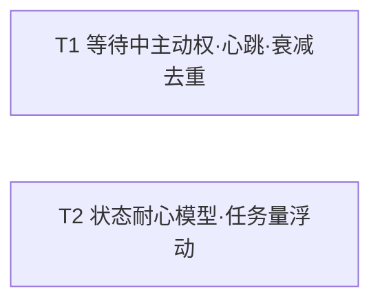

# 0012 · 用户侧等待体感真实化：心跳主动权 · 进度可见 · 任务相关耐心

<!-- 本文件由 spec 工具维护：frontmatter 为结构化源数据（含 tasks DAG），正文为组级 rust-RFC 9 段总览。 -->

## Summary

把用户 agent 面对慢/卡 harness 时的行为，从「静默干等到超时」升级为拟真机制：

1. **等待中的主动权**——心跳唤醒后走 **judge → intent → act**（`waiting_mode` 默认 `three`，可选 `two` 合并前两步），在菜单 `{keep_waiting, invoke_control, give_up}` 上兑付；控制名对框架不透明。
2. **可见进度**——等待 prompt 喂 `last_progress` 与跨轮 `prior_activity`；Busy≠正确，按内容判 on/off track。
3. **有条件耗心**——`keep_waiting` **仅当本心跳无 new_progress** 才按 `patience_decay` 扣耐心；有新活动不罚。
4. **WAIT_GAP + ATTRIBUTION**——intent 兑不进菜单记 gap；用户自打断不归咎 harness。
5. **任务相关起始耐心**——性格档位 + 任务量微浮动。

peek/status 续等与旁路接收见 **0019**。落点 `backend/auto_designer/user/sim/`。

## Motivation

**现状（就地复述，本 spec 自包含）。** 0005 建立的用户侧是「回合制」的：user agent 发一条消息 → 阻塞等 `harness.send()` 返回 → 据回复走动作空间与体感。这套模型隐含「harness 总能在合理时间内回一句」的假设。但被进化的 harness 是真实多轮 nexau code agent，单轮最坏墙钟可达 ~16 分钟（`_CALL_TIMEOUT×_RUN_RETRIES`），期间用户侧只有一条阻塞的 `send()`，既无可见性也无干预手段。

由此产生两个体感失真：

1. **等待被抹平成「结果的一部分」。** 真人等 10 分钟无动静会追问、会打断、会弃坑；回合制模型把这段煎熬压缩成「最终拿到回复时的一次主观判断」，丢掉了「等待过程本身就是体感杀手」这一真实信号。
2. **耐心与任务无关。** 0005 的起始耐心只由 persona 性格（D4.3）定档，同一个人无论接小任务还是大活，起始耐心一样——不符合真实。

此外，早期「等待耗心」可能双记；后来又发现「有进度仍每次 keep_waiting 都扣心」会惩罚合法长任务，故改为**仅无新进度才耗心**。单轮选 action 不足以表达「先判轨道 → 真实意愿 → 菜单兑付」，故拆成 judge/intent/act，并用 WAIT_GAP 暴露错配。

**为什么现在做。** 训练信号是体感；延迟是关键维度。用户侧必须能在等待中表达主动权、看到过程、耐心贴合「有无进展」与任务量——否则设计师拿不到可靠延迟信号（见 0016）。

## Guide-level explanation

- **等待中。** 真实子进程 harness（`begin/poll/control`）心跳唤醒；Fake/Scripted 不触发。
  - 决策：`judge` → `intent` → `act` 兑付到菜单；兑不齐记 `WAIT_GAP`。
  - 上下文：已等秒数、history、MANUAL、本轮 `progress`、上一轮 `prior_activity`。
  - `keep_waiting`：**无新进度才耗心**；有进度不扣；耐心≤0 或 `_MAX_HEARTBEATS` → `give_up`。
  - `invoke_control`：控制名原样透传（peek 续等 vs interrupt 终结见 0019）。
- **起始耐心。** OPENING 据 `task_load` 微浮动（`-1…+2`，钳 ≥1）。
- **归因。** 评分 ATTRIBUTION：用户自己 interrupt 勿怪 harness。

## Reference-level explanation

### 现状代码锚点

- `user/sim/loop.py`：`_supervise_send`（`waiting_mode`、`new_progress`、`force_redecide`）、judgment/intent/action 归一、`WAITING_ACTIONS`、`prior_activity`。
- `user/sim/prompt.py`：`WAITING_JUDGMENTS`/`WAITING_INTENTS`/`INTENT_MENU_OK`、`build_waiting_*_turn`、评分 ATTRIBUTION。
- `user/sim/state.py`：`Coef.patience_decay`、`init_state`、`TASK_LOAD_DELTA`、`apply_verdict`。

### 目标方案

| 关注点 | 现状（0005） | 目标（本组） |
|---|---|---|
| 慢 harness 等待 | 阻塞 `send()` | 心跳 → judge/intent/act |
| 可见性 | 无 | `progress` + `prior_activity` |
| 等待耗心 | 可能双记 / 有进度也扣 | 仅无 new_progress 才扣 |
| 意图错配 | 无 | `WAIT_GAP` |
| 自打断归因 | 易怪 harness | ATTRIBUTION |
| 起始耐心 | 仅 D4.3 | + 任务量微浮动 |

### DAG

### 文件分配

- **T1**：`loop.py`、`prompt.py`、`test_heartbeat.py`、`test_loop.py`
- **T2**：`state.py`、`test_state.py`

### 与 harness 侧的接缝

progress 发射见 **0013**；旁路接收/peek 续等见 **0019**。

## Drawbacks

- 只对真实子进程生效；three 模式每心跳最多三次 LLM 调用；`new_progress` 以条数增长为准可能偏松；常量为经验值。

## Rationale and alternatives

- **备选 A：超时直接放弃**——丢分化信号。
- **备选 B：每次 keep_waiting 都扣心**——惩罚合法长任务。
- **备选 C：单轮选 action**——意图/菜单错配不可见。
- **备选 D：起始耐心只按性格**——忽略任务量。

## Prior art

0005/0008 时间维度延伸；0019 peek 续等；长运行 agent heartbeat。

## Unresolved questions

阈值与 `TASK_LOAD_DELTA` 重标？`new_progress` 是否内容去重？是否提示已知控制名以减 WAIT_GAP？

## Future possibilities

等待序列结构化喂 0016；按情绪调心跳频率；two/three 默认 A/B。
