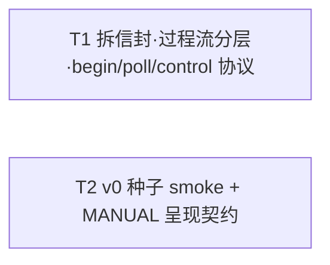

# 0013 · Harness 呈现与交互协议：拆信封 · 过程流分层 · 打断/心跳

<!-- 本文件由 spec 工具维护：frontmatter 为结构化源数据（含 tasks DAG），正文为组级 rust-RFC 9 段总览。 -->

## Summary

规范 harness 作为「可启动程序 + 黑盒对话契约」对用户的**呈现层**与**交互协议**，让被进化 harness 的内部结构不污染用户体感：

1. **拆信封**——工具型 agent 收尾吐的 `complete_task` 信封（`{success,status,output:{result}}`）被剥到 `output.result`，用户只看最终答案；
2. **过程流分层**——内层每步（模型发言/工具调用/结果）经协议 `steps` 字段只吐给观测层，persona 只吃 `reply`；
3. **打断/心跳协议**——`control:interrupt` 可在某轮进行中即时打断、回定型 `[interrupted]` 并保留会话；launcher 的 `begin/poll/control` 把一轮 `send` 拆成分片轮询，进程活着即视为合法长任务、绝不按墙钟盲杀。

落点 `backend/harness_template/`（v0 种子/参考实现）+ `backend/auto_designer/harness/launcher.py`。是 0012 用户侧心跳的 harness 侧对偶。

## Motivation

**现状（就地复述，本 spec 自包含）。** harness 不建模为单个 agent，而是「可启动程序 + 黑盒对话契约」：启动后从 stdin 收用户消息、向 stdout 回复；内部由 1 个或 N 个 nexau 自行编排，用户侧仅通过 `HarnessInterface`(send/reset/close) 交互、不感知内部结构（CLAUDE.md 架构约束）。`harness_template/` 是 v0 种子，用于初始化 harness 独立仓。

三个具体失真需要在协议层根治：

1. **信封泄漏。** nexau 工具型 agent 的收尾 `complete_task` 会把一整个协议信封当作回复吐出。若原样喂给 persona，用户「看到」的是 `{"success": true, "status": "TASK_COMPLETED", ...}` 而非人话答案——体感被协议噪声污染。
2. **过程流污染体感。** 内层多轮迭代（模型思考、工具调用、报错重试）对观测极有价值，但真人用户看不到 harness 内部；若把这些 step 混进 `reply`，persona 会据「过程」而非「结果」打体感，失真。
3. **慢会话无协议。** 单轮 nexau 可能长跑十几分钟。若没有「进行中/可打断」协议，用户侧只能阻塞或按墙钟盲杀——前者丢主动权（见 0012），后者会杀掉合法长任务、把「还在算」误判成「挂了」。

**为什么放在 harness 侧且进种子。** 呈现与协议是 harness 的对外契约，必须由 harness 自身实现才能保证「用户不感知内部结构」；放进 `harness_template` v0 种子，则每个被进化实例从第一版起就带这套契约，dev 的演化在其上增量进行。

## Guide-level explanation

harness 的对外契约（v0 起即成立）：

- **协议帧。** stdin 逐行 JSON：`{"message": ...}` 触发一轮处理；`{"control": ...}` 是旁路控制（如 `interrupt`）。stdout 每轮回一行 `{"reply": <人话>, "steps"?: [{kind,text}...]}`。
- **reply 是给人看的。** `reply` 已拆掉 `complete_task` 信封，是最终答案；`steps` 是可选观测旁路，persona 侧读不到。
- **打断。** 处理某轮时收到 `{"control":"interrupt"}`，harness 优雅停止当前轮（保留 session/history）并回 `[interrupted] ...`，不再重试本轮；用户可在下一轮基于保留的上下文续给指令。
- **长任务不盲杀。** launcher 用 `begin`（起一轮、不阻塞）+ `poll(timeout)`（分片等）+ `control`（旁路控制）三件套：`poll` 只要进程还活着就返回 `("pending", waited)`，让上层（用户 agent）决定继续等/打断/放弃；只有「进程已退出却没吐合法输出」才判失败。
- **预算钮可见。** entry.py 顶层对 `_CALL_TIMEOUT`/`_RUN_RETRIES` 标注其延迟体感含义（最坏 ~16 分钟静默硬磨），提示后续 dev 演化优先动预算钮/改交付方式，而非只在外层堆恢复（呼应 0016 设计师「延迟即痛点」）。

## Reference-level explanation

### 现状代码锚点

- `harness_template/entry.py`：`main`（stdin 循环）、`_stdin_reader`（分发 msg_q/ctrl_q）、`_reply`/`_run_supervised`（跑一轮 + 守超时/打断）、`_unwrap_reply`（拆信封，至多两层取 `output.result`）、`_make_step_collector`（tracer 收 `{kind,text}`）、`_INTERRUPT_REPLY`（`[interrupted]`）、常量 `_RUN_RETRIES=4`/`_CALL_TIMEOUT=240`。
- `harness/launcher.py`：`begin`/`poll`/`control`/`send`、`last_steps`（观测旁路）、`_resolve_sha`/`_checkout`（按 commit SHA 缓存 checkout，保证会话级快照）。
- `harness/interface.py`：`HarnessInterface`(send/reset/close) 黑盒契约。
- `loop/sim_user.py`、`models.py`：把 `steps` 落进观测记录的结构与管线。

### 呈现/协议契约表

| 关注点 | 无协议时 | 本组契约 |
|---|---|---|
| 收尾回复 | `complete_task` 信封原样吐 | `_unwrap_reply` 剥到 `output.result` |
| 内层过程 | 混进 reply 或丢失 | `steps` 字段只吐观测，persona 只吃 reply |
| 慢会话 | 阻塞 / 墙钟盲杀 | `begin/poll/control`，活进程返回 pending 不杀 |
| 打断 | 无 | `control:interrupt` → `[interrupted]`、保留会话 |
| 过期控制 | 可能误打断下一轮 | 每轮开始清空遗留 ctrl_q |

### DAG

T1（协议与拆分实现）与 T2（种子自测 + 手册）`files` 互斥，可并行；T2 的 smoke 与 MANUAL 描述的是 T1 落定的行为。

### 文件分配（各 Task `files` 互斥）

- **T1**：`harness_template/entry.py`、`harness/launcher.py`、`harness/interface.py`、`loop/sim_user.py`、`models.py`、`tests/harness/test_template_entry.py`、`tests/harness/test_launcher.py`
- **T2**：`harness_template/tests/test_smoke.py`、`harness_template/MANUAL.md`

### 与相邻组的接缝

- **0012（用户侧心跳）** 消费本组的 `begin/poll/control`；控制名对框架不透明、由本组 harness 的 MANUAL 定义。
- **0014（收尾闸门）** 依赖「对外可观察行为改动须同步 MANUAL」——MANUAL 的呈现契约由本组 T2 奠定。
- **0015（提交边界）** 依赖 `tests/` 只放 harness 本体测试的约定——由本组 T2 的 smoke 树立。

## Drawbacks

- **信封拆解是启发式**：`_unwrap_reply` 至多解两层、按固定键名（`output.result`/`result`）猜，若某版 agent 换了信封结构会拆不干净。
- **`steps` 是可选契约**：老 harness/无内层过程时缺省，观测层需容忍缺失，不能当硬约束。
- **打断依赖 nexau 的 `force_stop` 语义**：优雅停止在下一个检查点生效，若 agent 长时间不到检查点，打断有宽限延迟。
- **进程存活≠有进展**：`poll` 不盲杀活进程，但「活着但空转」只能靠上层（用户心跳耐心/心跳上限）而非协议本身识别。

## Rationale and alternatives

选「协议层分层 + 不盲杀」，因为它把「用户体感的纯净」与「观测的完整」这对张力在契约层一次性解开，且与「harness 黑盒、可替换」的架构约束一致。

- **备选 A：把 steps 也拼进 reply、让上层过滤。** 违反黑盒契约、且极易漏过滤污染体感；分层放 harness 内更稳。
- **备选 B：按墙钟硬超时杀进程。** 会杀掉合法长任务、把「还在算」误判成「挂了」，制造假故障信号；改用「活进程 pending + 上层决策」。
- **备选 C：不拆信封，在 persona 侧做兼容。** 把 harness 的实现细节泄漏进用户侧，违反「用户不感知内部结构」，且每换一种 agent 都要改用户侧。

## Prior art

- **CLAUDE.md 架构**：「harness = 可启动程序 + 黑盒对话契约」「用户仅通过 HarnessInterface 交互、不感知内部结构」——本组是该约束的协议落地。
- **stdio JSON-lines 协议**：LSP / 各类 agent runner 常用逐行 JSON 帧 + 旁路控制；此处沿用并加「过程流观测旁路」。
- **长运行任务的 poll/heartbeat**：不盲杀、周期性回报、允许中途干预，是长任务编排通行做法。

## Unresolved questions

- **信封契约标准化**：是否应让 nexau 收尾直接吐「已拆」结果，从源头免掉 `_unwrap_reply` 的启发式？
- **timeout 的呈现**：v0 种子当前硬超时仍走静默重试；「首次超时即回可检查的部分结果/进行中状态」应作为 dev 演化目标（0016 已把此列为设计师方向），还是直接写进种子？
- **steps 的粒度与体量**：内层过程可能极长，观测层的截断策略与 persona 的严格隔离边界需固化。

## Future possibilities

- 种子内建「超时即回进行中/部分结果」，把「等很久才失败」从体感杀手降级为可续跑状态。
- `control` 词表标准化（interrupt/continue/narrow-scope…），并在 MANUAL 里结构化声明，供用户 agent 精确调用。
- 观测层按 `steps` 重建 harness 内层时间线，支撑「延迟归因到具体内层步」的诊断。

