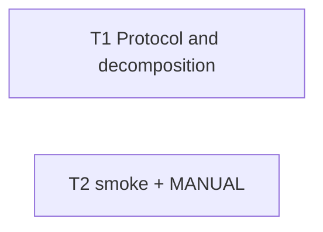

# 0013 · Harness Presentation and Interaction Protocol: Envelope Unwrapping · Layered Process Streams · Interruption/Heartbeat

<!-- This file is maintained by the spec tool: frontmatter is the structured source data (including the tasks DAG), and the body is a group-level nine-section rust-RFC overview. -->

## Summary

Standardize the user-facing presentation and interaction protocol of the harness as a “launchable program + black-box conversation contract”:

1. **Envelope unwrapping**—strip the `complete_task` envelope down to `output.result`, so the user sees only the final answer;
2. **Layered process streams**—internal `steps` exposes only the observation layer, and the persona consumes only `reply`;
3. **In-flight activity strip**—a turn may first emit zero or more `{"progress":{kind,text}}` lines (sharing the stdout lock with terminal reply), while the terminal state remains one line containing `reply`;
4. **Interruption/segmented polling**—`control:interrupt` → `[interrupted]`; launcher `begin/poll/control` returns pending for a live process without blindly killing it.

See **0019** for relaxed side-channel keys and continued waiting with peek. Implementation targets: `harness_template/` + `harness/launcher.py`.

## Motivation

The harness is a black-box conversation contract: receive messages on stdin and reply on stdout. Envelope leakage, process streams contaminating the user experience, and the lack of a protocol for slow sessions must be addressed at the root; waiting must also expose a visible activity strip for 0012 heartbeat decisions.

## Guide-level explanation

- **Protocol frames.** stdin: `{"message"}` / `{"control"}`. stdout: multiple `progress` lines may appear while running; one terminal `{"reply", "steps"?}` line.
- **reply is for people**; `steps` is an observation side channel; `progress` is live status, not the final answer (MANUAL activity strip).
- **Interruption** → `[interrupted]`, preserving the session.
- **Do not blindly kill long tasks**: `poll` with a live process → pending.
- **Visible budget controls** (`_RUN_RETRIES` / `max_iterations`); the harness imposes no wall-clock limit on an entire turn.

## Reference-level explanation

### Code anchors

- `harness_template/entry.py`: `_emit_progress`, `_stdout_lock`, envelope unwrapping, interrupt, tracer→steps.
- `harness/launcher.py`: `begin`/`poll`/`control`, `last_steps`/`last_progress` (see 0019 for relaxed reception).
- `MANUAL.md`: division of responsibilities between activity strip + terminal reply.

### Contract table

| Concern | Contract for this group |
|---|---|
| Completion | Unwrap down to `output.result` |
| Internal process | `steps` is observation-only |
| In flight | Multiple `progress` lines, without replacing reply |
| Slow sessions | begin/poll/control, pending for live processes |
| Interruption | `[interrupted]` |

### DAG

### Interfaces

0012 consumes progress/poll; 0019 relaxes unknown side channels and peek; 0014 requires MANUAL to be synchronized when external behavior changes.

## Drawbacks

Envelope unwrapping is heuristic; progress and steps may duplicate information; interruption depends on nexau `force_stop` checkpoints.

## Rationale and alternatives

- Blind wall-clock kills can terminate legitimate long tasks.
- Appending progress to reply would contaminate the user experience.
- Reception of unknown side channels belongs to 0019; this group owns the seed emission contract.

## Prior art

CLAUDE.md black-box contract; stdio JSONL; long-task poll/heartbeat.

## Unresolved questions

Should the seed provide built-in “partial results” on timeout? What progress granularity and truncation should be used?

## Future possibilities

Seed behavior that “returns in-flight status on timeout”; reconstruct timelines from progress/steps in the observation layer.
