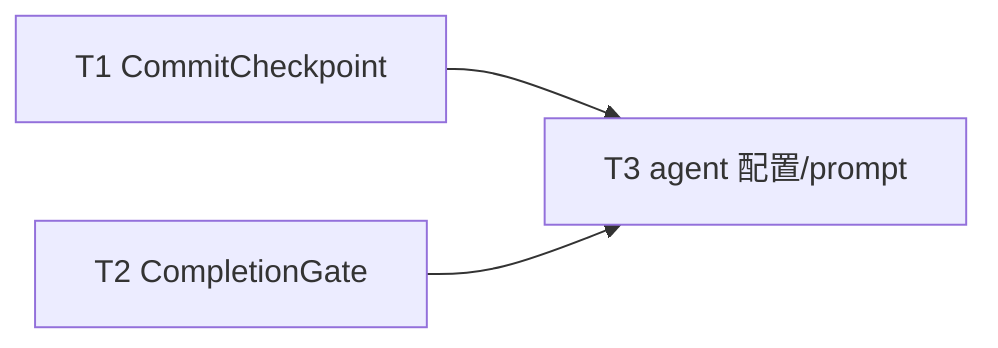

# 0014 · 开发者侧提交纪律：增量落地闸 + 收尾硬闸（含接线 AST）

<!-- 本文件由 spec 工具维护：frontmatter 为结构化源数据（含 tasks DAG），正文为组级 rust-RFC 9 段总览。 -->

## Summary

用机制保证 dev 每轮产出干净已提交增量：

1. **CommitCheckpoint**——预算过线/改动过大/末段零提交时逐级施压，逼早落最小片；
2. **CompletionGate**——拦 `complete_task`：硬闸=工作区干净 + MANUAL 同步 + **主路径 AST「先用后赋」接线扫描**；软闸=催 `tests/`，并对 heartbeat/进度符号催补短等契约测；
3. **systemprompt**——一次冒烟即止，且**冒烟必须覆盖真实接线/对外契约**，禁止只测 helper。

落点 `dev/` + `agent_defs/developer_agent/`。

## Motivation

纯 trunk 下 LLM dev 常见：零提交白跑、半截收尾（手册漂移）、helper 测绿但 `main` NameError、只测静态不测等待中 progress。软 prompt 不够，必须机制闸门。

## Guide-level explanation

- **早期**：CommitCheckpoint 三档施压；本轮一旦有 commit 闭嘴。
- **收尾硬闸**：脏仓 / 改 entry 未同步 MANUAL / `main`·`_run_supervised` 先用后赋 → 剔 `complete_task`。
- **收尾软闸**：无回归测试；有 heartbeat 无 sleep/wait 类断言 → 催进度契约测；预算紧让路。
- **冒烟纪律**：一种一遍即止；但必须按真实调用顺序走到本轮接线（含中途 progress）。

## Reference-level explanation

### 代码锚点

- `commit_checkpoint.py`；`completion_gate.py`（`_local_used_before_assign`、`_has_heartbeat_symbol`、`_tests_mention_timing`）；`systemprompt.md`。

### 闸门表

| 阶段 | 触发 | 动作 |
|---|---|---|
| Checkpoint 普通/严重/硬落地 | 未提交过线 | 施压直至 commit |
| Gate 硬：脏仓/手册 | complete_task | 拦截 |
| Gate 硬：接线 AST | entry 主路径先用后赋 | 拦截 |
| Gate 软：无测试 / 无进度断言 | remaining 充足 | 软催 |
| Gate 让路 | remaining≤1 或 blocks 满 | 放行 |

### DAG

## Drawbacks

闸门不保证增量正确；AST 扫描非全语言语义；手册同步曾有误报风险。

## Rationale and alternatives

- 只加 prompt：已被证伪。
- 加大 max_iterations：不治过度自验。
- 闸门代 commit：违反「不提交未验证」。

## Prior art

0007 纯 trunk 护栏；CI pre-commit 思想进 agent 管线。

## Unresolved questions

手册同步误报；structured tool_call 与 complete_task；参数动态化。

## Future possibilities

「已过一次 smoke 又发明第二种验证」机制收束；自适应预算。
