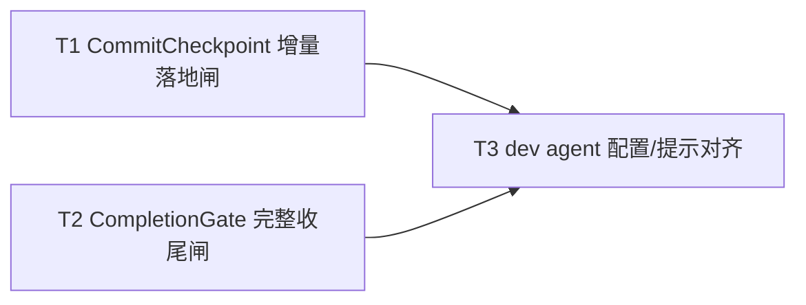

# 0014 · 开发者侧提交纪律：增量落地闸 + 完整收尾闸

<!-- 本文件由 spec 工具维护：frontmatter 为结构化源数据（含 tasks DAG），正文为组级 rust-RFC 9 段总览。 -->

## Summary

用**机制**（middleware + git 真实状态检查）而非软提示，保证 dev agent 每轮产出「一次干净的、已提交并推送的增量」，堵两个实测失败模式：**零提交白跑**（贪大一口气建全套 → 撞满迭代/墙钟 → 零提交落 main）与**半截收尾**（改了对外可观察行为却不同步手册、自验冒烟跑完即弃）。

两道闸：**CommitCheckpointMiddleware** 在预算过线/改动过大/末段仍零提交时逐级施压，逼尽早落一个已提交最小片；**CompletionGateMiddleware** 拦在 `complete_task` 上，强制收尾时工作区干净、可观察行为同步 `MANUAL.md`、并软催把自验落成回归测试。配套按实测调 `max_iterations=38`、硬落地窗口 `hard_commit_by_remaining=8`，与 systemprompt「一次冒烟即止」纪律。

## Motivation

**现状（就地复述，本 spec 自包含）。** 0007 把开发者侧改为纯 trunk：dev agent 领一条 open issue，`checkout main → 改 → commit → tag vK → push`，无分支/无门禁，坏 commit 靠后续多轮迭代回正。dev 是带 git 工具的 nexau agent，跑在有限迭代预算（`max_iterations`）+ 墙钟里。

纯 trunk 把「每轮必须干净落地」的要求推到极致，而 LLM dev 有两类稳定的坏行为，软 prompt 约束会被间歇忽略：

1. **贪大 → 零提交白跑。** dev 无视「切最小片」的方法论，一口气想做完整个大改（实测 entry.py 憋 +375 行未提交），撞满迭代或墙钟时**一个 commit 都没落**，整轮预算白烧、main 毫无推进——这是最坏结果。
2. **半截收尾。** 改了 `entry.py` 的对外可观察行为却不更 `MANUAL.md`（实测 3 轮里 2 轮没更）；自验冒烟跑完即弃、0/3 落库成回归测试。收尾看着「完成」，实则留下手册漂移与工作区脏尾。
3. **过度自验 → 耗尽迭代。** 反过来，dev 有时把「证明它工作」当成开放式目标，提交后仍反复发明新的验证方式（signal 模拟、多个 tempfile 脚本、反复 git status/diff），把预算耗到撞上限；实测提交落在最后一口气（34/34）时，已没预算走 `tag/push/complete_task` 尾巴。

**为什么用机制而非 prompt。** 上述都是「软纪律被间歇忽略」，唯一稳的办法是把「希望它做」变成「state-triggered 的主动干预」：在正确时机据真实 git 状态施压或拦截，但仍**不替模型写/提交未验证代码**。

## Guide-level explanation

dev agent 每轮的执行被两道闸约束：

- **早期（CommitCheckpoint）。** 若预算已过 1/4（`first_commit_by_frac`）或未提交改动过大（`big_diff_lines`）却还没 commit，注入「切最小片、先落地」提示；越晚越硬——`frac>=0.66` 警告正走向零提交白跑，`remaining<=hard_commit_by_remaining`（末 8 轮）给不可含糊的「下一步就 commit+tag+push、其余留 follow-up」。一旦本轮产生任何 commit，立即闭嘴。
- **收尾（CompletionGate）。** dev 调 `complete_task` 时，检查：① 工作区必须干净；② 改了对外可观察行为（`entry.py`）就必须在提交里同步 `MANUAL.md`（或在报告里显式声明「本次无对外可见变化」）；③（软）改了逻辑最好落一个 `tests/` 下回归测试。不达标就把 `complete_task` 剔掉、注入反馈、令其同轮补齐——但预算见底（`remaining<=1` 或拦截达 `max_blocks`）时整体让路，绝不空转到上限。
- **行为纪律（systemprompt）。** 「一次冒烟即止」：`py_compile` + 一条 smoke 绿即视为验证充分、立刻提交；验证只跑一种一遍，过了禁止再发明第二种反复自证。

三者协同：CommitCheckpoint 保证「早落一个增量」，systemprompt 保证「验证不发散」，CompletionGate 保证「收尾完整」。

## Reference-level explanation

### 现状代码锚点

- `dev/commit_checkpoint.py`：`CommitCheckpointMiddleware(before_agent 锚 HEAD, before_model 三档施压)`；参数 `first_commit_by_frac=0.25`、`big_diff_lines=150`、`hard_commit_by_remaining=8`。
- `dev/completion_gate.py`：`CompletionGateMiddleware(after_model 拦 complete_task)`；参数 `observable_paths=("entry.py",)`、`manual_path="MANUAL.md"`、`max_blocks=8`、`soft_gate_min_remaining=6`；豁免语 `_NO_VISIBLE_MARKERS`。
- `agent_defs/developer_agent/agent.yaml`：`max_iterations=38`、`tool_call_mode: structured`，中间件链 `WorkspaceJail`（见 0015）→ `RoundAndTokenReminder` → `CommitCheckpoint` → `CompletionGate`。
- `agent_defs/developer_agent/systemprompt.md`：诊断型工作流 + 绝对规则 + 收尾契约 + 「一次冒烟即止」。

### 三档施压 / 收尾闸逻辑

| 阶段 | 触发条件 | 动作 |
|---|---|---|
| CommitCheckpoint 普通 | 未提交 且（`frac>=0.25` 或 pending>=150 行） | 提醒切最小片先落地 |
| CommitCheckpoint 严重 | 未提交 且 `frac>=0.66` | 警告零提交白跑 |
| CommitCheckpoint 硬落地 | 未提交 且 `remaining<=8` | 「下一步就 commit+tag+push」 |
| CommitCheckpoint 达标 | 本轮 HEAD 已前移 | 闭嘴 |
| CompletionGate 硬闸 | `complete_task` 时工作区脏 / 改 entry.py 未同步 MANUAL | 剔除 complete_task、force_continue |
| CompletionGate 软闸 | 改逻辑未落测试 且 `remaining>6` | 软催落 tests/ 测试 |
| CompletionGate 让路 | `remaining<=1` 或 `blocks>=8` | 放行收尾 |

### DAG

T1、T2 各自实现一个 middleware（`files` 互斥）；T3 把二者接线进 `agent.yaml` 并对齐 systemprompt，依赖 T1、T2。

### 文件分配（各 Task `files` 互斥）

- **T1**：`dev/commit_checkpoint.py`、`tests/dev/test_commit_checkpoint.py`
- **T2**：`dev/completion_gate.py`、`tests/dev/test_completion_gate.py`
- **T3**：`developer_agent/agent.yaml`、`systemprompt.md`、`MANUAL.md`

### 实测调参依据

`max_iterations 34→38` + `hard_commit_by_remaining 3→8`：窗口 3 太晚——实测 dev 在第 34/34 轮才提交，没预算再走 `tag/push/complete_task`（`work_one` 以新 tag 为 ground truth，判 `committed=False`）。前移到 8、放宽到 38 后，提交提前到 ~30 轮、整条 git 尾巴走完（实测 `committed=True`、tag 落地、仓纯净）。

## Drawbacks

- **闸门只施压/拦截，不保证质量**：机制保证「有一个已提交、完整收尾的增量」，但不保证该增量是对的——坏 commit 仍靠 0007 的多轮迭代回正。
- **参数为经验值**：`first_commit_by_frac`/`big_diff_lines`/`hard_commit_by_remaining`/`max_iterations` 均据少量实测拍定，未系统标定。
- **CompletionGate 存在误报风险**：以 `start_sha..HEAD` 判「本轮是否同步了 MANUAL」，在 amend/多次提交等边界下曾观察到 `[手册同步]` 误拦，导致尾部空转（见 Unresolved）。
- **依赖 `SANDBOX_WORK_DIR` 指向 harness 仓**：环境不对时闸门 no-op，静默失去保护。

## Rationale and alternatives

选「state-triggered middleware」，因为软 prompt 约束被反复证明会间歇失效，而机制能在正确时机据真实 git 状态强制干预、且不越界替模型写代码。

- **备选 A：只加 prompt 纪律。** 已是现状基线，实测被间歇忽略（零提交白跑/半截收尾）。
- **备选 B：无脑加大 max_iterations。** 不治本——过度自验会把任意预算填满；实测需要的是「早落地 + 验证不发散」，而非更多轮。
- **备选 C：闸门直接替模型 commit 未验证代码。** 违反「不提交未验证代码」，会把坏增量自动焊进 main，放大 0007 无门禁的风险。
- **备选 D：把两道闸合成一个 middleware。** 二者时机（before_model 施压 vs after_model 拦收尾）与职责不同，合并降低内聚、难测试。

## Prior art

- **0007 纯 trunk 开发者侧**：本组是其配套「护栏」——纯 trunk 去掉了门禁，把「每轮干净落地」的压力转移到 dev 行为，本组用机制承接。
- **CI 的 pre-commit / 提交规范钩子**：以机制强制「提交须完整、须带测试」，本组把类似思想放进 agent 执行管线（而非仓钩子），因为要在「模型还在决策时」施压。
- **增量交付 / 最小可提交步**：trunk-based development 的小步提交纪律。

## Unresolved questions

- **CompletionGate `[手册同步]` 误报**：实测出现「commit 已含 MANUAL.md 却仍被拦」的假阳性，触发条件未复现清楚，需给 gate 加运行时调试日志定位（当前记为 follow-up）。
- **structured XML tool_call_mode 的影响**：dev 在长多步角色下有时不干净发 `complete_task`（撞 max_iter 而非 stop 收尾），是否与 XML 模式解析相关待查。
- **参数标定**：硬落地窗口/预算是否应据 issue 复杂度动态调整，而非全局定值。

## Future possibilities

- 修掉 CompletionGate 手册同步误报，让 `complete_task` 能干净收尾（而非靠 max_iter 兜底）。
- 据 issue 规模自适应 `max_iterations` 与硬落地窗口。
- 把「一次冒烟即止」从 prompt 纪律升级为机制（检测到「已过一次 smoke 又在发新验证」时主动收束）。

