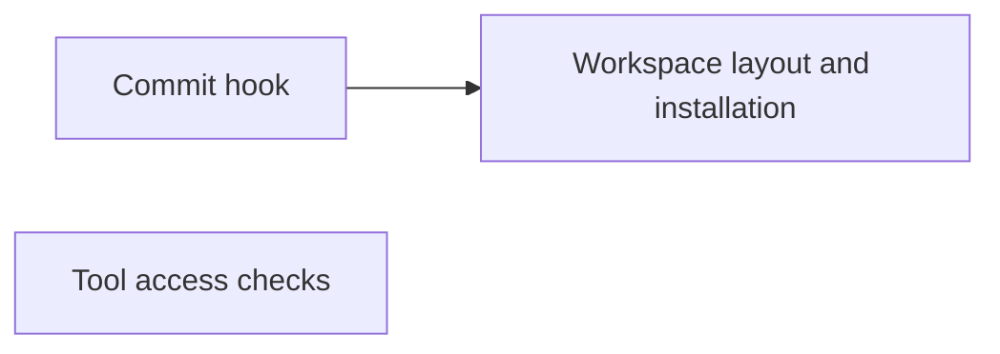

# 0015 · Harness Boundaries and Requirement Tool Access

## Summary

Three mechanisms are currently retained: the Harness submission rejection list, isolation of the working-directory and raw-trace layouts, and tool file-path checks for the requirements Agent. The implementation is located in `backend/ahe_beta/guards/`, and no longer belongs to a built-in development role.

## Motivation

The product repository must not ingest keys or experiment runtime state, and the requirements Agent must not read raw task traces arbitrarily. Path checks can block direct out-of-bounds access, but cannot constrain all behavior executed by an interpreter; therefore, they must not be described as an operating-system sandbox.

## Guide-level explanation

- `harness_boundary.py` generates an independent pre-commit hook that rejects `.env`, `.env.*`, and top-level `.openagents`; `.env.example` and normal product files are allowed to be submitted.
- `run.py` places the Harness under `data/harness_sandbox/harness_repo`, preventing raw traces from becoming a sibling directory of the workspace.
- Triage, Architect, PM, and Owner check tool access through `WorkspaceJailMiddleware`; declared observation artifacts must also satisfy authorization by call and session.

## Reference-level explanation

T1 owns `guards/harness_boundary.py` and its tests; T2 owns the directory layout and hook installation for the startup entry point; T3 owns `guards/workspace_jail.py` and its tests. The requirements Agent definition references `ahe_beta.guards.workspace_jail:WorkspaceJailMiddleware`.

The submission hook is installed after the seed commit and depends only on the standard library and Git. When modifying the rejection list, update the independent script for the Harness template smoke test in sync. Write operations are restricted to the workspace; read operations allow the workspace, NexAU source code, and temporary framework output, while raw sessions and runtime traces are not made accessible by moving directories. Explicit observation authorization is still validated by the requirements-side observation provider.

Offline verification: `uv run --locked --extra dev pytest backend/tests/guards/test_harness_boundary.py backend/tests/guards/test_workspace_jail.py backend/tests/test_sandbox_isolation.py`. Full wiring regression also checks the four-role YAML, temporary-repository submission and rejection, and observation authorization.

## Drawbacks

Tool-argument-level checks cannot prevent every out-of-bounds method available to an interpreter or arbitrary shell; directory isolation is also not permission isolation. Container- or operating-system-level isolation requires independent verification.

## Rationale and alternatives

Retain the effective checks and move them into `guards`, avoiding removal of defenses that are still assembled; use an explicit rejection list rather than the old product-file-name allowlist, so that legitimate new source code and Spec documents can be submitted.

## Prior art

Earlier submission allowlists and path checks were used to reduce the risk of task content contaminating the product. The current submission boundary already permits normal product expansion while continuing to reject keys and runtime state.

## Unresolved questions

None. This reorganization preserves the existing check behavior and trigger points and does not add new sandbox capabilities.

## Future possibilities

The submission hook and CI rejection rules could be generated from the same source, and operating-system-level isolation could be verified further; these protections do not arise automatically from package migration.
