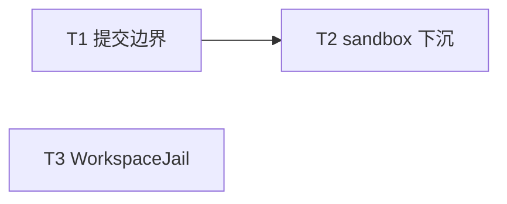

# 0015 · 开发者侧过拟合泄漏隔离：提交边界 + trace 物理隔离 + 工作区 jail

<!-- 本文件由 spec 工具维护：frontmatter 为结构化源数据（含 tasks DAG），正文为组级 rust-RFC 9 段总览。 -->

## Summary

堵 dev/designer 把任务产物焊进通用 harness 的过拟合泄漏，三道机制：

1. **提交边界**——pre-commit 拒非 harness 白名单路径；
2. **trace 物理隔离**——sandbox 下沉，断掉 `../sessions` / `../harness_runs`；
3. **WorkspaceJail**——**写**只许 harness 仓；**读**放行 harness 仓 + **NexAU 源码** + **NexAU 运行时临时目录**（`nexau_bash_tool_results` / `nexau_tool_outputs`）；trace 仍一律拒。

## Motivation

写侧：照 issue 字面把被测项目写进 harness。读侧：翻轨迹过拟合；但若连 NexAU 自己的 bash/tool 临时输出也拒读，会误伤正常工具环。故读写分流：挡 trace，放行框架只读根。

## Guide-level explanation

- **能写/提交**：仅 harness 本体白名单。
- **能读**：仓内 + NexAU 库源码 + nexau 临时输出目录。
- **不能读**：`data/sessions` / `data/harness_runs`（布局 + jail 双挡）。

## Reference-level explanation

### 代码锚点

- `harness_boundary.py`；`run.py` 下沉布局；`workspace_jail.py`：`_WRITE_TOOLS`、`_read_roots_for`、`_nexau_repo_root`、`_nexau_runtime_read_roots`、`_TRACE_REF`。

### 三道防线

| 防线 | 挡什么 |
|---|---|
| pre-commit | 任务代码进仓 |
| 目录下沉 | 相对路径翻 trace |
| jail | 写越界；读 trace；读侧放行 NexAU |

### DAG

## Drawbacks

静态 shell 扫描非 airtight（`python -c`）；白名单硬编码；钩子可被 `--no-verify` 绕过。

## Rationale and alternatives

- 仅 nexau 原生权限：read 不走权限。
- 仅 prompt：已被泄漏事故证伪。
- 读侧一律 work_dir：误伤 NexAU 工具环。

## Prior art

CLAUDE.md train/test 分离；0007 无门禁更需边界。

## Unresolved questions

是否上 OS 级沙箱；ALLOWED_TOP 演进；误伤可观测性。

## Future possibilities

拦截事件进看板；内容级提交检查。
