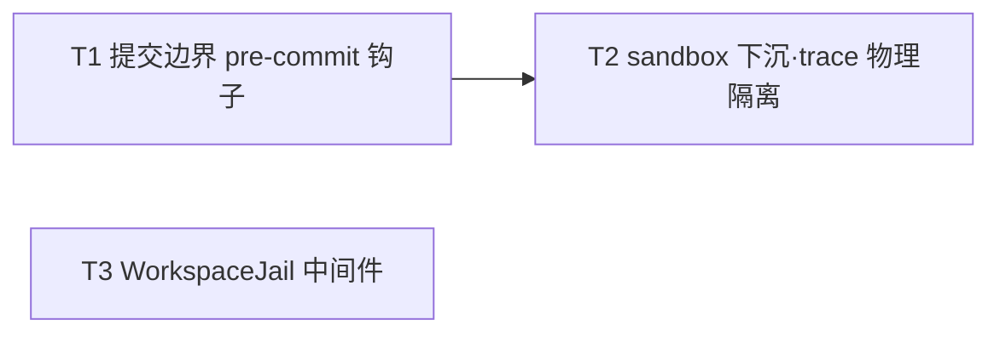

# 0015 · 开发者侧过拟合泄漏隔离：提交边界 + trace 物理隔离 + 工作区 jail

<!-- 本文件由 spec 工具维护：frontmatter 为结构化源数据（含 tasks DAG），正文为组级 rust-RFC 9 段总览。 -->

## Summary

堵一个关键的架构级漏洞：dev/designer agent 把「某个具体被测任务的产物」焊进**通用** harness，导致过拟合——训练目标（体感）与测试目标（benchmark）互相污染，正是项目约束要极力避免的。三道正交的机制层防线：

1. **提交边界硬闸**——harness 仓 `pre-commit` 钩子，暂存区出现 harness 本体之外的路径即拒；
2. **trace 物理隔离**——sandbox 工作目录下沉到独立父目录，使 `data/sessions`/`data/harness_runs` 不再是其 `../` 同级、断掉相对路径可达；
3. **工作区 jail**——`WorkspaceJailMiddleware` 用 `wrap_tool_call` 把文件/shell 操作关进 `SANDBOX_WORK_DIR`，越界读写一律拒（补 nexau「read 不走权限」的缺口）。

## Motivation

**现状与事故（就地复述，本 spec 自包含）。** 项目的核心约束是「训练信号（体感）与测试（benchmark held-out）分离，persona 来自真实数据、不依据 benchmark 或轨迹构造」——目的是让 harness 的进化不被 benchmark 特征污染、避免过拟合。dev/designer 的 sandbox 工作目录就是 harness 仓；harness 是**通用编码助手**，仓里只该有它自身的制品（`entry.py`/`agents/`/`tools/`/`MANUAL.md`/配置/`tests/`）。

真实闭环里观测到两类泄漏：

1. **写侧泄漏（焊任务代码进 harness）。** 用户 agent 把「跑不动某 benchmark 任务（如 unidecode）」当 bug 提 issue，dev 领到后照字面 `mkdir -p unicode_ascii/tables; cat > pyproject.toml …`，把**被测项目本体**一行行写进 harness 仓并提交——通用工具被过拟合成某具体任务；且 dev 把整轮迭代耗在建/装/测这个包上（实测 issue #69 用掉 23 次 shell 调用），直接爆迭代。
2. **读侧泄漏（翻任务轨迹）。** dev/designer 顺 `../sessions`/`../harness_runs` 就能读到别人跑某任务的轨迹（某库 API、某类文件、预期输出）；逐行看会把任务专属知识带进 harness，同样是过拟合。而 nexau 的 read 类工具**不走权限体系**、只读 bash（`cat`/`grep`/`find`）又在白名单无条件放行——原生权限挡不住。

**为什么要机制、且要三道。** 这不是「提醒 agent 别这么做」能解决的：写侧靠仓钩子（agent 绕不过，除非显式 `--no-verify`，指令不会那么做），读侧靠「目录布局 + 工具级 jail」双保险。三道正交、互为兜底。

## Guide-level explanation

从 dev/designer 的视角，能做与不能做：

- **能做**：在自己的 harness 仓内 `git`、`pytest`、读写仓内源码——合法工作全在仓内。
- **不能提交**：harness 本体之外的任何文件。`git commit` 时若暂存区有 `unicode_ascii/`、`pyproject.toml`、顶层 `test_*.py` 之类，`pre-commit` 钩子直接拒、列出越界清单，逼它删掉只提交对 harness 能力的改动。
- **不能读到 trace**：`data/sessions`/`data/harness_runs` 既不在工作目录的 `../` 同级（物理隔离），工具层也拒——`read_file ../sessions/x.json`、`grep ... ../harness_runs` 一律返回 `[workspace-jail] 拒绝`。诊断只能靠 `git log` + 读仓内源码，不靠翻轨迹。
- **designer 同样被 jail**：designer 也只读 harness 仓 + 自己的定义目录，不能翻 trace。

对 dev 的净效果：把「照 issue 字面把任务代码写进 harness」这条过拟合路径，从「靠自觉避免」变成「机制上做不到」。

## Reference-level explanation

### 现状代码锚点

- `dev/harness_boundary.py`：`ALLOWED_TOP`（白名单顶层路径）、`violations()`、`_HOOK_TEMPLATE`（自包含 pre-commit 脚本，白名单内联）、`render_hook()`、`install_pre_commit(repo)`。
- `run.py`：`_SANDBOX_ROOT = DATA/"harness_sandbox"`、`HARNESS_REPO = _SANDBOX_ROOT/"harness_repo"`（下沉布局）；`_seed_harness_repo()` 建仓 + `install_pre_commit`；`launcher` 的 `runs_root=DATA/"harness_runs"`、`store=DATA/"sessions"`。
- `dev/workspace_jail.py`：`WorkspaceJailMiddleware.wrap_tool_call`、`_PATH_PARAMS`（各工具的路径参数键）、`_escapes()`（resolve 后逃逸判定）、`_shell_offender()`（shlex 分词 + trace 正则 `_TRACE_REF`）、`_deny()`。
- `agent_defs/developer_agent/agent.yaml` 与 `agent_defs/designer/agent.yaml`：中间件链首位挂 `WorkspaceJailMiddleware`（注册在各自 agent 定义里，跨 0014/0016 组）。

### 三道防线职责

| 防线 | 机制 | 挡什么 | 绕不过的原因 |
|---|---|---|---|
| 提交边界（T1） | git pre-commit 钩子 | 写：任务代码进 harness 仓 | 仓层钩子，非 `--no-verify` 拦不掉 |
| trace 物理隔离（T2） | sandbox 目录下沉 | 读：`../sessions`/`../harness_runs` 相对路径 | 布局上不再可达 |
| 工作区 jail（T3） | `wrap_tool_call` | 读/写：任何越界路径（含绝对路径） | 直接短路工具、不调 call_next |

### DAG

T2 的 `_seed_harness_repo` 调用 T1 的 `install_pre_commit`，故 T2 依赖 T1；T3（工具级 jail）独立，可并行。三者 `files` 互斥（T1 落 `harness_boundary.py`，T2 落 `run.py`，T3 落 `workspace_jail.py`）。

### 文件分配（各 Task `files` 互斥）

- **T1**：`dev/harness_boundary.py`、`dev/agentic_developer.py`、`tests/dev/test_harness_boundary.py`
- **T2**：`run.py`、`tests/test_sandbox_isolation.py`
- **T3**：`dev/workspace_jail.py`、`tests/dev/test_workspace_jail.py`

> 中间件注册在 `developer_agent/agent.yaml` 与 `designer/agent.yaml`，这两个文件分别归 0014/T3 与 0016/T2 所有（跨组重叠，OVERVIEW 会标）。

## Drawbacks

- **jail 静态扫描非 airtight**：`run_shell_command` 若用 `python -c` 动态拼绝对路径读文件，静态 token 扫描扫不出；100% 密封需 OS 级沙箱（容器/`sandbox-exec`），出本层范围。对非对抗性 LLM 已堵住所有现实发现路径。
- **白名单是硬编码策略**：`ALLOWED_TOP` 若未来 harness 需要新顶层结构，得改钩子模板并重装。
- **误伤风险**：jail 的 shell 扫描对含 `/` 的搜索词/参数可能误判；已用「只审 path 参数键」「heredoc 跳过」「trace 正则区分路径段 vs 搜索词」压低误伤，但非零。
- **钩子可被 `--no-verify` 绕过**：机制假设 dev 指令不会显式跳钩子；对抗场景不成立。

## Rationale and alternatives

选「三道正交机制」，因为写侧与读侧是不同攻击面、单一手段都有缺口，且都必须是机制（软提示实测被无视）。

- **备选 A：只用 nexau 原生权限体系。** 实测不足——`check_path_permission` 只管写、read 类工具与只读 bash 白名单绕过，无法「按路径禁读」。故自研 jail。
- **备选 B：只靠 prompt 告诫「别翻 trace / 别写任务代码」。** 正是被泄漏事故证伪的基线。
- **备选 C：只做目录下沉、不做工具 jail。** 挡住相对路径，但绝对路径仍可达；反之只做 jail 不下沉则依赖扫描无死角。二者互补更稳。
- **备选 D：把 trace 完全移出机器/加密。** 过重，且观测层本身要读 trace；隔离到「dev/designer 读不到」这一粒度即可。

## Prior art

- **项目约束（CLAUDE.md）**：「benchmark 全程 held-out、persona 不依据 benchmark 或轨迹构造」——本组是「不让 harness 演化过程接触任务特征」的机制落地。
- **0007 纯 trunk dev**：dev 直推 main、无门禁，使「坏提交立即生效」，更需要边界钩子挡住结构性错误提交。
- **沙箱/越权防护**：seccomp、容器、chroot 等 OS 级隔离思想的轻量应用层近似（`wrap_tool_call` 拦截）。

## Unresolved questions

- **是否上 OS 级沙箱**：`python -c` 动态路径的残余缺口是否值得引入容器/`sandbox-exec`，还是维持「对非对抗 LLM 足够」的现状。
- **ALLOWED_TOP 演进**：harness 若合法地需要新顶层目录（如 `data/` 内部缓存），白名单与钩子的升级流程。
- **jail 误伤的可观测性**：被拒的合法操作如何回流为「误伤率」指标以便调 `_TRACE_REF`/token 规则。

## Future possibilities

- 把三道防线的拦截事件计数进观测看板，量化「泄漏尝试率」，作为 harness 是否在过拟合的信号。
- 钩子从「顶层白名单」升级为「内容级」检查（如禁 `import` 被测项目、禁 `pyproject.toml` 新增依赖）。
- 用 OS 级沙箱替换静态扫描，消除动态路径缺口。

