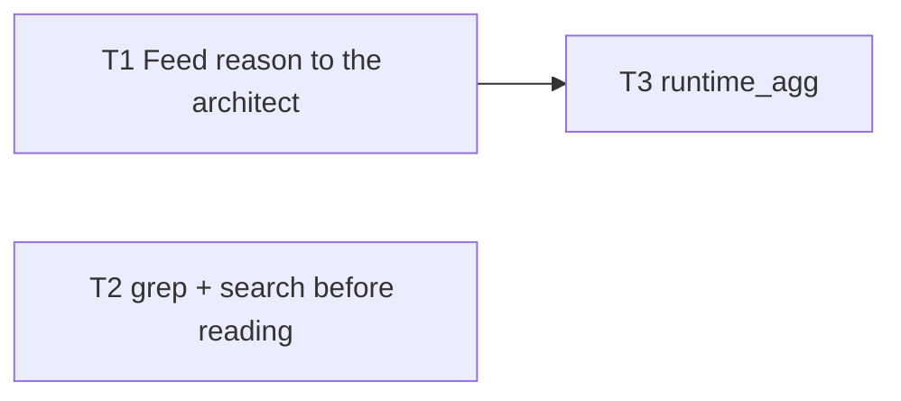

# 0016 · Architect Root-Cause Signals + Code-Reading Efficiency + Runtime Aggregation

<!-- This file is maintained by the spec tool: the frontmatter is structured source data (including the tasks DAG), and the body is a nine-section group-level rust-RFC overview. -->

## Summary

Add the signals and code-reading efficiency required for the Architect's diagnosis:

1. **Experience reason**—persist it in the index alongside the score and feed it into the trend (latency-related pain points appear only in reason);
2. **Search before reading**—`search_file_content` + discipline, avoiding iteration burn from reading entire files;
3. **runtime_agg**—after the fact, scan the most recent N Session sessions, aggregate the proportions of 0-step rounds/timeouts/interruptions/errors, median steps, and budget knobs, and inject them into `propose_once` (**observation only, no attribution**).

Locations: `architect/` + `session_store` + `agent_defs/architect/`.

## Motivation

Looking only at scores misses latency root causes and leads to incorrect recovery requirements; without grep, reading entire files burns the budget; the prompt claims to have "0-step proportion/timeout proportion" but never injects the numbers, and when reason is compressed to "timed out again," it is impossible to distinguish forgetting from a budget that is too tight—hence runtime_agg.

## Guide-level explanation

- The trend includes reason; determine the root cause of latency before submitting requirements.
- Search large files first, then read the relevant sections closely.
- Add a side-channel block of **mechanism-level comparison numbers** (runtime_agg); the Architect performs attribution itself.

## Reference-level explanation

### Code anchors

- `session_store`: the index includes reason; `architect.py`: trend + injection into `format_runtime_agg(aggregate_runtime(...))`.
- `runtime_agg.py`: `RuntimeAgg`, most recent N=50, coarse reply labels, and reading `_CALL_TIMEOUT`/`_RUN_RETRIES`/`max_iterations` from the repository.
- architect agent.yaml / systemprompt / search_file_content.

### Signal flow

```
FeelingScore{score,reason} → index
Turn.steps + reply + budget controls → runtime_agg
        ↓
propose_once: curve(reason) + runtime block → classify as bug/feature → propose requirements
```

### DAG



### File allocation

- **T1**: `architect.py`, `session_store.py`, `test_architect.py` (including the propose injection call site)
- **T2**: architect agent definition and grep tool
- **T3**: `runtime_agg.py`, `test_runtime_agg.py`

## Drawbacks

reason noise; runtime_agg uses coarse labels rather than task semantics; grep still depends on keyword selection.

## Rationale and alternatives

- Scores only: latency is invisible.
- Structured reason labels: the MVP feeds the raw text first.
- Do not inject numbers and rely on the prompt to pretend that metrics exist: disproven.

## Prior art

0005 FeelingScore; 0012/0013 latency and steps side channels.

## Unresolved questions

Whether reason should be labeled; whether to structure waiting sequences and include them in agg.

## Future possibilities

Display agg in a dashboard; aggregate pain points by label.
