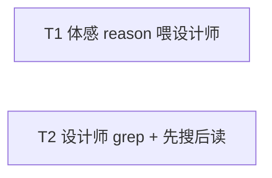

# 0016 · 设计师根因信号 + 读码效率：体感 reason 喂设计师 · 先搜后读

<!-- 本文件由 spec 工具维护：frontmatter 为结构化源数据（含 tasks DAG），正文为组级 rust-RFC 9 段总览。 -->

## Summary

补上设计师诊断根因所缺的**定性信号**，并降低其读码开销：

1. **体感 reason 喂设计师**——把用户打分背后那句「为什么」（`FeelingScore.reason`）随分数一起落进 `SessionStore` index 并喂给设计师。分数只告诉「差」，reason 才告诉「差在哪」；尤其「延迟/等待本身」这类痛点只出现在 reason 里、分数高低看不出，设计师据此先判 bug/feature 再给 dev 提需求，别把延迟误读成「没交付」去堆恢复逻辑。
2. **先搜后读**——给设计师 `search_file_content`(grep) 工具与「先搜后读、别整篇通读」纪律，避免把 `entry.py` 等大文件整篇 `read_file` 烧光迭代预算。

落点 `backend/auto_designer/designer/` + `user/session_store.py` + `agent_defs/designer/`。

## Motivation

**现状与信号缺口（就地复述，本 spec 自包含）。** 设计师是产品+架构角色：以「为用户解决问题」为前提，看体感 → 分析根因（是缺陷还是能力缺口）→ 把需求动作提给 dev。它的输入是历轮体感曲线（1–4 分随时间）。

但早期 `SessionStore` 的 index 只落了**分数**，没落 `reason`——用户打分背后那句定性理由被丢弃。这造成一个隐蔽而严重的信号缺口：

- **延迟类痛点在分数里不可见。** 实测有会话：harness 反复超时、周转极慢，用户体感明显不满，但最终「等到一个结果」时分数并不极端低；真正的痛「等了很久才失败 / 半天没动静 / 等到弃坑」**只写在 reason 里**。设计师只看分数，会漏掉「延迟即痛点」，甚至把它误读成「功能没交付」，进而给 dev 提「加恢复/重试逻辑」的错误需求——而正确方向是收紧超时预算/改增量交付/首超即回部分结果（见 0013）。
- **设计师读码烧预算。** 设计师此前无 shell、只能 `read_file`；面对 `entry.py`（数百行）只能整篇通读，瞬间烧光迭代预算（曾撞满 max-iter）。它需要「先搜后读」的能力与纪律。

**为什么现在做。** 这是让「延迟」这维体感信号真正驱动进化的关键一环：用户侧已能产生延迟体感（0012）、harness 侧已可承载可检查交付（0013），但若设计师看不到 reason、读不动机制源码，链路就断在设计师这里——它给出的需求会系统性地跑偏。

## Guide-level explanation

改完后设计师的工作方式：

- **体感曲线带「为什么」。** 每个历史分数后面跟着用户当时那句 reason。设计师读曲线时，分数定位「哪类场景差」，reason 定位「差在哪」。
- **延迟被识别为痛点。** systemprompt 明确：「延迟/等待本身」是体感杀手、只在 reason 里；看到「等很久才失败/半天没动静」要判成**延迟根因**，方向是动预算钮/改交付方式，而不是加恢复逻辑。先判 bug/feature，再给 dev 提需求。
- **先搜后读。** 面对 `entry.py` 这类大文件，先 `search_file_content` 按关键词（`timeout|retry|_CALL_TIMEOUT|_RUN_RETRIES|max_iter`）跳到相关处，命中后只 `read_file` 那一段（带 offset/limit）精读；`agents/main.md` 短可直接读。没读机制源码就别断言机制根因（先判根因在行为层 `main.md` 还是机制层 `entry.py`/`agent.yaml`）。

## Reference-level explanation

### 现状代码锚点

- `user/session_store.py`：`save()` 写 `index.json`，每条含 `session_id/score/created_at/n_issues`；本组补 `reason`。
- `designer/designer.py`：`_feeling_trend()`（从 index 读体感曲线）、`_format_trend()`（格式化喂设计师）；本组改为读/格式化含 `reason` 的三元组 `(created_at, score, reason)`。
- `agent_defs/designer/agent.yaml`：设计师工具列表（`read_file`/`list_directory`，本组加 `search_file_content`）。
- `agent_defs/designer/systemprompt.md`：体感解读纪律（reason=根因、延迟即痛点）+ 先搜后读工作流。
- `agent_defs/designer/tools/search_file_content.tool.yaml`：从 dev 工具定义复用的 grep 工具声明。

### 信号流

```
用户会话 → FeelingScore{score, reason} → SessionStore.index(score+reason)
                                              │
设计师 _feeling_trend → (created_at, score, reason) → _format_trend
                                              │
设计师读曲线：score 定位「哪差」、reason 定位「差在哪」→ 判 bug/feature → 提需求给 dev
```

### DAG



T1（信号：index + trend + prompt 解读纪律）与 T2（工具：grep + 先搜后读纪律）`files` 互斥，可并行；二者合起来让设计师「看得到 reason，也读得动源码」。

### 文件分配（各 Task `files` 互斥）

- **T1**：`designer/designer.py`、`user/session_store.py`、`tests/loop/test_designer.py`
- **T2**：`designer/agent.yaml`、`designer/systemprompt.md`、`designer/tools/search_file_content.tool.yaml`

> dev 侧的「先搜后读」纪律落在 `developer_agent/systemprompt.md`（归 0014/T3）；本组只覆盖设计师侧。`search_file_content` 工具受 0015/T3 的 WorkspaceJail 约束（只能搜仓内）。

## Drawbacks

- **reason 是主观自由文本**：质量取决于用户 agent 生成的理由，噪声/含糊的 reason 会误导设计师。
- **prompt 依赖**：「延迟即痛点」「reason 定位根因」是 systemprompt 纪律，仍可能被间歇忽略（非机制强制）。
- **grep 增加一次工具选择负担**：设计师需正确选关键词，选错仍可能退回通读；先搜后读是习惯而非强制。
- **index schema 变更**：`reason` 字段对旧 index 需做缺省兼容（`get("reason","")`）。

## Rationale and alternatives

选「把 reason 显式喂进体感曲线 + 强调延迟即痛点」，因为根因诊断的关键信息本就在 reason 里，缺它则设计师必然系统性跑偏；这是最小、最直接的补全。

- **备选 A：只看分数、靠设计师推断原因。** 正是被实测证伪的现状——延迟类痛点在分数里根本不可见。
- **备选 B：把 reason 结构化成标签（bug/latency/…）再喂。** 更机器友好，但会丢失自由文本的细节、且需要额外分类器；MVP 先喂原文，分类交给设计师。
- **备选 C：不给设计师 grep，只加大迭代预算。** 不治本——整篇通读会把任意预算填满；正确解是「先搜后读」降低单位读码成本。

## Prior art

- **CLAUDE.md 待定项**：「体感 1–4 的评分细则（评分维度与归一）」——本组把「分数 + reason」并用，正是对「分数不足以表达体感」的回应。
- **0005 FeelingScore**：定义了 `score` 与 `reason` 字段；本组把此前被 index 丢弃的 `reason` 接回设计师链路。
- **先搜后读**：与 0014/0015 给 dev 的同名纪律一致，是「大文件按需精读、别整篇烧预算」的通用工程习惯。

## Unresolved questions

- **reason 的结构化程度**：长期是否需要把 reason 归一/打标（如 latency/correctness/usability）以支撑跨会话聚合分析？
- **延迟识别的可靠性**：靠 prompt 让设计师从 reason 里认出「延迟」是否稳定，是否需要机制辅助（如把等待时长作为独立结构化字段喂入，见 0012 Future）。
- **评分细则**：体感 1–4 的维度与归一仍待定（CLAUDE.md），会影响 reason 的采集口径。

## Future possibilities

- 把 0012 的「等待时长/心跳序列」作为结构化字段与 reason 并喂，让延迟诊断不只靠自由文本。
- 体感曲线看板按「分数 + reason 摘要 + 归因 SHA」展示，支撑设计师跨轮回看。
- reason 自动打标 + 按标签聚合，识别「哪类痛点系统性反复出现」。

