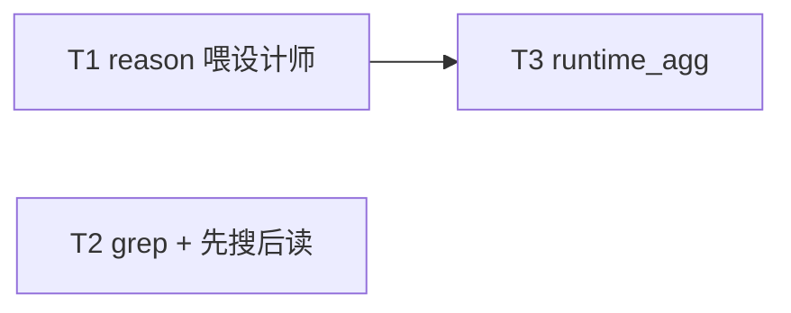

# 0016 · 设计师根因信号 + 读码效率 + 运行时聚合

<!-- 本文件由 spec 工具维护：frontmatter 为结构化源数据（含 tasks DAG），正文为组级 rust-RFC 9 段总览。 -->

## Summary

补上设计师诊断所需信号与读码效率：

1. **体感 reason**——随分数落 index，喂曲线（延迟类痛点只在 reason 里）；
2. **先搜后读**——`search_file_content` + 纪律，避免整篇烧迭代；
3. **runtime_agg**——事后扫最近 N 局 Session，聚合 0 步/超时/打断/错误占比、中位 steps、预算钮，注入 `propose_once`（**只观测、不归因**）。

落点 `synthesizer/` + `session_store` + `agent_defs/synthesizer/`。

## Motivation

只看分数会漏延迟根因、误提恢复逻辑；无 grep 会通读烧预算；prompt 宣称有「0 步占比/超时占比」却从未注入数字，reason 压成「又超时」时分不清失忆与预算太紧——故补 runtime_agg。

## Guide-level explanation

- 曲线带 reason；延迟先判根因再提需求。
- 大文件先搜后精读。
- 旁路一块**机制层对照数字**（runtime_agg），设计师自行归因。

## Reference-level explanation

### 代码锚点

- `session_store` index 含 reason；`synthesizer.py` trend + 注入 `format_runtime_agg(aggregate_runtime(...))`。
- `runtime_agg.py`：`RuntimeAgg`、最近 N=50、reply 粗标签、读仓内 `_CALL_TIMEOUT`/`_RUN_RETRIES`/`max_iterations`。
- synthesizer agent.yaml / systemprompt / search_file_content。

### 信号流

```
FeelingScore{score,reason} → index
Turn.steps + reply + 预算钮 → runtime_agg
        ↓
propose_once：曲线(reason) + 运行时块 → 判 bug/feature → 提需求
```

### DAG



### 文件分配

- **T1**：`synthesizer.py`、`session_store.py`、`test_synthesizer.py`（含 propose 注入调用点）
- **T2**：synthesizer agent 定义与 grep 工具
- **T3**：`runtime_agg.py`、`test_runtime_agg.py`

## Drawbacks

reason 噪声；runtime_agg 粗标签非任务语义；grep 仍依赖关键词选择。

## Rationale and alternatives

- 只看分数：延迟不可见。
- 结构化打标 reason：MVP 先喂原文。
- 不注入数字、靠 prompt 假装有指标：已证伪。

## Prior art

0005 FeelingScore；0012/0013 延迟与 steps 旁路。

## Unresolved questions

reason 是否打标；是否把等待序列结构化并入 agg。

## Future possibilities

看板展示 agg；按标签聚合痛点。
