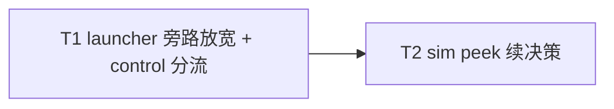

# 0019 · 控制旁路放宽 + peek 后继续等待决策

<!-- 本文件由 spec 工具维护：frontmatter 为结构化源数据（含 tasks DAG），正文为组级 rust-RFC 9 段总览。 -->

## Summary

在 0012（用户侧等待心跳）与 0013（harness `begin/poll/control`）之上，把 **control 的传输与等待编排**从「一律按打断收工」放宽为两种合法形状：

1. **stdout 旁路放宽**——一轮内除终态 `{"reply":…}` 外，任意非 reply JSON（`progress` / `status` / 未来字段）均可被 launcher 收下，未知键不报协议违例；
2. **旁路型 vs 终结型 control**——手册声明的 `status`/`peek` 等只吐旁路、本轮继续；`interrupt` 等仍以 `reply` 收工。用户 sim 在旁路型之后把预览写入等待上下文并**立刻再决策**，不把 peek 记成「YOU stopped」。

控制名对编排侧仍不透明：能力真相源是 harness `MANUAL.md`，**不引入控制注册表**。开发者不需要知道对面是用户 agent。

## Motivation

**0013 隐含的 control 形状过窄。** 初版 `launcher.control()` 假定「发控制 → 必等 `reply` 结束本轮」（打断形状）；`poll` 只认 `progress` 与 `reply`，其余 JSON 报协议违例。进化后的 harness 若按手册提供 `status`/`peek`（吐 `{"status":…}`、不结束 `agent.run`），用户侧会报错或干等——手册有能力、管道接不住。

**0012 的等待编排同样过窄。** `_supervise_send` 在任意 `invoke_control` 后立刻 `return`，把控制返回值当成本轮 `harness_output`，并可能记「YOU stopped…」。这对 interrupt 正确，对 peek 则错误：请求仍在跑（`in_flight`），下一轮 `begin` 会撞「上一轮未收完」，且归因把「看一眼」写成「停了请求」。

**为何现在做。** 探针显示：在 MANUAL 含 status/peek 且管道/编排放宽后，expert/blind 都会主动调 `status`，`check_status→invoke_control:status` 可兑付、不再记 WAIT_GAP；等待交互从「只能干等或打断」变为「可窥探再决定」。这是体感信号进入设计师/开发者闭环的前提之一。

## Guide-level explanation

改完后的行为契约：

- **Harness（CLI）**：stdin 仍是 `{"message"}` / `{"control":"<名>"}`；stdout 一轮内可多行旁路，最后一行带 `reply` 才结束。旁路型控制只发 status 类行；终结型最终发 reply。
- **Launcher**：收下一切非 reply 旁路；`control()` 等到「非纯 progress 旁路」或 `reply`；暴露 `in_flight`。
- **用户 sim**：`invoke_control` 后若仍 `in_flight` → 写入 history/progress → 立刻再 judge/intent/act（计入决策预算）；若已结束 → 返回 reply，仅此时记「YOU stopped」。
- **Persona**：从 `<harness_manual>` 取控制名原样调用；框架不维护白名单。
- **不变**：黑盒 harness、手册为能力真相源、无控制注册、Fake/无 begin/poll/control 的后端仍不走心跳。

## Reference-level explanation

### 现状锚点（本组落地后）

- `harness/launcher.py`：`_ingest_sideband`、`last_sideband`、`_is_control_ack_sideband`（排除纯 progress）、`control()` 旁路/终结分流、`in_flight`。
- `user/sim/loop.py`：`_harness_in_flight`、`_note_control_sideband`、`_ensure_status_on_progress`、`_supervise_send` 的 `force_redecide`；`run_session` 仅终结型 `user_control` 写「YOU stopped」。
- `user/sim/prompt.py`：`INTENT_MENU_OK["check_status"]=invoke_control`；act 文案区分 peek 与 interrupt。
- 单测：`tests/harness/test_launcher.py`、`tests/user/sim/test_heartbeat.py`。

### 协议表（相对 0013 的增量）

| 关注点 | 0013 隐含 | 本组 |
|---|---|---|
| 非 reply 旁路 | 仅 `progress` | 任意非 reply JSON |
| `control` 后 | 必等 `reply` | 旁路 ack **或** `reply` |
| peek 后等待环 | （无定义，套 interrupt） | 写上下文 → 立刻再决策 |
| 控制名 | 不透明 | 仍不透明（手册） |

### DAG

### 文件分配（互斥）

- **T1**：`harness/launcher.py`、`tests/harness/test_launcher.py`
- **T2**：`user/sim/loop.py`、`user/sim/prompt.py`、`tests/user/sim/test_heartbeat.py`

### 与相邻组

- **0012**：本组修正其「invoke_control 一律结束等待」；WAITING_ACTIONS 不变。
- **0013**：本组放宽其 stdout/`control` 接收形状；拆信封、steps、interrupt 语义不变。
- **被进化 harness**：可在 MANUAL 声明 status/peek 并实现旁路；开发者无需感知 sim。

## Drawbacks

- **旁路 ack 启发式**：以「非纯 progress」判定对本 control 的应答；若 harness 在 control 后先狂打 progress、迟迟不吐 status，`control()` 会多等（仍受绝对上限约束）。
- **立刻再决策耗预算**：peek 后再选计入 `_MAX_HEARTBEATS`，防只 peek 空转，但也会让「连 peek」更快触达上限。
- **sim 与真 CLI 客户端**：若未来有人类 CLI 读旁路，需自行处理多行 JSON；本组只约束编排侧 launcher。

## Rationale and alternatives

选「接收放宽 + 按 `in_flight` 分流」，因与 CLI 心智一致：文档有子命令即可调，管道不预设词表。

- **备选 A：控制名注册表（sim 侧白名单）。** 违反手册真相源，harness 进化要改两处；拒绝。
- **备选 B：强制 `control_ack` + correlation id。** 更严谨，但加重 harness 作者负担；本组用启发式旁路 ack，留作 Future。
- **备选 C：peek 后等下一轮 90s 心跳再决策。** 延迟过大；改为立刻 `force_redecide`。
- **备选 D：所有 control 仍结束本轮、由用户再 `send`。** 与「peek 不打断」语义冲突，且 `in_flight` 未清会堵下一轮。

## Prior art

- **0012 / 0013**：心跳与 `begin/poll/control` 底座。
- **stdio JSON-lines**：多事件流 + 单一终态帧（类 LSP/agent runner）。
- **真人 IDE**：状态查询不取消任务；取消才结束。

## Unresolved questions

- 是否在 RUNTIME/模板 MANUAL 中固化「旁路型 vs 终结型」作者说明（种子默认是否带 status）？
- `control()` 是否应对「仅 progress、无 status」设更短的旁路超时并回退错误，避免误等？
- peek 再决策是否应与 poll 心跳分开两套预算？

## Future possibilities

- 可选 `{"control_result":{"name","body"}}` 相关帧，去掉启发式。
- 种子 entry 默认实现 status/peek，与 MANUAL 同步（进化起点即具备）。
- 观测层把旁路型 control 与 WAIT_GAP 曲线一并展示，量化「窥探是否降低无谓 interrupt」。

