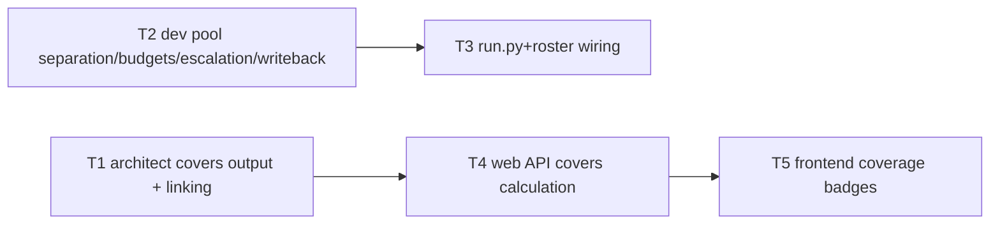

# 0020 · Covers Relationship Fulfillment + Developer Claiming Strategy and Issue-Type Budget

<!-- This file is maintained by the spec tool: the frontmatter is structured source data (including the tasks DAG), and the body is the group-level nine-section rust-RFC overview. -->

## Summary

Testing shows that the signal-production side is healthy (experience reasons are specific, the issue path works, and runtime_agg has fed architect),
while the bottleneck is on the **consumption side**—the architect's insights and developers' labor cannot compound across rounds. This group repairs three broken links:

1. **Covers relationship fulfillment (covers)**: architect's subsume judgment already exists (duplicate judgment rubric R3), and the proposal body naturally describes integration of “multiple bugs,” but nobody executes it—there is no structuring, no linking, no effect on claiming, and even after a fix the covered issues are not closed together. This group makes it data-driven:
   The proposal JSON carries the `covers` field → the database write appends a machine-readable line to the body + adds a comment to each covered bug → covered bugs sink during claiming → after the design issue is completed, they are closed together → the frontend issue list/detail displays coverage badges.
2. **Claiming strategy pools (dispatch)**: in testing, design issues remained starved for long periods (the number of new bugs per round ≈ the number of devs, and `work_one` takes `list_open_issues()[0]` with Gitea's default newest→oldest ordering). Change this to label-based pools + configurable `pick_policy ∈ {design_first, bug_first}` per dev: design issues are prioritized by default, while a configurable number of bug-first devs is retained (empty pools fall back to each other without spinning).
3. **Issue-type budget + same-issue retry escalation (budget)**: in testing, structural changes repeatedly hit the 38-iteration limit and reports were lost. Set the initial `max_iterations` by label (bug=38 / design=60, overridable at runtime through AgentConfig); a same-issue retry (still open with an attempt record) automatically moves up one tier. Add minimal report write-back: at the end of work_one, comment the result back to the issue (success=full report, failure=attempt marker), which is both the data source for retry decisions and prevents “follow-up evaporation.”

Do not introduce benchmark signals (held-out remains intact); architect still produces only “problem + direction” and does not gain permission to close issues.

## Motivation

**Starved design issues reproduce the original problem that the replication project is meant to solve.** In testing, most version progress came from prompt-level patches; structural design issues that directly addressed the most frequent experience-reason pain points (timeouts/iteration limits) remained unclaimed for long periods. Once the bug queue was emptied, the buried design issues were immediately claimed and became structural versions—it was not that devs could not handle design issues, but that they could not get scheduled. “Can only make local modifications and is unable to produce structural improvements” is exactly the phenomenon that CLAUDE.md identifies as requiring a project, and the current scheduling reproduces it inside its own closed loop.

**The coverage judgment breaks at the execution layer.** The architect prompt already requires that “when multiple issues duplicate each other, use one integrative proposal to identify the same root cause for #X/#Y,” and in testing architect did in fact write this kind of integrative wording in proposal bodies—but architect does not touch tracker states, devs do not read this sentence,
so bugs and design issues with the same root cause **compete** in the queue: devs fixing bugs redo work unnecessarily (the root cause is in the design issue), and two devs in the same round may collide on the same root cause and overwrite each other under direct trunk pushes.

**The budget is mismatched with task size.** entry.py has continued to grow as versions evolved, while the dev budget remained fixed at 38—in testing, structural changes hit the iteration limit, and only intervention at the time by urging the middleware to force the changes through preserved the tag; complete_task did not finish and the reports were entirely lost (the live detail retained only the iteration-limit error). Lost reports also caused “follow-up evaporation”: eight places in the prompt/middleware said to “write remaining work into the report as follow-up,” but reports only entered the dashboard and left no trace in the tracker, so nobody could pick them up in the next round.

**Why not a larger solution** (the design discussion has converged):
- “Have devs assess difficulty first and then use a floating budget” was rejected: max_iterations is a construction-time field requiring a two-stage run, self-assessment has no ground truth, and the incentive is distorted (claiming difficulty yields more); use label-based initial values + **escalate only after one failure** instead (an escalation calibrated by reality).
- “Clear all issues each round before entering the next round” was rejected: it destroys attribution granularity (eight changes bundled together cannot receive credit allocation), removes issue-curve observability (always 0), and leaves round duration unbounded. A backlog is a feature; the problem to solve is design-issue starvation, not emptying the queue.
- “Have architect directly close duplicate issues” was rejected: misjudging subsume would silently discard real user signals, violating the bottom line that “experience is the only training signal”; this group uses “link and reduce priority, close only after fixing,” where the cost of a misjudgment is merely delayed handling and remains reversible.

## Guide-level explanation

A round after the change (with reference to spec-0007's a→d→b→c):

- **d stage**: each architect proposal JSON item may carry `"covers": [5, 6]` (optional; by default it covers no issues). When writing to the database, the driver appends a machine-readable `covers: #5 #6` line at the end of the design issue body and adds a comment `covered-by: #<design number>` to each covered open bug. Architect permissions remain unchanged (only create_issue + add_comment, with no state changes).
- **b stage**: each dev carries `pick_policy`. `design_first`: claim from the design pool first (ascending issue number = oldest first), then fall back to the bug pool if empty; `bug_first` does the reverse. Within each pool, **covered issues sink** (they remain claimable, preventing starvation after fallback). After claiming, determine the budget by label: bug=38, design=60 (overridable through env); if the issue has exactly one attempt marker (it was previously claimed but not fixed) → move up one tier (bug→60, design→90). **Retry at most once**: issues with ≥2 attempt markers are considered stuck and sink to the bottom of the pool—normally they are no longer claimed (so they do not block the queue), and may be claimed only as a fallback when the pool is empty (the budget remains at the escalated value and is not increased again). An issue's lifecycle is at most “initial claim (standard tier) → retry (escalated tier) → stuck at bottom,” so the budget is naturally bounded. Start the agent after runtime override `cfg.max_iterations`.
- **b-stage completion**: when a dev completes a design issue (a new tag appears), the driver parses that issue's covers line and closes any covered bugs that remain open (comment: `covered by #<D> → v<K>`). Regardless of success or failure, comment the result back to the issue: success=full complete_task report; failure/missing report=`[dev-attempt]` marker + a git diff --stat summary as fallback.
- **Roster configuration**: `N_BUG_FIRST_DEVS` (default 1)—the first N devs use `bug_first`, and the rest use `design_first`. Follow the roster's existing env-override style.
- **Frontend**: in the issue list, covered bugs display the “⊂ #N” badge (N=the design issue number covering them); design issues display “covers #5 #6”; the detail page does the same.
  The data comes from the new `covers: number[]` / `covered_by: number | null` fields added by `/api/issues` (the web layer parses and computes them from the covers line in the body, with no new storage).

## Reference-level explanation

### covers Data Model (Single Source of Truth = Design Issue Body)

- **Production**: `architect.py`'s `_parse_proposals` allows each item to optionally carry `covers: list[int]` (invalid values are silently discarded); when `propose_once` writes to the database, the body appends `\n\ncovers: #5 #6` (regex `^covers:((\s*#\d+)+)\s*$`, with MULTILINE using the **last** matching entry). The linking comment is only for Gitea readability and is not the parsing source.
- **Consumer 1 (claiming deprioritization)**: when `agentic_developer.py` claims, it parses the covers line from the design issues in `list_open_issues()` to form the covered set (with zero additional API calls); the bug-pool sort key is `(is_covered, number)`.
- **Consumer 2 (cascading closure)**: when `work_one` contains `committed=True` and the claimed issue is a design issue, parse its covers line and `set_state(closed, f"covered by #<D> → v<K>")` for numbers that remain open; failure to close one issue does not affect the others (try/except).
- **Consumer 3 (web)**: `api.py` `_list_issues` computes the `covers`/`covered_by` fields for all issues; `covered_by` recognizes only **open** design issues (once a design issue is closed, its coverage relationship disappears—the bugs should already have been closed together).

### Claiming and Budget (`agentic_developer.py`)

- `__init__` adds new parameters: `pick_policy: str = "design_first"`, `budget_bug: int`, `budget_design: int` (the private-function no-default-value convention applies only to functions beginning with `_`; public constructors may have defaults).
- Pool division: labels containing `design` → design pool; all others → bug pool. The pool sort key is `(is_stuck, is_covered, number)`—stuck (attempt ≥2) goes lowest, covered comes next, and all others are ordered by issue number ascending (oldest first).
- Budget resolution order: determine the tier by label → escalate based on attempt markers (only once). For attempt determination:
  when `getattr(tracker, "list_comments")` is available, count comments on the issue beginning with `[dev-attempt]`:
  =1 → move up one tier (×1.5, rounded down); ≥2 → stuck (sink to the bottom; when claimed as a fallback, the budget is the escalated value and is not increased again).
  If the tracker lacks this capability (before Fake is extended) → do not escalate or sink; behavior degrades to pure label-based budgeting.
- **Why cap attempts at two**: without a cap, oldest-first ordering would let an unfixable issue consume one dev slot every round (unlimited retries block the queue); after the cap, sink the issue rather than close it—closing it silently discards real user signals and pollutes the issue curve, while sinking is reversible, and the fact that “an unfixable issue exists” remains observable in the open set.
- Runtime override: after `cfg = AgentConfig.from_yaml(...)`, use `cfg.max_iterations = budget` (the same pattern as setting `cfg.resolved_tracer` in architect.py). Keep 38 in the agent_defs YAML as the default documentation value.
- Write-back: success → `add_comment(number, report_text)` (full report, including the follow-up section written by dev itself); no progress → `add_comment(number, "[dev-attempt] No progress on main this round: <reason/diff-stat>")`.
- Env controls (run.py wiring): `DEV_BUDGET_BUG` (default 38), `DEV_BUDGET_DESIGN` (default 60), `N_BUG_FIRST_DEVS` (default 1). Escalation = directly take the previous tier ×1.5, rounded down (38→57≈60 tier, 60→90); do not add separate env variables for the constants.

### Current Anchors

- `agentic_developer.py:84-88` claiming = filter skip, then take `[0]`; `gitea.py:92-105` does not specify sort (Gitea defaults to newest→oldest) → old issues sink.
- `gitea.py:141` already has `list_comments` (observability path); the `tracker/base.py` protocol includes `add_comment`/`set_state`.
- `architect.py:244 _parse_proposals` currently takes only title/body/labels.
- `roster.py` handles only quantity; `run.py`, where the developers list is constructed, is the strategy injection point.
- The frontend `SidePanel.tsx:114` already renders label chips (the badge attachment point); `IssueDetail.tsx` already has the detail panel;
  `/api/issues` returns `{number,title,labels,state,...}` (`api.py:65-90`).

### DAG

T1 and T2 run in parallel (the covers-line format is defined by this spec, and both sides implement and test independently according to the contract).

### File Allocation (Mutually Exclusive)

- **T1**: `backend/ahe_beta/demand/architect.py`, `backend/tests/loop/test_architect.py`
- **T2**: `backend/ahe_beta/dev/agentic_developer.py`, `backend/ahe_beta/tracker/fake.py`,
  `backend/tests/dev/test_agentic_developer.py`, `backend/tests/tracker/test_fake.py`
- **T3**: `backend/ahe_beta/experiment/controllers/ordinary.py`, `backend/ahe_beta/loop/roster.py`, `backend/tests/loop/test_roster.py` (new)
- **T4**: `backend/ahe_beta/web/api.py`, `backend/tests/web/test_api.py`
- **T5**: `frontend/src/components/SidePanel.tsx`, `frontend/src/components/detail/IssueDetail.tsx`,
  `frontend/src/types.ts`, `frontend/src/api.ts`

## Drawbacks

- **Parsing the covers line is a text convention**: if the design issue body is manually corrupted (the covers line is changed), the coverage relationship is silently lost. Using “the last matching entry” + unit tests that pin the format provides mitigation; independent storage is not introduced to preserve Occam's razor.
- **Cascading closure can close the wrong issue**: a design issue's fix may not actually resolve every covered bug. Accept this cost—if a bug is incorrectly closed and recurs, the user side will naturally reopen it in the next round (the recurrence itself is a training signal); reopening is cheap.
- **Escalation depends on list_comments**: the `IssueTracker` protocol does not include it (it is an observability capability), so before Fake is extended, escalation degrades to a no-op in the test backend. This group also adds `list_comments` to Fake; the protocol itself remains unchanged.
- **Design issues cost more** (60 iterations × serial b stage): round duration increases. Make this configurable with “design_first dev count”—if round duration is a concern, increase N_BUG_FIRST_DEVS.

## Rationale and alternatives

- **Variable budget based on self-assessed difficulty (rejected)**: See Motivation; two label tiers + escalation on failure = the same adaptability with two rules,
  and cannot be gamed by the agent.
- **Clear the backlog every round (rejected)**: See the three points in Motivation (attribution/observability metrics/round duration).
- **Give the architect authority to close issues (rejected)**: An incorrect subsumption judgment = loss of a real user signal; an incorrect judgment under the link-and-deprioritize approach is reversible.
- **Store covers outside the tracker (rejected)**: Any out-of-band storage (local json/separate table) conflicts with
  “Gitea is the authoritative source for issues” and requires consistency management; an embedded line in the body requires no infrastructure.
- **Dedicated bug-only dev (rejected)**: When the bug pool is empty, idle time wastes budget; `bug_first` with fallback semantics is equivalent and does not idle.

## Prior art

- **spec-0016 (architect root-cause signal)**: The duplicate determination rubric and the output side of “integrative proposals naming #X/#Y” are already in place;
  this group completes their execution side.
- **Old commit discipline design (now retired)**: Previously prompted commits and final checks within a single round; this group addresses cross-round
  continuity (report write-back, retry escalation), complementing it without overlap.
- **GitHub duplicate/tracking issue convention**: `covered-by`/`tracking` linking + closing linked issues upon completion is an established workflow.
- **Empirical observations**: The data sources for all arguments in this group: design issues being starved, structural changes hitting the budget ceiling, and broken coverage determination links are all observed phenomena
  (data: data/sessions user experience, Gitea issues, harness repo tags).

## Unresolved questions

- The escalation factor of 1.5 and design default of 60 are initial estimates: calibrate them against runtime_agg (ceiling-hit rate) from subsequent observations.
- Detecting recurrence of the same root cause across issues (the same root cause repeatedly opened under different issue numbers) is outside this group: it requires the architect to check closed issues,
  and is left to a later spec; this group's “same-issue retry escalation” only covers reclaiming the same issue number.
- If a design issue remains unresolved for a long time after covered bugs are moved to the bottom, those bugs are effectively delayed indefinitely. Is a “coverage time limit” needed
  (remove deprioritization if the design issue has seen no activity for N rounds)? Observe first.
- The eventual disposition of stuck issues (moved to the bottom after two failed attempts): if two escalated budgets still cannot fix the issue, that often means the problem is bigger than one dev issue.
  Ideally, it would become input evidence for the architect (its attempt comment contains the failure reason), but the architect currently reads only
  issue bodies, not comments; this group will move it to the bottom and observe for now, leaving architect input for later.

## Future possibilities

- Architect recurrence determination against closed issues (“vK did not resolve #N” → reopen + automatic escalation), completing the “was it fixed” loop.
- Attach “observable acceptance numbers” to design issues (define completion criteria using runtime_agg metrics), for dev to check when closing the issue.
- Structure the follow-up section: automatically convert `follow-up:` lines in reports into `create_issue(labels=["follow-up"])` links.
- When the backlog exceeds a threshold, elastically assign additional devs (soft rule), replacing the impulse to clear it completely.

