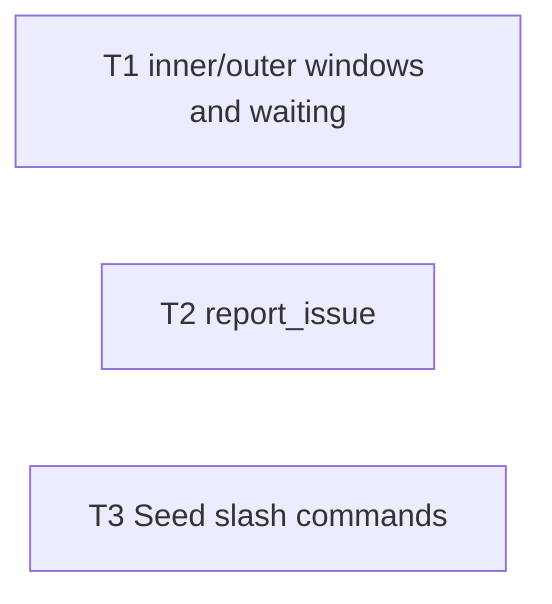

# 0022 · User↔harness internal and external channels: open intent · mid-session report_issue · slash demonstration

<!-- This file is maintained by the spec tool: frontmatter is the structured source data (including the tasks DAG), and the body is a group-level rust-RFC nine-section overview. -->

## Summary

Define the interaction boundaries between the user agent and harness, and update the waiting loop and initial seed accordingly:

1. **Internal boundary**—all “speaking” to the harness is `message` (main loop `send`/`begin`, `emit_message` while waiting; slash is also message body content, dispatched internally by the harness).
2. **External boundary**—`interrupt` (Ctrl+C, `control:interrupt`) and session closure (`give_up` / `accept*` / terminal state `file_issue`); these are not equivalent to chatting.
3. **Waiting menu**—`keep_waiting | send_message | interrupt | give_up`; remove the generic `invoke_control`.
4. **Open intent**—free text; act narrows it to the menu and self-reports `gap`→`WAIT_GAP`.
5. **Mid-session `report_issue` tool**—may be called or left unused, without terminating the session; flushed together with the final artifact at closure.
6. **Initial harness**—`/exit` `/quit` demonstrate slash; MANUAL describes only current capabilities.

This group supersedes the original “user-side peek/status through control” path (formerly 0019/T2, now abandoned); launcher reception of non-reply side-channel messages (0019/T1) and the heartbeat foundation (0012) remain.

## Motivation

**State at the time.** 0012 established heartbeat and judge→intent→act; 0019 layered side-channel peek/status onto the control channel. This produced three overlapping mechanisms: message, generic control, and framework-local termination. Even if the manual did not declare peek, the user side could still use `invoke_control`; the closed intent enum conflicted with the “manual-driven `/XX`” mental model.

**What needs to change.** Training signals must be authentic: as with a person, speaking to a tool has a single message channel; interrupting works like Ctrl+C; filing an issue can be an optional action along the way or part of closure. If peek evolves, it should be a message (such as a slash command in the manual), not a second control API.

**Why now.** The user side and seed MANUAL/entry have already been updated to the internal/external model; the live snapshot must align with the code and explicitly retire the 0019 user-side peek Task that conflicts with the live implementation.

## Guide-level explanation

- **Main loop**: Nonterminal EMIT → `send` or supervised `begin`; terminal actions do not call the harness.
- **Heartbeat**: Wake on timeout without a terminal reply; four menu items; `send_message` inserts another message (whether the harness accepts it is up to the harness); `interrupt` interrupts externally; each heartbeat is fed accumulated `progress` (discrete activity entries, not a token stream).
- **Intent**: Write what you want to do; Act: map it to the four buttons + `gap`.
- **report_issue**: Inner tool; take notes and continue chatting; observe `ISSUE_TOOL` / `issue_notes`.
- **Seed**: Send `/exit` or `/quit` → `[exited]`, then the process exits; other messages go to the agent; interrupt remains available.

## Reference-level explanation

### Channels

| Boundary | Carrier | Behavior |
|---|---|---|
| Internal | `{"message"}` | begin / emit_message / slash body |
| External·process | `{"control":"interrupt"}` | Stop the current turn, emit a reply |
| External·closure | No I/O | give_up / accept* / terminal file_issue |
| Side-channel observation | stdout non-reply | progress, etc. → `last_progress` (0019/T1) |

### DAG and files

- **T1**: `user/sim/loop.py` `prompt.py` `harness/launcher.py` + heartbeat/launcher unit tests
- **T2**: `tools.py` `persona_client.py` `loop/sim_user.py` + related unit tests
- **T3**: `harness_template/entry.py` `MANUAL.md` `RUNTIME.md` + smoke

### Relationships with adjacent groups

- **0012**: Heartbeat, patience depletion without new progress, and initial patience still apply; **this group governs the waiting menu and IO semantics** (the 0012 body has been rewritten to align).
- **0019**: Retains only **T1** side-channel reception; the original **T2** (user-side peek-via-control) is now `abandon`, superseded by this group's T1 (available in git history).
- **0013**: interrupt / progress / envelope unpacking still apply; this group's T3 adds a slash demonstration on top.
- **0008**: Inner tool framework; this group's T2 extends `report_issue`.

## Drawbacks

- In-flight `emit_message` may be queued as a request for the next turn in v0 entry, unlike a “same-turn interjection”; the initial implementation does not implement same-turn `/btw`, and the manual does not claim it.
- `report_issue` has no short in-conversation feedback and may remain unused for long periods—sparse authentic signals are acceptable.
- Files still overlap across groups (for example, `launcher.py` appears in both 0019/T1 and 0022/T1)—a historical artifact; this group is the current IO description.

## Rationale and alternatives

- **Internal/external split + message as the only internal channel**: Aligns with real human terminal use; internal slash dispatch is structurally equivalent to Claude Code `/cmd [args]`, with a minimal seed.
- **Alternative: retain opaque control names through invoke_control.** Conflicts with “internal=message”; rejected.
- **Alternative: keep intent as a closed enum.** Cannot express new slash commands in the manual; change to open intent + narrowing by act.
- **Alternative: implement same-turn interjections initially.** Too large; leave to Future / harness evolution.

## Prior art

- Terminal CLI slash (Claude Code `parseSlashCommand` → registry); this group only has `/exit`|/quit`.
- 0012 heartbeat; 0013 present; 0008 inner tool; 0019 side-channel reception (T1).

## Unresolved questions

- Should the launcher layer explicitly coordinate “main-path replies and queued mid-flight messages” to prevent competition for replies?
- Should `report_issue` expose an equivalent entry point for blind (no tool stack)?

## Future possibilities

- The harness evolves same-turn `/btw` and similar capabilities: still through internal message dispatch + MANUAL.
- An observation dashboard displays `ISSUE_TOOL` and WAIT_GAP curves.
- Optionally restrict the control surface to interrupt only, with side-channel ack dedicated to progress.
