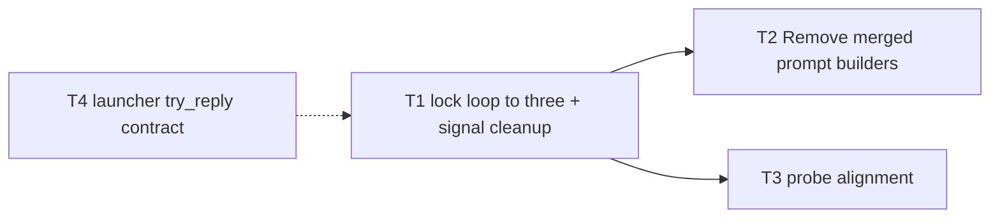

# 0023 · Lock Down the Event-Driven Wait Loop · Retire one/two and Legacy Signals

<!-- This file is maintained by the spec tool: frontmatter is the structured source data (including the tasks DAG), and the body is a group-level, nine-section rust-RFC overview. -->

## Summary

Lock the user-side process of “waiting for the harness after EMIT” into a single event loop, and remove the legacy knobs that coexist with it:

1. **AwaitEvent**——`poll`: `reply` is handed to the main loop for a decision; `timer` triggers a **one-shot** heartbeat (judge→intent→act). Once the action finishes, return to AwaitEvent without nesting another wait inside the heartbeat.
2. **Confirmation before action**——After the heartbeat LLM returns and before executing the side effects of `send_message`/`interrupt`/`give_up`/`keep_waiting`, perform a nonblocking `try_reply`; if a reply is available, **invalidate that waiting action**, record an explanation in history, and return control to the main loop to read the reply (preventing `give_up` from losing the reply by never polling).
3. **Single timeline**——Use history's `[+Ns]` consistently for session-relative time; the main decide's dual `<wait_cost>` / `wait_sec` channels have been removed.
4. **Keep only three for decision layering**——The default and only layering for the main loop and heartbeat is judge→intent→act; retire `one`/`two` for `decide_mode`/`waiting_mode` and the corresponding merged builders.
5. **Consolidate signals**——Record the intent–action gap on both the waiting and main paths as `WAIT_GAP` (remove `MAIN_GAP`, which has no consumers); delete `_TURN_WAIT_BUDGET_SEC`, which is never read.
6. **Align probes**——Rewrite or delete old peek-via-control / two-vs-three probes to avoid teaching incorrect IO boundaries.

The inner/outer windows and waiting menu shape still follow the existing IO boundaries: inner=`message` (including in-flight `emit_message`), outer=`interrupt` + session closure; menu `keep_waiting|send_message|interrupt|give_up`.

## Motivation

**State at the time.** After the heartbeat and open intent menu were implemented, the main path was already event-driven, but several parallel mechanisms remained: ① the main decide previously used `<wait_cost>` to report wall-clock seconds again, creating a second axis alongside history's `[+Ns]`; ② `run_session` exposed `decide_mode`/`waiting_mode`∈{one,two,three}, which production calls never passed and which always defaulted to three; one/two and `build_user_turn` / `*_judge_intent_turn` served only old tests and probes; ③ the `_TURN_WAIT_BUDGET_SEC` constant had no readers; ④ when act self-reported a gap, the main path wrote `MAIN_GAP:` while waiting wrote `WAIT_GAP:`, but dashboards and specification terminology recognized only the latter; ⑤ some `probe_*.py` still assumed a control-side peek bypass or two mode.

**What needs to change.** The contract recognizes only one wait loop and one decision layering scheme; code and probes must no longer provide a second timeline, a second set of modes, or a second gap prefix. The deleted `wait_cost` must not return; `try_reply` before action becomes a mandatory step rather than an optional optimization.

**Why now.** The event loop and abort-before-act are already available in the implementation; unless one/two and dead signals are retired immediately, documentation and probes will continue treating experimental knobs as active design, causing training signals and user experience explanations to diverge again.

## Guide-level explanation

- The user **sends the harness a message that requires waiting** (main loop EMIT) → enter AwaitEvent.
- **Reply arrives first**: the main loop sees the content before judge/intent/act (three stages structurally identical to the heartbeat).
- **Timer fires first**: run one round of the three-stage heartbeat; if it decides to interject, **continue AwaitEvent** after `emit_message` (the next reply still belongs to the main loop); if interrupt/give_up is chosen, end waiting according to the outer-window/closure rules.
- A reply may have entered the buffer while the heartbeat was thinking: the framework takes a quick look before acting; if one is present, tell history “intended to do X, but the reply had arrived, so the action was not executed; return to the main loop.”
- Observers need only look at history's `[+Ns]` and `WAIT_GAP` / patience curve; they no longer need to look for `wait_cost` or `MAIN_GAP`.
- When writing probes or unit tests: **do not** pass `waiting_mode="two"` / `decide_mode="one"` anymore; Fake/Scripted implementations without begin/poll still use blocking `send` (a capability branch, not a second set of waiting semantics).

## Reference-level explanation

### Event loop (contract)

```text
begin(message)
loop AwaitEvent:
  kind, val = poll(heartbeat_sec)
  if kind == reply:
    return to main decide(val)
  # timer → HeartbeatOnce
  action, msg, gap = judge → intent → act   # three only
  if try_reply() is Some(ready):
    stamp history: aborted before acting (action) …
    return to main decide(ready)
  match action:
    send_message → emit_message(msg); continue AwaitEvent
    interrupt    → control(interrupt); return to main (user_control)
    give_up      → terminal give_up
    keep_waiting → continue AwaitEvent
```

- `HarnessLauncher.try_reply`: nonblocking drain/peek of terminal replies already present in the stdout queue; `None` if none are available.
- Fake/Scripted: no `begin/poll/emit_message/control` → do not enter this loop; `route`→blocking `send` (test determinism).
- All three abandonment layers remain, with distinct responsibilities: persona chooses `give_up`; `patience<=0`; `_MAX_HEARTBEATS` imposes a hard cap.

### Decision layering (the only scheme)

| Location | Layering | Output |
|---|---|---|
| Main loop | judge → intent → act | `verdict` (writes state) + open intent + `action_space` action + `gap`→`WAIT_GAP` |
| Heartbeat | Structurally identical three stages | `judgment` + open intent + waiting menu + `gap`→`WAIT_GAP` |

Retire: the `decide_mode`/`waiting_mode` parameters; `build_user_turn`; `build_main_judge_intent_turn`; `build_waiting_judge_intent_turn`. `run_session` no longer accepts mode knobs (or accepts them but errors on invalid values—the implementation chooses to delete the parameters).

### Time and signals

- History: `_SessionClock` consistently uses `[+Ns]` (including waiting memories and abort explanations).
- Prohibited: injecting `<wait_cost>` or `wait_sec` into the main context.
- Gap: always `WAIT_GAP: intent=… action=…`; delete `MAIN_GAP:`.
- Delete the unused `_TURN_WAIT_BUDGET_SEC`; fix outdated comments that still point to `build_user_turn`.
- `stalled`→`unclear` alias: delete along with one/two (the prompt no longer teaches stalled).

### DAG and file allocation



| Task | Responsibility | files (mutually exclusive within the group) |
|---|---|---|
| T1 | Keep only three in `run_session`/`_main_decide`/`_heartbeat_once`; remove `MAIN_GAP`, budget constants, and `stalled`; change unit tests to default calls | `loop.py`, `test_loop.py`, `test_heartbeat.py` |
| T2 | Delete one/two builders; change prompt unit tests to target `build_main_*` / `build_waiting_*` | `prompt.py`, `test_prompt.py` |
| T3 | Remove two comparisons and the peek-via-control mental model from probes; keep three + the 0022 menu | `probe_*.py` listed below |
| T4 | `try_reply` nonblocking contract (implemented, locked down in the snapshot) | `launcher.py` |

e2e / probe paths: `tools/dev/probes/probe_wait_progress.py` (rewrite or delete the two arm), `probe_peek_decision_trace.py`, `probe_persona_wait_matrix.py`, `probe_ontrack_new_harness.py`, `probe_wait_signals_to_evolution.py`.

### Relationship to adjacent active snapshots (key points restated)

- **IO boundaries**: inner message / outer interrupt / four-item menu / open intent+gap—this group does not change the menu shape, only waiting timing and legacy knobs.
- **Waiting user experience**: conditional patience depletion, progress/prior_activity, task-volume-based patience—this group does not change the decay formula; it only ensures event-loop compatibility with it.
- **Side-channel progress**: stdout content other than replies can still enter `last_progress`; users must not perform peek via control.

## Drawbacks

- Removing one/two eliminates a ready-made A/B knob for “merging judge+intent to save LLM calls”; reducing call volume in the future will require a new experimental fork rather than reviving the public API.
- Rewriting probes has a short-term cost; leaving them unchanged would continue to mislead.
- The race between `try_reply` and the subsequent `poll` over the same buffer relies on the launcher's single-threaded draining convention; multiple readers are out of scope.

## Rationale and alternatives

- **Only three + AwaitEvent**: consistent with the division of responsibility in which “the main loop owns replies, and the heartbeat owns only the timer”; one/two break structural equivalence and are unused in production.
- **try_reply before action rather than push interruption**: physically, the mechanism remains poll-driven; logically, replies belong to the main loop. The alternative, “cancellation during the LLM call,” is costly and incompatible with the current launcher queue model.
- **Standardize on WAIT_GAP**: the alternative is to retain MAIN_GAP and change the dashboard—an extra prefix offers no benefit.
- **Keep Fake's blocking send**: the alternative is to make Fake implement begin/poll too—this increases the testing surface without improving user experience realism.

## Prior art

- User-side IO boundaries and waiting menu (inner/outer windows, four-item menu, open intent).
- Heartbeat foundation for the waiting user experience (progress, conditional patience depletion).
- Launcher side-channel progress and control wire compatibility.
- UI/agent event loops: timer heartbeats + completion events owned by the main state machine (common in clients for long-running tasks).

## Unresolved questions

(No mandatory open questions; if implementation reveals that production still depends on external calls to `waiting_mode=`, open an exception then—the current in-repository production paths do not pass it.)

## Future possibilities

- If LLM costs become a bottleneck, create a separate “experimental fork” probe to compare merged stages within the repository, without feeding this back into the public parameters of `run_session`.
- If prose in the heartbeat prompt such as “this request has already waited Ns” causes confusion with `[+Ns]`, consolidate it further into a single numeric source.
- If the 0012 body still says “or merge with two,” update that sentence when this group lands to align it (a cross-group documentation follow-up, not a file in this group).

