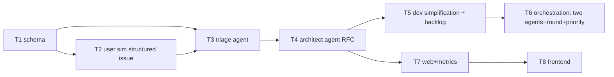

# 0025 · Issue Triage Funnel: User Submits an Issue → Triage Agent Classifies and Localizes It → Architect Agent Produces an RFC → Dev

<!-- This file is maintained by the spec tool: the frontmatter is structured source data (including the tasks DAG), and the body is the group-level, nine-section rust-RFC overview. -->

## Summary

Build the issue flow into a real software team’s **triage funnel**, and split the existing **single architect into two agents**—corresponding to the two distinct hats of support/triage and architect in the real world.

- **⓪ Product/direction layer = distill card library (human, not an agent)**: the persona×seed distribution determines “what usage the harness should optimize for.”
  Already present in the code (`run.py` layer ⓪ loads `persona_library.json` / `seeds.json`).
- **a · User sim**: fills in **user-visible fields** according to the user-side template to produce raw issues (type label + `needs-triage` + round number),
  and stores experience + god-view traces.
- **d1 · Triage agent (new)**: handles each issue by **classifying** (confirming the type) + **localizing** (reading harness code + using `get_session_timeline`
  to retrieve the real trace, then filling in TRIAGE section fields) + **deduplicating** + **rejecting/requesting more info**. Augments in place; does not create another issue.
- **d2 · Architect agent (the original architect, with a narrower scope)**: only performs **cross-issue structural synthesis**, producing an **RFC** (a separate label that supersedes type, consolidates/supersedes local issues, and gets the highest dev budget).
- **b · Dev**: each round, devs claim triaged issues + RFCs according to capacity (N devs, each claims one); **if the backlog exceeds capacity, unclaimed items carry over to the next round**.
  Budgets are tiered by kind; remove 0020’s pool separation/retry/stuck mechanisms.
- **No agent for the PM function**: priority is derived mechanically from **experience impact + runtime_agg frequency**.

**Carryover is the norm**: one round = newly triaged issues this round + uncleared backlog from the previous round. The observed curve (actionable backlog) rises and falls as items accumulate and are resolved—that is exactly what the metrics observed in CLAUDE.md should track (a long-term rise indicates degradation).

## Motivation

**Testing exposed gaps at two levels.** ① “Issue” is used incorrectly: user sim outputs and architect proposals are both called issues, distinguished only by label, and displayed side by side in the frontend—conflating **raw user feedback** with **actionable work items**. ② One “architect” agent handles both **item-by-item grooming**
(triage) and **finding root causes across items** (architect); these two cognitive tasks are bundled into one prompt, and the triage half is barely done—the user’s
issues go straight into the backlog as free text, so devs work directly from raw reports, making overfitting likely and implementation difficult.

**Real teams have two distinct hats**: support/triage clears the inbox item by item (classification, localization, deduplication, rejection); the architect writes RFCs across items (structural root causes). This is an industry-recognized practice (Kubernetes needs-triage→accepted + KEP; GitHub triage + RFC). This group **splits the architect into these two agents**, with distinct responsibilities and clear data boundaries (also allowing room to scale triage horizontally in the future).

**Triage can now localize issues**: main has just landed `session_timeline`—triage/architect agents can call `get_session_timeline` by issue number
 to retrieve the **real god-view trace** (`architect/session_timeline.py`). Triage’s “localization” is therefore grounded in three sources: user-reported symptoms + read-only harness code + real traces. The previous concern that “triage can’t see traces and has to make things up” is resolved.

**The product layer already exists in code and should remain human-operated**: the persona/seed card library in `run.py` layer ⓪ is the product judgment about “which usage distribution to optimize for,”
provided by a person through the CLI. It sets the goals and value, which cannot be derived from experience internally (experience is measured relative to the current distribution), so **there is no agent for it**.

## Guide-level explanation

One closed-loop round (compare spec-0007 a→d→b→c; the d stage now has two agents):

- **⓪**: Load the persona×seed distribution from the distill card library (by a person through the CLI).
- **a · User sim**: A persona fills in the user-visible fields in the **USER section** according to `issue_schema` (bug: reproduction/expected/actual;
  feature: background/goal/scenario), with quality varying by persona (experts provide details, blind users are perfunctory). The sim creates an issue: body=rendered USER section,
  label `[<type>, needs-triage, round-N]`. It also stores experience + sim_trace (god-view) in the store.
- **d1 · Triage agent** processes each `needs-triage` issue (including issues from the previous round’s backlog that are still untriaged):
  1. **Classify**: confirm or correct the type label.
  2. **Localize**: read harness code + `get_session_timeline(issue_number=…)` to retrieve the real trace → fill in the **TRIAGE section**
     (root-cause area/boundary/acceptance criteria), through `issue_schema.validate`.
  3. **Deduplicate**: compare with existing triaged issues; if duplicate → close it and link it to the primary issue.
  4. **Reject/request more info**: insufficient information / out of scope / platform issue (such as one requiring changes to the launcher) → apply the `rejected`/`needs-info`
     labels + provide a reason + close; **do not create zombie tracking issues**.
  After processing, remove `needs-triage` and add `triaged` (**augment in place; do not create a separate design issue**).
- **d2 · Architect agent** (the original architect): finds root causes across issues using the **groomed (triaged) backlog (including carryover)** + experience curve +
  runtime_agg + traces, and produces an **RFC** (label `RFC`, superseding type): RFC fields go in the RFC section; `covers` the
  local triaged issues it synthesizes, and those synthesized are marked `superseded-by #RFC` (excluded from the set dev can claim). Better to produce none than to produce a weak one (no theme →
  `[]`). **Do not split work across rounds** (one RFC for a large requirement; assume an individual item can be fixed in one round, without splitting it across rounds).
- **b · Dev**: each round, N devs each claim **one** claimable issue (`triaged` or `RFC`, excluding needs-triage/rejected/
  needs-info/superseded), in ascending issue-number order (older first); `attempted` prevents collisions. After a fix → also close the issues it covers
  (two RFC levels: RFC→triaged→raw). **If the backlog exceeds N, unclaimed items remain open and carry over to be claimed next round** (no attempt/
  stuck mechanism—carryover is simply a collection of open issues that remain claimable next round).
- **c**: Refeed the main SHA.
- **Priority**: mechanically derive P0–P3 from **experience impact (issues from low-scoring sessions rank higher) + runtime_agg frequency**; it is not assigned by an agent.
- **Frontend**: group the issue list by status/type (untriaged / triaged backlog / rejected), show RFCs in a separate prominent section, and mark backlog age.
- **Observability**: track the issue curve for the **actionable backlog (triaged + RFC, including carryover)**—a decrease means dev is resolving items; an increase means new root causes or growing backlog.

**Distinguish the two meanings of “fixed in one round”**: **individual issue size** is assumed to be fixable in one round (increase the budget + rely on 0014; do not split across rounds); **backlog
quantity** is limited by dev capacity (N devs/round), so anything over capacity **carries over**—the two are not contradictory.

## Reference-level explanation

### Roles and I/O (all based on existing code anchors)

| Role | Input (source anchor) | Output | agent? |
|---|---|---|---|
| ⓪ Product layer distill | persona_library.json / seeds.json (`run.py:316,321`, supplied by a person through the CLI) | persona×seed distribution | No (human) |
| a User sim | persona + scenario + harness+manual + workspace (`sim_user.py:150-190`) | experience+raw issue+trace (`:196-203`) | Yes |
| d1 Triage (**issue normalization only**, single-item scope) | needs-triage issue (including carryover) + read-only harness code + `get_session_timeline` (single-session trace, **including that session’s experience score**) | in-place triaged issue (confirmed type + TRIAGE fields + priority) / close duplicate / reject | Yes (new) |
| d2 Architect (**PM + architect**, global scope) | all triaged backlog (including carryover) + **experience curve** (scores + reasons, with session_id,`architect.py:272`) + **runtime_agg** (`:184`) + traces | RFC (in-depth requirements analysis → structural/framework improvements) + supersede markers | Yes (original architect, narrowed scope) |
| b Dev | claimable set (triaged/RFC) + issue body + writable harness repo | git commit/tag/push + close related issues | Yes |

**Division of responsibility**: triage sees only **individual issues** (report + code + that session’s trace, **without** aggregate runtime_agg / global experience curve)—
priority is anchored to that session’s experience score. The architect alone has the **global view** (all normalized issues + full experience picture + runtime_agg) and performs the PM function of
in-depth user-requirements analysis, driving structural/framework improvements (producing RFCs). Priority has already been assigned to triage (see T3), rather than being derived mechanically.

### Canonical issue fields (T1)

`issue_schema.SCHEMAS` defines normalized fields in the platform layer. The unused USER template is retired; user reports remain free text.
`Field.key` is the only wire/parser identifier. `Field.label` is an English display heading and is never an accepted alias.

| Kind | Required keys | Optional keys |
|---|---|---|
| `bug` | `root_cause`, `boundary`, `acceptance` | — |
| `feature` | `boundary`, `deliverable`, `acceptance` | — |
| `chore` | `acceptance` | `boundary` |
| `document` | — | `acceptance` |
| `rfc` | `problem`, `root_cause`, `related`, `direction`, `acceptance` | — |

| Key | Display label |
|---|---|
| `root_cause` | Root cause |
| `boundary` | Boundary |
| `acceptance` | Acceptance criteria |
| `deliverable` | Deliverable |
| `problem` | Problem |
| `related` | Related issues |
| `direction` | Direction |

`validate(kind, fields)` checks the selected kind's allowed and required keys and rejects unknown keys and nonstring values.
Parsers consume the canonical dictionary directly, without Chinese or display-label aliases. `render` reads each `Field.key` and emits `### Field.label` headings in declaration order.
Tool `fields` properties are generated from the same declarations; changing a display label cannot change schema keys or accepted payloads.
Current PM and Architect role-specific submit payloads remain unchanged; their canonical projections use these normalized keys.

### Splitting the two agents (T3/T4)

- Triage: new `architect/triage.py` (driven by Triager) + `agent_defs/triage_agent/` (tools include read_file +
  get_session_timeline; workspace_jail has read-only access to the harness repo).
- Architect: narrow the Architect in `architect/architect.py`—remove “check for duplicates item by item and create issues”; focus on cross-issue RFCs; reuse
  existing backlog/trend/runtime/trace inputs (already available in `architect.py:180-270`).

### Carryover (backlog across rounds)

No retry/stuck mechanism—carryover is a collection of open issues that have not been claimed. Each round, devs claim N issues (N = number of devs) in ascending issue-number order; unclaimed items
naturally remain for the next round. Triage handles only issues with `needs-triage` (incremental); already-triaged carryover is not triaged again. The architect consumes the
**entire** triaged backlog (the accumulation of carryover is precisely the material it uses to find cross-round themes).

### Existing anchors

- `run.py:316,321`: loading the distill card library (product layer). `run.py:406,450,486`: sim/dev/architect construction point (make wiring changes here).
- `sim_user.py:114`: raw issues currently use `['bug']` free text — T2 changes this to structured fields + type + needs-triage + round.
- `architect.py:180-270`: propose_once/_run_agent (currently mixes triage and architect work in one agent) — split in T3/T4.
- `architect/session_timeline.py`: `get_session_timeline` (trace tool, used for localization in T3/T4).
- `agentic_developer.py`: 0020/T2 pool separation/retry/stuck — remove in T5.
- `loop/roster.py`: remove `load_dev_pick_policies`(0020/T3); add triager staffing.
- `web/api.py` `_annotate_covers`; `loop/metrics.py` issue curve — adjust in T7.

### DAG

### File assignments (non-overlapping) are in each Task frontmatter `files`.

## Drawbacks

- **One more agent = one more LLM call + one more agent_def**: triage and architect each run once, making the d stage longer. Acceptable
  (triage can be parallelized later).
- **Triage is the sole interpreter + SPOF**: all raw issues depend on it for grooming. Mitigation: all triage actions are traceable, rejections include reasons, and raw issues are retained.
- **Carryover has no upper-bound protection**: a hard issue that dev repeatedly claims and fails to fix will consume one dev slot every round (0020’s stuck-
  sink has been removed). This group accepts that decision by the user (assuming an individual issue can be fixed in one round); truly hard cases are left for implementation by dev on a different repo (see Future).
- **Static product layer**: persona/seed do not expand automatically; exploration depends on people (an “issues reach zero” signal prompts people to expand the distribution). See Future.
- **Schema evolution cost**: adding a kind/field requires changes in the platform layer + frontend. Start with bug/feature + RFC.

## Rationale and alternatives

- **Single architect with two internal stages (previous proposal, rejected by the user)**: Change to **two separate agents**—triage and architect are two distinct roles;
  separating them clarifies responsibilities and allows triage to scale through sharding.
- **dev clears the entire backlog in one round (previous proposal, rejected by the user)**: Unrealistic—dev capacity is limited; uncleared work **accumulates** into the next round.
  Change to claiming work according to capacity, with carryover as the norm.
- **Retain dev retry/stuck/separate pools + splitting across rounds (0020/previous proposal, rejected by the user)**: Assume each item can be fixed in one round + increase the budget +
  use 0014 as a fallback; accumulated work is claimed again next round (open issues naturally carry over), without building retry/stuck.
- **dev reads raw issues directly (current behavior, rejected)**: Raw issues lack localization/acceptance criteria, making implementation difficult for dev and prone to overfitting.
- **Create tracking issues for platform/needs-information cases (rejected)**: Zombies with no one driving them forward. Change to rejection/needs-info + a reason.
- **Rely on Gitea ISSUE_TEMPLATE validation (rejected)**: Issues are created through the API throughout; Gitea forms only govern the Web UI. Change to a platform-level schema
  + separate sections filled by the user/triage + rendering in code.
- **Create a PM/product agent (rejected)**: The PM function = user experience signals (already the training objective); the mechanism can simply derive priorities. Product direction is a value
  judgment that cannot be derived from within user experience; leave it to humans (distill layer ⓪).

## Prior art

- **support/triage vs architect as two distinct roles**: Kubernetes needs-triage→triage/accepted + KEP; GitHub triage
  + RFC; Scrum refinement / Definition of Ready.
- **RFC / tracking-issue consolidation**: Structural proposals cover/supersede local issues.
- **spec-0020**: covers/dispatch — evolution in this group (mandatory coverage + simplified dispatch + RFC supersede + removal of retry).
- **spec-0016/0018**: architect root cause/envelope — retained by the architect agent.
- **spec-0024(godview-timeline)**: `get_session_timeline` — used by triage/architect for localization.
- **spec-0014**: Incremental commits — the dev-side fallback for "fix each item within one round".

## Unresolved questions

- **Priority derivation formula**: How user experience impact × frequency maps to P0–P3; start with simple rules and calibrate against actual measurements next round.
- **Whether triage and architect share the agent_def toolset**: Both need read_file + get_session_timeline; tool
  declarations can be reused, with only systemprompt differing.
- **Protection for difficult carryover issues**: Is a lightweight "reduce weight/flag after being claimed for N rounds without completion" mechanism needed (a minimal version of 0020 stuck)? This group will
  defer it and decide after observing the backlog curve.
- **Body representation of RFC supersede and covers**: RFC body `covers: #..` reuses the 0020 machine-readable lines + local issues receive the
  `superseded-by` label; consistency between the two is enforced by T4/T5.

## Future possibilities

- **Scale triage through sharding**: Large user volumes overwhelm triage context → map(batch triage)+reduce(deduplication); architect consumes only a bounded
  groomed set. The two-agent split already provides a boundary for this.
- **Product-level exploration mechanism**: The "zero issues = exploration has stopped" signal triggers humans (or a semiautomated process) to expand the persona/seed distribution, pushing the harness
  into new territory.
- **Integrate a developer agent for repository switching**: Replace the transitional dev-side implementation; address fine-grained collaboration for "large requirements/difficult issues carried over across rounds" at that point.
- **Automatic priority/budget calibration**: Use the next round's runtime_agg budget-limit hit rate as feedback to adjust budget tiers and the priority formula.
- **Extend the schema with chore/document + more fields**: Expand as needed.

