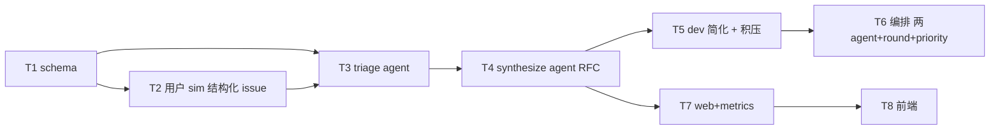

# 0025 · issue triage 漏斗：用户提 issue → triage agent 分类定位 → synthesize agent 出 RFC → dev

<!-- 本文件由 spec 工具维护：frontmatter 为结构化源数据（含 tasks DAG），正文为组级 rust-RFC 9 段总览。 -->

## Summary

把 issue 流建成真实软件团队的 **triage 漏斗**，并把现有**单一 designer 拆成两个 agent**——对应真实世界
support/triage 与 architect 两顶不同的帽子。

- **⓪ 产品/方向层 = distill 卡库（人，非 agent）**：persona×seed 分布决定"harness 该在什么使用上优化"。
  已存在于代码（`run.py` ⓪ 层加载 `persona_library.json` / `seeds.json`）。
- **a · 用户 sim**：按用户端模板填**用户可见字段**产 raw issue（type 标签 + `needs-triage` + 轮号），
  外加体感 + god-view 轨迹落 store。
- **d1 · triage agent（新）**：逐条**分类**(确认 type) + **定位**(读 harness 代码 + `get_session_timeline`
  拉真实轨迹，填 TRIAGE 区字段) + **去重** + **驳回/needs-info**。就地增补，不另建 issue。
- **d2 · synthesize agent（原 designer 收窄）**：只做**跨 issue 结构综合**，产 **RFC**（独立标签、凌驾
  type，consolidate/supersede 局部 issue、最高 dev 预算）。
- **b · dev**：每轮按容量（N dev，各领一条）领 triaged issue + RFC；**backlog 超容量则未领的积压到下一轮**。
  预算按 kind 分档、去 0020 分池/retry/stuck。
- **PM 职能不设 agent**：优先级由**体感影响 + runtime_agg 频率机制化派生**。

**carryover 是常态**：一轮 = 本轮新 triaged + 上轮未清空的积压。观测曲线（可执行 backlog）随积累与消化
升降——这正是 CLAUDE.md 观测指标要看的（长期不降 = 退化）。

## Motivation

**实测暴露两个层次的缺口。** ①「issue」被误用：用户 sim 产出与 designer 提案都叫 issue、只靠 label 分、
前端并列一栏——把**原始用户反馈**和**可执行工作项**混同。②「designer」一个 agent 同时干**逐条梳理**
（triage）与**跨条找根因**（architect），两件认知任务揉在一个 prompt 里，triage 这半几乎没做——用户
issue 直接以自由文本进 backlog，dev 直啃 raw、易过拟合、难落地。

**真实团队分两顶帽子**：support/triage 逐条清 inbox（分类、定位、去重、驳回）；architect 跨条写 RFC
（结构根因）。业界公认（Kubernetes needs-triage→accepted + KEP；GitHub triage + RFC）。本组把 designer
**拆成这两个 agent**，各司其职、数据边界清晰（也为将来 triage 分片扩容留路）。

**现在能做 triage 定位了**：main 刚落地 `session_timeline`——triage/synthesize agent 可按 issue 号
调 `get_session_timeline` 拉 **god-view 真实轨迹**（`designer/session_timeline.py`）。于是 triage 的
「定位」有了三管齐下的 grounding：用户填的症状 + 只读 harness 代码 + 真实轨迹。之前"triage 看不到轨迹
只能硬凑"的顾虑已消。

**产品层已在代码里、且该留人手**：`run.py` ⓪ 层的 persona/seed 卡库就是"优化什么使用分布"的产品判断，
经 CLI 人喂。它设定目标/价值，无法从体感内部导出（体感是相对当前分布测的），故**不设 agent**。

## Guide-level explanation

一轮闭环（对照 spec-0007 a→d→b→c，d 段现在两 agent）：

- **⓪**：distill 卡库加载 persona×seed（人经 CLI）。
- **a · 用户 sim**：persona 按 `issue_schema` 的 **USER 区**填用户可见字段（bug:复现/期望/实际；
  feature:背景/目标/场景），质量随 persona 变（专家详、blind 潦草）。sim 建 issue：body=USER 区 render，
  标签 `[<type>, needs-triage, round-N]`。另落体感 + sim_trace(god-view) 到 store。
- **d1 · triage agent** 逐条处理 `needs-triage` issue（含上轮积压里仍未 triage 的）：
  1. **分类**：确认/纠正 type 标签。
  2. **定位**：读 harness 代码 + `get_session_timeline(issue_number=…)` 拉真实轨迹 → 填 **TRIAGE 区**
     （根因区域/边界/验收），经 `issue_schema.validate`。
  3. **去重**：与既有 triaged issue 比，重复 → 关掉、链到主 issue。
  4. **驳回/needs-info**：信息不足 / 超范围 / 平台类（要改 launcher 那种）→ 打 `rejected`/`needs-info`
     标签 + 写原因 + 关闭；**不建僵尸追踪 issue**。
  处理完去 `needs-triage`、加 `triaged`（**就地增补，不另建 design issue**）。
- **d2 · synthesize agent**（原 designer）：在**已 groomed（triaged）backlog（含跨轮积压）** + 体感曲线 +
  runtime_agg + 轨迹上找跨 issue 根因，产 **RFC**（`RFC` 标签，凌驾 type）：字段走 RFC 区，`covers` 它
  综合的局部 triaged issue，被综合者打 `superseded-by #RFC`（从 dev 可领集合排除）。宁缺毋滥（无主题→
  `[]`）。**不做跨轮切分**（大需求一条 RFC；单条尺寸假设一轮可修，不跨轮拆）。
- **b · dev**：每轮 N 个 dev 各领**一条**可领 issue（`triaged` 或 `RFC`，排除 needs-triage/rejected/
  needs-info/superseded），按票号升序（老优先）、`attempted` 防撞。修完 → 连带关闭它 covers 的 issue
  （RFC 两级：RFC→triaged→raw）。**backlog 超 N 时未领的保持 open、积压到下一轮再被领**（无 attempt/
  stuck 机制——carryover 就是一堆 open issue，下轮继续领）。
- **c**：回灌 main SHA。
- **优先级**：由**体感影响（来自低分会话的 issue 更高）+ runtime_agg 频率**机制派生成 P0–P3，非 agent 填。
- **前端**：issue 列表按状态/type 分组（未 triage / triaged backlog / 已驳回），RFC 单独突出区，积压项标龄。
- **观测**：issue 曲线盯**可执行 backlog（triaged + RFC，含积压）**——降=dev 消化，升=新根因/积压。

**两个"一轮修完"要分清**：**单条 issue 尺寸**假设一轮可修（预算调大 + 0014 兜，不跨轮切分）；**backlog
数量**受 dev 容量限制（N dev/轮），超出即**积压**——二者不矛盾。

## Reference-level explanation

### 角色与 I/O（全部据现有代码锚点）

| 角色 | 输入（来源锚点） | 输出 | agent? |
|---|---|---|---|
| ⓪ 产品层 distill | persona_library.json / seeds.json（`run.py:316,321`，人经 CLI） | persona×seed 分布 | 否（人） |
| a 用户 sim | persona + scenario + harness+manual + workspace（`sim_user.py:150-190`） | 体感+raw issue+轨迹（`:196-203`） | 是 |
| d1 triage（**纯 issue 规范化**，单条视野） | needs-triage issue(含积压) + 只读 harness 代码 + `get_session_timeline`(单局轨迹，**含那局体感分**) | 就地 triaged(确认 type+TRIAGE 字段+优先级) / 关重复 / 驳回 | 是（新） |
| d2 synthesize（**PM + 架构师**，全局视野） | triaged backlog(全部，含积压) + **体感曲线**(评分+reason，带 session_id,`designer.py:272`) + **runtime_agg**(`:184`) + 轨迹 | RFC(深度需求分析→结构/框架改进) + supersede 标记 | 是（原 designer 收窄） |
| b dev | 可领集合(triaged/RFC) + issue 正文 + 可写 harness 仓 | git commit/tag/push + 连带关闭 | 是 |

**分工要点**：triage 只看**单条 issue**（报告+代码+那局轨迹，**无**聚合 runtime_agg / 全局体感曲线）——
优先级由那局体感锚定。synthesize 独占**全局视野**（全部规范化 issue + 体感全景 + runtime_agg），行 PM 之职
深度分析用户需求、促成结构/框架级改进（产 RFC）。优先级已归 triage（见 T3），不再机制派生。

### schema 分区（T1）

`issue_schema.py`：每 kind 字段分 **USER 区**（用户可见、sim 侧填）与 **TRIAGE 区**（需读码/轨迹、triage
侧填）。bug USER{复现/期望/实际} TRIAGE{根因区域/边界/验收/优先级}；feature USER{背景/目标/场景}
TRIAGE{边界/交付物/验收/优先级}。RFC 独立 kind：{问题/根因/涉及issue/方向/验收}。`validate(kind,fields,
section)` + `render`。放平台层，dev 够不着。

### 两 agent 拆分（T3/T4）

- triage：新 `designer/triage.py`（Triager 驱动）+ `agent_defs/triage_agent/`（工具含 read_file +
  get_session_timeline，workspace_jail 只读 harness 仓）。
- synthesize：`designer/designer.py` 的 Designer 收窄——去掉"逐条判重建 issue"，专注跨 issue RFC；沿用
  现有 backlog/trend/runtime/轨迹输入（`designer.py:180-270` 现成）。

### carryover（跨轮积压）

无 retry/stuck 机制——积压 = 一堆没被领的 open issue。每轮 dev 按票号升序领 N 条（N=dev 数），未领的
自然留到下轮。triage 只处理带 `needs-triage` 的（增量），已 triaged 的积压不重 triage；synthesize 吃
**全部** triaged backlog（积压累积正是它发现跨轮主题的原料）。

### 现状锚点

- `run.py:316,321`：distill 卡库加载（产品层）。`run.py:406,450,486`：sim/dev/designer 构造点（接线改这里）。
- `sim_user.py:114`：raw issue 现打 `['bug']` 自由文本 —— T2 改结构化 + type + needs-triage + round。
- `designer.py:180-270`：propose_once/_run_agent（现单 agent triage+synthesize 混一）—— 拆 T3/T4。
- `designer/session_timeline.py`：`get_session_timeline`（轨迹工具，T3/T4 定位用）。
- `agentic_developer.py`：0020/T2 分池/retry/stuck —— T5 删。
- `loop/roster.py`：`load_dev_pick_policies`(0020/T3) 删；加 triager 编制。
- `web/api.py` `_annotate_covers`；`loop/metrics.py` issue 曲线 —— T7 调。

### DAG

### 文件分配（互斥）见各 Task frontmatter `files`。

## Drawbacks

- **多一个 agent = 多一次 LLM + 多一个 agent_def**：triage 与 synthesize 各一次 run，d 段更长。可接受
  （triage 可并发化留后续）。
- **triage 是唯一解释器 + SPOF**：raw issue 全靠它梳理。缓解：全 triage 可追溯、驳回带原因、raw 保留。
- **carryover 无上界保护**：某条 dev 反复领反复修不完的硬 issue，会每轮再吃一个 dev 槽位（0020 的 stuck-
  sink 已被删）。本组按用户决定接受（假设单条一轮可修）；真硬的留待换仓 dev 实现处理（见 Future）。
- **产品层静态**：persona/seed 不自动扩张，探索靠人（"issue 归零"信号触发人扩分布）。见 Future。
- **schema 演化成本**：加 kind/字段动平台层 + 前端。起步 bug/feature + RFC。

## Rationale and alternatives

- **单 designer 两内部阶段（前案，被否 by 用户）**：改**拆两 agent**——triage 与 architect 是两顶帽子，
  拆开职责清、triage 可分片扩容。
- **dev 一轮清空全部 backlog（前案，被否 by 用户）**：不现实——dev 容量有限，未清空的**积压**到下轮。
  改按容量领、carryover 常态。
- **保留 dev retry/stuck/分池 + 跨轮切分（0020/前案，被否 by 用户）**：单条假设一轮可修 + 预算调大 +
  0014 兜；积压靠下轮再领（open issue 自然 carryover），不建 retry/stuck。
- **dev 直读 raw issue（现状，被否）**：raw 欠定位/验收，dev 难落地、易过拟合。
- **平台/需信息建追踪 issue（被否）**：无人推进的僵尸。改驳回/needs-info + 原因。
- **靠 Gitea ISSUE_TEMPLATE 校验（被否）**：issue 全程 API 建，Gitea 表单只管 Web UI。改平台层 schema
  + 用户/triage 分区填 + 代码渲染。
- **PM/产品设 agent（被否）**：PM 职能 = 体感信号（已是训练目标），机制派生优先级即可；产品方向是价值
  判断、无法从体感内部导出，留人手（distill ⓪ 层）。

## Prior art

- **support/triage vs architect 两顶帽子**：Kubernetes needs-triage→triage/accepted + KEP；GitHub triage
  + RFC；Scrum refinement / Definition of Ready。
- **RFC / tracking-issue consolidation**：结构提案 covers/supersede 局部 issue。
- **spec-0020**：covers/dispatch —— 本组演进（覆盖强制化 + dispatch 简化 + RFC supersede + 去 retry）。
- **spec-0016/0018**：designer 根因/信封 —— synthesize agent 沿用。
- **spec-0024(godview-timeline)**：`get_session_timeline` —— triage/synthesize 定位用。
- **spec-0014**：增量提交 —— "单条一轮修完"的 dev 侧兜底。

## Unresolved questions

- **优先级派生公式**：体感影响 × 频率如何映 P0–P3，起步拍简单规则、下轮实测校准。
- **triage 与 synthesize 是否共享 agent_def 工具集**：都要 read_file + get_session_timeline，可复用工具
  声明、仅 systemprompt 不同。
- **carryover 的硬 issue 保护**：是否需要轻量"领了 N 轮未修完则降权/标记"（0020 stuck 的极简版）？本组先
  不做，观察积压曲线再定。
- **RFC supersede 与 covers 的 body 表示**：RFC body `covers: #..` 复用 0020 机器行 + 局部 issue 打
  `superseded-by` 标签，两者一致性由 T4/T5 钉。

## Future possibilities

- **triage 分片扩容**：用户量大时 triage 上下文爆 → map(分批 triage)+reduce(去重)；synthesize 只吃有界
  groomed 集。两 agent 拆分已为此留边界。
- **产品层探索机制**："issue 归零 = 探索停止"信号触发人（或半自动）扩张 persona/seed 分布，把 harness 推
  向新 territory。
- **换仓开发者 agent 接入**：dev 侧过渡实现替换；届时处理"大需求/硬 issue 跨轮 carryover"的精细协作。
- **优先级/预算自动校准**：用下轮 runtime_agg 撞顶率回调预算档与优先级公式。
- **schema 扩 chore/document + 更多字段**：随需要扩。

