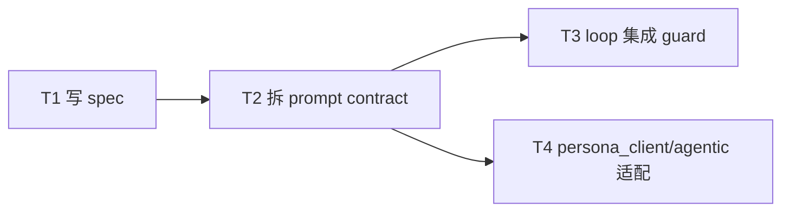

# 0031 · 用户模拟阶段契约下沉：薄 base system 与 prompt 去平台手册化

<!-- 本文件由 spec 工具维护：frontmatter 为结构化源数据（含 tasks DAG），正文为组级 rust-RFC 9 段总览。 -->

## Summary

本组把用户模拟 prompt 从「全局平台操作手册」改为「薄 base system + 阶段局部 contract」。`build_system()` 不再把动作空间、动作语义、终止规则、issue 写作、rating 评分、JSON action schema 等平台契约塞进所有阶段；base system 只保留用户角色、persona、感知边界、禁止隐藏真相与保持会话一致性。主流程与等待流程仍保持 judge → intent → act 三跳，但每跳只暴露本阶段必要信息：judge 只产 `perceive + verdict/judgment`，intent 只产开放意愿，act 才看到菜单与 action/message/gap schema。issue 与 rating 的契约只在对应收尾 prompt 中出现。

主流程 act 阶段只收敛**外部交互动作**：对 harness 的所有继续沟通统一为 `send_message`，本地终止为 `accept` / `accept_with_reservations` / `file_issue` / `give_up`。旧外层 `verify_self` 退役；读文件、跑命令、看 diff、验证测试输出等私有查验是用户 agent 的内层 agentic 行为，主要服务 judge 阶段形成 `perceive + verdict`，不是 act 菜单按钮。judge 若认为当前 verdict 依据不足且 persona 有私有工具、低成本可查，应在本阶段调用工具；若不查，应在 `perceive` 中说明自己依赖 harness report 或认为不值得查。

本组保留「用户模型同出自然语言与粗标签」的现有形态：judge 阶段仍由同一个用户模型输出 `perceive` 与 `verdict`，不引入后处理分类器；但 `verdict` 被定位为对自己自然语言判断的粗粒度 bookkeeping bucket，而不是平台状态机指令。`<mood>` 人话化、waiting history 人话化、`report_issue` 工具阶段过滤、progress sanitizer 与 legacy user-agent prompt 清理暂不纳入实现范围，列为待定项。

## Motivation

当前 `backend/auto_designer/user/sim/prompt.py` 的旧 `BLOCK_G` 同时承担多个职责：用户角色、感知边界、动作空间约束、动作语义、终止时机、输出 JSON schema、verdict 解释、issue/accept 行为暗示等。即使主流程 `<action_space>` 只在 act 阶段出现，若共享 system prompt 或 action catalog 仍把 `verify_self` 暴露为“private action”，模型会把本该发生在 judge 内层的私有查验误投影成外层 act 按钮，造成 silent/no-op 验证循环。

这会削弱用户模拟作为训练信号的多样性：模型不是先像真人一样判断现状、表达开放意愿，再被框架收敛为动作；而是全程带着平台操作手册思考，容易按可用出口倒推判断、意图和体感。长期看，用户行为会向固定状态机坍塌，发散不出新的能力缺口与产品信号。

同时，完全取消结构化标签或改用后处理分类器并不稳妥。当前状态机仍需要 `verdict` 推进 patience/trust；另起分类器会引入新的误判源，且错误可能静默污染 state。本组选择保留同一用户模型的自标注输出，但移除跨阶段的全局平台契约，让标签成为对自然语言判断的弱摘要。

## Guide-level explanation

新的 prompt 组织方式如下：

```text
build_system(persona)
  = BASE_USER_SYSTEM + compile_block_p(persona)

main judge user prompt
  = task/history/output/mood + judge-local contract
  -> {perceive, verdict}

main intent user prompt
  = task/history/output/mood + judgment + intent-local contract
  -> {intent}

main act user prompt
  = task/history/output/mood + judgment + intent + action_space + act-local contract
  -> {action, message, gap}
  # action_space = send_message + terminal outcomes; no private verify action

issue prompt
  = task/history/mood + issue-local contract
  -> {issue}

rating prompt
  = task/history/mood + rating-local contract
  -> {score, reason}
```

薄 base system 只讲不随阶段变化的事实：这是一个真人用户 persona；只能依据该 persona 能感知和理解的内容；不能使用隐藏答案；不能伪造运行/检查结果；需要保持历史一致。它不讲 `<action_space>`、action ids、terminal 动作、JSON action schema、issue 格式或 1–4 评分 rubric。

stage-local contract 放在对应 builder 产出的 user prompt 中。judge 阶段可以看到粗标签列表，但标签说明必须弱化为「closest rough bookkeeping bucket」，并明确先写自然语言 `perceive`，不要决定下一步动作；当判断依据不足且私有工具能低成本核实时，工具查验应发生在这个 judge 内层循环。intent 阶段只表达原始愿望（raw wish）：先说此刻真正想做什么，不考虑当前 harness 是否支持、help text 是否声明、菜单里是否有按钮；可用性与缺口留给 act 收敛阶段处理。act 阶段才看到动作菜单、动作语义、`message` 语义与 `gap`；主流程 act 菜单只包含 `send_message` 与终止动作，所有「让 harness 跑/给证据/继续改/补充要求」都只是 `send_message` 的不同正文。waiting 流程同构：waiting judge 看等待中可见过程；waiting intent 表达原始愿望；waiting act 才看 `keep_waiting/send_message/interrupt/give_up` 菜单。

Agentic 内层 tool-use 仍然保留 private tool 协议与工具列表，但不继承全局动作契约。内层可以用工具补强 `perceive`，最终仍按当前外层阶段的 user prompt contract 输出。

## Reference-level explanation

### Prompt 分层

| 层 | 内容 | 禁止内容 |
|----|------|----------|
| Base system | 用户角色、persona、感知边界、禁止隐藏真相、禁止伪造验证、历史一致性 | action ids、terminal 语义、`<action_space>`、issue/rating contract、阶段输出 schema |
| Main judge | 当前任务/历史/输出/mood；`perceive + verdict` 本阶段 schema；必要时内层 private tool 查验 | action/message/gap schema、菜单、终止建议、issue 指导 |
| Main intent | judgment + 原始愿望 schema：不考虑当前 harness 是否支持 | 动作菜单、按钮 id、终止规则、help-text-gated 可用性判断 |
| Main act | `<action_space>`、外部动作语义（`send_message` + 终止）、`action/message/gap` schema | 评分 rubric、issue 写作规则、private investigation action |
| Waiting judge | 等待时长、progress/prior_activity、mood；`perceive + judgment` schema | waiting 菜单、action schema |
| Waiting intent | waiting judgment + 原始愿望 schema：可说出希望存在但当前未必支持的互动 | waiting 菜单、action schema、help-text-gated 可用性判断 |
| Waiting act | waiting 菜单与 `action/message/gap` schema | issue/rating contract |
| Issue | 第一人称 issue 写作要求 | action_space、rating rubric |
| Rating | 1–4 体感评分 rubric | action menu、issue 写作规则 |

### 违禁标记与测试口径

本组测试不得用普通单词扫描（例如禁止任何 `action`、`accept` 字符串）作为验收标准，因为自然语言里可能合理出现这些词。验收应检查明确的结构标记、标题或语义段落。最低违禁标记如下：

- Base system 禁止：`G3`、`G7`、`# ACTION SEMANTICS`、全局 `# OUTPUT CONTRACT` 中带 `"action"` / `"message"` 的 schema、`<action_space>`、`accept / give_up / file_issue` 的 terminal 语义段、issue/rating rubric 标题。
- Main/waiting judge 与 intent 禁止：`<action_space>`、`# MENU`、`"action"` / `"message"` / `"gap"` 输出 schema、terminal timing 语义段、issue/rating rubric 标题。
- Main/waiting act 允许：本阶段的 `# MENU`、`<action_space>`（main act）、waiting 菜单、`"action"` / `"message"` / `"gap"` schema；主流程 act 菜单不得包含 `verify_self`，harness-facing 外部动作统一为 `send_message`。
- Issue 允许：issue 写作 contract；禁止 rating rubric 与 action menu。
- Rating 允许：1–4 rating rubric；禁止 action menu 与 issue 写作 contract。

其中 `G7` 的 accept precondition、`# ACTION SEMANTICS`、terminal timing、全局含 action 的 output contract 必须离开 base system；若这些段落仍出现在 `build_system()` 或 `build_inner_system()` 的 base 部分，本组目标未达成。

### `verdict` 同出而非后处理分类

主 judge 仍输出：

```json
{"perceive": "...", "verdict": "satisfied | failed_blame_harness | failed_blame_self | unsure | stuck"}
```

但 prompt 语义变为：先用自己的话写所见与感受，再选择最接近的粗 bucket 供系统记账。prompt 不说明这些 bucket 如何影响 patience/trust，也不把某个 bucket 绑定到后续动作。

waiting judge 同理保留：

```json
{"perceive": "...", "judgment": "on_track | off_track | unclear"}
```

本组不引入「自然语言 judge → 另一个分类器打标签」的后处理路径，避免多一个模型误差源。

### Act 收敛与安全兜底

judge / intent 更发散后，act 阶段承担唯一的动作收敛职责。实现不得新增 verdict 后处理分类器，但必须保持既有动作收敛链可用：act prompt 明确给出菜单与 `gap`；`action:"free"` 可继续走 `classify_action(system, ret, space)`（若 client 支持）；最终仍由 `resolve_action(ret, space, persona)` 负责越权投影、channel/message 一致性与安全兜底。测试需覆盖 free / resolve / 原主流程路径仍可完成，不因上游 intent 更开放而崩。

主流程 act 只表达外部交互：`send_message` 表示向 harness 发任意自然语言正文，覆盖原 `send_task` / `refine_request` / `give_feedback` / `ask_harness_run` / `request_evidence` / `grant_autorun` 等标签化变体；`accept` / `accept_with_reservations` / `file_issue` / `give_up` 表示本地收场。`verify_self` 不再是合法外层动作；如果用户需要自己查文件、diff 或测试，应该已经在 judge 内层工具循环中完成，并作为 `perceive` 的证据。

### Inner tool-use system

`build_inner_system()` 不再拼旧 `BLOCK_G`。它应由以下部分组成：

1. 薄 base system。
2. `INNER_PROTOCOL`：private tool-use 协议。
3. `_render_tools(...)`：当前 persona 可用工具。
4. `clause_verification_policy(...)` 与 `clause_capability(...)`：核实倾向与能力说明。
5. `compile_block_p(persona)` 与可选 skill。

内层 system 可以说明「工具是 private、结果可写入 perceive」，但不得全局说明 act action ids 或 terminal 行为。最终输出契约来自当前外层 user prompt。judge user prompt 可要求：若当前 verdict 依据不足且低成本可查，应先使用 private tools；若不查，需在 perceive 中说明自己依赖 harness report 或认为不值得查。

### DAG / file allocation



| Task | 职责 | files（组内互斥） |
|------|------|------------------|
| T1 | 写 0031 活快照 | `docs/specs/0031-user-sim-stage-contracts.md` |
| T2 | 拆 `BLOCK_G`，实现薄 base + stage-local contract，并覆盖 prompt 单测 | `prompt.py`, `test_prompt.py`, `test_inner_prompt.py` |
| T3 | 主 loop / 心跳 loop 的运行时投喂 guard 与必要适配；主流程动作空间统一为 `send_message` + 终止 | `loop.py`, `actions.py`, `action_space.py`, `test_loop.py`, `test_heartbeat.py`, `test_action_space.py` |
| T4 | `ScriptedPersonaClient` / `AgenticPersonaClient` 与 trace guard 适配 | `persona_client.py`, `test_persona_client_agentic.py` |

### 验证路径

```bash
./tools/spec-driven-development/spec validate
PYTHONPATH=backend .venv/bin/pytest backend/tests/user/sim/test_prompt.py backend/tests/user/sim/test_inner_prompt.py -v
PYTHONPATH=backend .venv/bin/pytest backend/tests/user/sim/test_loop.py backend/tests/user/sim/test_heartbeat.py -v
PYTHONPATH=backend .venv/bin/pytest backend/tests/user/sim/test_persona_client_agentic.py -v
PYTHONPATH=backend .venv/bin/pytest backend/tests/user/sim -v
.venv/bin/ruff check backend/auto_designer/user/sim backend/tests/user/sim
.venv/bin/ruff format --check backend/auto_designer/user/sim backend/tests/user/sim
```

### Out of scope

本组不改变内部 `apply_verdict`、`derive_feeling` 或 issue tracker 流程。动作空间只做层次纠偏：主流程外部交互统一为 `send_message`，终止动作保持不变，private verification 不再经外层 action 表达。`<mood>` 仍可作为标签文本存在，但不再由全局 BLOCK_G 绑定到 terminal 动作；是否把 mood 渲染成人话另议。

## Drawbacks

- 拆分后 prompt 片段数量增加，维护者需要确保 stage-local contract 与 loop 阶段一致。
- 去掉全局 action contract 后，某些离线 scripted 行为可能暴露隐式依赖，需要适配测试。
- 合并 harness-facing 外部动作为 `send_message` 会丢失旧 action id 的粗分类；分类应从 message 文本、intent、timeline 投影或后续 triage/Owner 语义中恢复，而不是在用户 act 层预编码。
- judge/intent prompt 不再看到全局动作语义后，模型可能更频繁地产生开放、不可直接执行的意图；这符合设计目标，但 act 阶段与 `resolve_action` / `classify_action` fallback 必须承担好收敛职责，并用测试确认 free 路径与原 loop 路径不崩。
- 本组不处理 `<mood>` 与 waiting history 的机器标签，因此平台信号污染不会一次性归零。

## Rationale and alternatives

### 为什么不保留 BLOCK_G 并继续打补丁

保留大 `BLOCK_G` 意味着每次发现泄漏都要从 user prompt 层堵一个口，但 system 层仍然泄漏平台操作手册。动作菜单、终止语义、issue/rating contract 属于不同阶段，不应共享。阶段 contract 下沉能从结构上减少回归面。

### 为什么不引入后处理分类器

后处理分类器会把自然语言判断转为 `verdict`，看似能让 judge 更自然，但它引入第二个模型误差源；分类错会静默影响 patience/trust 与体感曲线。当前更稳的方案是保留同一用户模型的 `perceive + verdict` 同出，只弱化 verdict 的说明。

### 为什么不一次性做人话化 mood / waiting history

这两项确实会影响多样性，但它们是状态表达与历史回灌问题，触及行为解释、测试期望与后续观测。先拆掉全局平台操作手册，能显著降低最大污染源；mood/history 可在效果明确后独立收敛。

### 为什么 issue/rating contract 下沉

issue 与 rating 是会话末专属任务。如果它们出现在 base system，用户在正常 judge/intent 阶段会提前意识到“最终要开单/打分”，导致行为向这些平台出口靠拢。放在专属 builder 中能保留结构化输出，又不污染前置阶段。

### 为什么去掉外层 `verify_self`

`verify_self` 把两个层次混在一起：名字像“用户自己查验”，但作为外层 action 只能在 act 阶段被选择，且容易退化成 silent/no-op 或重复消费同一条 harness reply。真正的自查是用户私有 agentic 行为，应发生在 judge 内层工具循环中，作为 `perceive/verdict` 的证据；act 阶段只表达对 harness 或会话状态的外部动作。若用户想让 harness 提供证据或再运行测试，应发送一条 `send_message`，而不是选择一个 private action。

## Prior art

- 0022：定义用户与 harness 的内外窗口、等待菜单与开放 intent，强调 message 是内通道、interrupt 是外通道。
- 0023：把主 loop 与心跳 loop 钉成 judge → intent → act 三跳，为本组的阶段 contract 下沉提供结构基础。
- 0024：Session.sim_trace 与设计师取证投影，强调用户可见 transcript 与 god-view trace 分离。
- 0027：triage/designer 通过 submit-tool 统一结构化输出，说明结构化 contract 可以按角色/阶段局部化，而不必全局注入。
- 0030：harness 产品化边界，要求平台概念不进入 harness；本组把同样边界原则用于用户模拟 prompt。

## Unresolved questions

1. **`<mood>` 是否人话化。** 当前 `patience=...` / `trust=...` 是机器标签。拆掉 BLOCK_G 后其动作绑定会减弱，但仍可能压缩行为多样性。本组暂不改内部状态或 mood 渲染。
2. **waiting history 是否人话化。** `_note_waiting_memory()` 仍可能写 `judged/chose/gap` 等机器标签回灌到后续 prompt。本组暂不处理。
3. **`report_issue` 工具是否阶段过滤。** Agentic 用户在 judge/intent 阶段仍可能看到 `report_issue` 工具；是否只在 act 或 issue 阶段暴露，另议。
4. **intent 中出现“我想自查”是否需要再机制化处理。** 当前不加 guard：intent 仍保持 raw wish；若后续分布显示“judge 未查、intent 想私查”频繁造成歧义，再另行收敛。
5. **progress/prior_activity 是否 sanitizer。** waiting judge 仍可看到 progress；需要确认 harness progress 是否始终 human-facing，而非内部 sideband JSON。
6. **persona 文案是否去 oracle 化。** 例如 expert 能力文案中的具体场景词是否需要泛化，另开或小修。
7. **legacy `backend/agent_defs/user_agent/prompt.md` 是否废弃。** 需确认是否仍有生产接线；若已废弃，可后续清理或标注。

## Future possibilities

- 将 mood 渲染从硬标签改成人类化短句，同时保留内部 `State` 结构化数值。
- 将 waiting history 改为人类可记忆事实，而不是平台标签串。
- 为 AgenticPersonaClient 增加阶段化工具栈，使 `report_issue` 等平台工具只在合适阶段可见。
- 增加 progress sanitizer，只把 human-facing 活动摘要喂给用户模拟。
- 建立 prompt leakage lint：自动检查 judge/intent prompt 不含 action/menu/issue/rating contract 关键词。

