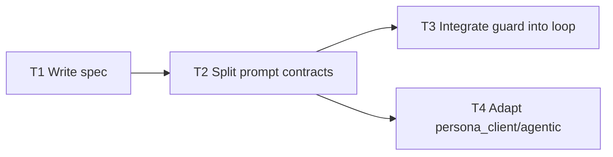

# 0031 · Lowering User Simulation Stage Contracts: Thin Base System and De-platformized Prompts

<!-- This file is maintained by the spec tool: the frontmatter is structured source data (including the tasks DAG), and the body is a group-level rust-RFC nine-section overview. -->

## Summary

This group changes user simulation prompts from a “global platform operations manual” to a “thin base system + stage-local contract.” `build_system()` no longer puts the action space, action semantics, termination rules, issue writing, rating, JSON action schema, and other platform contracts into every stage; the base system retains only the user role, persona, perception boundaries, prohibition on hidden truths, and session consistency. The main and waiting flows still retain the three-hop judge → intent → act structure, but each hop exposes only the information necessary for its stage: judge produces only `perceive + verdict/judgment`, intent produces only an open-ended wish, and only act sees the menu and action/message/gap schema. The issue and rating contracts appear only in their corresponding closing prompts.

The main-flow act stage converges only on **external interaction actions**: all continued communication with the harness is uniformly `send_message`, while local termination is `accept` / `accept_with_reservations` / `file_issue` / `give_up`. The old outer-layer `verify_self` is retired; private checks such as reading files, running commands, inspecting diffs, and verifying test output are inner agentic behavior of the user agent. They primarily serve the judge stage to produce `perceive + verdict` and are not act menu buttons. If judge considers the current verdict basis insufficient and the persona has private tools that can perform a low-cost check, it should call the tools during this stage; if it does not check, it should explain in `perceive` that it relies on the harness report or considers checking not worthwhile.

Private checks are still the user’s own actions and must form in-session memory. After any inner tool call in a main/waiting stage ends, the framework generates a bounded `<private_evidence>` summary from the tool action and that stage’s `parsed.perceive`, for example `[E2 after_reply/judge] Private tools: read_file ...; Conclusion: ...`. This block is supplied to the judge/intent/act stages of subsequent main/waiting flows, helping the user remember what they privately checked, what they observed, and which evidence conflicts remain unresolved; it is not sent to the harness, does not replace `sim_trace` raw steps, and does not contain complete stdout / full file contents / benchmark oracle.

This group retains the existing form in which the “user model emits natural language and a coarse label together”: the judge stage still has the same user model output `perceive` and `verdict`, without introducing a post-processing classifier; however, `verdict` is positioned as a coarse bookkeeping bucket for its own natural-language judgment, rather than as a platform state-machine instruction. `<mood>` humanization, humanization of waiting history, `report_issue` tool-stage filtering, the progress sanitizer, and legacy user-agent prompt cleanup are not included in the implementation scope for now and are listed as pending items.

## Motivation

The current `backend/ahe_beta/user/sim/prompt.py`’s old `BLOCK_G` simultaneously performs multiple responsibilities: user role, perception boundaries, action-space constraints, action semantics, termination timing, output JSON schema, verdict explanation, and issue/accept behavior hints. Even if the main-flow `<action_space>` appears only in the act stage, if the shared system prompt or action catalog still exposes `verify_self` as a “private action,” the model will project private checks that should occur inside judge onto outer-layer act buttons, causing silent/no-op verification loops.

This weakens the diversity of user simulation as a training signal: instead of first judging the current situation like a real person, expressing an open-ended wish, and then being converged by the framework into an action, the model thinks with the platform operations manual throughout the process. It is therefore prone to deriving its judgment, intent, and user experience from the available exits. Over the long term, user behavior will collapse toward a fixed state machine and fail to surface new capability gaps and product signals.

At the same time, completely removing structured labels or switching to a post-processing classifier is not robust. The current state machine still needs `verdict` to advance patience/trust; introducing a separate classifier would add a new source of misclassification, and errors could silently pollute state. This group therefore retains self-labeling output from the same user model while removing the global platform contract across stages, making the label a weak summary of the natural-language judgment.

## Guide-level explanation

The new prompt organization is as follows:

```text
build_system(persona)
  = BASE_USER_SYSTEM + compile_block_p(persona)

main judge user prompt
  = task/history/output/mood + judge-local contract
  -> {perceive, verdict}

main intent user prompt
  = task/history/output/mood + judgment + intent-local contract
  -> {intent}

main act user prompt
  = task/history/output/mood + judgment + intent + action_space + act-local contract
  -> {action, message, gap}
  # action_space = send_message + terminal outcomes; no private verify action

issue prompt
  = task/history/mood + issue-local contract
  -> {issue}

rating prompt
  = task/history/mood + rating-local contract
  -> {score, reason}
```

The thin base system describes only facts that do not vary by stage: this is a real human user persona; it may rely only on content that the persona can perceive and understand; it must not use hidden answers; it must not fabricate run/check results; and it must maintain historical consistency. It does not describe `<action_space>`, action ids, terminal actions, the JSON action schema, issue format, or the 1–4 rating rubric.

The stage-local contract is placed in the user prompt produced by the corresponding builder. The judge stage may see the coarse-label list, but the label description must be weakened to “closest rough bookkeeping bucket,” and it must explicitly write natural language `perceive` first rather than deciding the next action; when the basis for judgment is insufficient and a private tool can cheaply verify it, the tool check should occur in this inner judge loop. The intent stage only expresses the raw wish: first state what it genuinely wants to do at this moment, without considering whether the current harness supports it, whether the help text declares it, or whether a button exists in the menu; availability and gaps are handled during act-stage convergence. Only the act stage sees the action menu, action semantics, `message` semantics, and `gap`. The main-flow act menu contains only `send_message` and termination actions; all “ask the harness to run something/provide evidence/continue making changes/add requirements” requests are merely different bodies of `send_message`. The waiting flow is structurally identical: waiting judge sees the visible process while waiting; waiting intent expresses the raw wish; and only waiting act sees the `keep_waiting/send_message/interrupt/give_up` menu.

Inner agentic tool use continues to retain the private tool protocol and tool list, but does not inherit the global action contract. The inner loop may use tools to strengthen `perceive` and ultimately still outputs according to the current outer-stage user prompt contract.

## Reference-level explanation

### Prompt layering

| Layer | Content | Prohibited content |
|----|------|----------|
| Base system | User role, persona, perception boundaries, prohibition on hidden truths, prohibition on fabricating verification, historical consistency | action ids, terminal semantics, `<action_space>`, issue/rating contract, stage output schema |
| Main judge | Current task/history/output/private_evidence/mood; `perceive + verdict` schema for this stage; inner private tool checks when necessary | action/message/gap schema, menu, termination recommendation, issue guidance |
| Main intent | judgment + private_evidence + raw-wish schema: without considering whether the current harness supports it | action menu, button ids, termination rules, help-text-gated availability judgments |
| Main act | `<action_space>`, private_evidence, external action semantics (`send_message` + termination), `action/message/gap` schema | rating rubric, issue-writing rules, private investigation action |
| Waiting judge | Wait duration, progress/prior_activity/private_evidence/mood; `perceive + judgment` schema | waiting menu, action schema |
| Waiting intent | waiting judgment + private_evidence + raw-wish schema: may state an interaction it hopes exists even if it may not currently be supported | waiting menu, action schema, help-text-gated availability judgments |
| Waiting act | private_evidence + waiting menu and `action/message/gap` schema | issue/rating contract |
| Issue | First-person issue-writing requirements | action_space, rating rubric |
| Rating | 1–4 experience-score rubric | action menu, issue-writing rules |

### Forbidden markers and test criteria

Tests in this group must not use ordinary-word scanning (for example, prohibiting any `action` or `accept` string) as an acceptance criterion, because these words may reasonably occur in natural language. Acceptance should check explicit structural markers, headings, or semantic sections. The minimum forbidden markers are as follows:

- Base system prohibitions: `G3`, `G7`, `# ACTION SEMANTICS`, the global `# OUTPUT CONTRACT` containing `"action"` / `"message"` schema, `<action_space>`, the `accept / give_up / file_issue` terminal-semantics section, and issue/rating rubric headings.
- Main/waiting judge and intent prohibitions: `<action_space>`, `# MENU`, `"action"` / `"message"` / `"gap"` output schemas, the terminal-timing semantics section, and issue/rating rubric headings.
- Main/waiting act allowed content: this stage’s `# MENU`, `<action_space>` (main act), the waiting menu, and the `"action"` / `"message"` / `"gap"` schemas; the main-flow act menu must not contain `verify_self`, and harness-facing external actions must uniformly be `send_message`.
- Issue allowed content: the issue-writing contract; prohibited content includes the rating rubric and action menu.
- Rating allowed content: the 1–4 rating rubric; prohibited content includes the action menu and issue-writing contract.

In particular, `G7`’s accept precondition, `# ACTION SEMANTICS`, terminal timing, and the global output contract containing action must leave the base system; if these sections still appear in `build_system()` or in the base portion of `build_inner_system()`, this group’s goal has not been achieved.

### `verdict` co-emission rather than post-processing classification

The main judge still outputs:

```json
{"perceive": "...", "verdict": "satisfied | failed_blame_harness | failed_blame_self | unsure | stuck"}
```

However, the prompt semantics change to: first write what it sees and feels in its own words, then select the closest coarse bucket for system bookkeeping. The prompt does not explain how these buckets affect patience/trust or bind any bucket to a subsequent action.

The waiting judge likewise retains:

```json
{"perceive": "...", "judgment": "on_track | off_track | unclear"}
```

This group does not introduce a post-processing path of “natural-language judge → another classifier assigns a label,” avoiding an additional model error source.

### Act convergence and safe fallback

After judge / intent become more divergent, the act stage assumes sole responsibility for action convergence. The implementation must not add a verdict post-processing classifier, but it must keep the existing action-convergence chain available: the act prompt explicitly provides the menu and `gap`; `action:"free"` may continue through `classify_action(system, ret, space)` (if the client supports it); and `resolve_action(ret, space, persona)` remains responsible for unauthorized projection, channel/message consistency, and safe fallback. Tests must cover the free / resolve / original main-flow paths through completion and must not break because the upstream intent is more open.

The main-flow act expresses only external interaction: `send_message` means sending arbitrary natural-language content to the harness, covering the former labeled variants `send_task` / `refine_request` / `give_feedback` / `ask_harness_run` / `request_evidence` / `grant_autorun`; `accept` / `accept_with_reservations` / `file_issue` / `give_up` mean local closure. `verify_self` is no longer a valid outer-layer action; if the user needs to inspect files, diffs, or tests, it should already have completed that work in the inner judge tool loop and included it as evidence in `perceive`.

### Private evidence memory

`private_evidence` is the user’s own private in-session evidence memory, not the harness transcript and not a raw dump of the architect timeline. Its sources are limited to private `tool` / `tool_result` / `tool_error` in this session’s `persona_trace.steps`, combined with `parsed.perceive` from the same call to generate a short conclusion.

Format convention:

```text
<private_evidence>
[E1 opening/judge]
Private tools: run_shell `pwd && ls -la`.
Conclusion: The workspace is empty; no implementation or tests exist yet.

[E2 after_reply/judge]
Private tools: read_file `xarray/core/dataarray.py`; read_file `xarray/core/dataset.py`.
Conclusion: DataArray.integrate now accepts `coord` and delegates to Dataset.integrate(coord, ...).

[E3 during_wait/act]
Private tools: run_shell `git status --short`.
Observed: returncode=0; stdout: M money.py
</private_evidence>
```

Rules: `E#` is a private evidence sequence number, independent of the outer-layer `turn` numbering; the location label uses `opening|after_reply|during_wait` + `judge|intent|act` to avoid confusing the waiting loop with the main turn. Record only private tool use that actually occurred; harness progress/prior_activity does not enter this block. Each piece of evidence is at most one short paragraph, prioritizing the tool action and the 1–2 sentence conclusion from `parsed.perceive`; stdout / full file contents are truncated into a short `Observed`. Retain only the most recent several entries and limit the total character count to prevent context growth. This block is also supplied to the main/waiting judge, intent, and act stages so that all three stages can perceive what the user has already checked privately.

### Inner tool-use system

`build_inner_system()` no longer concatenates the old `BLOCK_G`. It should consist of the following parts:

1. Thin base system.
2. `INNER_PROTOCOL`: private tool-use protocol.
3. `_render_tools(...)`: tools available to the current persona.
4. `clause_verification_policy(...)` and `clause_capability(...)`: checking inclination and capability description.
5. `compile_block_p(persona)` and optional skills.

The inner system may explain that “tools are private and results may be written into perceive,” but must not globally describe act action ids or terminal behavior. The final output contract comes from the current outer user prompt. The judge user prompt may require: if the current verdict lacks sufficient evidence and verification is inexpensive, use private tools first; if no verification is performed, explain in perceive that it relies on the harness report or considers verification not worthwhile.

### DAG / file allocation



| Task | Responsibilities | files (mutually exclusive within the group) |
|------|------|------------------|
| T1 | Write the 0031 live snapshot | `docs/specs/0031-user-sim-stage-contracts.md` |
| T2 | Split `BLOCK_G`, implement a thin base + stage-local contract, and cover prompt unit tests | `prompt.py`, `test_prompt.py`, `test_inner_prompt.py` |
| T3 | Runtime input guards and necessary adaptations for the main loop / heartbeat loop; standardize the main-flow action space as `send_message` + termination | `loop.py`, `actions.py`, `action_space.py`, `test_loop.py`, `test_heartbeat.py`, `test_action_space.py` |
| T4 | Adapt `ScriptedPersonaClient` / `AgenticPersonaClient` and the trace guard | `persona_client.py`, `test_persona_client_agentic.py` |

### Verification path

```bash
./tools/spec-driven-development/spec validate
PYTHONPATH=backend .venv/bin/pytest backend/tests/user/sim/test_prompt.py backend/tests/user/sim/test_inner_prompt.py -v
PYTHONPATH=backend .venv/bin/pytest backend/tests/user/sim/test_loop.py backend/tests/user/sim/test_heartbeat.py -v
PYTHONPATH=backend .venv/bin/pytest backend/tests/user/sim/test_persona_client_agentic.py -v
PYTHONPATH=backend .venv/bin/pytest backend/tests/user/sim -v
.venv/bin/ruff check backend/ahe_beta/user/sim backend/tests/user/sim
.venv/bin/ruff format --check backend/ahe_beta/user/sim backend/tests/user/sim
```

### Out of scope

This group does not change internal `apply_verdict`, `derive_feeling`, or issue tracker workflows. Changes to the action space only correct its layering: main-flow external interactions are standardized as `send_message`, termination actions remain unchanged, and private verification is no longer expressed through outer actions. `<mood>` may still exist as label text, but is no longer bound to terminal actions by global BLOCK_G; whether to render mood in natural language is a separate discussion.

## Drawbacks

- Splitting increases the number of prompt fragments; maintainers must ensure that stage-local contracts match the loop stages.
- Removing the global action contract may expose implicit dependencies in some offline scripted behavior, requiring test adaptations.
- Consolidating harness-facing external actions into `send_message` loses the coarse classification provided by old action ids; classification should be recovered from message text, intent, timeline projections, or subsequent triage/Owner semantics, rather than pre-encoded at the user act layer.
- Once judge/intent prompts no longer see global action semantics, the model may more frequently produce open-ended intentions that cannot be executed directly; this aligns with the design goal, but the act stage and `resolve_action` / `classify_action` fallbacks must handle convergence properly, with tests confirming that neither the free path nor the original loop path breaks.
- This group does not address machine labels in `<mood>` and waiting history, so platform-signal contamination will not drop to zero all at once.

## Rationale and alternatives

### Why not retain BLOCK_G and keep patching it

Retaining the large `BLOCK_G` means plugging a hole at the user prompt layer whenever leakage is discovered, while the system layer continues to leak the platform operations manual. Action menus, termination semantics, and issue/rating contracts belong to different stages and should not be shared. Moving contracts down to their respective stages structurally reduces the regression surface.

### Why not introduce a post-processing classifier

A post-processing classifier would convert natural-language judgments into `verdict`, seemingly making judge more natural, but it introduces a second source of model error; misclassification would silently affect patience/trust and the user experience curve. The more robust approach for now is to retain joint `perceive + verdict` output from the same user model and only soften the explanation of verdict.

### Why not convert mood / waiting history to natural language all at once

These two items do affect diversity, but they concern state representation and history feedback, touching behavioral interpretation, test expectations, and subsequent observation. Removing the global platform operations manual first can significantly reduce the largest source of contamination; mood/history can be addressed independently once the effects are clear.

### Why move issue/rating contracts down

Issues and ratings are tasks specific to the end of a session. If they appear in the base system, users become aware during normal judge/intent stages that they will “eventually need to file an issue/give a rating,” steering behavior toward those platform outlets. Placing them in dedicated builders preserves structured output without contaminating earlier stages.

### Why remove the outer `verify_self`

`verify_self` mixes two layers: its name sounds like “the user verifying things themselves,” but as an outer action it can only be selected during the act stage, and can easily degrade into silent/no-op behavior or repeatedly consume the same harness reply. True self-verification is private agentic user behavior and should occur in the inner judge tool loop as evidence for `perceive/verdict`; the act stage only expresses external actions directed at the harness or session state. If the user wants the harness to provide evidence or rerun tests, they should send an `send_message` rather than select a private action.

## Prior art

- 0022: Defines the inner and outer windows between the user and harness, waiting menus, and open-ended intent, emphasizing that message is the inner channel and interrupt is the outer channel.
- 0023: Fixes the main loop and heartbeat loop as three hops, judge → intent → act, providing the structural foundation for moving this group's contracts down to their respective stages.
- 0024: Session.sim_trace and architect forensic projections, emphasizing separation between the user-visible transcript and the god-view trace.
- 0027: triage/architect standardizes structured output through submit-tool, demonstrating that structured contracts can be localized by role/stage rather than injected globally.
- 0030: The harness product boundary requires platform concepts to stay out of the harness; this group applies the same boundary principle to user simulation prompts.

## Unresolved questions

1. **Whether to render `<mood>` in natural language.** Currently, `patience=...` / `trust=...` are machine labels. Removing BLOCK_G weakens their action bindings, but they may still constrain behavioral diversity. This group does not change internal state or mood rendering for now.
2. **Whether to render waiting history in natural language.** `_note_waiting_memory()` may still write machine labels such as `judged/chose/gap` back into subsequent prompts. This group does not address this for now.
3. **Whether to filter the `report_issue` tool by stage.** Agentic users may still see the `report_issue` tool during judge/intent stages; whether to expose it only during act or issue stages is a separate discussion.
4. **Whether an intent such as “I want to check it myself” requires additional mechanism-level handling.** No guard is added for now: intent remains a raw wish; if subsequent distributions show that “judge did not verify, intent wants private verification” frequently causes ambiguity, address it separately.
5. **Whether progress/prior_activity needs a sanitizer.** The waiting judge can still see progress; confirm whether harness progress is always human-facing rather than internal sideband JSON.
6. **Whether to remove oracle-like information from persona wording.** For example, whether specific scenario terms in expert capability descriptions need to be generalized should be addressed separately or through a small revision.
7. **Whether legacy `backend/agent_defs/user_agent/prompt.md` is deprecated.** Confirm whether it is still wired into production; if already deprecated, it can be cleaned up or annotated later.

## Future possibilities

- Change mood rendering from rigid labels to natural-language short sentences while retaining the internal `State` structured values.
- Change waiting history to facts a human could remember rather than strings of platform labels.
- Add stage-specific tool stacks to AgenticPersonaClient so that platform tools such as `report_issue` are visible only at appropriate stages.
- Add a progress sanitizer that feeds only human-facing activity summaries into user simulation.
- Establish prompt leakage lint: automatically check that judge/intent prompts contain no action/menu/issue/rating contract keywords.

